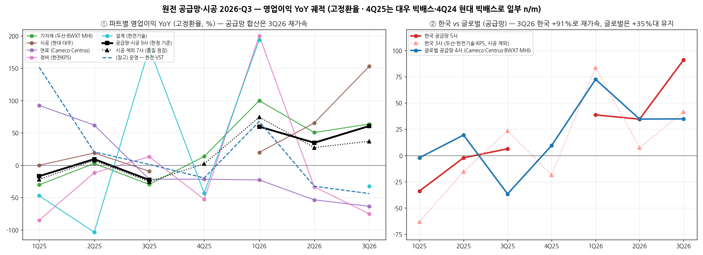
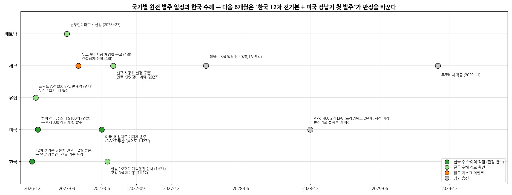
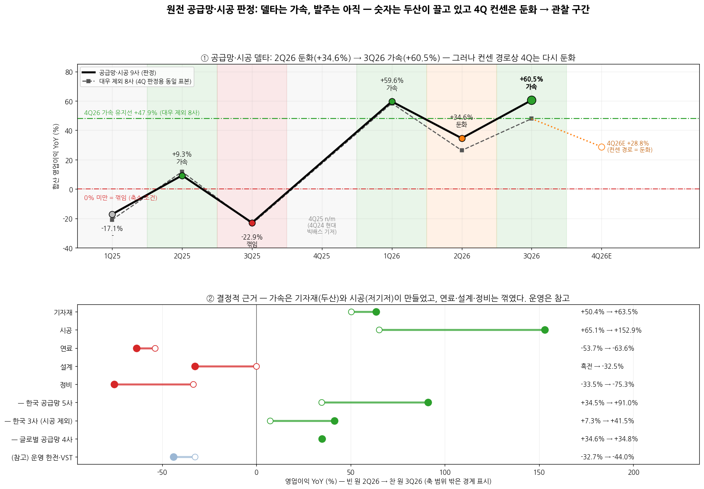

# 원전 · 글로벌 섹터 통합 리뷰

> 현재 상태 (최신 분기 기준)
> 최신 분기: 2026-Q3
> 섹터 델타: 가속 | 내러티브: 약화
> 모멘텀 신호: 없음
> 활성 테마: 없음
> 포지셔닝: 섹터 중립 | 한국 아웃퍼폼 | 선호 두산에너빌리티, BWXT
> 편입 종목: 판정 그룹 = 공급망·시공 9사(두산에너빌리티, 현대건설, 대우건설, 한전기술, 한전KPS, Cameco, Centrus, BWXT, Mitsubishi Heavy(Energy Systems)) / 참고 그룹 = 운영 3사(한국전력, Constellation, Vistra — 발주처 체력 점검용, 판정 제외) / 마일스톤 추적 3사(NuScale, Oklo, X-energy — 합산 제외)
> 갱신 시각: 2026-11-22 22:40 KST

> **판정 기준 (BT 결정 2026-11-22)**: 원전 섹터 리뷰는 **"원전 공급망·시공에 투자할지"**를 판단하는 문서다. 섹터 델타·포지셔닝은 공급망·시공 9사로만 낸다. 운영사(한전·CEG·VST)는 이익이 요금 규제·전력가 사이클로 움직이는 유틸리티라 판정에서 빼고, **발주처의 체력(돈을 쓸 여력)을 보는 참고 그룹**으로 둔다 (③-3)

## 누적 시계열

| 분기 | 편입 종목 | 합산 매출 | 합산 영업이익 | OPM | 매출 YoY | 영업이익 YoY | 영업이익 YoY 델타 (%p) | 섹터 델타 | 내러티브 | 모멘텀 신호 | 활성 테마 |
|---|---|---|---|---|---|---|---|---|---|---|---|
| 1Q24 | 공급망·시공 9사 (한국 5 · 북미 3 · 일본 1) | 218,171억원 ($16.2B) | 15,905억원 ($1.18B) | 7.3 | — | — | — | — | - | - | - |
| 2Q24 | 동일 | 213,950억원 ($15.5B) | 13,599억원 ($0.99B) | 6.4 | — | — | — | — | - | - | - |
| 3Q24 | 동일 | 203,590억원 ($15.2B) | 10,383억원 ($0.77B) | 5.1 | — | — | — | — | - | - | - |
| 4Q24 | 동일 | 217,656억원 ($15.2B) | -4,926억원 (-$0.34B) | -2.3 | — | — | — | — | - | - | - |
| 1Q25 | 동일 | 207,809억원 ($14.4B) | 13,721억원 ($0.95B) | 6.6 | -7.0 | -17.1 | — | — | - | - | - |
| 2Q25 | 동일 | 212,702억원 ($15.4B) | 15,225억원 ($1.10B) | 7.2 | -1.8 | +9.3 | +26.4 | 가속 | - | - | - |
| 3Q25 | 동일 | 203,465억원 ($14.5B) | 8,180억원 ($0.58B) | 4.0 | -0.9 | -22.9 | -32.2 | 꺾임 | - | - | - |
| 4Q25 | 동일 | 225,217억원 ($15.5B) | 2,069억원 ($0.14B) | 0.9 | +3.3 | 흑전 (시공 제외 7사 +2.1) | n/m | n/m | - | - | - |
| 1Q26 | 동일 | 218,510억원 ($14.9B) | 21,798억원 ($1.48B) | 10.0 | +5.9 | +59.6 | n/m (7사 +72.1) | 가속 | - | - | - |
| 2Q26 | 동일 | 216,001억원 ($14.5B) | 20,699억원 ($1.39B) | 9.6 | +1.2 | +34.6 | -25.0 | 둔화 | - | - | - |
| **3Q26** | 동일 | **199,657억원 ($14.8B)** | **12,650억원 ($0.94B)** | **6.3** | **+0.4** | **+60.5** | **+25.9** | **가속** | **약화** | **없음** | **없음** |

→ **표본**: 판정 그룹 = 공급망·시공 9사 — 한국 5사(두산에너빌리티·현대건설·대우건설·한전기술·한전KPS) + 북미 3사(Cameco·Centrus·BWXT) + 일본 1사(Mitsubishi Heavy). 각 종목 2026-Q3 실적 리뷰 ① 분기 표를 그대로 썼다. 운영 3사와 SMR 3사는 합산에서 뺐다
→ **4Q 빅배스 기저**: 4Q24 현대건설(영업손실 1.78조원), 4Q25 대우건설(영업손실 1.11조원) 때문에 4Q25 YoY와 4Q26 YoY는 9사 기준으로 비교가 안 된다. 4Q25·1Q26 판정은 시공 제외 7사로 보조 확인했고, **4Q26 판정은 대우 제외 8사(동일 표본)로 한다**
→ **영업이익 정의**: 한국 = K-IFRS 연결 영업이익 / 미국 = GAAP 영업이익 / Cameco = IFRS 영업활동이익(Westinghouse 지분법 제외) / Mitsubishi Heavy = Energy Systems 사업이익(원자력 이익 미공시라 원자력을 포함한 최소 공시 단위 — 가스터빈·IGCC 포함). 한전기술 2025 분기는 2025-12 회계정책 변경 소급치
→ **YoY 계산**: 고정환율 — 비교 분기 금액도 이번 분기 환율로 환산했다. 레벨(합산 매출·영업이익)은 각 분기 환율 기준
→ **적용 환율** (분기 평균, Yahoo Finance 월말 종가 평균 [근사]): 원/달러 1Q24 1,345 · 2Q24 1,380 · 3Q24 1,341 · 4Q24 1,434 · 1Q25 1,448 · 2Q25 1,379 · 3Q25 1,403 · 4Q25 1,452 · 1Q26 1,471 · 2Q26 1,489 · 3Q26 1,351 · 4Q26E 1,341. 달러/캐나다달러 3Q25 1.388 · 3Q26 1.402. 엔/달러 3Q25 149.8 · 3Q26 158.4
→ **판정 기준 변경 이력**: 2026-11-22 첫 배포본은 운영사 포함 11사(CEG 제외) 기준으로 '꺾임 · 섹터 축소 · 한국 언더퍼폼'이었다. 같은 날 BT 결정으로 공급망·시공 9사 기준으로 바꿨다 — 판정이 꺾임 → 가속으로 바뀐 이유는 전부 한국전력(3Q26 영업이익 -70.9%)의 제외다

## 2026-Q3 섹터 리뷰

> **이번 분기 한 줄** — 원전 공급망은 **숫자는 가속, 발주는 아직**이다. 9사 합산 영업이익 YoY가 +34.6% → +60.5%로 다시 올랐지만, 가속을 만든 건 두산에너빌리티(가스터빈 포함)와 시공 2사의 낮은 기저다. 연료·설계·정비는 꺾였고, 미국 AP1000 첫 기자재 발주는 1H27로 밀렸다. 컨센 경로상 4Q는 다시 둔화한다.

① 섹터 합산 숫자와 델타 (공급망·시공 9사, 단위: 억원, %, 고정환율 YoY)

| 항목 | 1Q25 | 2Q25 | 3Q25 | 4Q25 | 1Q26 | 2Q26 | **3Q26** | 4Q26E |
|---|---|---|---|---|---|---|---|---|
| 합산 매출 | 207,809 | 212,702 | 203,465 | 225,217 | 218,510 | 216,001 | **199,657** | — |
| 합산 영업이익 | 13,721 | 15,225 | 8,180 | 2,069 | 21,798 | 20,699 | **12,650** | 17,566 |
| OPM | 6.6 | 7.2 | 4.0 | 0.9 | 10.0 | 9.6 | **6.3** | — |
| 매출 YoY | -7.0 | -1.8 | -0.9 | +3.3 | +5.9 | +1.2 | **+0.4** | — |
| **영업이익 YoY (9사, 판정)** | -17.1 | +9.3 | -22.9 | 흑전 | +59.6 | +34.6 | **+60.5** | n/m (4Q25 대우 빅배스) |
| 영업이익 YoY (대우 제외 8사, 4Q 판정용) | -20.8 | +11.8 | -23.7 | 흑전 | +58.4 | +26.3 | **+47.9** | **+28.8** |
| 영업이익 YoY (시공 제외 7사, 품질 점검) | -21.9 | +7.3 | -25.6 | +2.1 | +74.2 | +27.2 | **+37.0** | +26.0 |
| **영업이익 YoY 델타 (%p, 9사)** | — | +26.4 | -32.2 | n/m | n/m | -25.0 | **+25.9** | — |

→ (출처: 9사 2026-Q3 실적 리뷰 ① 분기 표 [계산]. 4Q26E [추정]: 한국 = 리뷰별 컨센·증권사 평균(두산 3,080 · 현대 1,842 · 대우 1,772 · 한전기술 236 · KPS 372억원), 글로벌은 GAAP 가이던스가 없어 가정치 — Cameco·Centrus 4Q25 수준, BWXT 3Q YoY(+16.6%) 유지, MHI ES 2H 계획 YoY(+26%))
→ **가속의 질**: 시공 2사를 빼도 7사가 +27.2% → +37.0%로 가속이다. 저기저만으로 만든 가속은 아니다. 다만 7사 증가분의 대부분이 두산에너빌리티(+15.9% → +90.6%)이고, 두산 연결 이익에는 가스터빈이 섞여 있다
→ **매출은 제자리**: 9사 매출 YoY는 +0.4%다. 이익 가속이 물량 증가가 아니라 마진(두산 OPM 3.5% → 5.9%, 시공 저기저)에서 나왔다 — 발주가 매출로 들어오기 전 단계라는 뜻이다 [판단]
→ **컨센 경로상 정점**: 대우 제외 8사 기준 3Q26 +47.9%가 정점이고 4Q26E는 +28.8%로 둔화한다. 가속을 이어가려면 4Q에 미국 장납기 발주나 두산 컨센 상회가 필요하다

**서브섹터(밸류체인 파트)별 합산** (고정환율, 억원·%)

| 파트 | 종목 | 3Q26 영업이익 | 매출 YoY 3Q26 | 영업이익 YoY 1Q26 → 2Q26 → **3Q26** | 델타 (%p) |
|---|---|---|---|---|---|
| 연료 | Cameco·Centrus | 244 | -3.2 | -22.9 → -53.7 → **-63.6** | -9.9 |
| 설계 | 한전기술 | 108 | +22.2 | +193.8 → 흑전 → **-32.5** | n/m |
| 기자재 | 두산에너빌리티·BWXT·MHI(ES) | 8,132 | +21.0 | +99.7 → +50.4 → **+63.5** | +13.1 |
| 시공 | 현대건설·대우건설 | 4,049 | -17.7 | +19.6 → +65.1 → **+152.9** | +87.8 |
| 정비 | 한전KPS | 117 | -16.1 | +374.4 → -33.5 → **-75.3** | -41.8 |
| **공급망·시공 합계 (9사)** | | **12,650** | **+0.4** | +59.6 → +34.6 → **+60.5** | **+25.9** |
| (참고) 운영 — 한국전력·VST | | 39,484 | — | +67.5 → -32.7 → **-44.0** | -11.3 |

→ 기자재 안에서도 갈린다: 두산에너빌리티 +15.9% → +90.6%(가속) vs 글로벌 기자재 2사(BWXT·MHI ES) +64.2% → +53.2%(둔화) [계산]
→ 이익 규모로는 기자재(8,132억원)가 9사의 64%, 시공(4,049억원)이 32%다. 연료·설계·정비 3개 파트는 합쳐도 4%라 섹터 델타에 거의 영향을 주지 못한다

→ (출처: 9사 실적 리뷰 [계산]. 왼쪽 = 파트별 영업이익 YoY와 공급망·시공 9사 합산(검은 실선 = 판정 기준, 점선 = 시공 제외 7사), 파란 점선 = 참고 그룹 운영(한전·VST) / 오른쪽 = 한국 공급망 5사 vs 글로벌 공급망 4사, 한국 3사(시공 제외). 4Q25는 빅배스 기저로 일부 n/m, 축 범위 밖 값은 경계에 표시)

② 서브섹터 델타 순위 · 종목별 판정 (서브섹터 리뷰를 따로 두지 않고 통합 리뷰 안에서 같이 쓴다 — 서브섹터 8개 중 6개가 종목 1\~2개라 [판단])

**(1) 서브섹터 델타 순위** (영업이익 YoY 델타 큰 순)

| 순위 | 서브섹터 | 영업이익 YoY 2Q26 → 3Q26 | 델타 (%p) | 판정 | 1등 종목 (국가) | 비고 |
|---|---|---|---|---|---|---|
| 1 | 시공 | +65.1 → +152.9 | +87.8 | 가속 | 현대건설 (한국) | 저기저·일회성 주도 — 매출 -17.7%, 2사 모두 ⚠ 플래그 |
| 2 | 기자재 | +50.4 → +63.5 | +13.1 | 가속 | 두산에너빌리티 (한국) / BWXT (글로벌) | 3사 모두 플러스, 매출 +21.0% — 숫자와 매출이 같이 가는 유일한 파트 |
| 3 | 연료 | -53.7 → -63.6 | -9.9 | 꺾임 | Cameco (북미) | 우라늄 장기가 사상 최고인데 실현가는 못 따라감 |
| 4 | 설계 | 흑전 → -32.5 | n/m | 꺾임 | 한전기술 (한국) | 매출 +22%에도 판관비 일회성 |
| 5 | 정비 | -33.5 → -75.3 | -41.8 | 꺾임 | 한전KPS (한국) | 원전 정비 기간 장기화로 매출 이연 |
| 참고 | 운영 (판정 제외) | -32.7 → -44.0 (CEG 제외) | -11.3 | 꺾임 | — | 발주처 체력 점검 그룹 (③-3) |

**(2) 종목별 델타 판정표** (판정 = 각 종목 리뷰 0번 그대로)

| 델타 순위 | 종목 | 국가 · 파트 | 매출 YoY | 영업이익 YoY 2Q26 → 3Q26 | 델타 (%p) | 델타 판정 | 섹터 집계 | 내러티브 | 비영업 요인 | 한 줄 |
|---|---|---|---|---|---|---|---|---|---|---|
| 1 | 현대건설 | 한국 · 시공 | -20.3 | +20.6 → +114.2 | +93.6 | 가속 | 가속 | 약화 | ⚠ 저기저(3Q25 OPM 1.3%) + 일회성 손익(싱가포르·솔로몬 비용 약 1,230억 vs HEC 정산 약 500억원) | QoQ로는 -15% 감익, 원전 본계약 첫 건 대기 |
| 2 | 두산에너빌리티 | 한국 · 기자재 | +14.7 | +15.9 → +90.6 | +74.7 | 가속 | 가속 | 약화 | — (3Q25 에너빌리티 부문 일회성 비용 기저) | 가스터빈이 원전 수주 공백을 메움. 9M 원자력 수주 0.4조 vs 계획 4.9조원 |
| 3 | 대우건설 | 한국 · 시공 | -7.4 | +182.6 → +223.8 | +41.2 | 가속 | 가속 | 훼손 | ⚠ 저기저 + 정산이익 +1,067억 − 대손 733억원 | 체코 시공 주간사 지위 상실 |
| 4 | Cameco | 북미 · 연료 | +0.7 | -49.3 → -28.0 | +21.4 | 꺾임 | 꺾임 | 유지 | — | 실현가 US$66 vs 장기가 US$96. Key Lake 정비 |
| 5 | BWXT | 북미 · 기자재 | +10.0 | +11.4 → +16.6 | +5.2 | 유지 | 유지 | 약화 | ⚠ 인수(PCG·Kinectrics) 매출 효과, 의료사업 매각예정 | 해군 독점 견조, 상업 첫 발주는 1H27로 후퇴 |
| 6 | Mitsubishi Heavy (ES) | 일본 · 기자재 | +30.9 (ES) | +79.6 → +80.2 | +0.6 | 유지 | 유지 | 강화 | ⚠ IGCC 충당금 약 ¥70bn(원자력 무관) + 저기저 | 원자력 매출 +46.5%, 수주 +51.7% |
| 7 | 한전KPS | 한국 · 정비 | -16.1 | -33.6 → -75.4 | -41.8 | 꺾임 | 꺾임 | 약화 | 없음 | 정비 장기화 → 매출 이연, 노무비 고정비 |
| — | 한전기술 | 한국 · 설계 | +22.2 | 흑전 → -32.2 | n/m | 꺾임 | 꺾임 | 약화 | ⚠ 판관비 일회성 양방향(빼면 +8%, 참고) | 매출은 체코 설계로 사상 최대 |
| — | Centrus | 북미 · 연료 | -25.9 | -69.0 → 적지 | n/m | 꺾임 | 꺾임 | 강화 | — | 분기 인도 시점에 따라 이익 출렁임. 12/7 Investor Day |
| 참고 | 한국전력 | 한국 · 운영 | -2.6 | -47.2 → -70.9 | -23.7 | 꺾임 | 판정 제외 | 약화 | ⚠ 복구충당부채 +5,447억 + 배출원가 +5,456억원 (빼도 -52%) | 판매단가 173.5원 < 민간 구입단가 194.2원/kWh |
| 참고 | Vistra | 북미 · 운영 | +27.7 | +7.4 → +64.5 | +57.1 | 가속 | 판정 제외 | 약화 | ⚠ 미실현 헤지이익 $559M, Lotus 편입 | 헤지 제외 참고치도 +34.5% |
| 참고 | Constellation | 북미 · 운영 | +45.4 | -39.0 → +129.5 | +168.5 | 가속 | 판정 제외 (인수 주도) | 강화 | ⚠ Calpine 인수 + 헤지 | 기존 5개 지역 RNF -0.5% |

→ **누가 끌고 누가 먼저 꺾였나**: 공급망 가속은 **두산에너빌리티**(기자재)와 **시공 2사**(저기저)가 만들었다. **선행 꺾임**은 연료(Cameco 1Q26부터 마이너스)와 정비(KPS)다. 한전기술은 매출은 사상 최대인데 이익이 꺾였다
→ 델타 판정 분포 (9사): 가속 3(현대·두산·대우) · 유지 2(BWXT·MHI) · 꺾임 4(KPS·한전기술·Cameco·Centrus). 가속 3개 중 2개(현대·대우)가 저기저 플래그다. **플래그 없는 가속은 두산에너빌리티 하나다**

③ 섹터 공통 쟁점

(1) **미국 대형원전 — 정책은 확정, 첫 기자재 발주는 아직** (두산에너빌리티 · BWXT · Cameco · 한전기술 · 현대건설)
→ 종목별: Cameco는 한미 프레임워크(AP1000 6기 + APR1400 2기, 최대 US$1,200억)와 연말 선급금 US$100억 중 약 US$75억이 AP1000 장납기 기자재용이라고 공시했다. BWXT는 미국 첫 원자로 기자재 발주를 "연말 가능, 늦어도 1H27"로 미뤘고 AP1000 기자재에서 두산·IHI와 경쟁한다고 했다. 두산은 연내 AP1000 장납기 계약을 확정하지 못했다
→ 셀사이드 해석 차이: 두산 리뷰 기준 Bernstein·BofA·삼성은 "첫 계약 = 재평가 트리거", 대신은 "의미 있는 금액은 2H27부터"
→ **[판단]** 두 회사(BWXT·두산)의 일정이 같은 방향으로 밀렸다. **AP1000 첫 기자재 발주는 1H27이 현실적 기준선**이다. 한국 자금이 들어간 프레임워크 물량은 두산 몫이 클 가능성이 높고, DOE 10기 물량은 BWXT·IHI와 나눌 가능성이 있다 (두산·BWXT 리뷰 공통 판단)

(2) **체코 두코바니 시공 결렬 — 주기기·설계는 그대로, 시공·일정 신뢰가 깨짐** (두산 · 대우 · 현대 · 한전기술 · 한전KPS)
→ 종목별: 대우건설은 시공 주간사 지위를 잃었다(내러티브 훼손). 두산은 주기기 5.6조원 계약은 유지되고 시공분 약 3조원이 2026 수주에서 빠졌다. 현대건설은 재입찰 참여 의사를 밝혔다(수익성 우선). 한전기술 설계 매출은 3Q 약 290억원으로 램프 중이고 KPS 시운전·정비 계약은 2027 목표다
→ 셀사이드 해석 차이: 두산 리뷰의 11곳 모두 "주기기는 무관"에 동의, 갈림은 재입찰 금액·수익성(미래에셋·대신 경계 vs Macquarie·BofA "타이밍 문제")
→ **[판단]** 이익 영향은 작다(시공은 10년 넘게 나눠 인식되는 저마진 EPC). 하지만 한수원이 총액확정 방식을 고수하는 한, 재입찰에 들어가는 쪽이 위험을 더 지는 구조다. **한국 시공사에 체코는 "기회"보다 "리스크 관리" 이벤트다**

(3) **한국 국내 정책 — 계속운전은 풀리는데 신규 기수는 미정** (한전기술 · 한전KPS · 한국전력 · 두산)
→ 종목별: KPS는 노후 원전 정비 장기화로 매출이 밀렸고(수주는 그대로), 한전기술은 2026 신규 수주가 사실상 없다(미래에셋 2026F 0.06조원). 한전은 원전 이용률이 연결 이익 방어 수단이다
→ 셀사이드 해석 차이: 한전기술 리뷰 기준 하나는 12차 전기본 최대 4기 추가 가능하나 AI 데이터센터 수요 전망 하향 위험, 삼성은 "신규 수주 임박"
→ **[판단]** 계속운전 승인 속도가 2026년 들어 빨라졌다(고리 3·4 승인). KPS·한전에는 2027 이용률·정비 물량 회복 근거다. 신규 원전은 12월 공론화 권고 → 연말 정부안이 처음으로 숫자(기수)를 주는 이벤트다

(4) **전력 가격·연료비 — 같은 "원전 운영"인데 이익 방향이 반대** (한국전력 vs Constellation · Vistra)
→ 한전은 규제 요금 판매사다. 연료·구입전력비가 오르면 이익이 준다(판매단가 173.5원 < 민간 구입단가 194.2원/kWh). 미국 비규제 발전사(CEG·VST)는 전력 가격이 오르면 이익이 는다
→ **[판단]** 같은 연료비 충격이 한국 운영 이익은 깎고 미국 운영 이익은 키웠다. 같은 원전 운영이라도 국가별 발주처 체력이 반대로 움직인다 (③-3 참조)

(5) **연료 — 우라늄 장기가는 사상 최고, 실현가는 못 따라옴** (Cameco · Centrus)
→ Cameco 3Q 실현가 US$65.78/lb vs 장기가 US$96.50 (9/30). 10월 말 장기가는 US$99로 1996년 집계 이후 최고 (TradeTech, 보도). Centrus는 인도 시점에 따라 분기 매출총이익이 적자
→ **[판단]** 연료 파트의 이익 재가속은 계약 갱신이 장기가를 따라붙는 2027\~28년 이후다 (Cameco 리뷰). 지금은 가격 뉴스가 이익보다 먼저 가는 구간

(6) **SMR — 마일스톤은 진전, 구속력 있는 계약은 0건** (NuScale · Oklo · X-energy · 두산 · BWXT)
→ NuScale은 TVA 구속력 PPA 미체결(정체), Oklo는 첫 발전 2028 → 2028\~29로 후퇴(정체), X-energy는 Long Mott 건설허가로 진전, Dow 최종투자결정 대기
→ **[판단]** 한국 수혜는 SMR 회사 주가가 아니라 **두산의 선행 제작 계약**(NuScale 1모듈, X-energy 증기발생기 전열관·주단소재 — 4Q SMR 수주 목표 약 1조원)으로 들어온다

**종목 고유 이슈**
→ 현대건설: 해외 잔고 재표시, 순차입금·브릿지론
→ 대우건설: 미분양 대손, PF·책임준공
→ BWXT: 의료사업 매각 후 Commercial 재기준
→ Mitsubishi Heavy: IGCC 충당금 착시, 자사주 매입 최대 ¥300bn (모회사 맥락)
→ Constellation: PJM 용량가격 상한, Crane 재가동(2H27)
→ Vistra: 텍사스 정책, Cogentrix 인수(4Q부터)

③-2 국가별 원전 정책과 발주 — 한국 수혜는 어디서 오나 (BT 지정 핵심 파트)

이 파트가 이번 리뷰의 중심 질문이다: **국가별 원전 정책이 어떻게 움직이고 있고, 그 발주가 한국 종목의 숫자로 들어오는가.** 국가 → 발주 → 밸류체인 파트 순서로 내려간다.

(1) **국가별 정책 현황** (2026-11-22 기준)

| 국가 | 정책 방향 | 이번 분기 핵심 사실 | 노형 | 한국 참여 경로 | 한국 수혜 판단 [판단] |
|---|---|---|---|---|---|
| **미국** | 강한 확대 — 2030년까지 대형 10기 착공, 2050년까지 300GW 추가 목표 | DOE 조건부 대출 US$175억 (2026-06, AP1000 10기 · 5개 부지 장납기 기자재). 한미 원전 프레임워크 최대 US$1,200억 (AP1000 6기 + APR1400 2기, 2026-10 발표) · 연말까지 최대 US$100억 선투입. 한국 기업 Westinghouse 지분 5\~10% 추진 | AP1000 중심 + APR1400 2기 | AP1000: 두산 주기기(원자로용기·증기발생기), 한국 시공사 / APR1400: 한수원·한전기술·두산·시공사 풀 패키지 | **가장 큼, 다만 2027년부터**. 첫 숫자는 두산 AP1000 장납기 계약 |
| **한국** | 신중한 유지 → 확대 여부 공론화 | 11차 전기본 대형 2기 + SMR 1기는 추진 재확인, 한수원 부지 공모. 12차 전기본 원전 공론화 3개월(12월 중순 권고) → 연말 정부안, 신규 기수는 기후부·전기본위가 결정. 계속운전: 고리 2호기(2025-11) · 고리 3·4호기(2026-10-27) 승인, 한빛 1·2호기는 1H27 심사 | APR1400 · i-SMR | 국내 신규: 한전기술 설계, 두산 주기기, 시공사 / 계속운전: KPS 정비, 한전 이용률 | **중간, 12월이 갈림길**. 기수 4기 이상이면 한전기술·두산 2027 수주 가정이 산다 |
| **체코** | 확대 (두코바니 5·6 → 테믈린 3·4 후속) | 시공 협상 결렬(10/29). 재입찰 공고 2027-04 · 신규 시공사 선정 7월, 건설허가 신청 2027-04, 착공 2029-11 목표 유지. 설계(한전기술)·주기기(두산) 계약 유지, 연료(한전원자력연료)·시운전정비(KPS) 2027 체결 목표. 보조기기 200여 품목 입찰 2030까지 | APR1000 | 이미 계약: 한전기술·두산 / 남은 것: 시공(현대·삼성물산 등 재입찰), KPS 정비 | **매출은 이미 들어옴(설계·주기기)**. 남은 시공은 위험 이벤트 |
| **폴란드** | 확대 (대형 2개 단지 6\~9GW 계획) | AP1000 3기 1호기 장납기 기자재 조달 착수(10/8), 1호기 상업운전 2036 목표, EPC 본계약 연내 목표 | AP1000 | 두산 1호기 장납기 협상(두산 리뷰), Westinghouse 공급망 | **두산 한정 옵션** |
| **네덜란드 · 불가리아 · 슬로바키아** | 확대 (Westinghouse 수주) | 네덜란드 대형 2기 FEED에 Westinghouse–현대건설 협력(10/8). 불가리아 AP1000 2기 현대건설 초기 시공(현대 리뷰), 슬로바키아 Bohunice FEED(Cameco 리뷰) | AP1000 | 현대건설 시공, 두산 주기기 | **현대건설의 유일한 해외 원전 본계약 후보군** |
| **일본** | 재가동 가속 + 교체 신설 | 가시와자키·가리와 6호기 재가동(2026-01) — 후쿠시마 이후 재가동 15기. 2040년대까지 2\~5기 교체 방침 보도. 하마오카는 재가동 신청 철회 | APWR(MHI) | 없음 (자국 공급망) | **한국 수혜 없음 — MHI 원자력 매출 +46.5%로 직접 확인** |
| **베트남** | 신규 도입 | 닌투언2 팀코리아 수주전, 2026\~27 파트너 선정 · 2036\~40 상업운전 목표 | 한국형 (노형 미정) | 한전·한수원·두산·대우(시공 후보) | **중장기 옵션, 금융 조건 싸움** |
| **중동 · 튀르키예** | 확대이나 한국 경쟁력 약화 | UAE 바라카 5·6호기 일정 지연, 사우디는 미-사우디 123협정으로 Westinghouse 가능성↑, 튀르키예는 러시아 가능성↑ (미래에셋 — 한전기술 리뷰) | — | 한전·한수원 | **축소 — 증권사 추정에서 빠지는 중** |

→ **[판단] 국가별 결론**: 한국 수혜의 크기는 **미국 > 한국 국내 > 체코(잔여) > 유럽 AP1000 > 베트남** 순이다. 시점은 반대다 — 체코는 이미 매출, 한국 국내는 12월 결정, 미국은 2027년 첫 발주다. 중동은 기대에서 빠지는 쪽이다

→ (출처: 각국 정부·한수원 발표와 종목 리뷰 [정리]. 짙은 초록 = 한국 수주·이익에 직결되는 판정 변수, 연한 초록 = 수혜 경로 확인, 주황 = 리스크 이벤트, 회색 = 장기 옵션. 일정은 발표 기준이며 지연될 수 있다)

(2) **발주별 한국 수혜 — 노형이 한국 몫을 정한다**

| 발주 | 규모 · 상태 | 노형 | 한국 몫이 큰 파트 | 수혜 종목 | 숫자로 들어오는 시점 [판단] |
|---|---|---|---|---|---|
| 한국 국내 신규 (11차 2기 + SMR 1기, 12차 추가분) | 11차 확정분 부지 공모, 12차 기수 12월 결정 | APR1400 · i-SMR | 설계·주기기·시공·정비 전부 | 한전기술 · 두산 · 현대/대우 · KPS | 설계 계약 2027 (미래에셋 2027F 원자력 수주 2.63조원 가정) |
| 한국 계속운전 (10기 신청) | 고리 2·3·4 승인, 한빛 1·2 1H27 | 기존 노형 | 정비 · 운영 | 한전KPS · 한국전력 | 고리 3·4 재가동 1H27 → KPS 정비, 한전 이용률 |
| 체코 두코바니 5·6 | 주계약 2025-06, 시공 재입찰 2027 | APR1000 | 설계 · 주기기 (계약 완료) / 시공 (재입찰) | 한전기술(진행) · 두산(진행) · 현대(재입찰) · KPS(2027) | 설계·주기기는 이미 매출. 시공은 2027-07 선정 후 |
| 미국 AP1000 (DOE 10기 + 한미 6기) | 장납기 선발주 단계 | AP1000 | 주기기(원자로용기·증기발생기), 시공 일부 | 두산(BWXT·IHI와 경쟁) · 현대건설 | 첫 장납기 계약 4Q26\~1H27 |
| 미국 APR1400 2기 (한미 프레임워크 2단계) | 노형 합의, 세부 4Q 협의 | APR1400 | 설계 · 주기기 · 시공 (Westinghouse 몫 1기당 약 US$20억 차감) | 한전기술 · 두산 · 한수원 · 시공사 | 2028년 이후 [추정] |
| 유럽 AP1000 (폴란드 3 · 불가리아 2 · 네덜란드 2) | 폴란드 LLI 착수, 네덜란드 FEED | AP1000 | 주기기(두산) · 시공(현대) | 두산 · 현대건설 | 폴란드 LLI 1H27, 불가리아·네덜란드 2027\~ |
| SMR 선행 제작 (NuScale · X-energy · TerraPower) | 두산 4Q SMR 수주 목표 약 1조원 | 각 사 노형 | 주기기 소재·부품 | 두산 | 4Q26 |
| 베트남 닌투언2 | 파트너 선정 2026\~27 | 한국형 (노형 미정) | 풀 패키지 | 한전 · 두산 · 시공사 | 2028년 이후 [추정] |

→ **[판단] 노형이 몫을 정한다**: APR1400(또는 APR1000)이면 한국 생태계 전체(설계 → 주기기 → 터빈 → 시공 → 정비)가 들어간다. AP1000이면 사실상 **두산 주기기와 일부 시공**만 남는다. 미국 8기 중 6기가 AP1000이라 미국 수혜는 **두산에 집중되고 한전기술·KPS에는 얇다**

(3) **밸류체인 파트별 한국 노출 — 누가 어느 발주에 걸려 있나**

| 파트 | 한국 종목 | 이번 분기 델타 | 가장 큰 수혜 발주 | 경쟁 구도 | 한국 수혜 확신도 [판단] |
|---|---|---|---|---|---|
| 기자재 | 두산에너빌리티 | 가속 | 미국 AP1000 · 한미 프레임워크 · 국내 신규 · SMR | BWXT·IHI (AP1000), MHI (일본 자국) | **높음** — 노형과 무관하게 주기기는 들어간다 |
| 시공 | 현대건설 · 대우건설 | 가속 (저기저) | 유럽 AP1000(현대) · 국내 신규 · 체코 재입찰 | 미국 내 Bechtel 등 | 중간 — 현대는 Westinghouse 협력, 대우는 체코 이탈 |
| 설계 | 한전기술 | 꺾임 | 국내 신규 · 미국 APR1400 2기 · 체코 진행분 | AP1000은 Westinghouse 설계 | 중간 — APR 노형이어야만 크다 |
| 정비 | 한전KPS | 꺾임 | 국내 계속운전 · 체코 정비(2027) · 루마니아 | UAE는 건별 입찰로 전환 | 낮음\~중간 — 국내 인허가 속도 의존 |
| 운영 | 한국전력 | 꺾임 | (발주와 무관) 요금·연료비 | — | 낮음 — 원전 수출 지분보다 요금 사이클이 이익을 결정 |
| 연료 | (상장 한국 종목 없음 — 한전원자력연료 비상장) | — | 체코 연료 2027 | Cameco·Centrus·Urenco | 비교 불가 |

→ **[판단] 결과적으로 한국 수혜는 "두산에너빌리티 > 현대건설 > 한전기술 > 한전KPS > 한국전력" 순**이다. 정책 뉴스(미국·한국)가 가장 확실하게 숫자로 들어오는 경로는 **노형과 무관한 주기기**다. 반대로 한전·KPS는 수출 뉴스보다 국내 요금·인허가 사이클이 이익을 결정한다

③-3 운영사 — 발주처 체력 점검 (참고 그룹, 판정 제외)

운영사 이익은 판정에 넣지 않는다. 대신 **"발주처가 원전 공급망에 돈을 쓸 수 있는 상태인가"**를 본다. 원전 기자재·시공 발주의 돈은 결국 운영사(전력회사)에서 나온다.

| 운영사 | 3Q26 영업이익 YoY | 이익 방향의 원인 | 공급망에 주는 신호 [판단] |
|---|---|---|---|
| 한국전력 (한수원 연결) | -70.9% (꺾임) | 규제 요금 — 판매단가 173.5원 < 민간 구입단가 194.2원/kWh, 연료비조정 상한 18분기째 고정 | **국내 발주 여력 약화 신호**. 신규 원전 발주 주체(한수원)가 연결 안에 있어, 한전 적자 확대는 12차 전기본 기수·발주 속도에 부담. 계속운전(정비)은 비용이 작아 영향 적음 |
| Constellation | +129.5% (인수 주도) | 비규제 발전 — 전력가 상승, Calpine 편입, 하이퍼스케일러 원전 PPA | **미국 업레이트·재가동 발주 확대 신호**. DOE 조건부 대출 최대 $50억(원전 확장, 2026-10) — 기자재·정비 수요(BWXT·두산 간접) |
| Vistra | +64.5% (헤지 포함) | 비규제 발전 — 헤지 평가이익 $559M, 원전 계약 진척은 지연 | 미국 기존 원전 업레이트 수요. DOE 조건부 대출 최대 $42억(PJM 원전 업레이트, 2026-10) |

→ **[판단] 국가별로 발주처 체력이 정반대다**: 미국 운영사는 이익이 늘고 정부 저리 대출까지 받아 **업레이트·재가동·신규 PPA에 돈을 쓸 여력이 커지고 있다**. 한국 운영사(한전)는 요금에 묶여 이익이 꺾였다. 한국 공급망의 국내 발주 경로는 "정부 정책(12차 전기본)"이 열어도 "발주처 재무"가 속도를 늦출 수 있다
→ **다음 분기 체크**: 한전 4Q 적자 전환 여부와 12월 요금 결정(국내 발주 여력), CEG·VST의 신규 원전 PPA·업레이트 CapEx(미국 공급망 수요)

④ 섹터 판정 (공급망·시공 9사)

> 섹터 델타: **가속** | 내러티브: **약화** → **숫자는 가속, 발주는 아직 — 9사 영업이익 YoY가 +34.6% → +60.5%로 다시 올랐지만 두산(기자재)과 시공 저기저가 만든 가속이고 매출은 +0.4%로 제자리다. 미국 첫 기자재 발주·국내 신규 기수가 확인되기 전까지 관찰 구간. 4Q 대우 제외 8사 YoY +47.9% 유지가 가속 유지선, 컨센 경로는 +28.8% 둔화**

→ (출처: 9사 실적 리뷰 [계산]. 상단 = 공급망·시공 9사 합산 영업이익 YoY(점 색 = 분기별 판정)와 대우 제외 8사(4Q 판정용 동일 표본), 4Q26 가속 유지선 +47.9%·꺾임선 0%, 4Q26E 컨센 경로 / 하단 = 파트·국가별 영업이익 YoY 2Q26 → 3Q26 이동(초록 = 개선, 빨강 = 악화, 연한 파랑 = 참고 그룹 운영))

→ **델타 판정 근거**: 9사 합산 영업이익 YoY가 2Q26 +34.6% → 3Q26 +60.5%로 25.9%p 확대 = 가속. 시공을 빼도 7사가 +27.2% → +37.0%로 가속이라 판정은 견고하다. 다만 컨센 경로상 4Q26은 대우 제외 8사 +28.8%로 다시 둔화가 예고돼 있다
→ **내러티브 판정 근거**: 9사 내러티브는 강화 2(MHI·Centrus) · 유지 1(Cameco) · 약화 5(두산·현대·한전기술·KPS·BWXT) · 훼손 1(대우)이다. 정책(미국 대출·한미 프레임워크·계속운전 승인)은 강해졌지만, 수주(미국 첫 장납기 발주, 두산 원자력 수주 9M 0.4조원)는 숫자로 확인되지 않았고 체코 시공 결렬·SMR 일정 후퇴가 겹쳐 약화
→ **국면 해석 [판단]**: 델타 가속 × 내러티브 약화 = 종목 리뷰 기준 '관찰 구간'과 같다. 이익 가속이 물량(매출)이 아니라 마진에서 나왔고, 컨센은 4Q 둔화를 그린다. **정책 → 발주 → 매출로 이어지는 첫 고리(미국 장납기 발주)가 확인되는 순간이 확대 전환점**이다
→ **직전 분기 대비**: 첫 작성 — 소급 판정 둔화(2Q26) → 가속(3Q26). 궤적은 3Q25 꺾임(-22.9%) → 1Q26 가속(+59.6%) → 2Q26 둔화 → 3Q26 재가속으로 지그재그다. 원전 공급망 이익은 분기 출렁임이 커서 2개 분기 연속 방향이 같아야 추세로 본다 [판단]
→ **비영업 요인의 판정 영향**: 시공 2사의 저기저·정산이익을 빼도(7사 기준) 가속은 유지된다. 한전기술 판관비 일회성을 빼도(참고 +8%) 설계 파트 이익 규모가 작아 섹터 판정은 같다

⑤ 모멘텀 신호 — 없음

→ 활성 테마가 없어 '테마 종료 후보'는 해당 없다
→ **델타 급증 후보 조건 대조**: ① 섹터 영업이익 YoY 델타 뚜렷한 확대 — 충족(+25.9%p) ② 편입 종목 과반 가속 — 미충족(9사 중 가속 3, 그중 2개 저기저 플래그) ③ 내러티브 형성·강화 — 미충족(약화) → 후보로 올리지 않는다
→ **다음 분기에 후보로 올리는 조건**: ① 4Q26 대우 제외 8사 YoY +47.9% 이상(2개 분기 연속 가속) ② 미국 AP1000 장납기 첫 계약(두산 수주 공시) ③ 12차 전기본 신규 대형 4기 이상 — 3개 중 2개 이상 충족 시 **"원전 공급망(기자재) 델타 급증 후보"**로 올린다 (제안 테마 키워드: "미국 원전 공급망 재건 → 대형 주기기")
→ **반대 논거**: 원전은 수주 → 매출 전환이 3\~5년이다. 지금 가속은 발주가 아니라 마진(두산 가스터빈 포함)과 저기저에서 나왔다. 정책 이벤트(12월 전기본·미국 첫 발주)가 이익보다 먼저 주가를 움직일 수 있다 — 델타 프레임이 늦게 반응하는 섹터라는 점은 명시해 둔다

⑥ 다음 분기 섹터 관전 포인트

| 순위 | 무엇을 (변수·임계값) | 어떤 데이터로 | 언제 |
|---|---|---|---|
| 1 | **4Q26 대우 제외 8사 합산 영업이익 YoY +47.9% 이상 — 가속 유지 / 0\~47.9% = 둔화 / 0% 미만 = 꺾임**. 컨센 경로 +28.8%(둔화). 금액으로 약 1.81조원(4Q26 환율) 이상이면 가속 유지 [계산] | 8사 4Q26 실적 | 2027-02 초\~하순 |
| 2 | 미국 AP1000 장납기 첫 발주와 두산 공급 범위(원자로용기·증기발생기만인지, 냉각재펌프·터빈까지인지) | 한미 선급금 US$100억 집행, 두산 수주 공시, BWXT 콜 | 2026-12\~1H27 |
| 3 | 12차 전기본 신규 원전 기수 — 대형 4기 이상이면 한전기술·두산 2027 수주 가정 유효 | 공론화위 권고(12월 중순), 정부안(연말) | 2026-12 |
| 4 | 두산 4Q SMR 수주 약 1조원(NuScale·X-energy 선행 제작) | 두산 수주 공시 | 4Q26 |
| 5 | (참고 그룹) 한전 4Q 적자 여부·1Q27 요금 — 국내 발주처 체력 | 한전 실적·정부 발표 | 2026-12 말\~2027-02 |

⑦ 글로벌 PM 포지셔닝 — 결론

> **섹터(공급망·시공): 비중 중립 — 4Q 대우 제외 8사 YoY +47.9% 유지 + 미국 AP1000 첫 장납기 발주 확인 시 확대** | **서브섹터: 기자재 확대 > 시공 유지 > 연료·설계·정비 축소** | **한국: 아웃퍼폼 (두산에너빌리티 단독 견인 — 한전기술·한전KPS는 예외적 약세)**

(1) 섹터 비중 — 중립 (관찰)

| 판단 축 | 이번 분기 근거 (수치) | 방향 |
|---|---|---|
| 이익 델타 (1순위) | 9사 영업이익 YoY +34.6% → +60.5% (가속), 시공 제외 7사도 +27.2% → +37.0% | 확대 |
| YoY 정점 시점 | 대우 제외 8사 기준 3Q26 +47.9%가 컨센 경로상 정점, 4Q26E +28.8% | 중립 (정점 분기) |
| 수주·잔고 선행지표 | 두산 9M 원자력 수주 0.4조 vs 계획 4.9조원, 한전기술 2026 신규 수주 사실상 0, MHI 원자력 수주 +51.7%(일본 자국) | 중립 (한국 약함, 일본 강함) |
| 최종 수요 지표 (발주처) | 미국 운영사 이익 확대 + DOE 원전 대출 약속 US$340억 이상, 우라늄 장기가 US$99 사상 최고 / 한전은 꺾임 | 확대 (미국) · 축소 (한국) |
| 이벤트·정책 | 12월 12차 전기본 · 한미 선급금, 1H27 미국 첫 기자재 발주 · 체코 재입찰 | 확대 쪽 (결과 미정) |
| 밸류에이션·멀티플 (2순위) | 한국 종목 TP 하향이 실적보다 멀티플 주도(한전기술 2026E OP -10\~15%에 TP -31.5%, 두산 MS TP -33% WACC·멀티플) | 중립 |
| 주가 낙폭 | 한전기술 52주 고점 대비 -66%, 한전KPS 발표 후 -13.7% | 반등 여지 (2순위) |

→ **결론**: 델타는 가속이지만 **컨센 경로상 정점 분기이고, 가속이 매출(물량)이 아닌 마진·저기저에서 나왔다**. 그래서 섹터 베타는 **중립**으로 두고 섹터 안에서 기자재로 비중을 옮긴다. 가속 확인 분기 = 컨센상 정점 분기일 때 섹터 베타를 유지하고 섹터 내 비중을 옮기는 스킬 원칙 그대로다
→ **확대 전환 조건**: ① 4Q26 대우 제외 8사 합산 영업이익 YoY +47.9% 이상(약 1.81조원) ② 미국 AP1000 장납기 첫 계약(두산 수주 공시) — 두 개 동시 충족 시 확대. ③ 12차 전기본 신규 대형 4기 이상이면 확대 근거 강화
→ **축소 전환 조건**: 4Q26 8사 YoY 0% 미만(꺾임) 또는 1H27까지 미국 첫 발주 없음 + 1Q27 2개 분기 연속 둔화

(2) 한국 vs 글로벌 — 한국 아웃퍼폼 (공급망 기준)

**국가별 델타 표** (공급망·시공, 고정환율, 영업이익 YoY %)

| 국가 | 합산 편입 종목 | 영업이익 YoY 2Q26 → 3Q26 | 델타 판정 | 수주·잔고 방향 | 제외 종목 |
|---|---|---|---|---|---|
| 한국 | 5사 (두산·현대·대우·한전기술·KPS) | +34.5 → **+91.0** | 가속 | 원자력 수주 약세(두산 9M 0.4조원), 체코 시공 이탈 | — |
| 한국 (시공 제외) | 3사 (두산·한전기술·KPS) | +7.3 → **+41.5** | 가속 (두산 단독) | 위와 같음 | — |
| 북미 | 3사 (Cameco·Centrus·BWXT) | -27.5 → **-7.8** | 꺾임 (마이너스 지속) | BWXT 상업 발주 1H27로 후퇴, Cameco 계약 정체 | — |
| 일본 | Mitsubishi Heavy (ES) | +79.6 → **+80.2** | 유지 | 원자력 수주 +51.7% | — |
| 글로벌 합계 | 4사 | +34.6 → **+34.8** | 유지 | | — |

**서브섹터 × 국가 표** (영업이익 YoY 델타, %p)

| 서브섹터 | 한국 (종목 · 델타) | 글로벌 (종목 · 델타) | 서브섹터 내 우위 | 한국 매출 비중 (3Q26) |
|---|---|---|---|---|
| 기자재 | 두산에너빌리티 +74.7 (가속) | BWXT +5.2 · MHI +0.6 (유지) | **한국** | 두산 4.45조원 vs 글로벌 2사 약 6.3조원 — 한국 약 41% [계산] |
| 시공 | 현대 +93.6 · 대우 +41.2 (저기저) | 비교 불가 — 편입 종목 없음 | — | 100% |
| 설계 | 한전기술 n/m (꺾임) | 비교 불가 — Westinghouse 비상장 | — | 100% |
| 정비 | 한전KPS -41.8 (꺾임) | 비교 불가 — 편입 종목 없음 | — | 100% |
| 연료 | 비교 불가 — 상장 한국 종목 없음 | Cameco +21.4 · Centrus n/m (꺾임) | — | 0% |

→ **결론**: **한국 아웃퍼폼 = 서브섹터 내 효과(기자재에서 두산이 BWXT·MHI를 앞섬) + 믹스 효과(한국은 저기저로 가속한 시공을 갖고 있고, 글로벌은 꺾인 연료를 갖고 있음)**. 단, 한국 안에서 이익을 끄는 건 두산 하나다 — 한전기술·KPS는 꺾였다
→ 이유 3개 (델타 방향 → 이익 추정 → 구조 요인 순)
→ ① 델타 방향: 한국 5사 +34.5% → +91.0%, 시공 제외 3사도 +7.3% → +41.5%. 글로벌 4사는 +34.6% → +34.8%로 제자리
→ ② 이익 추정: 두산은 3Q 컨센 상회(+6.4%)·4Q 컨센 +45% YoY. 반면 KPS 2026E OP -25%, 한전기술 2026E OP -10\~15% 하향 — 한국 안에서 추정 방향이 갈린다. 글로벌은 MHI 원자력 계획 상향, BWXT 상업 일정 후퇴
→ ③ 구조 요인: 노형과 무관하게 들어가는 주기기(두산)는 미국 AP1000·한미 프레임워크·국내 신규·SMR 모든 발주의 길목에 있다. 설계·정비는 APR 노형이나 국내 인허가에 묶여 있다
→ **경쟁력 축** (공급망 기준, 한국 vs 글로벌)

| 경쟁력 축 | 한국 | 글로벌 | 우위 |
|---|---|---|---|
| 델타 방향 (1순위) | 5사 +34.5% → +91.0%, 판정 가속 3 · 꺾임 2 | 4사 +34.6% → +34.8%, 유지 2 · 꺾임 2 | 한국 |
| 마진 레벨 | 두산 5.9%, 현대 3.6%, 대우 9.9%, KPS 3.5% | BWXT 13.9%, MHI ES 7.5%, Cameco 10.8% | 글로벌 |
| 마진 방향 | 두산 OPM 3.5% → 5.9%, 현대 1.3% → 3.6% | BWXT 13.1% → 13.9%, MHI ES 5.4% → 7.5% | 엇갈림 |
| 수주·출하 증가율 | 두산 원자력 수주 부진, 한전기술 신규 수주 0 | MHI 원자력 수주 +51.7% | 글로벌 |
| 생산 능력·현지화 | 두산 주기기 생산 능력, 체코 현지 경험 | BWXT 캐나다 대형 부품 능력 +50%, 미국 공장 연말 FID | 한국 (주기기) |
| 가격 | 체코 총액확정 → 시공 마진 위험 | BWXT "AP1000 가격 압력 예상" | 중립 |
| 관세·규제 | 미국 진출은 한미 프레임워크(정부 간)로 열림 | 미국 자국 우선(AP1000) | 중립 |
| 환율 | 3Q26 원화 강세(원/달러 3Q25 1,403 → 3Q26 1,351 [근사]) — 수출 원화 매출에 불리 | 엔 약세는 MHI 유리 | 글로벌 |
| 이익 추정 방향 | 두산 상향 · 한전기술·KPS 하향 | MHI 상향 · BWXT 상업 후퇴 | 중립 |
| 밸류에이션·낙폭 (2순위) | 한전기술 고점 대비 -66%, KPS 2027E P/E 11.0배 | BWXT·MHI는 낙폭 작음 | 한국 (반등 여지) |

→ **비교 범위**: 글로벌 편입 종목 4사(숫자 중심 리뷰) 기준. 시공·설계·정비는 글로벌 상장 피어가 없어 국가 비교에서 뺐다 — **근거 얇음**. 편입 후보: 시공은 Fluor(미국 원전 EPC), 설계는 Westinghouse(상장 시 편입 결정됨)
→ **반대 논거**: 한국 아웃퍼폼의 절반은 시공 저기저(3Q25 현대 OPM 1.3%, 대우 2.8%)다. 4Q26은 대우 빅배스 기저로 비교가 깨지고, 1Q27부터는 시공 기저가 정상화돼 한국 YoY가 빠르게 낮아질 수 있다. 두산을 빼면 한국 공급망은 꺾임(한전기술·KPS)이다
→ **예외 종목**: **한전기술·한전KPS** — 한국 아웃퍼폼 안의 꺾임 종목이다. 둘 다 국내 인허가·노형(APR)·발주처(한수원) 체력에 묶여 있다

(3) 서브섹터 순위와 선호 종목

| 순위 | 서브섹터 | 비중 | 근거 |
|---|---|---|---|
| 1 | 기자재 | **확대** | 3사 모두 플러스, 매출 +21%. 미국·한국·유럽·SMR 발주가 모두 이 파트를 지난다 |
| 2 | 시공 | 유지 | 델타 순위 1위지만 저기저·정산이익 주도, 매출 -17.7%. 체코 재입찰·유럽 AP1000은 이벤트 |
| 3 | 연료 | 축소 | 장기가 사상 최고에도 실현가·이익 꺾임 — 이익 재가속은 2027\~28 |
| 4 | 설계 | 축소 | 2026 신규 수주 0, APR 노형이어야 몫이 크다 |
| 5 | 정비 | 축소 | 국내 정비 장기화, 4Q 반등은 저기저 효과 |

**서브섹터별 1등 종목**

| 서브섹터 | 글로벌 1등 (판정 · 근거) | 한국 1등 (판정 · 근거) |
|---|---|---|
| 기자재 | BWXT (유지 · 델타 +5.2%p, OPM 13.1% → 13.9%, 해군 독점) | 두산에너빌리티 (가속 · 델타 +74.7%p, 플래그 없음) |
| 시공 | 비교 불가 | 현대건설 (가속 · 델타 +93.6%p, 저기저 플래그) |
| 연료 | Cameco (꺾임 · 델타 +21.4%p, 마이너스 지속) | 비교 불가 |
| 설계 | 비교 불가 | 한전기술 (꺾임) |
| 정비 | 비교 불가 | 한전KPS (꺾임) |

→ **글로벌 선호**: BWXT — 델타 유지지만 마진이 오르고, 미국 원전 공급망 재건의 직접 수혜. 상업 첫 발주(1H27)가 확인되면 가속 후보 / **글로벌 비선호**: Cameco·Centrus(연료 꺾임)
→ **한국 선호**: 두산에너빌리티 — 섹터 유일의 플래그 없는 가속, 노형과 무관한 주기기 / **한국 비선호**: 한전KPS(꺾임), 대우건설(내러티브 훼손)
→ **반등 후보 (이벤트 드리븐 — 델타 프레임 밖)**
→ 한전기술: 12차 전기본 신규 4기 이상 + 미국 APR1400 설계 범위 공개 시 (12월\~)
→ 현대건설: 체코 재입찰 참여 조건 + 불가리아·네덜란드 본계약 (2027)
→ 한전KPS: 4Q26 영업이익 193억원(4Q25 저기저) 초과로 YoY 플러스 전환 — 숫자상 반등이지 가속 근거는 아님
→ Centrus: 12/7 Investor Day · 12/31 Piketon 리스 연장
→ NuScale: ENTRA1–TVA 구속력 PPA 체결 시

(4) 콜을 바꾸는 조건과 일정

| 시점 | 이벤트 | 섹터 비중 | 한국 콜 |
|---|---|---|---|
| 2026-12-07 | Centrus Investor Day | 영향 작음 | — |
| 2026-12 중순 | 12차 전기본 원전 공론화 권고 → 연말 정부안 | 신규 대형 4기 이상이면 확대 근거 강화 | 아웃퍼폼 강화 (한전기술·두산) / 기수 축소 시 중립 |
| 2026-12 말 | (참고) 한전 1Q27 요금·연료비조정 | 국내 발주처 체력 — 간접 | 상한 조정 없으면 한국 국내 발주 속도 우려 |
| 2026-12\~1H27 | 한미 선급금 US$100억 집행 · AP1000 장납기 첫 계약 | 첫 계약 + 두산 범위 확대면 중립 → 확대 | 두산 아웃퍼폼 강화 |
| 2027-02 | 8사 4Q26 실적 | 대우 제외 8사 YoY +47.9% 이상이면 확대, 0% 미만이면 축소 | 두산 4Q 3,080억원 미달 시 중립 |
| 2027-04 | 체코 시공 재입찰 공고 · 건설허가 신청 | 영향 작음 | 리스크 분담 완화면 현대건설 이벤트 |
| 2027-07 | 체코 신규 시공사 선정 | 영향 작음 | 현대 선정 시 시공 유지 → 확대 검토 |

→ 참고 자료: [한미 원전 프레임워크 — 한국경제 2026-10-01](https://www.hankyung.com/article/2026100185791) · [DOE American Nuclear Supply Chain Loans 2026-06-23](https://www.energy.gov/articles/department-energy-announces-american-nuclear-supply-chain-loans) · [12차 전기본 원전 공론화 — 전자신문 2026-09-22](https://www.etnews.com/20260922000370) · [체코 시공 결렬 — 서울신문 2026-10-30](https://www.seoul.co.kr/news/newsView.php?id=20261030029003) · [고리 3·4호기 계속운전 허가 — 한국경제 2026-10-27](https://www.hankyung.com/article/202610278399Y) · [Westinghouse 폴란드·네덜란드 — ANS 2026-10-13](https://www.ans.org/news/2026-10-13/article-8483/westinghouse-moves-forward-on-polish-dutch-power-plant-projects/) · [일본 원전 2026 — nippon.com](https://www.nippon.com/en/japan-data/h02901/japan%E2%80%99s-nuclear-power-plants-in-2026.html) · [우라늄 장기가 US$99 — Crux Investor 2026-11](https://www.cruxinvestor.com/posts/record-us-99-uranium-contract-price-favors-miners-with-supply-left-to-sell)

### (서브) SMR·차세대 원자로 3사 — 어떻게 되고 있나

합산·판정에는 넣지 않음 (적자 개발사 — 마일스톤·현금 소진 추적)

| 종목 | 마일스톤 판정 | 내러티브 | 핵심 진척 | 매매 트리거 |
|---|---|---|---|---|
| NuScale (SMR) | 정체 | 약화 | ENTRA1–TVA 구속력 PPA 미체결, 두산 URPV 제작 진행 | 구속력 PPA 체결 시 이벤트 재진입 후보 |
| Oklo (OKLO) | 정체 | 약화 | Aurora 첫 발전 2028 → 2028\~29로 후퇴, 구속력 PPA 0건 | 연료·임계 마일스톤 후 PPA |
| X-energy (XE) | 진전 | 유지 | Long Mott 건설허가(2026-11), Dow 최종투자결정 대기 | Dow FID · 구속력 주문 |

→ 섹터와의 비교: SMR 3사는 대형원전보다 발주 순서가 앞선다는 BWXT 설명(Darlington BWRX-300 → TVA → AP1000)과 달리, 상장 SMR 3사의 구속력 계약은 아직 없다
→ 한국 연결: 수혜는 SMR 회사 주가가 아니라 두산의 선행 제작 계약으로 들어온다(NuScale 1모듈, X-energy 증기발생기 전열관·주단소재, TerraPower 주기기 3종). 두산 4Q SMR 수주 목표 약 1조원이 확인 지표다
→ 다음 분기 체크: NuScale PPA, X-energy Dow FID, Oklo 현금 소진(ATM 사용)

