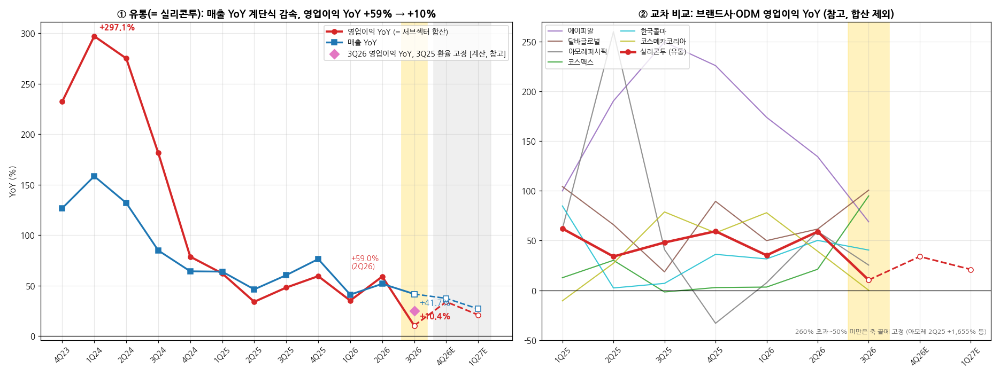
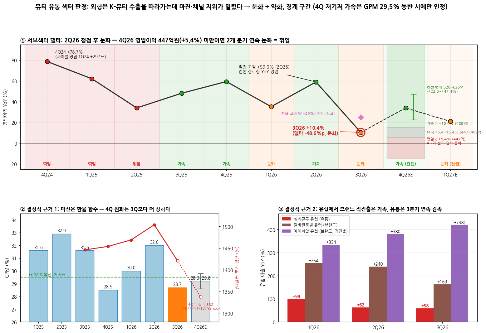

# 뷰티 · 유통 섹터 리뷰

> 현재 상태 (최신 분기 기준)
> 최신 분기: 2026-Q3
> 섹터 델타: 둔화 | 내러티브: 약화
> 모멘텀 신호: 없음
> 활성 테마: 없음
> 포지셔닝: 서브섹터 축소 | 한국 해당 없음 | 1등 실리콘투
> 델타 근거: 3Q 둔화 → 4Q 반등은 저기저, 1Q27 다시 둔화
> 내러티브 근거: 수출 수요는 유효, 환율·브랜드 직진출로 마진이 밀려 약화
> PM 근거: 정점 통과·환율 역풍 지속으로 축소
> 편입 종목: 실리콘투
> 갱신 시각: 2026-11-22 22:15 KST

## 누적 시계열

| 분기 | 편입 종목 | 합산 매출 | 합산 영업이익 | OPM | 매출 YoY | 영업이익 YoY | 영업이익 YoY 델타 (%p) | 섹터 델타 | 내러티브 | 모멘텀 신호 | 활성 테마 |
|---|---|---|---|---|---|---|---|---|---|---|---|
| 4Q23 | 실리콘투 | 1,057억원 | 149억원 | 14.1 | +126.7 | +232.4 | — | —† | - | - | - |
| 1Q24 | 동일 | 1,499억원 | 294억원 | 19.6 | +158.4 | +297.1 | +64.7 | 가속 | - | - | - |
| 2Q24 | 동일 | 1,814억원 | 389억원 | 21.5 | +131.9 | +275.1 | -22.0 | 둔화 | - | - | - |
| 3Q24 | 동일 | 1,867억원 | 426억원 | 22.8 | +84.9 | +181.5 | -93.6 | 꺾임 | - | - | - |
| 4Q24 | 동일 | 1,736억원 | 266억원 | 15.3 | +64.2 | +78.7 | -102.8 | 꺾임 | - | - | - |
| 1Q25 | 동일 | 2,457억원 | 477억원 | 19.4 | +63.9 | +62.1 | -16.6 | 꺾임 | - | - | - |
| 2Q25 | 동일 | 2,653억원 | 522억원 | 19.7 | +46.3 | +34.0 | -28.1 | 꺾임 | - | - | - |
| 3Q25 | 동일 | 2,994억원 | 631억원 | 21.1 | +60.4 | +48.1 | +14.1 | 가속 | - | - | - |
| 4Q25 | 동일 | 3,059억원 | 424억원 | 13.9 | +76.3 | +59.4 | +11.3 | 가속 | - | - | - |
| 1Q26 | 동일 | 3,466억원 | 645억원 | 18.6 | +41.1 | +35.2 | -24.2 | 둔화 | - | - | - |
| 2Q26 | 동일 | 4,026억원 | 830억원 | 20.6 | +51.8 | +59.0 | +23.8 | 가속 | - | - | - |
| **3Q26** | **동일** | **4,244억원** | **696억원** | **16.4** | **+41.7** | **+10.4** | **-48.6** | **둔화** | **약화** | **없음** | **없음** |

→ **편입 = 실리콘투 1개사.** 워치리스트 `| 뷰티 | 유통 | 실리콘투 | - | - |` 그대로라 "서브섹터 합산 = 실리콘투 단독"이다. 판정은 종목 리뷰 0번과 다르게 둘 수 없다 (단일 종목 서브섹터 — `파운드리_섹터리뷰.md` 관례)
→ **통화 = 원화 단일** (K-IFRS 연결). 환율 환산 없음
→ (출처: `earnings-review/2026-Q3_실리콘투_리뷰.md` 1-① 분기 표 — 4Q23~2Q26 OpenDART 연결(기업개요 시계열, 4Q = 연간 − 3Q 누적), 3Q26 회사 IR·분기보고서)
→ **판정 소급**: 리뷰 표의 영업이익 YoY 델타에 섹터 규칙(±5%p 유지 / 축소 + 플러스 = 둔화 / 마이너스 전환 또는 2개 분기 연속 둔화 + 정점 통과 = 꺾임)을 적용했다. **†** 4Q23은 3Q23 YoY가 리뷰 표에 없어 델타·판정 없음. 3Q24~2Q25 "꺾임"은 1Q24 사이클 정점(+297%) 통과 후 4개 분기 연속 축소라 붙은 **규칙상 꺾임**이다 — 이 기간 영업이익 YoY는 +34% 이상 플러스였다
→ **BT 표기 규칙(2026-11-22) 적용 여부**: "꺾임(개선)/꺾임(악화)"는 영업이익 YoY가 마이너스일 때만 쓴다. 이 시계열에는 마이너스 분기가 없어 해당 행이 없다. 4Q26 영업이익이 424억원 미만(YoY 마이너스)이면 첫 적용 대상이 된다
→ 내러티브·모멘텀 신호 열은 당시 섹터 리뷰가 없어 `-`. 활성 테마 없음 (theme-review·earnings-theme에 뷰티 테마 문서 없음 — `뷰티_산업기초.md`만 있음)

---

## 2026-Q3 섹터 리뷰

> 대상: `earnings-review/2026-Q3_실리콘투_리뷰.md` (2026-11-22 작성, 통합 검수 완료, 셀사이드 6건). 교차 확인용 참고: 같은 섹터 브랜드사 `2026-Q3_{에이피알|달바글로벌|아모레퍼시픽}_리뷰.md`, ODM `2026-Q3_{코스맥스|한국콜마|코스메카코리아}_리뷰.md` — 합산에는 넣지 않는다
> 2층 구조의 서브섹터 리뷰다. 뷰티 섹터 비중(1단계)과 서브섹터 순위(2단계)는 뷰티 통합 리뷰(`뷰티_섹터리뷰.md`, 미작성)가 맡는다. 이 문서는 유통 판정, K-뷰티 수출 채널 지표로서의 교차 검증, 유통 1등 종목(3단계)에 답한다
> 첫 유통 리뷰라 직전 분기 관전 포인트·⑦ 콜 체크는 없다
> **국가 프레임 구멍**: 글로벌 종목 없음 (K-뷰티 B2B 수출 유통에 직접 대응하는 상장 글로벌 피어가 없다) → ⑦(2)는 `비교 불가 — 편입 종목 없음`, 대체 축으로 "유통(실리콘투) vs 브랜드 직진출(에이피알·달바)"을 쓴다. 편입 후보는 ⑦(2) 끝에 제안
> **비영업 요인**: 종목 리뷰 ⚠ 플래그 = 원화 강세(영업 내 GPM -3.3%p QoQ + 영업외 외환 손실 577억원), 일회성 대손상각비 23억원(영업이익 포함), 미국 관세 환입(영업외). 판정은 보고 기준 그대로 쓰고 ② 비영업 요인 열·④ 근거에 표시한다. 인수 주도 가속 해당 없음

① 섹터 합산 숫자와 델타

| 항목 | 4Q24 | 1Q25 | 2Q25 | 3Q25 | 4Q25 | 1Q26 | 2Q26 | **3Q26** | 4Q26E | 1Q27E |
|---|---|---|---|---|---|---|---|---|---|---|
| 합산 매출 (억원) | 1,736 | 2,457 | 2,653 | 2,994 | 3,059 | 3,466 | 4,026 | **4,244** | 4,203 | 4,401 |
| 합산 영업이익 (억원) | 266 | 477 | 522 | 631 | 424 | 645 | 830 | **696** | 568 | 781 |
| OPM (%) | 15.3 | 19.4 | 19.7 | 21.1 | 13.9 | 18.6 | 20.6 | **16.4** | 13.5 | 17.7 |
| GPM (%) | 32.4 | 31.6 | 32.9 | 31.6 | 28.5 | 30.0 | 32.0 | **28.7** | 28.6~29.8 | |
| 매출 YoY (%) | +64.2 | +63.9 | +46.3 | +60.4 | +76.3 | +41.1 | +51.8 | **+41.7** | +37.4 | +27.0 |
| 영업이익 YoY (%) | +78.7 | +62.1 | +34.0 | +48.1 | +59.4 | +35.2 | +59.0 | **+10.4** | +34.0 | +21.0 |
| **영업이익 YoY 델타 (%p)** | -102.8 | -16.6 | -28.1 | +14.1 | +11.3 | -24.2 | +23.8 | **-48.6** | +23.6 | -13.0 |
| 판정 | 꺾임 | 꺾임 | 꺾임 | 가속 | 가속 | 둔화 | 가속 | **둔화** | 가속 (컨센, 저기저) | 둔화 (컨센) |
| (참고) 영업이익 YoY, 3Q25 환율 고정 [계산] | | | | | | | | 약 +25 | | |
| (참고) 영업이익 YoY, 대손 23억원 제외 [계산] | | | | | | | | +14 | | |

→ (출처: `2026-Q3_실리콘투_리뷰.md` 1-①. 4Q26E = 다올·삼성·하나·한화·NH·유안타 6곳 평균(영업이익 520~625억원), 1Q27E = NH·한화·다올 3곳 평균(소수 의견). 참고 행은 종목 리뷰 [계산] — 판정 미사용)
→ **합산 기준**: K-IFRS 연결 단일 영업부문(K-뷰티 유통). 사업부 영업이익 공시 없음 → 사업부 기준 합산 불가. IFRS 18 미적용이라 외환차손·환산손실은 영업외(에이피알은 IFRS 18 조기적용으로 외화 매출채권 환손실이 영업이익에 들어가 있어 **영업이익 범위가 다르다** — 교차 비교 시 주의)
→ **이익 레벨**: 매출 4,244억원은 7분기 연속 최대, 3Q 누적이 2025년 연간을 넘었다. 영업이익은 2Q26 830억원(최대) 대비 -16% QoQ
→ **델타**: 영업이익 YoY +59.0% → **+10.4%(-48.6%p)**. 매출 YoY도 +51.8% → +41.7%로 내려왔다. 매출 YoY와 영업이익 YoY의 격차가 -31.3%p로 2023년 이후 가장 크게 벌어졌다 [계산] — **외형은 유지, 마진이 델타를 깎았다**
→ **컨센 경로상 정점**: 영업이익 YoY 정점은 2Q26(+59%). 4Q26E +34%는 4Q25 저기저(OPM 13.9%, 성과급·운반비 집중) 효과이고 1Q27E +21%로 다시 내려간다. 매출 YoY 정점은 1Q24(+158%)로 이미 한참 지났다 [전망]

→ (출처: `2026-Q3_실리콘투_리뷰.md` 1-①, 브랜드사·ODM 각 2026-Q3 리뷰 1-① 영업이익 YoY. 왼쪽 = 유통(= 실리콘투) 매출·영업이익 YoY, 분홍 마름모 = 3Q25 환율 고정 참고치, 노란 음영 = 3Q26, 회색 = 컨센 E / 오른쪽 = 같은 분기 브랜드사 3사·ODM 3사 영업이익 YoY(참고, 합산 제외, 축 범위 밖 값은 끝에 고정). 단일 종목 서브섹터라 섹터 합산선 = 종목선)

② 종목별 델타 판정표

| 델타 순위 | 종목 | 국가 | 매출 YoY | 영업이익 YoY | 영업이익 YoY 델타 | 델타 판정 | 내러티브 | 비영업 요인 | 한 줄 |
|---|---|---|---|---|---|---|---|---|---|
| 1 | 실리콘투 | 한국 | +41.7% | +10.4% | -48.6%p | 둔화 | 약화 | ⚠ 원화 강세(영업 내 GPM -3.3%p QoQ, 영업외 외환 손실 577억원) · 대손 23억원(일회성) · 관세 환입(영업외) | 매출 7분기 연속 최대·북미 QoQ +24%·중남미 +123%, 그러나 GPM 28.7%·영업이익 컨센 -14.9% 미스, 2위 브랜드 직유통 전환 |

→ (출처: `2026-Q3_실리콘투_리뷰.md` 0번 판정 그대로 — "성장 델타: 둔화 | 내러티브: 약화 → 경계 구간 (매매 제외 근접)")
→ 한 종목이라 순위는 1행뿐이고 선행·후행 종목 구분이 없다. 대신 **같은 뷰티 섹터 안 시차**를 적는다 (참고): 브랜드사 에이피알은 영업이익 YoY가 3Q25(+250%)부터 4개 분기 연속 축소해 3Q26 "꺾임", ODM 코스맥스는 3Q26에 +21% → +95%로 "가속". **유통은 브랜드사와 함께 먼저 꺾이는 쪽, ODM보다 앞선 레이어**다 [판단]
→ 비영업 요인 영향: 환율 고정(+25%)·대손 제외(+14%) 어느 쪽으로 봐도 2Q26(+59%)보다 낮아 "둔화" 라벨은 같다 (④ 근거)

③ 섹터 공통 쟁점 — K-뷰티 수출 채널 지표로서의 교차 검증

> 편입 종목이 1개라 "2개 종목 이상 공통 쟁점"은 성립하지 않는다. 아래는 실리콘투 쟁점을 같은 분기 브랜드사·ODM 리뷰와 맞대어, 유통 숫자가 K-뷰티 수출 전체에 대해 무엇을 말하는지 교차 확인한 것이다

(1) 원화 강세 — 뷰티 전 종목 공통, 유통이 가장 민감

| 리뷰 | 같은 쟁점이 어떻게 나왔나 | 영업이익에 들어갔나 |
|---|---|---|
| 실리콘투 | GPM 32.0% → 28.7%(-3.3%p QoQ), 영업외 외환 손실 577억원(미실현 약 390억원), 순이익 -85% | 영업 내(GPM) + 영업외 |
| 에이피알 | 환율 영향 -278억원(IFRS 18 외화 매출채권 환손실 OPM -1.9%p + 환산 매출·원가율 -1.7%p) | 영업 내 (IFRS 18) |
| 아모레퍼시픽 | 영업외손익 -442억원(대부분 외환손실), 순이익 -14% | 영업외만 |
| 코스맥스 | 영업외 외화 관련 손실 277억원 | 영업외만 |
| 코스메카코리아 | 외화환산손실 약 103억원, 순이익 -35% | 영업외만 |
| 달바글로벌 | 외환 관련 손실 47억원 | 영업외만 |

→ (출처: 각 종목 2026-Q3 리뷰 상단 비영업 요인·⚠ 플래그)
→ **[판단]** 원화 강세가 **영업이익(마진)까지 깎은 곳은 유통(실리콘투)과 직진출 브랜드(에이피알) 둘**이다. ODM·아모레는 순이익만 맞았다. 실리콘투는 원가가 원화 매입, 매출 98%가 외화라 환율이 GPM에 바로 꽂히는 "순수 수출 유통" 구조이고(외화 10% = 세전이익 ±423억원, 연간 영업이익의 약 15%), 뷰티 안에서 환율 베타가 가장 크다. **K-뷰티 수출 채널 지표로 쓸 때 실리콘투 마진은 수요가 아니라 환율 지표**로 읽어야 한다
→ **4Q 환율 체크** [계산]: 4Q26 누적 원/달러(10/1~11/13, Yahoo 일간 종가 평균, `방산_섹터리뷰.md` 환율표) 약 1,338원으로 3Q26 평균(1,417~1,421원, Yahoo·NH)보다 약 -6% 더 강하다. 셀사이드 4Q GPM 회복(삼성 29.8%) 가정의 전제인 "환율 변동성 완화"가 아직 숫자로 나오지 않았다

(2) 수요는 살아 있다 — 유통 매출은 한국 화장품 수출과 같은 속도

| 지표 | 3Q26 | 비고 |
|---|---|---|
| 실리콘투 매출 YoY | +41.7% | 매출 98% 수출 |
| 한국 화장품 수출 (HS 3304) YoY | 7월 +36%, 8월 +53%, 9월 +30% (3Q 평균 약 +38%) → 10월 +57%(잠정), 11월 1~10일 +64% | `2026-Q3_코스맥스_리뷰.md` 2번(NH 표5, TRASS) |
| 코스맥스 한국 법인 매출 YoY | +23.3% → **+60.7%** | ODM 국내 = 수출 브랜드 생산 |
| 한국콜마 화장품(proxy) 영업이익 YoY | +48.7% → **+72.5%** | `2026-Q3_한국콜마_리뷰.md` |

→ **[판단]** 유통 매출 YoY(+42%)는 3Q 수출 평균(약 +38%)과 거의 같은 속도로, 유통 외형은 수출 수요를 그대로 따라가고 있다. 수요 축의 둔화는 없다 — 오히려 10~11월 수출(+57~64%)과 ODM 국내 가속은 **4Q 유통 매출에 순풍**이다. 따라서 3Q 유통 델타 둔화는 수요가 아니라 **마진(환율) + 채널 지위(아래 (3))** 문제다
→ ODM과 유통이 엇갈리는 이유: ODM은 원화 매출(국내 법인) 비중이 커 환율이 영업이익에 안 들어오고, 생산 물량 증가가 바로 레버리지로 간다. 유통은 같은 수요를 받지만 외화 매출 환산과 저마진 대형 거래선 믹스가 마진을 깎는다

(3) 채널 지위 — 브랜드 직진출이 유통 몫을 가져간다

| 권역 (3Q26 매출 YoY) | 실리콘투 (유통) | 에이피알 (브랜드, 직진출) | 달바글로벌 (브랜드) | 아모레퍼시픽 |
|---|---|---|---|---|
| 유럽 | +57.7% (1Q +99 → 2Q +62 → 3Q +58, 3개 분기 감속, QoQ -7%) | **+738%** (QoQ +22.6%) | +163% (1Q +254 → 2Q +240) | EMEA +9.9% |
| 북미 | +49.4% (QoQ +24%) | +117.5% (QoQ -5.5%) | +31.8% (2Q +174% → 급감속) | 미주 +16.8% |
| 중남미·기타 | 중남미 +123% | 기타(중동·중남미) +311% | 기타 +274% | — |
| 아시아 | +4.8% | +11.3% | 일본 +34% | 기타 아시아 +19.5% |

→ (출처: `2026-Q3_실리콘투_리뷰.md` 1-③(2), `2026-Q3_에이피알_리뷰.md` 1-②(2), `2026-Q3_달바글로벌_리뷰.md` 1-②(2), `2026-Q3_아모레퍼시픽_리뷰.md` 1-②. 에이피알 유럽 YoY 1Q26 +334%·2Q26 +380% = 리뷰 표 원자료 [계산])
→ **[판단] 유럽이 가장 선명한 신호다.** K-뷰티 유럽 수요는 브랜드 숫자로 보면 오히려 가속(에이피알 +334% → +738%)인데, 유통의 유럽은 3개 분기 연속 감속했다. 유로 기준 QoQ 보합(실리콘투 리뷰 [계산])이라 환율·계절만으로는 설명이 안 된다. 1위 브랜드(메디큐브)가 아마존 EU·부츠 등 직진출을 늘리고, 2위 브랜드(조선미녀·구다이글로벌)가 한성USA 인수로 자체 유통을 키우면서 **유통이 연 시장을 브랜드가 직접 가져가는 단계**에 들어섰다
→ 북미는 반대다: 유통 북미가 QoQ +24%로 재가속하는 동안 에이피알 북미는 QoQ -5.5%, 달바 북미는 +174% → +32%로 급감속했다. 북미 유통 재가속은 Ulta·Target·Sam's Club 등 **오프라인 리테일러 입점 대행** 수요(브랜드가 직접 못 하는 영역)다. 유통의 역할이 "신규 지역 개척"에서 "대형 오프라인 리테일러·신흥 지역(중남미) 대행"으로 이동하고 있다
→ **K-뷰티 수출 채널 지표로서의 함의**: 유통 매출 YoY가 수출 YoY를 밑돌기 시작하면(지금은 비슷) 직유통 전환이 수요를 잠식하는 것이다. 4Q 수출(+57~64%) 대비 유통 매출 컨센(+37%)이 이미 20%p 이상 낮다 → 컨센 자체가 "유통 몫 축소"를 내재하고 있다 [판단]

(4) 멀티플 압축 — 뷰티 공통, 유통 할인이 더 크다
→ 실리콘투: TP 평균 -26.1%(5.36 → 3.96만원), 목표 PER 11~13배 → 8~10.5배, 2027E 영업이익 하향은 -6%. 유안타는 "대형 브랜드 직유통 전환"을 멀티플 할인 근거로 명시
→ 에이피알: TP 평균 -11.4%, 목표 PER 27~28배 → 18.5~25배, 연간 영업이익 하향 -2~5% (`2026-Q3_에이피알_리뷰.md` 2번 쟁점 ③)
→ **[판단]** 뷰티 전반의 멀티플 압축 위에 유통 고유의 할인(환율 민감도 + 브랜드 이탈)이 얹혔다. 주가는 52주 고가 대비 -56%(11/13 24,000원), 12MF PER 5.9~6배로 역사적 하단

(5) 종목 고유 이슈
→ 매출채권: 내셔널 리테일러 여신 거래 확대로 매출채권 1,112억원(2024말 422억원), 첫 대손 23억원(다올이 처음 부각)
→ RCS 3,000억원(2026.09 발행) 사용처 미공개, 조기상환권 파생상품 평가손익이 매 분기 당기손익에 반영
→ 순이익은 분기말 환율 파생 지표 — 미실현 환산손실 약 390억원의 4Q 환입 여부가 12/31 환율에 걸려 있다

④ 섹터 판정

> 섹터 델타: **둔화** | 내러티브: **약화** → **K-뷰티 수출 수요는 살아 있는데(유통 매출 +42% ≈ 수출 +38%) 유통의 마진(환율)과 채널 지위(브랜드 직진출)가 함께 밀렸다 — 경계 구간. 4Q26은 저기저로 숫자상 "가속"이 나오기 쉬워, GPM 29.5% 동반 여부로 진짜 회복을 가른다. 4Q26 영업이익 447억원(YoY +5.4%) 미만이면 2개 분기 연속 둔화 = 꺾임**

→ (출처: `2026-Q3_실리콘투_리뷰.md` 1-①·1-②·1-③, 에이피알·달바글로벌 리뷰 권역 표, 4Q 누적 환율 = `방산_섹터리뷰.md` 환율표(Yahoo, 10/1~11/13). 상단 = 영업이익 YoY 궤적과 분기별 판정 색(가속 초록·둔화 주황·꺾임 빨강), 4Q26 판정 구간(가속 ≥489억원 / 유지 447~489억원 / 꺾임 <447억원)과 컨센 범위 520~625억원 / 하단 왼쪽 = GPM(막대)과 원/달러 분기 평균(선, 3Q25~3Q26 NH·우리은행, 4Q 누적 Yahoo) / 하단 오른쪽 = 유럽 매출 YoY 유통 vs 브랜드 2사)

→ **델타 판정 근거**: 영업이익 YoY +59.0% → +10.4%(-48.6%p), 축소했지만 플러스라 "둔화". 직전 분기(2Q26)가 확대였으므로 "2개 분기 연속 둔화" 요건이 아니다. 종목 리뷰 0번 판정과 같다. 컨센 경로는 4Q26E +34%(가속, 4Q25 OPM 13.9% 저기저) → 1Q27E +21%(둔화)로, 정상 기저로 돌아오는 1Q27에 다시 둔화가 예고돼 있다
→ **비영업 요인 영향**: 환율 고정 시 약 +25%, 대손 제외 시 +14%로 둘 다 2Q26보다 낮아 판정은 같다. 다만 환율 고정 참고치(+25%)는 자료마다 3Q25 원/달러 평균이 다르다(NH 1,446원 vs Yahoo 1,386원) — YoY 환율 방향 자체가 출처에 따라 바뀌어 신뢰도가 낮다. QoQ 원화 강세(-5~6%)는 모든 자료에서 같다 (불확실)
→ **내러티브 판정 근거**: 종목 리뷰 "약화" 그대로. 스토리의 전제(K-뷰티 수출 수요·지역 확장)는 수출 통계·ODM 가속으로 교차 확인됐다. 약해진 것은 "고성장 + 고마진" 중 마진, 그리고 브랜드 직진출(에이피알 유럽 +738%)이 유통 몫을 가져가는 채널 구조다 — 브랜드사 숫자가 유통 약화를 같은 방향으로 확인해 준다
→ **[판단] 결정적 근거 두 가지**: ① 마진은 환율 함수다 — 4Q 누적 원화가 3Q보다 약 6% 더 강해, 셀사이드 GPM 회복 가정(28.6~29.8%)의 상단은 아직 근거가 없다 ② 유럽(매출 38%)에서 유통 감속과 브랜드 직진출 가속이 동시에 나왔다 — 환율이 돌아와도 채널 몫은 돌아오지 않는다
→ 직전 판정 대비: 첫 유통 리뷰. 소급 궤적은 가속(1Q24) → 둔화 → 꺾임×4(3Q24~2Q25, 규칙상) → 가속(3Q25·4Q25) → 둔화(1Q26) → 가속(2Q26) → **둔화(3Q26)**. 2025년 하반기 이후 가속과 둔화가 한 분기씩 번갈아 나오는 "톱니" 궤적이고, 톱니의 고점은 +59~60%에서 막혀 있다

⑤ 모멘텀 신호

→ **없음** — 활성 테마가 없어 테마 종료 후보는 해당 없음. 델타 급증 후보 조건도 충족하지 않는다
→ 델타 급증 후보 조건 대조
→ ① 섹터 영업이익 YoY 델타 뚜렷한 확대 — **미충족** (-48.6%p 축소)
→ ② 편입 종목 과반 가속 — **미충족** (0/1)
→ ③ 내러티브 형성·강화 — **미충족** (약화)
→ 다음 분기 후보로 올릴 조건: 4Q26 영업이익 YoY +34%(컨센) 이상 **그리고** GPM 29.5% 이상 **그리고** 유럽 매출 1,700억원(+47%) 이상 QoQ 회복 — 저기저 가속이 아니라 마진·채널 회복이 동반될 때만
→ **반대 논거**
→ (1) 4Q 숫자는 좋아 보일 가능성이 높다: 4Q25 저기저라 컨센 568억원(+34%)이면 보고 기준 "가속"이다. 수출(10월 +57%)도 강해 매출 서프라이즈 여지가 있다 — 4Q 실적 직후 "가속" 라벨만 보고 후보로 올리면 안 된다
→ (2) 레이어 성격: 유통의 마진 하락 일부(유럽 내셔널 리테일러·중남미 대형 거래선 저마진 믹스)는 신규 채널 확장의 비용이다. 2027 월마트·코스트코·더글라스 직거래가 매출로 들어오면 외형 델타는 다시 커질 수 있다 — 다만 마진은 더 낮아지는 방향이다 [판단]
→ (3) 원화 약세 전환 시 GPM·환산이익이 동시에 돌아오는 비대칭 — 환율 한 변수에 델타 방향이 뒤집힐 수 있다

⑥ 다음 분기 섹터 관전 포인트

| 순위 | 무엇을 (변수·임계값) | 어떤 데이터로 | 언제 |
|---|---|---|---|
| 1 | **4Q26 영업이익 YoY +5.4% 이상(447억원) — 미만이면 2개 분기 연속 둔화 + 정점(2Q26) 통과 = 꺾임.** +15.4%(489억원) 이상이면 가속, 그 사이 유지. 424억원(YoY 0%) 미만이면 마이너스 전환 = 꺾임(BT 표기 규칙 첫 적용). 컨센 568억원(+34%, 범위 520~625억원)은 가속 — 단 4Q25 저기저(OPM 13.9%) | 4Q26 잠정실적·IR | 2027-02 말 (노션 캘린더 확인 필요) |
| 2 | **GPM 29.5% 이상** — 가속 라벨의 질 판단. 28%대면 환율 기저 부담 지속(다올 "1H27까지") | 4Q IR 손익표 | 2027-02 말 |
| 3 | **환율** — 4Q 평균 원/달러 3Q(1,417~1,421원) 이상이면 GPM 순풍. 11/13까지 누적 약 1,338원으로 역풍 방향. 12/31 분기말이 9/30보다 원화 약세면 미실현 환산손실 약 390억원 일부 환입 | 서울외국환중개 고시 환율 | 12월 말 |
| 4 | **유통 매출 YoY vs 한국 화장품 수출 YoY 격차** — 유통이 수출보다 10%p 이상 낮으면 직유통 전환이 수요를 잠식. 유럽 1,700억원(+47%) 이상 회복 여부, 메디큐브 1위 유지·상위 브랜드 직유통 발표 | 관세청 월간 화장품 수출(12/1·1/1·2/1), 4Q IR 권역·브랜드 TOP10 | 12월~2027-02 |
| 5 | **브랜드사 직진출 속도** — 에이피알 4Q 유럽(QoQ +20% 이상 지속 여부)·달바 북미 재가속 여부. 브랜드 직진출이 빨라질수록 유통 몫 축소 | 에이피알·달바글로벌 4Q26 실적 | 2027-02 |

→ 1순위 판정선(447억원 = 4Q25 424억원 × 1.054 [계산])은 ④ 키 차트와 같다. **종목 리뷰 4번(1)과 기준이 다르다**: 종목 리뷰는 "469억원(+10.4%) 이상 가속, 424억원 미만 꺾임"으로 적었는데, 섹터 규칙(±5%p 유지, 2개 분기 연속 둔화 + 정점 통과 = 꺾임)을 그대로 적용하면 가속선은 +15.4%(489억원), 꺾임선은 +5.4%(447억원)다. 3Q26이 이미 둔화라 4Q가 0~+5.4%여도 "둔화"가 아니라 "꺾임"이 된다

⑦ 글로벌 PM 포지셔닝 — 결론

> **서브섹터: 축소 — 4Q26 영업이익 YoY +15.4%(489억원) 이상 + GPM 29.5% 이상이면 유지로 상향** | **서브섹터 내: 한국 해당 없음 (글로벌 피어 없음 — 비교 불가)** | **1등: 실리콘투 (한국, 유일) / 글로벌 1등 없음**

(1) 서브섹터 판정 — 확대 / 유지 / 축소

| 판단 축 | 3Q26 근거 | 방향 |
|---|---|---|
| 이익 델타 (1순위) | 영업이익 YoY +59.0% → +10.4% 둔화 (-48.6%p), 매출 YoY +51.8% → +41.7% | 축소 |
| YoY 정점 시점 | 컨센 경로상 영업이익 YoY 정점 2Q26 통과, 4Q26E +34%는 저기저, 1Q27E +21% | 축소 |
| 선행지표 (수출·권역) | 한국 화장품 수출 10월 +57%·11월 1~10일 +64%(강함) / 유통 최대 권역 유럽 3개 분기 감속 | 중립 (수요 +, 채널 −) |
| 최종 수요 | K-뷰티 글로벌 수요는 브랜드·ODM 숫자로 확인 (에이피알 유럽 +738%, 코스맥스 한국 +61%) | 확대 (단, 유통 몫 축소) |
| 환율 | 4Q 누적 원/달러 약 1,338원, 3Q 대비 약 -6% — GPM 역풍 지속 | 축소 |
| 이벤트·정책 | 2027 월마트·코스트코·더글라스·일본·브라질 법인(1H27) / 상위 브랜드 직유통 확대 | 중립 |
| 밸류에이션 (2순위) | 12MF PER 5.9~6배(역사적 하단), TP 하향 -26%는 멀티플 주도(2027E 영업이익 -6%) | 확대 (가치 프레임) |
| 주가 낙폭 | 52주 고가 대비 -56%, 발표 후에도 -10% 추가 하락 | 중립 — 디레이팅이 이익보다 먼저 |

→ **결론: 서브섹터 축소** [판단]. 델타 1순위 프레임에서 둔화 + 약화, 컨센 경로상 정점 통과, 환율 역풍이 4Q에도 이어진다. 같은 K-뷰티 수요를 받는 ODM(코스맥스 가속·강화)이 레버리지 측면에서 더 깨끗한 노출이다 — 뷰티 안 비중 이동은 통합 리뷰가 판단한다
→ 델타 방향과 정점 시점이 엇갈리는 지점: 4Q26은 저기저로 보고 기준 "가속"이 나올 가능성이 높다(컨센 +34%). 이 가속은 정점(2Q26 +59%) 아래의 기저 효과라 **GPM 동반 없이는 축소 콜을 바꾸지 않는다**
→ **유지로 상향 조건**: 4Q26 영업이익 489억원(+15.4%) 이상 **그리고** GPM 29.5% 이상 (또는 유럽 1,700억원 이상 회복)
→ **확대 조건**: 위 + 1Q27 영업이익 YoY 컨센(+21%) 상회 경로 + 원화 약세 전환 — 정상 기저에서 재가속 확인
→ **축소 유지·강화 조건**: 4Q26 영업이익 447억원 미만(꺾임) 또는 메디큐브 등 1위권 브랜드의 직유통 확대로 유통 매출 YoY가 수출 YoY를 10%p 이상 하회

(2) 같은 서브섹터 안 한국 vs 글로벌

→ **글로벌: 비교 불가 — 편입 종목 없음.** K-뷰티 수만 SKU를 175개국 B2B로 파는 상장 글로벌 피어가 없다. 한국 국가 판단은 결론에서 뺀다
→ **대체 대비 축: 유통(실리콘투) vs 브랜드 직진출(에이피알·달바글로벌)** — 같은 K-뷰티 해외 수요를 누가 가져가는가. 브랜드 2사는 브랜드사 서브섹터 편입 종목이라 합산에 넣지 않는다

| 경쟁력 축 | 유통 (실리콘투) | 브랜드 직진출 (에이피알 · 달바글로벌) | 우위 |
|---|---|---|---|
| 델타 방향 (1순위) | 영업이익 YoY +59.0% → +10.4% (둔화) | 에이피알 +134% → +69% (꺾임) · 달바 +62% → +101% (가속, 저기저) | 엇갈림 |
| 매출 성장 | +41.7% | 에이피알 +100% · 달바 +36% | 에이피알 |
| 마진 레벨 | OPM 16.4% | 에이피알 20.8% · 달바 21.5% | 브랜드 |
| 마진 방향 | -4.7%p YoY | 에이피알 하락(환율) · 달바 +6.9%p YoY(저기저) | 엇갈림 |
| 유럽 | +58% (3개 분기 감속) | 에이피알 +738% · 달바 +163% | 브랜드 |
| 북미 | +49%, QoQ +24% (재가속) | 에이피알 +118%·QoQ -5.5% · 달바 +32% (급감속) | 유통 (방향) |
| 신흥 지역 (중남미·CIS) | 중남미 +123%, CIS +51% | 에이피알 기타 +311% | 비슷 |
| 환율 민감도 | 매출 98% 외화, 원가 원화 — 가장 큼 | 에이피알 IFRS 18로 영업이익 반영 / 달바 영업외만 | 브랜드 |
| 이익 추정 방향 | 2027E 영업이익 -6% | 에이피알 2027E -4.8% | 비슷 |
| 밸류에이션·낙폭 (2순위) | 12MF PER 약 6배, 고점 -56% | 에이피알 12MF PER 약 12배, 고점 -49% | 유통 (가치 프레임) |

→ (출처: 실리콘투·에이피알·달바글로벌 2026-Q3 리뷰 0번·1번·2번)
→ **결론 [판단]**: 유럽은 브랜드가, 북미 오프라인·신흥 지역 대행은 유통이 가져가는 **분업 구도**로 옮겨 가고 있다. 델타 프레임에서 유통의 상대 우위는 "브랜드가 직접 못 가는 곳"으로 좁아졌다
→ **반대 논거**: 유통 PER 약 6배는 브랜드(약 12배)의 절반이라 가치 프레임이면 결론이 반대일 수 있다. 또 유통은 수만 SKU 분산이라 특정 브랜드 실패 리스크가 낮다
→ **비교 범위**: 한국 편입 1개(풀 리뷰) + 같은 섹터 브랜드사 리뷰 2건의 권역 숫자. 글로벌 비교 없음 — 근거 얇음
→ **편입 후보 제안 (BT 판단)** — 노션 실적 캘린더 발표일은 미확인
→ Ulta Beauty (ULTA): 실리콘투 북미 핵심 거래처이자 미국 뷰티 리테일 사이클 대표. 회계연도 3Q(8~10월) 실적이 12월 초 발표 — K-뷰티 북미 오프라인 수요의 하류 지표로 **트래킹 피어** 제안
→ Douglas (DOU.DE): 실리콘투가 2027 직거래를 추진하는 유럽 최대 뷰티 리테일러 — 유럽 수요 하류 지표로 트래킹 피어 제안
→ 둘 다 유통(B2B 수출)과 사업모델이 달라 합산 편입보다 (트래킹) 표가 맞다 [판단]

(3) 유통 1등 종목

| 구분 | 종목 | 델타 판정 | 근거 한 줄 |
|---|---|---|---|
| **한국 1등 (서브섹터 1등)** | 실리콘투 | 둔화 · 약화 | 델타 순위 1위(유일). 매출 +42%·7분기 연속 최대, 영업이익 YoY +10% (GPM 28.7%) |
| 글로벌 1등 | 없음 | — | 편입 종목 없음 |

→ **선호**: 없음 — 1등이지만 서브섹터 축소 콜이라 선호 종목으로 올리지 않는다 [판단]
→ **비선호**: 해당 없음 (편입 1개)
→ **반등 후보 (이벤트 드리븐)**: 실리콘투 — 확인 이벤트 ① 12/31 분기말 원화 약세 전환(미실현 환산손실 390억원 환입 → 순이익 서프라이즈) ② 2027 월마트·코스트코 입점·더글라스 직거래 발표. 델타 프레임 밖의 반등이며 12MF PER 약 6배가 이 반등의 폭을 키울 수 있다

(4) 콜을 바꾸는 조건과 일정

| 시점 | 이벤트 | 서브섹터 판정 | 비고 |
|---|---|---|---|
| 2026-12-01 / 2027-01-01 | 관세청 11월·12월 화장품 수출 | 수출 +30% 이상 유지 = 수요 확인 (콜 변화 없음). +20% 미만이면 수요 축도 둔화 → 축소 강화 | ⑥ 4순위 |
| 2026-12 초 | Ulta Beauty FY3Q 실적 (트래킹 후보) | K-뷰티 카테고리 코멘트 — 북미 유통 재가속 지속 여부 | 편입 시 |
| 2026-12-31 | 분기말 환율 | 원화 약세 = 4Q 환산이익 환입·GPM 순풍 → 반등 후보 이벤트 / 원화 강세 지속 = 축소 유지 | ⑥ 3순위 |
| 2027-01 | 셀사이드 4Q 프리뷰 | 4Q 영업이익 추정이 489억원 아래로 내려가면 가속 라벨 불확실 | |
| 2027-02 말 | 실리콘투 4Q26 실적 | ≥489억원 + GPM 29.5% → 유지로 상향 / 447~489억원 → 유지 판정이나 축소 콜 유지 / <447억원 → 꺾임, 축소 유지 | ⑥ 1·2순위 |
| 2027-02 | 에이피알·달바글로벌 4Q26 실적 | 브랜드 유럽 직진출 가속 지속 = 채널 몫 축소 확인 → 축소 유지 | ⑥ 5순위 |
| 1H27 | 월마트·코스트코·더글라스·일본·브라질 법인 | 매출 개시 확인 시 외형 델타 재가속 근거 — 마진 동반 여부 별도 확인 | |

→ 출처: `2026-Q3_실리콘투_리뷰.md` 4번 항목, 에이피알·달바글로벌·코스맥스 리뷰 4번 항목
