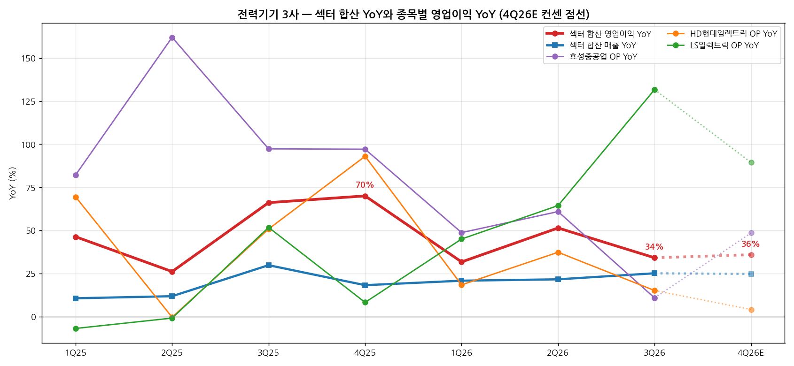
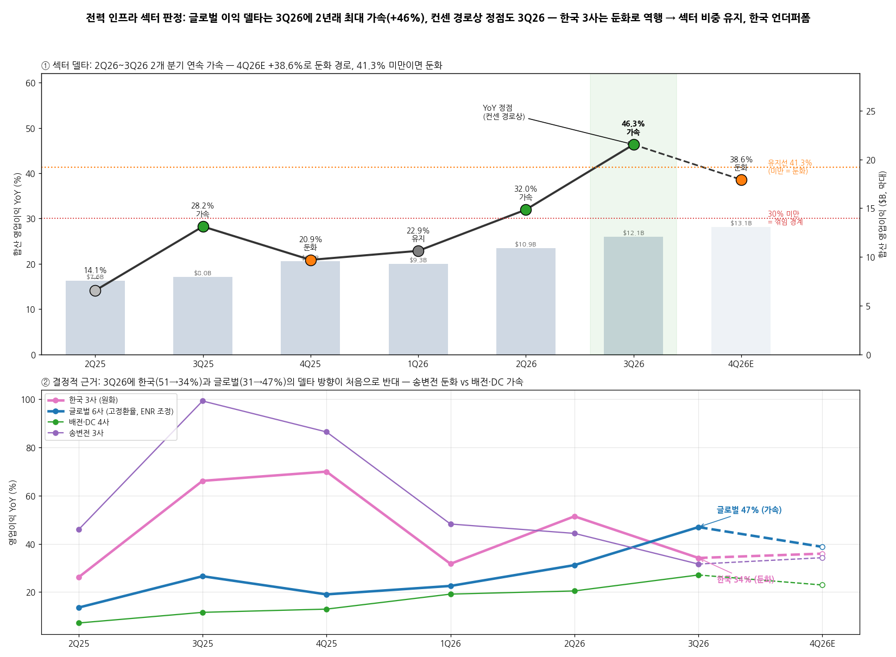

# 전력 인프라 · 글로벌 9사 섹터 리뷰

> 현재 상태 (최신 분기 기준)
> 최신 분기: 2026-Q3
> 섹터 델타: 가속 | 내러티브: 유지
> 모멘텀 신호: 없음
> 활성 테마: 없음
> 포지셔닝: 섹터 중립 | 한국 언더퍼폼 | 선호 Eaton, LS일렉트릭
> 편입 종목: 글로벌 9사 — GE Vernova, Siemens Energy, Hitachi Energy, Schneider Electric, ABB, Eaton, 효성중공업, HD현대일렉트릭, LS일렉트릭
> 갱신 시각: 2026-11-14 19:00 KST

## 누적 시계열

| 분기 | 편입 종목 | 합산 매출 | 합산 영업이익 | OPM | 매출 YoY | 영업이익 YoY | 영업이익 YoY 델타 (%p) | 섹터 델타 | 내러티브 | 모멘텀 신호 | 활성 테마 |
|---|---|---|---|---|---|---|---|---|---|---|---|
| 2Q24 | 글로벌 9사 | 659,184억원 ($48.1B) | 83,766억원 ($6.11B) | 12.7 | — | — | — | — | - | - | - |
| 3Q24 | 동일 | 673,876억원 ($49.6B) | 75,809억원 ($5.58B) | 11.2 | — | — | — | — | - | - | - |
| 4Q24 | 동일 | 732,622억원 ($52.4B) | 101,523억원 ($7.27B) | 13.9 | — | — | — | — | - | - | - |
| 1Q25 | 동일 | 707,126억원 ($48.7B) | 101,079억원 ($6.96B) | 14.3 | — | — | — | — | - | - | - |
| 2Q25 | 동일 | 755,757억원 ($53.8B) | 106,466억원 ($7.58B) | 14.1 | +9.7 | +14.1† | — | — | - | - | - |
| 3Q25 | 동일 | 783,899억원 ($56.5B) | 110,596억원 ($7.97B) | 14.1 | +11.0 | +28.2† | +14.1 | 가속 | - | - | - |
| 4Q25 | 동일 | 859,912억원 ($59.6B) | 137,988억원 ($9.56B) | 16.0 | +9.8 | +20.9 | -7.4 | 둔화 | - | - | - |
| 1Q26 | 동일 | 834,506억원 ($56.9B) | 136,332억원 ($9.30B) | 16.3 | +11.8 | +22.9 | +2.0 | 유지 | - | - | - |
| 2Q26 | 동일 | 962,526억원 ($64.1B) | 163,636억원 ($10.89B) | 17.0 | +18.2 | +32.0 | +9.1 | 가속 | - | - | - |
| **3Q26** | 동일 | **964,963억원 ($68.0B)** | **171,336억원 ($12.07B)** | **17.8** | **+21.6** | **+46.3** | **+14.4** | **가속** | **유지** | **없음** | **없음** |

→ **합산 방식**: 9사 영업이익을 달러로 환산해 합산했고, 표에는 원화(억원)와 달러를 같이 적었다. 원화 금액은 분기 평균 원/달러로 다시 환산한 값이다
→ **YoY 기준**: 매출·영업이익 YoY는 **고정환율 기준**이다. 전년 분기를 이번 분기 환율로 다시 환산해서, 환율 변동이 섞이지 않은 동일 표본 성장률을 구했다. 달러 환산 보고 기준 YoY는 ①의 참고 행에 따로 적었다
→ **종목별 이익 지표** (회사가 주 지표로 쓰는 것)
→ 한국 3사: 연결 영업이익
→ GE Vernova: Adj. EBITDA
→ ABB: Operational EBITA. 4Q26E는 매각익을 뺀 $2,010M을 썼다
→ Schneider Electric: Adj. EBITA. 분기 실적이 공시되지 않아 반기 마진 × 분기 매출로 나눈 값이다 [추정]. 3Q26·4Q26E에는 하반기 가이던스 마진 20.3%를 썼다
→ Eaton: 세그먼트 영업이익
→ Hitachi Energy: 달러 Adj. EBITA. 회사가 밝힌 분기 달러값이 있으면 그대로 쓰고, 없는 분기는 엔화 Power Grids 실적을 분기 평균 엔/달러로 나눴다. 4Q25·1Q26은 FY25 하반기 달러 합계를 엔화 비율로 나눴다 [계산]
→ Siemens Energy: Profit before Special items
→ **ENR 조정**: 전년 Gamesa 적자 기저 때문에 ENR 보고 YoY는 +227%로 부풀어 있다. 그래서 합산 YoY는 ENR을 Gamesa 제외 사업부 이익(GS+GT+TI)으로 바꿔 계산했다. 이 조정 숫자는 4Q24부터 있어서 조정 YoY는 4Q25부터 구할 수 있다. 4Q26E는 ENR 리뷰의 가이던스 경로(+40%)를 썼다 [추정]
→ **† 표시**: 2Q25·3Q25 영업이익 YoY는 ENR을 뺀 8사 기준이다. 비교 기간이 2Q24부터라 1Q25 이전 행은 YoY가 없다. Hitachi Energy의 분기 숫자는 2Q24부터 공개됐다
→ **적용 환율** (분기 평균)
→ 원/달러: 2Q24 1,371 · 3Q24 1,358 · 4Q24 1,397 · 1Q25 1,453 · 2Q25 1,404 · 3Q25 1,387 · 4Q25 1,444 · 1Q26 1,466 · 2Q26 1,502 · 3Q26 1,420 · 4Q26E 1,340. 출처는 `메모리_섹터리뷰.md`와 같다 (BNK·하나·골드만 리포트 가정치, 2025년 이전은 근사치)
→ 달러/유로: 2Q24 1.077 · 3Q24 1.098 · 4Q24 1.068 · 1Q25 1.052 · 2Q25 1.134 · 3Q25 1.168 · 4Q25 1.163 · 1Q26 1.170 · 2Q26 1.163 · 3Q26 1.14 · 4Q26E 1.12. 1Q26·2Q26은 FRED/OECD 분기 평균을 역수로 바꾼 값이고, 3Q26은 7월 평균 1.142와 10월 중순 1.12로 잡은 근사치다 [근사]
→ 엔/달러: 2Q24 155.9 · 3Q24 149.0 · 4Q24 152.4 · 1Q25 152.6 [근사]. 2Q25 이후는 회사 달러 공시를 그대로 썼다
→ 소급 행의 판정은 같은 기준으로 계산했다. 내러티브·모멘텀 신호·테마 열은 당시 섹터 리뷰가 없어서 `-`로 두었다
→ 이전 판(2026-11-03)은 한국 3사만 묶은 "둔화 | 약화" 판정이었다. 그 분석은 문서 끝 `(서브) 한국 전력기기 3사` 섹션에 그대로 남겼다. 원화 시계열은 ①의 그룹별 표 "한국 3사" 행에서 이어 본다

---

## 2026-Q3 섹터 리뷰

> 대상: 2026-Q3 실적 리뷰 9건 — `earnings-review/2026-Q3_{효성중공업|HD현대일렉트릭|LS일렉트릭|GEV|ABB|SU|HE|ENR|ETN}_리뷰.md`
> 직전 섹터 리뷰: 2026-11-03 한국 3사판 (둔화 | 약화). 글로벌판으로는 첫 리뷰다. 한국 3사판 ⑥번의 관전 포인트(4Q 판정선 등)는 4Q26 실적이 나와야 체크할 수 있다
> BT 지시 (2026-11-14): 글로벌 전력 섹터 전체를 다루면서 한국 기업 경쟁력을 함께 본다. 결론은 글로벌 PM 입장에서 (a) 전력 섹터 비중을 확대할지 축소할지, (b) 한국을 아웃퍼폼으로 둘지 언더퍼폼으로 둘지 → ⑦번

① 섹터 합산 숫자와 델타

| 항목 | 2Q25 | 3Q25 | 4Q25 | 1Q26 | 2Q26 | **3Q26** | 4Q26E |
|---|---|---|---|---|---|---|---|
| 합산 매출 ($B) | 53.8 | 56.5 | 59.6 | 56.9 | 64.1 | 68.0 | 69.6 |
| 합산 매출 (조원) | 75.6 | 78.4 | 86.0 | 83.5 | 96.3 | 96.5 | 93.3 |
| 합산 영업이익 ($B) | 7.58 | 7.97 | 9.56 | 9.30 | 10.89 | 12.07 | 13.10 |
| 합산 영업이익 (조원) | 10.65 | 11.06 | 13.80 | 13.63 | 16.36 | 17.13 | 17.55 |
| OPM (%) | 14.1 | 14.1 | 16.0 | 16.3 | 17.0 | 17.8 | 18.8 |
| 매출 YoY (고정환율) | +9.7 | +11.0 | +9.8 | +11.8 | +18.2 | +21.6 | +18.2 |
| 영업이익 YoY (고정환율, ENR 조정) | +14.1† | +28.2† | +20.9 | +22.9 | +32.0 | +46.3 | +38.6 |
| **영업이익 YoY 델타 (%p)** | — | +14.1 | -7.4 | +2.0 | +9.1 | +14.4 | -7.8 |
| 참고: 영업이익 YoY (달러 환산·ENR 보고) | +24.1 | +42.8 | +31.5 | +33.7 | +43.7 | +51.3 | +37.1 |
| 판정 | — | 가속 | 둔화 | 유지 | 가속 | 가속 | 둔화 |

→ (출처: 9사 2026-Q3 리뷰의 1-1 분기 표 [계산]. 4Q26E 출처는 종목마다 다르다: 컨센 — 한국 3사·GEV·ABB / 가이던스 — HE 하반기 균등 분할, SU 하반기 마진, ETN 4Q 가이던스 마진 / 가이던스 비례 — ENR [추정])
→ **이익 레벨**: 3Q26 합산 영업이익 $12.1B(17.1조원)로 분기 사상 최대다. 마진은 17.8%로 6개 분기 연속 올랐다. 4Q26E도 $13.1B, 마진 18.8%로 다시 최대를 갱신하는 경로다
→ **델타**: 영업이익 YoY가 +22.9%(1Q26) → +32.0%(2Q26) → +46.3%(3Q26)로 2개 분기 연속 가속했다. 매출 YoY도 +11.8% → +18.2% → +21.6%로 함께 올라 "강한 가속"이다. 보고 기준(달러, ENR 미조정)으로 봐도 +33.7% → +43.7% → +51.3%로 방향이 같다
→ **컨센 경로상 섹터 YoY 정점은 3Q26이다**. 4Q26E는 +38.6%(-7.8%p)로 둔화하고, 9사 중 6사(LS·GEV·ENR·ETN·SU·HE)의 컨센·가이던스 YoY가 3Q26에서 정점을 찍는다 [계산]. 레벨은 계속 오르지만 델타는 다음 분기부터 내려가는 경로다

그룹별 영업이익 YoY (고정환율, ENR 조정, %)

| 그룹 | 구성 | 2Q25 | 3Q25 | 4Q25 | 1Q26 | 2Q26 | 3Q26 | 4Q26E | 3Q26 델타 (%p) | 판정 |
|---|---|---|---|---|---|---|---|---|---|---|
| 한국 3사 | 효성·HD·LS (원화) | +26.1 | +66.1 | +70.0 | +31.7 | +51.4 | +34.1 | +35.9 | -17.3 | 둔화 |
| 글로벌 6사 | GEV·ENR·HE·SU·ABB·ETN | +13.5 | +26.6 | +19.0 | +22.5 | +31.2 | +46.9 | +38.7 | +15.8 | 가속 |
| 송변전 | 효성·HD·Hitachi Energy | +45.9 | +99.3 | +86.4 | +48.2 | +44.3 | +31.6 | +34.2 | -12.7 | 둔화 |
| 배전·DC | SU·ABB·Eaton·LS | +7.1 | +11.6 | +12.9 | +19.1 | +20.4 | +27.1 | +22.9 | +6.6 | 가속 |
| 발전 | GEV·ENR(조정) | — | — | +22.0 | +23.7 | +59.2 | +113.0 | +77.0 | +53.9 | 가속 |

→ 한국 3사는 원화, 글로벌 6사와 서브섹터는 고정환율 달러 기준이다. 서브섹터 분류는 워치리스트를 따른다. LS일렉트릭은 배전·DC에 넣었다
→ 발전의 2Q25·3Q25는 ENR 조정치가 없어 비워 두었다

3Q26 그룹별 규모와 증가 기여

| 그룹 | 3Q26 매출 ($B) | 비중 | 3Q26 영업이익 ($B) | 비중 | OPM | 영업이익 증가분 기여 (고정환율, ENR 조정) |
|---|---|---|---|---|---|---|
| 한국 3사 | 3.4 | 5% | 0.54 | 4% | 15.9 | $0.14B (4%) |
| 글로벌 6사 | 64.6 | 95% | 11.53 | 96% | 17.9 | $3.74B (96%) |
| 송변전 | 7.7 | 11% | 1.26 | 10% | 16.5 | $0.30B (8%) |
| 배전·DC | 33.0 | 49% | 7.11 | 59% | 21.5 | $1.51B (39%) |
| 발전 | 27.3 | 40% | 3.70 | 31% | 13.6 | $2.06B (53%) |

→ **섹터 이익 증가분($3.88B)의 96%를 글로벌 6사가 만들었다**. 종목별로는 GEV +$1.13B(29%), ENR +$0.93B(24%), SU·ETN 각 +$0.51B(13%), ABB +$0.39B(10%), HE +$0.26B(7%)이고, 한국 3사는 합쳐 +$0.14B(4%)다 [계산]
→ 한국 3사는 섹터 이익의 4%다. 글로벌 PM 포트폴리오에서 한국은 섹터 베타를 정하는 쪽이 아니라 그 안에서 상대 선택(알파)을 하는 대상이다

→ (출처: 9사 2026-Q3 리뷰 [계산]. 왼쪽 = 9사 합산 영업이익·매출 YoY(고정환율, ENR 조정)와 서브섹터별 영업이익 YoY / 오른쪽 = 종목별 영업이익 YoY(현지 통화, ENR은 Gamesa 제외 사업부, 250% 상한 표시, ★ = 한국). 점선 = 4Q26E)

② 종목별 델타 판정표

| 종목 | 서브섹터 | 매출 YoY | 영업이익 YoY | 영업이익 YoY 델타 | 델타 판정 | 내러티브 | 한 줄 |
|---|---|---|---|---|---|---|---|
| GE Vernova | 발전 | +26.8% | +139.6% (Adj. EBITDA) | +77.3%p | 가속 | 유지 | 가스터빈 마진이 이익을 끌었다. 신규 가스 계약은 11GW로 1Q의 절반, 데이터센터 수주 $2.4B → $1.4B |
| Siemens Energy | 발전 | +23.0% | +91.8% (Gamesa 제외) | +34.7%p | 가속 | 강화 | GS·GT 이익이 반반씩 기여. FY30 마진 20~22% 제시. 확정 가스 수주는 2GW, 대신 SRA가 39GW로 늘었다 |
| Hitachi Energy | 송변전 | +17.4% ($) | +41.3% ($ EBITA) | -1.6%p | 유지 | 강화 | 수주 +50%, 잔고 $66.9B. FY30 마진 목표 19~21%로 상향. 매매 수단이 Hitachi 6501이라 순수 노출은 아니다 |
| Schneider Electric | 배전·DC | +17.9% | 1H26 +16.6% (반기) | — | 유지 | 유지 | 데이터센터 수주 세 자릿수. 고원 상단. PTC 인수·증자가 주가를 누르고 있다 |
| ABB | 배전·DC | +14.3% | +24.1% (Op EBITA) | +3.6%p (환율 제외 +6%p) | 가속 | 유지 | Electrification 북미 수주 +117%, 마진 20.8%. 멀티플은 12월 FERC까지 대기 |
| Eaton | 배전·DC | +28.0% | +29.4% (세그먼트) | +12.0%p | 가속 | 강화 | 마진 25.3%로 사상 최고, 데이터센터 수주 +101%, 가이던스 올해 세 번째 상향. 이익 YoY 정점은 3Q26 |
| 효성중공업 | 송변전 | +7.2% | +10.8% | -50.1%p | 둔화 | 약화 | 매출 2,650억원이 4Q로 이연, 건설 충당금 400억원. 수주 +122%, 잔고 18.9조원은 사상 최대 |
| HD현대일렉트릭 | 송변전 | +18.5% | +15.1% | -22.1%p | 둔화 | 약화 | BESS·국내 믹스와 원화 강세로 OPM 24.1%. 수주 -19%는 생산 슬롯 소진 때문 |
| LS일렉트릭 | 배전·DC | +54.4% | +131.7% | +67.3%p | 가속 | 강화 | 미국 데이터센터 배전반이 끈 분기 최대 실적. 컨센 대비 영업이익 +20%, 이익 YoY 정점은 3Q26 |

→ (출처: 각 종목 2026-Q3 리뷰 0번 판정 그대로. SU는 분기 이익 미공시라 반기 기준)
→ **판정 분포**: 가속 5(GEV·ENR·ABB·ETN·LS), 유지 2(HE·SU), 둔화 2(효성·HD). 내러티브는 강화 4(ENR·HE·ETN·LS), 유지 3(GEV·ABB·SU), 약화 2(효성·HD)다. **둔화·약화 판정 2건이 모두 한국 송변전**이다
→ **섹터 델타를 끄는 것은 발전(GEV·ENR)이다**. 이익 증가분의 53%를 차지한다. 가스터빈 가격 사이클이 매출로 넘어오는 구간이다. 그다음이 배전·DC(39%)이고, ETN·ABB·LS 세 곳이 동시에 가속했다
→ **선행 종목은 한국 송변전(효성 → HD)이다**. 효성은 YoY 정점이 2Q25(+162%), HD는 4Q25(+93%)로 9사 중 가장 먼저 정점을 지났다. HE도 3Q25(+120%)가 정점이었지만 +40%대에서 고원을 유지하고 있다. 한국 3사판에서 본 "리드타임 순서대로 정점 통과"가 글로벌로 넓혀도 그대로 나온다. 초고압 변압기(3년)가 먼저, 데이터센터 배전(6~12개월)과 가스터빈 가격 반영이 나중이다 [판단]

③ 섹터 공통 쟁점

(1) 북미 데이터센터 수주 — 둔화하고 있나 (9사 공통)

| 종목 | 3Q26 데이터센터·북미 신호 | 해석 |
|---|---|---|
| Eaton | 데이터센터 수주 +101%, 파이프라인 307 → 366GW, Electrical Americas 분기 수주 사상 최대. 롤링 수주 증가율만 +41% → +39% | 수요 가속, 증가율만 정점권 |
| ABB | Electrification 북미 수주 +117%, 2개 분기 연속 세 자릿수 | 가속 |
| Schneider | 데이터센터 수주 4개 분기 중 3개 분기 세 자릿수, 북미 organic +23% → +20% | 고원 |
| LS일렉트릭 | 미국 수주 비중 66%, 누적 수주의 50% 이상이 데이터센터 | 가속 (단납기라 바로 매출) |
| Hitachi Energy | 데이터센터는 매출의 10%대 초반, "지연·결제 문제 없음", FY27 데이터센터 수주 5배 목표 | 유지 |
| Siemens Energy | 데이터센터 잔고 €15B(전체의 10% 미만), 미국 수주 +70% | 비중은 작고 북미는 가속 |
| 효성중공업 | 중공업 미국 수주 +308%, 하이퍼스케일러 직접 발주, STATCOM 진입 | 수주 강함, 매출은 이연 |
| HD현대일렉트릭 | 수주 -19%(생산 슬롯 소진), 빅테크 B·C·D사 장기공급계약 11월 말 | 공급 제약 |
| GE Vernova | 데이터센터 수주 1Q $2.4B → 3Q 약 $1.4B, 가스 신규 계약 11GW(1Q 21GW) | 둔화. 단 SRA·슬롯 선점 구조 |

→ (출처: 각 종목 2026-Q3 리뷰 2번 쟁점)
→ **공통 결론: 수요 둔화의 증거는 없다**. 수주가 줄어든 곳은 GEV 데이터센터와 HD 두 곳인데, 둘 다 공급(슬롯)과 타이밍 문제로 설명된다. 배전·DC 4사와 북미 수주를 따로 공시한 ENR·효성은 모두 가속했다
→ 갈리는 지점은 **증가율의 정점**이다. ETN 롤링 수주(+41% → +39%)와 SU 북미 organic(+23% → +20%)이 꺾이기 시작했다. 레벨은 사상 최대지만 증가율은 고원에 들어섰다
→ **[판단]** "북미 데이터센터 수주 둔화"는 수요가 아니라 납기 순서의 문제다. 리드타임이 긴 품목(대형 변압기·가스터빈)은 2029~2030년 슬롯까지 선점돼 있어 신규 확정 수주가 덜 잡힌다. 리드타임이 짧은 품목(배전반·UPS·차단기)은 수주가 바로 늘어난다. 그래서 3Q26 수주 숫자는 배전·DC > 발전·송변전 순서로 강하게 나왔다

(2) 이익 추정은 올라가고 멀티플은 내려간다 (9사 공통)

| 종목 | 평균 TP 변화 | 이익 추정 방향 | 주가 (고점 대비) | 밸류에이션 |
|---|---|---|---|---|
| GE Vernova | $1,120 → $1,061 (-5.2%) | 상향 | -28% (11/2) | 12M Fwd P/E 55배 → 38배 (키움) |
| Siemens Energy | €207.5 → €198 (-4.4%) | 상향 (JPM FY29까지 최대 +21%) | 약 -31% | FY27 가이던스 기준 약 25배 (aktiencheck) |
| Hitachi (6501) | 컨센 TP ¥6,600 변화 없음 | 가이던스 2회 상향 | 발표 후 1주 -12% | PER 30배 (그룹 전체) |
| Schneider | €329~333, 변경 소수 | 상향 | 약 -21% (증자가 기준) | 2026E PER 약 23배 |
| ABB | CHF 80.8 → 78.7 (-2.7%) | 유지 | -20% | 2026E PER 22.3배 (2025년 33.2배) |
| Eaton | $490.7 → 약 $477 | 상향 (2026·27 EPS) | -15% | Fwd P/E 약 27~29배 |
| 효성중공업 | 371만원 → 315만원 (-15.2%) | 하향 (-4~5%) | -61% | 2027F PER 15~16배 |
| HD현대일렉트릭 | 104만원 → 81만원 (-21.7%) | 하향 (-3%) | -68% | 12M Fwd PER 15배 |
| LS일렉트릭 | 28.2만원 → 27.0만원 (-4.2%) | 상향 (+9~10%) | -48% | 적용 멀티플 약 -12% |

→ (출처: 각 종목 리뷰 2-4 표. GEV·ETN·ENR 멀티플은 웹 보도 보완 — TIKR·Insider Monkey·Simply Wall St, 11월 초)
→ **공통 결론: TP 하향은 9사 모두 멀티플 때문이다**. 이익 추정이 내려간 곳은 효성·HD 두 곳뿐이고 폭도 -3~5%다. 나머지 7곳은 이익 추정이 올라갔는데도 TP가 유지되거나 내려갔다
→ **[판단]** 섹터가 "이익 상향 + 멀티플 하향" 국면에 있다. 시장은 12월 FERC·ERCOT 결론과 AI capex 센티먼트를 먼저 가격에 넣고 있다. 9사 주가가 고점 대비 -15~-68% 빠지는 동안 이익 추정은 내려가지 않았다. 멀티플 디레이팅이 이익 경로를 앞서 간 상태다

(3) 공급 병목 — 슬롯과 증설이 매출 속도를 정한다 (송변전·발전 공통)

→ 송변전: HD 수주 -19%(슬롯 소진, 잔고는 2026E 송배전 매출의 2.9배), 효성 잔고 18.9조원(멤피스 증설 2026년 말 4억달러 → 2028년 7억달러), HE 잔고 $66.9B(매출 약 3년치, "납기 단축 어려움")
→ 발전: GEV 가스 확정 수주 3GW + SRA 8GW, ENR 확정 2GW + SRA 39GW. 두 회사 모두 같은 분기에 "확정 수주는 줄고 예약은 쌓이는" 패턴이었다. 가격은 엇갈렸다: ENR은 "FY27 수주 가격 > FY26", GEV는 "4Q kW당 가격 하락"이라고 했다
→ 배전·DC는 반대다. 단납기라 수주가 바로 매출이 된다. ETN 25개 증설 중 18개 완료, LS 배전반 +30% 증설
→ **[판단]** 2027년 섹터 델타는 수요보다 증설 속도가 정한다. 증설이 앞서 있는 글로벌 피어(ETN·ABB·HE·ENR)와 2027년 이후 가동되는 한국(효성 멤피스 2028, HD 알라바마 2Q27·울산 11월)의 차이가 매출 성장률 격차로 나타난다

(4) 12월 FERC·ERCOT — 데이터센터 전력 비용을 누가 내나 (9사 공통 이벤트)

| 노출도 | 종목 | 근거 |
|---|---|---|
| 높음 | LS일렉트릭, Eaton, Schneider, ABB | 데이터센터 직접 매출. 단, 온사이트 전원·모듈형은 계통 우회 수요로 일부 헤지 |
| 중간 | HD현대일렉트릭, GE Vernova | 빅테크 패키지, 데이터센터 수주. GEV는 규제가 강화되면 자가발전(가스터빈) 수혜 |
| 낮음 | 효성중공업, Hitachi Energy, Siemens Energy | 765kV·HVDC 등 규제 투자 중심. 데이터센터 비중 10% 안팎 |

→ (출처: 각 종목 리뷰 4번 (3)항. 일정: 11/3 중간선거·주민투표 → FERC RTO 보고 11/16~20 → ERCOT 감사 12/10 → FERC 반론 시한 12/16)
→ **[판단]** 결론이 강화(데이터센터 비용 부담 확대) 쪽이면 섹터 안에서 순서가 바뀐다. 발전(자가발전)과 송변전(규제 투자)이 상대적으로 낫고, 배전·DC는 단기 센티먼트가 가장 나쁘다. 완화 쪽이면 지금 멀티플 할인이 가장 큰 종목(HD·효성·GEV)의 반등 폭이 크다

(5) 마진 — 글로벌은 사상 최고, 한국은 둘이 후퇴

| 종목 | 3Q26 마진 | 전년 대비 | 방향 |
|---|---|---|---|
| Eaton | 25.3% (세그먼트) | +0.3%p, 사상 최고 | ↑ |
| HD현대일렉트릭 | 24.1% | -0.7%p (2Q 25.1%) | ↓ |
| ABB | 20.8% (Op EBITA) | +1.6%p | ↑ |
| Schneider | 1H26 19.3% → 2H26E 20.3% | +1.0%p | ↑ |
| Hitachi Energy | 15.9% ($ Adj. EBITA) | +2.7%p | ↑ |
| GE Vernova | 15.4% (Adj. EBITDA) | +7.3%p | ↑ |
| 효성중공업 | 14.0% | +0.5%p (2Q 15.7%) | ↓ |
| LS일렉트릭 | 12.4% | +4.1%p | ↑ |
| Siemens Energy | 12.0% (PbSI) / GT 20.1% | +7.5%p | ↑ |

→ **[판단]** 마진 레벨로는 HD(24%)가 ETN 다음이다. 한국의 문제는 마진 레벨이 아니라 방향이다. 9사 중 3Q26 마진이 전분기보다 내려간 곳은 효성·HD 두 곳이다. 원화 강세(3Q26 1,420원, 2Q26 1,502원), BESS·국내 믹스, 건설 충당금이 원인이었다. 글로벌 피어는 가격·생산성 레버로 마진을 계속 올리고 있다

(6) 한국이 먼저 꺾이는 것은 산업 구조인가 — 변압기 선행 둔화 패턴

(6-1) 구조적으로 변압기가 먼저 둔화되기 쉬운 이유 [판단]
→ **부족 사태가 가장 먼저 왔다**: 2022~23년 북미 계통 투자·노후 교체로 변압기 부족이 가장 먼저 터졌고 가격·마진도 가장 먼저 올랐다. 먼저 오른 만큼 기저효과로 YoY도 먼저 꺾인다 (HD·효성 마진은 2023~25년에 한 자릿수 → 20%대)
→ **증설이 상대적으로 쉽다**: 변압기는 2~3년이면 증설이 된다. 가스터빈(핵심 부품)·HVDC(기술 장벽)보다 공급 반응이 빨라 가격 프리미엄이 먼저 줄어드는 구조다. 한국·인도·중국·멕시코의 북미향 증설이 2026~28년에 몰려 있다
→ **수주에서 매출까지가 짧다**: 변압기는 수주 후 2~4년, 가스터빈은 2029~30년 슬롯까지 차 있다. 고가 수주가 변압기에서는 먼저 매출로 소진되고 가스터빈은 이제 들어오기 시작한다. 3Q26 서브섹터 델타가 발전(+113%) > 배전·DC > 송변전(정점 3Q25 통과) 순서인 것과 맞다
→ **과거 사이클**: 2008~2012년 사이클에서도 변압기는 증설 물량이 들어오면서 가격이 다른 전력기기보다 먼저 꺾였고, 한국 중전기 이익도 2009~2010년부터 먼저 내려왔다

(6-2) 구조만으로는 설명되지 않는 부분
→ **같은 변압기 1위인 Hitachi Energy는 고원 유지**: 달러 Adj. EBITA YoY +41%. "변압기 = 먼저 둔화"가 전부라면 HE도 같이 꺾였어야 한다
→ **차이는 사업 구성**: HE는 HVDC·대형 시스템 프로젝트 비중이 크고 잔고가 매출 약 3년치다. 한국 3사는 단품 변압기·차단기 수출 비중이 높다. 같은 송변전 안에서도 **시스템·프로젝트는 늦게, 단품 수출은 먼저 꺾인다** [판단]
→ **이번 분기 숫자에는 일회성이 섞였다**: 효성 건설 충당금·매출 이연(약 2,650억원), HD 생산 슬롯 소진(공급 제약), 공통 원화 강세. 셋 다 수요 둔화 신호는 아니다. 4Q 이연분이 인식되면 한국 숫자는 일부 되돌아올 수 있다

(6-3) [판단]
→ 한국이 먼저 둔화되는 흐름은 "단품 변압기 수출"이라는 사업 구성에서 오는 구조적 경향이 맞다. ⑦ 한국 언더퍼폼 콜의 방향성 근거다
→ 다만 3Q26 둔화 폭은 일회성으로 과장됐을 수 있다. 구조적 둔화인지는 **미국 변압기 가격(PPI) 하락 전환, 대형 변압기 납기 단축, 한국 신규 수주 단가 < 기존 잔고 단가** 세 선행지표로 확인한다 (⑥ 관전 포인트 6순위). 하나라도 확인되면 일회성이 아니라 구조적 둔화로 본다

(7) 종목 고유 이슈
→ GE Vernova: 4Q 가스 계약 13GW+ 달성 여부, Prolec 인수 통합
→ Siemens Energy: Gamesa 3분기 연속 흑자(기업개요 분류 조건 ①), TI 분리
→ Hitachi Energy: 엔화 환산 왜곡. 모회사 6501 DSS 일회성 손실
→ Schneider: PTC 인수·증자 오버행
→ ABB: 2027 가이던스 "low teens" 유지 여부(1월)
→ Eaton: Boyd 3월 organic 편입, Mobility-Dana RMT
→ 효성중공업: 이연분 2,650억원의 4Q 인식, 건설 추가 충당
→ HD현대일렉트릭: 빅테크 B·C·D 장기공급계약(11월 말)
→ LS일렉트릭: 중국 법인 정리, SST 첫 수주

④ 섹터 판정

> 섹터 델타: **가속** | 내러티브: **유지** → **글로벌 이익 델타는 3Q26에 2년래 최대 가속(+46%, 고정환율), 그러나 컨센 경로상 섹터 YoY 정점도 3Q26 — 4Q부터 30%대 후반 고원으로 감속. 엔진은 발전·배전·DC이고 한국 송변전은 먼저 꺾여 역행한다. 4Q26 합산 영업이익 YoY 41.3% 미만이면 둔화, 1Q27까지 이어지면 꺾임**

→ (출처: 9사 2026-Q3 리뷰 [계산]. 상단 = 9사 합산 영업이익 YoY(고정환율, ENR 조정. 점 색 = 분기별 섹터 델타 판정, 막대 = 합산 영업이익 달러)와 4Q26 판정선 / 하단 = 한국 3사(원화) vs 글로벌 6사 영업이익 YoY와 송변전·배전·DC 서브섹터)

→ **델타 판정 근거**: 합산 영업이익 YoY가 2Q26 +32.0%에서 3Q26 +46.3%로 14.4%p 커져 "가속"이다. 2개 분기 연속 가속이고 매출 YoY(+18.2% → +21.6%)도 함께 올랐다. ENR 미조정 달러 기준(+43.7% → +51.3%)으로 봐도 가속이다. 컨센 4Q26E는 +38.6%(-7.8%p)로 "둔화" 경로다
→ **내러티브 판정 근거**: 종목별 내러티브는 강화 4, 유지 3, 약화 2다. 섹터 공통 스토리는 "미국 전력망·데이터센터·가스발전 수요 → 잔고 → 증설 → 가격·마진 확장"이다. 이번 분기 수주·잔고·마진 숫자는 이 스토리를 확인했고, 가이던스 상향도 4건(ETN·HE·ENR·GEV) 나왔다. 그러나 9사 모두 TP 기준 멀티플이 내려갔다. 이익 추정 상향과 멀티플 하향이 상쇄돼 "유지"다. 기준표상 "강화"에는 TP 상향 동반이 필요하다
→ **[판단] 결정적 근거는 한국과 글로벌의 델타 방향이 처음으로 갈라졌다는 점이다**. 2Q26까지는 한국 3사의 영업이익 YoY가 글로벌보다 높았다(2Q26 +51% vs +31%). 3Q26에 처음 역전됐다(+34% vs +47%). 송변전은 3Q25(+99%) 정점 뒤로 내려오는 중이고, 배전·DC는 2Q25 이후 매 분기 YoY가 올랐다. 섹터 판정 "가속"은 배전·DC와 발전의 가속이고, 한국이 많이 들어 있는 송변전은 반대 방향이다
→ 직전 판정 대비 변화: 한국 3사판 "둔화 | 약화"(11/3) → 글로벌 9사판 "가속 | 유지"(11/14). 판정이 바뀐 이유는 표본이 넓어졌기 때문이다. 한국 3사만 놓고 보면 판정은 여전히 둔화다. 소급 시계열상 섹터 판정 궤적은 가속(3Q25) → 둔화(4Q25) → 유지(1Q26) → 가속(2Q26) → 가속(3Q26)이다

⑤ 모멘텀 신호

→ **없음** — 활성 테마가 없어 "테마 종료 후보"는 해당하지 않는다
→ 델타 급증 후보 조건 대조
→ ① 섹터 영업이익 YoY 델타 확대 — **충족**. +14.4%p, 2개 분기 연속 확대
→ ② 편입 종목 과반 가속 — **충족**. 9사 중 5사가 가속
→ ③ 내러티브 형성·강화 — **미충족**. 유지
→ 조건 3개 중 2개 충족이지만 후보로 올리지 않는다. 내러티브가 못 따라오고, 컨센 경로상 섹터 YoY 정점이 바로 이번 분기라 "새 델타 급증"이 아니라 "가속의 마지막 분기"로 본다 [판단]
→ 다음 분기 후보로 올릴 조건: 4Q26 합산 영업이익 YoY 51.3% 초과(가속 유지) + 12월 FERC 결론이 데이터센터 접속을 허용하는 방향 + TP 상향 전환(멀티플 회복)
→ **반대 논거**
→ (1) 서브섹터 단위로는 "발전"이 조건을 모두 충족할 수 있다. ENR 조정 YoY +59% → +113%, GEV·ENR 둘 다 가속, ENR 내러티브 강화. 다만 4Q26E에 +77%로 바로 내려오고, 확정 가스 수주가 2개 분기 연속 줄었다
→ (2) 배전·DC는 2Q25 이후 매 분기 YoY가 오른 유일한 서브섹터다. 레이어상 하이퍼스케일러 capex의 공급 측이라, capex가 꺾이지 않는 한 2027년에도 고원이 유지될 수 있다
→ 테마 키워드 제안 (제안일 뿐): "AI 데이터센터 배전·온사이트 전원 — 단납기 배전반·UPS·모듈형·가스터빈 자가발전" (ETN·ABB·LS·GEV 중심). 한국 3사판의 "AI 데이터센터 배전" 키워드를 글로벌로 넓힌 것이다

⑥ 다음 분기 섹터 관전 포인트

| 순위 | 무엇을 (변수·임계값) | 어떤 데이터로 | 언제 |
|---|---|---|---|
| 1 | **4Q26 9사 합산 영업이익 YoY(고정환율, ENR 조정) 41.3% 이상 — 미만이면 둔화**. 금액으로는 4Q26 환율 기준 $13.4B 이상. 51.3%($14.4B) 초과면 가속. 컨센·가이던스 합 $13.2B(+38.6%)는 둔화 경로. 30% 미만($12.4B)이면 1Q27에 꺾임 확정 위험 | 9사 4Q26 실적 | 2027-01 말(GEV·ABB·HE·한국 3사) ~ 2/11(ENR) |
| 2 | 12월 FERC·ERCOT 결론 — 데이터센터 접속·비용 부담 방향 (노출도: 배전·DC > HD·GEV > 효성·HE·ENR) | FERC RTO 보고(11/16~20), ERCOT 감사(12/10), FERC 반론 시한(12/16) | 11월 중순 ~ 12월 중순 |
| 3 | 북미 데이터센터 수주 증가율 정점 여부 — ETN 롤링 수주 35% 이상, ABB·SU 북미 수주 세 자릿수 유지, GEV 4Q 가스 계약 13GW+, ENR SRA 확정 전환 10GW+ | 4Q 보도자료·컨콜 수주 문단 | 2027-01 말 ~ 2월 |
| 4 | 한국 3사 4Q 정상화 — 효성 이연분 인식(영업이익 3,800억원+), HD 북미 비중 45% 이상·빅테크 장기계약, LS 이익 YoY +89% 경로 | 3사 4Q 잠정실적, HD 공시(11월 말) | 11월 말 ~ 2027-01 말 |
| 5 | 2027 가이던스 — GEV·ETN(2월), ABB(1월), ENR(FY27 마진 14~16% 유지), HE(4월) | 각 사 4Q 발표 | 2027-01 ~ 04 |
| 6 | 변압기 선행 둔화가 구조적인지 — 미국 변압기 PPI 횡보 → 하락 전환, 대형 변압기 납기 단축, 한국 3사 신규 수주 단가가 기존 잔고 단가 하회. 하나라도 확인되면 송변전 축소·한국 언더퍼폼 강화 | 미국 BLS PPI(전력·특수 변압기), 업계 납기 조사(Wood Mackenzie 등), 한국 3사 컨콜 수주 단가 코멘트, 한국 변압기 수출 단가(관세청 HS 8504) | 매월 PPI·수출 통계, 1월 말 4Q 컨콜 |

→ 1순위 판정선(41.3%)은 ④ 키 차트와 같다. 근거: 3Q26 +46.3%에서 "유지" 범위(±5%p)를 뺀 값이다. 이 아래면 둔화다. 1Q27까지 둔화가 이어지면 "2개 분기 연속 둔화 + 정점(3Q26) 통과"로 꺾임이다

⑦ 글로벌 PM 포지셔닝 — 결론

> **섹터: 비중 유지(중립) — 추가 확대는 12월 FERC 결론과 4Q 델타 확인 후** | **서브섹터: 배전·DC 비중 확대 > 발전 유지 > 송변전 축소** | **한국: 언더퍼폼 (LS일렉트릭만 예외)**

(1) 전력 섹터 비중 — 확대 / 중립 / 축소

| 판단 축 | 3Q26 근거 | 방향 |
|---|---|---|
| 이익 델타 (1순위) | 합산 영업이익 YoY +32% → +46%, 2개 분기 연속 가속 | 확대 |
| YoY 정점 시점 | 컨센 경로상 섹터 정점이 3Q26. 4Q26E +38.6%, 9사 중 6사가 3Q26 정점 | 축소 |
| 수주·잔고 선행지표 | 잔고 사상 최대(HE $66.9B, ENR €164B, 효성 18.9조원), 북미 수주 가속(ENR +70%, ETN 데이터센터 +101%). 단 롤링 증가율은 정점권(ETN +41% → +39%) | 확대 |
| 북미 데이터센터 수주 | 수요 둔화 증거 없음. 둔화 2곳(GEV 데이터센터, HD)은 슬롯·타이밍 | 중립~확대 |
| 12월 FERC·ERCOT | 결론 전까지 섹터 멀티플이 눌림. 강화 결론이면 배전·DC 센티먼트 타격 | 축소 (이벤트 전) |
| 밸류에이션·멀티플 | 9사 모두 TP 하향 = 멀티플. GEV P/E 55 → 38배, ABB 33 → 22배, 한국 15~16배. 이익은 상향 | 확대 (2순위 변수) |
| 주가 낙폭 | 고점 대비 -15%(ETN) ~ -68%(HD). 디레이팅이 이익 경로를 앞섰다 | 중립 |

→ **결론: 비중 유지(중립)** [판단]. 델타만 보면 확대다. 하지만 모멘텀 관점에서 "가속이 확인된 분기"가 "컨센상 YoY 정점 분기"와 겹친다. 다음 분기부터 델타가 내려가는 경로에서 섹터 베타를 늘리면 진입 시점이 정점과 겹친다. 밸류에이션 매력(멀티플 30~40% 압축)은 하방을 줄여 주지만, BT 프레임에서 밸류에이션은 2순위다
→ 대신 **섹터 안에서 비중을 옮긴다**. 델타가 매 분기 오르는 배전·DC로 옮기고, 정점을 가장 먼저 지난 송변전 비중을 줄인다. 이 조정으로 섹터 비중을 유지하면서도 델타 노출을 높일 수 있다
→ **확대 전환 조건**: ① 12월 FERC 결론이 데이터센터 접속 허용·비용 분담 명확화 쪽(12/16 전후) ② 4Q26 합산 영업이익 YoY 41.3% 이상(1월 말~2/11) ③ 2027 가이던스가 컨센 이상이고 TP 상향 전환. ①+② 충족 시 확대
→ **축소 전환 조건**: ① FERC가 대형부하 접속 비용을 데이터센터에 전가하는 쪽으로 결론 ② 4Q26 YoY 30% 미만 ③ ETN 롤링 수주 증가율 30% 미만 또는 GEV 4Q 가스 계약 10GW 미만. 2개 이상 충족 시 축소

(2) 한국 vs 글로벌 — 아웃퍼폼 / 언더퍼폼

| 경쟁력 축 | 한국 3사 | 글로벌 6사 | 우위 |
|---|---|---|---|
| 델타 방향 (1순위) | +51% → +34% 둔화. 2사(효성·HD) 둔화·약화 | +31% → +47% 가속. 6사 중 둔화 0 | 글로벌 |
| 마진 레벨 | HD 24.1%(ETN 다음 2위), 효성 14.0%, LS 12.4% | ETN 25.3%, ABB 20.8%, SU 약 20%, HE 15.9%, GEV 15.4%, ENR 12.0% | 비슷 (HD 상위권) |
| 마진 방향 | 효성·HD 전분기 대비 하락 (환율·믹스·충당금) | 6사 모두 상승 또는 유지 | 글로벌 |
| 수주 증가율 | 효성 +122%, LS 미국 수주 급증, HD -19% (슬롯) | HE +50%, ENR 미국 +70%, ETN 데이터센터 +101%, ABB 북미 +117% | 비슷 |
| 미국 노출·생산 슬롯 | 미국 비중 높음(LS 66%, HD 북미 38~48%). 미국 현지 capa는 2027~28년 가동(효성 멤피스, HD 알라바마) | 미국 현지 생산 확보(ENR Charlotte, ETN 증설 18/25 완료, HE·ABB 현지 공장) | 글로벌 |
| 가격 | 초고압 변압기 가격 견조. 다만 원화 강세로 원화 환산 가격 하락 | ENR "FY27 수주 가격 > FY26", ETN 1/2 가격 인상, GEV 4Q 단가 하락 | 비슷 |
| 관세 | 미국 수출 품목 관세 부담(LS 관세 환급은 일회성) | 미국 현지 생산 비중 높아 관세 영향 작음 | 글로벌 |
| 환율 | 원화 강세 역풍(4Q26 약 200억원, 2027년 약 1,000억원 — HD 골드만) | 엔화 약세 HE 순풍, 유로 약세 ENR·SU 순풍 | 글로벌 |
| 이익 추정 | 효성·HD 하향(-3~5%), LS 상향 | 7곳 상향 또는 유지 | 글로벌 |
| 밸류에이션·낙폭 | PER 15~16배(효성·HD), 고점 대비 -48 ~ -68% | P/E 22~38배, 고점 대비 -15 ~ -31% | 한국 (2순위 변수) |

→ **결론: 한국 언더퍼폼** [판단]
→ 이유 (1) 델타 방향이 반대다. 섹터가 가속하는 분기에 한국 송변전 2사가 둔화했고, 한국 3사의 YoY가 처음으로 글로벌 아래로 내려갔다(34% vs 47%)
→ 이유 (2) 이익 추정이 내려간 곳은 9사 중 한국 2곳뿐이다. 마진이 후퇴한 곳도 한국 2곳뿐이다. 원화 강세·믹스·이연처럼 회사가 통제하기 어려운 변수가 4Q·2027년에도 남아 있다
→ 이유 (3) 증설 타이밍이 늦다. 글로벌 피어는 미국 현지 증설이 이미 매출로 들어오는데, 한국 송변전의 미국 capa는 2027~28년에 가동된다. 수주가 강해도 2027년 매출 성장 속도는 슬롯이 묶는다
→ 반대 논거: 밸류에이션 할인이 가장 크다(PER 15배 vs 글로벌 22~38배). 주가 낙폭(-61~-68%)이 이미 "사이클 정점"을 반영했다. 12월 FERC가 완화 쪽이거나 HD 빅테크 B·C·D 계약이 11월 말 확정되면 반등 탄력은 한국 송변전이 가장 크다. 언더퍼폼은 "델타 프레임" 결론이고, 가치 프레임이라면 결론이 반대일 수 있다
→ **예외: LS일렉트릭**. 한국 3사 중 유일하게 가속·강화이고, 배전·DC 서브섹터에 속한다. 한국 비중 안에서는 LS로 집중한다. 다만 LS도 컨센상 YoY 정점이 3Q26(+132% → 4Q +89%)이다

(3) 서브섹터 순위와 선호 종목

| 순위 | 서브섹터 | 비중 | 근거 |
|---|---|---|---|
| 1 | 배전·DC | 확대 | 2Q25 이후 매 분기 YoY 상승(+7% → +27%), 마진 21.5%(서브섹터 최고), 데이터센터 수주 가속, 단납기라 수주가 바로 매출. FERC 노출은 가장 크다 |
| 2 | 발전 | 유지 | 델타 최대(+113%)지만 4Q부터 +77%로 급감속. 확정 가스 수주 2개 분기 연속 감소(SRA로 대체). FERC 강화 시 자가발전 수혜로 헤지 |
| 3 | 송변전 | 축소 | 정점(3Q25 +99%) 뒤로 내려오는 중(+44% → +32%). 한국 2사 둔화·약화. HE만 고원 유지(순수 노출 수단 없음) |

→ **글로벌 선호**
→ Eaton: 가속·강화, 마진 25.3%로 사상 최고, 가이던스 세 번째 상향. 배전·DC의 핵심
→ Siemens Energy: 가속·강화, FY30 마진 20~22% 제시. P/E 약 25배로 GEV(38배)보다 싸다
→ ABB: 가속, 북미 수주 +117%, PER 22배로 피어 중 가장 싸다
→ 비선호: Schneider(PTC 오버행), GE Vernova(내러티브 유지, 가스 확정 수주 감소. 다만 FERC 강화 시 헤지 수단)
→ **한국 선호**: LS일렉트릭(유일한 가속·강화)
→ 반등 후보(이벤트 드리븐, 델타 프레임 밖): HD현대일렉트릭. 빅테크 장기계약 11월 말, 12월 FERC 결론 확인 후 판단
→ 비선호: 효성중공업. 4Q 이연분 인식 확인 전까지

(4) 콜을 바꾸는 조건과 일정

| 시점 | 이벤트 | 섹터 비중 | 한국 콜 |
|---|---|---|---|
| 11월 말 | HD 빅테크 B·C·D 장기공급계약 확정 | — | 확정 시 HD를 중립으로 올림 |
| 11/16~20, 12/10, 12/16 | FERC RTO 보고 → ERCOT 감사 → FERC 반론 시한 | 완화 → 확대 / 강화 → 축소 검토 (배전·DC 먼저) | 완화 → 한국 송변전 반등 탄력 최대(중립 상향 검토) / 강화 → 한국 UW 유지 |
| 2027-01 말 | 한국 3사·GEV·ABB·HE 4Q 실적 | 9사 합산 YoY 41.3% 이상이면 유지, 51.3% 초과면 확대 | 한국 3사 YoY가 글로벌을 다시 웃돌면 아웃퍼폼 전환 |
| 2027-02 초 ~ 2/11 | ETN·ENR 4Q 실적, 2027 가이던스 | 가이던스 컨센 이상 + TP 상향 시 확대 | — |
| 상시 | 원/달러 1,300원 하회 | — | HD·LS 2027E 하향 → UW 강화 |

→ 출처: 각 종목 2026-Q3 리뷰 ⑥·4번 항목. 밸류에이션 보완은 아래 웹 자료(11월 초 기준, 소스마다 차이가 커 범위로만 인용)
→ [TIKR — GE Vernova·Eaton 11/3](https://www.tikr.com/blog/ge-vernova-soars-6-eaton-up-7-on-record-orders-and-bernsteins-data-center-call)
→ [Insider Monkey — GEV 47x vs ETN 29x](https://www.insidermonkey.com/news/ge-vernova-vs-eaton-which-ai-power-stock-can-earn-its-47x-or-29x-price-1849746/)
→ [Simply Wall St — GE Vernova·Siemens Energy](https://simplywall.st/stocks/de/capital-goods/fra-y5c/ge-vernova-shares/valuation)
→ [FRED — 유로 분기 평균 환율](https://fred.stlouisfed.org/series/CCUSMA02PTQ618N)
→ [theglobaleconomy — 엔/달러](https://www.theglobaleconomy.com/Japan/Dollar_exchange_rate/)

---

## (서브) 한국 전력기기 3사 — 2026-Q3 (2026-11-03 작성분 보존)

> 합산·판정은 위 글로벌 9사 기준으로 바뀌었다. 아래는 한국 3사만 묶었던 이전 판정(둔화 | 약화)과 분석을 그대로 남긴 서브 시리즈다. 한국 3사 원화 시계열은 ①의 그룹별 표 "한국 3사" 행에서 이어 본다. 아래 본문의 차트 2개는 이번 갱신 때 글로벌판 차트로 덮어썼으므로 빼고 남겼다

### 한국 3사 2026-Q3 섹터 리뷰 (원 판정: 둔화 | 약화)

> 대상: 효성중공업 3Q26, HD현대일렉트릭 3Q26, LS일렉트릭 3Q26 — `earnings-review/2026-Q3_{효성중공업|HD현대일렉트릭|LS일렉트릭}_리뷰.md`
> 첫 섹터 리뷰 — 직전 분기 섹터 관전 포인트 체크 없음

① 섹터 합산 숫자와 델타 (단위: 억원, %)

| 항목 | 1Q25 | 2Q25 | 3Q25 | 4Q25 | 1Q26 | 2Q26 | **3Q26** | 4Q26E |
|---|---|---|---|---|---|---|---|---|
| 합산 매출 | 31,229 | 36,245 | 38,358 | 44,306 | 37,713 | 44,058 | **47,983** | 55,245 |
| 합산 영업이익 | 4,079 | 4,820 | 5,677 | 7,111 | 5,372 | 7,298 | **7,615** | 9,666 |
| OPM | 13.1 | 13.3 | 14.8 | 16.0 | 14.2 | 16.6 | **15.9** | 17.5 |
| 매출 YoY | +10.6 | +11.8 | +29.8 | +18.2 | +20.8 | +21.6 | **+25.1** | +24.7 |
| 영업이익 YoY | +46.3 | +26.1 | +66.1 | +70.0 | +31.7 | +51.4 | **+34.1** | +35.9 |
| 영업이익 YoY 델타 (%p) | — | −20.2 | +40.0 | +3.8 | −38.3 | +19.7 | **−17.3** | +1.8 |

→ (출처: 3사 2026-Q3 리뷰의 1-1 분기 표 단순 합산 [계산]. 4Q26E는 각 리뷰의 컨센 평균(효성 5곳·HD 11곳·LS 12곳)의 합)
→ 이익 레벨은 사상 최고다. 3Q26 합산 영업이익 7,615억원은 분기 최대이고, 4Q26E 9,666억원은 다시 최대를 갱신하는 경로다
→ 델타는 4Q25(+70%)가 정점이다. 그 뒤로는 +32% → +51% → +34%로 30~50% 구간을 오가고 있고, 4Q26E도 +36%로 같은 구간이다
→ 매출 YoY는 반대로 +21% → +22% → +25%로 조금씩 올라가고 있다. 매출은 늘지만 이익 증가율이 따라오지 못하는 구간이다. 3Q26 OPM은 2Q26 대비 −0.7%p다
→ 연간으로는 2026E 합산 영업이익 3조 88억원(+38.7%), 2027E 4조 841억원(+35.7%)이다 [계산, 3사 리뷰 1-3 컨센 합. 2025년 2조 1,687억원]. 컨센이 그리는 섹터 YoY는 "정점 통과 후 30%대 고원"이다

② 종목별 델타 판정표

| 종목 | 매출 YoY | 영업이익 YoY | 영업이익 YoY 델타 | 델타 판정 | 내러티브 | 한 줄 |
|---|---|---|---|---|---|---|
| 효성중공업 | +7.2% | +10.8% | −50.1%p | 둔화 | 약화 | 미국 GIS 등 매출 2,650억원 이연과 건설 충당금 400억원. 수주잔고 18.9조원은 사상 최대 |
| HD현대일렉트릭 | +18.5% | +15.1% | −22.1%p | 둔화 | 약화 | BESS·국내 믹스와 원화 강세로 OPM 24.1%. 수주 −19%는 슬롯 소진 |
| LS일렉트릭 | +54.4% | +131.7% | +67.3%p | 가속 | 강화 | 미국 데이터센터 배전반이 끈 분기 최대 실적. 컨센 대비 영업이익 +20% |

→ (출처: 각 종목 2026-Q3 리뷰 0번 판정 그대로)
→ **섹터 델타를 끄는 것은 LS일렉트릭 하나다**. 3Q26 합산 영업이익 YoY 증가분 1,938억원 중 LS일렉트릭이 1,327억원(68%)이다 [계산]. 효성중공업(+237억원)과 HD현대일렉트릭(+374억원)의 기여는 합쳐도 32%다
→ **선행 종목은 효성중공업**이다. 영업이익 YoY 정점이 2Q25(+162%)로 3사 중 가장 빨랐고, 이후 +97% → +97% → +49% → +61% → +11%로 내려왔다. 다음이 HD현대일렉트릭(정점 4Q25 +93%)이다. LS일렉트릭은 컨센 기준 3Q26(+132%)이 정점이다
→ 정점 순서가 납기 순서와 같다. 리드타임 3년인 초고압 변압기(효성·HD)가 먼저 정점을 지났고, 리드타임 6~12개월인 데이터센터 배전(LS)이 마지막이다 [판단]

③ 섹터 공통 쟁점

(1) 이익 추정보다 멀티플이 더 깎였다 — 3사 공통 (TP 하향 = 멀티플)

| 종목 | 평균 TP 변화 | 2026E 영업이익 컨센 변화 | 2027E 영업이익 컨센 변화 | 주가 (52주 고점 대비) |
|---|---|---|---|---|
| 효성중공업 | −15.2% (하향 5/7) | −4.1% | −5.0% | −61% |
| HD현대일렉트릭 | −21.7% (하향 12/14) | −2.7% | −3.5% | −68% |
| LS일렉트릭 | −4.2% (하향 4/12) | +8.8% | +9.7% | −48% |

→ (출처: 3사 리뷰 2-4 표)
→ 3사 모두 TP 하향의 주원인이 멀티플이다. JPM은 효성·HD 둘 다 전력기기 PER을 30배에서 25배로 내렸고, NH는 HD·LS 둘 다 자기자본비용을 올렸다. 현대차증권은 LS의 글로벌 배전 피어 PER을 56배에서 44배로 내렸다
→ 갈리는 것은 이익 방향이다. 효성·HD는 이익이 3~5% 내려갔고, LS는 9~10% 올라갔다. 그런데도 LS까지 TP가 내려간 것은 회사가 아니라 업종 문제라는 뜻이다
→ **[판단]** 시장은 이미 "전력기기 사이클 정점"을 가격에 넣고 있다. 3사 주가는 고점 대비 48~68% 빠졌고, HSBC는 10/14 효성을 "Cycle concerns taking hold"로 Hold 하향했다. 이번 분기 셀사이드 하향은 주가를 따라간 것에 가깝다. 이익 경로(2026E +39%, 2027E +36%)와 멀티플 방향이 반대로 움직이는 구간이다

(2) 일회성·믹스를 빼면 정상 마진은 몇 %인가 — 3사 공통

| 종목 | 보고 OPM | 일회성·믹스 요인 | 조정 OPM [추정] |
|---|---|---|---|
| 효성중공업 | 14.0% | 건설 충당금 400억원 (−), 매출 이연 2,650억원 | 16.3% (건설 충당 제외), 16.8% (이연분 포함) |
| HD현대일렉트릭 | 24.1% | 안좌 BESS 1,250억원 (저마진), 원화 강세 | 25.8~27.0% (BESS 제외) |
| LS일렉트릭 | 12.4% | 관세 환급 (+), 중국 법인 손실 −485억원 | 12.4% (연결, 상쇄). 전력인프라 17.1%는 경상 12~14% |

→ (출처: 3사 리뷰 2번 쟁점 (1)·(2))
→ 3사 모두 "일회성을 빼면 마진은 꺾이지 않았다"는 결론이 나온다. 효성·HD는 일회성·믹스가 마진을 깎았고, LS는 일회성끼리 상쇄했다
→ **[판단]** 이 결론은 3사 모두 4Q26에 확인돼야 한다. 효성은 이연분 인식, HD는 북미 비중 회복(45% 이상), LS는 중국 손실 재발 여부가 같은 질문의 종목별 버전이다. 3사가 동시에 "4Q 정상화"를 가정하고 있어, 한 곳이라도 빗나가면 섹터 델타가 꺾임 판정선 근처로 내려간다

(3) 수주는 강한데 매출 성장이 capa에 묶인다 — 효성·HD 공통, LS는 반대

→ 효성중공업: 수주 3.2조원(+122%), 잔고 18.9조원(+71%). 그런데 중공업 매출 YoY는 +20% → +7% → +4%로 둔화했다. 멤피스 capa가 2026년 말 4억달러, 2028년 6월 7억달러로 늘어나야 잔고가 매출이 된다
→ HD현대일렉트릭: 수주 −19%는 슬롯 소진 때문이다. 잔고 88.4억달러(사상 최대)는 2026E 송배전 매출의 2.9배다. 울산 신공장(11월)과 알라바마 증설(2Q27)이 2027년 성장 속도를 정한다
→ LS일렉트릭: 반대 구조다. 잔고는 7.04조원으로 QoQ +0.6%에 그쳤지만, 단납기 배전반이 수주 즉시 매출로 빠져나간 결과다. 수주(1.59조원)와 매출(1.55조원)이 같은 속도로 움직였다
→ **[판단]** 섹터 성장의 병목은 수요가 아니라 생산능력이다. 그래서 2027년 섹터 델타는 수주 공시보다 증설 일정(효성 멤피스, HD 울산·알라바마·초고압 추가 증설, LS 배전반 +30%·유타 공장)이 결정한다. 수요 측 지표(수주·잔고)만 보면 델타 둔화를 놓친다

(4) 미국 데이터센터 규제 — 11/3 중간선거부터 12월 FERC·ERCOT까지, 3사 공통 이벤트

| 종목 | 데이터센터 직접 노출 | 리드타임 | 12월 결론의 의미 |
|---|---|---|---|
| 효성중공업 | 하이퍼스케일러 직접 발주 4억달러+ (잔고의 약 3%) | 3년 | 데이터센터향 일부 물량의 할인율 |
| HD현대일렉트릭 | 빅테크 A사 1.12조원 + B·C·D사 협의 (11월 말 확정 예정) | 3년 (배전은 짧음) | 두 번째 성장축(빅테크 패키지)의 할인율 |
| LS일렉트릭 | 잔고 7.04조원의 50% 이상이 데이터센터향 | 6~12개월 | 2027년 수주·매출 경로 자체 |

→ (출처: 3사 리뷰 4번 (3)항. 중간선거 데이터 = Axios 10/31·Forbes 11/2·Ballotpedia 11/2, FERC·ERCOT 일정 = 대신증권)
→ 세 이벤트(11/3 중간선거 주민투표 41~50건, 11/16~20 RTO 보고, 12/10 ERCOT 감사 완료·12/16 FERC 반론 시한)는 모두 "데이터센터 전력 비용을 누가 내나"를 다룬다
→ **[판단]** 노출도는 LS > HD > 효성 순이다. 섹터 델타를 끄는 유일한 엔진(LS)이 이 이벤트에 가장 민감하다는 점이 섹터 전체의 리스크다. 765kV 송전망(RTO 승인 규제 투자)은 3사 모두 영향이 작다. 다만 LS일렉트릭의 Bloom Energy 연료전지(누적 5,043억원)처럼 계통에 붙지 않는 온사이트 전원향 수주는 FERC 규제가 강화될 때 부분 헤지가 된다

(5) 원화 강세 — HD·LS 공통

→ HD현대일렉트릭: QoQ 환율이 OPM을 0.3~0.4%p, 영업외(외환손실 약 480억원)로 순이익을 깎았다. 4Q26 약 200억원, 2027년 약 1,000억원 역풍(골드만)이다
→ LS일렉트릭: YoY로는 환율 효과가 거의 없었지만, QoQ로 원화 6~8% 강세가 매출 약 450억원, 수주잔고 2,100~2,800억원을 깎았다 [추정]. 환헤지가 어려운 전력기기 OPM은 15.6%에서 14.3%로 내려갔다
→ 효성중공업 리뷰에서는 환율이 쟁점으로 다뤄지지 않았다 (대신증권 4Q26 가정 1,340원/달러)
→ **[판단]** 2027년 컨센에 환율 역풍이 아직 덜 들어가 있을 수 있다. 원/달러가 1,300원 아래로 내려가면 HD부터 2027E 추가 하향이 나온다

(6) 종목 고유 이슈
→ 효성중공업: 중동 이연분(700~800억원)의 4Q 인식 불확실성, 건설 부문 추가 충당금 여부
→ HD현대일렉트릭: 빅테크 B·C·D사 장기공급계약 11월 말 확정 여부, 배전 확대에 따른 마진 희석 논쟁
→ LS일렉트릭: 중국 법인 정리 완료 여부, SST 첫 수주, 전력기기 OPM 16% 회복

④ 섹터 판정

> 섹터 델타: **둔화** | 내러티브: **약화** → **이익 레벨은 사상 최고, 합산 델타는 4Q25에 정점 통과 — 초고압(효성·HD)에서 배전(LS)으로 엔진이 넘어가는 경계 구간. 섹터 베타보다 종목 선별 구간이며, 4Q 합산 영업이익 YoY 29% 미만(9,180억원 미만)이면 꺾임**

→ **델타 판정 근거**: 합산 영업이익 YoY가 2Q26 +51.4%에서 3Q26 +34.1%로 17.3%p 축소됐고 플러스를 유지해 "둔화"다. 1Q26 둔화 → 2Q26 가속으로 끊겼기 때문에 "2개 분기 연속 둔화"에는 아직 해당하지 않는다. 컨센 4Q26E는 +35.9%(+1.8%p)로 "유지" 경로다. 4Q가 29.1% 미만이면 2개 분기 연속 둔화에 정점(4Q25 +70%) 통과가 겹쳐 "꺾임"이다
→ **내러티브 판정 근거**: 종목별로는 약화 2(효성·HD), 강화 1(LS)이다. 섹터 공통 스토리인 "미국 전력망·데이터센터 수요 → 수주잔고 → 증설 → 마진 확장"에서 수요와 잔고는 3사 모두 숫자로 확인됐다. 하지만 마진 확장(일회성·환율·믹스)과 멀티플(3사 모두 TP 하향)에서 의문이 생겼다. 섹터 이익 추정은 효성·HD 하향이 LS 상향을 일부 상쇄했고, 멀티플은 3사 모두 내려갔다. 기준표의 "약화"에 해당한다
→ **[판단] 결정적 근거는 종목별 정점 시차**다. 효성(2Q25) → HD(4Q25) → LS(3Q26 컨센)로 납기가 긴 순서대로 정점을 지났다. 지금 섹터 델타를 받치는 것은 LS 하나이고, 그 LS도 컨센상 4Q26부터 YoY가 −42%p 내려간다. 섹터 전체로 보면 "새 가속"이 아니라 "마지막 엔진의 정점" 구간이다
→ 분류 변경 영향 [계산]: LS일렉트릭을 빼고 송변전 2사(효성·HD)만 합산하면 영업이익 YoY는 2Q26 약 +48% → 3Q26 약 +13%로 꺾임에 가까운 둔화다. 3사 합산 "둔화"는 LS 배전의 가속이 송변전 2사의 둔화를 가린 결과다
→ 직전 분기 대비 변화: 첫 섹터 리뷰. 소급 시계열상 판정은 둔화(2Q25) → 가속(3Q25) → 유지(4Q25) → 둔화(1Q26) → 가속(2Q26) → 둔화(3Q26)로 분기마다 교차했다. 분기 실적 변동성(효성의 이연, HD의 납품 타이밍)이 커서 단일 분기 판정보다 2개 분기 흐름을 보는 편이 맞다

⑤ 모멘텀 신호

→ **없음** — 활성 테마가 없어 "테마 종료 후보"는 해당하지 않는다
→ 델타 급증 후보 조건 대조: ① 섹터 영업이익 YoY 델타 확대 — 미충족(−17.3%p) ② 편입 종목 과반 가속 — 미충족(1/3, LS만) ③ 내러티브 형성·강화 — 미충족(약화) → 후보로 올리지 않음
→ 다음 분기 후보로 올릴 조건: 4Q26 합산 영업이익 YoY 39.1% 초과(9,890억원 이상)로 가속 전환 + 효성·HD 중 1곳 이상이 가속 + 12월 FERC 결론이 데이터센터 접속 허용 방향
→ 반대 논거: (1) 종목 단위로는 LS일렉트릭이 델타 급증(+67%p) 조건을 충족한다. "AI 데이터센터 단납기 배전"은 섹터와 별개로 볼 만한 키워드다. 다만 컨센상 LS의 YoY 정점이 3Q26이라, 이 키워드로 테마를 열면 진입 시점이 정점과 겹친다 [판단] (2) 레이어 성격상 전력기기는 데이터센터 capex의 공급 측이다. 하이퍼스케일러 섹터의 capex가 꺾이지 않는 한 수요는 이어지고, 이번 둔화는 수요가 아니라 capa·타이밍 요인이다. 증설이 매출로 들어오는 1H27에 재가속할 수 있다
→ 테마 키워드 제안 (제안일 뿐): "AI 데이터센터 배전 — 단납기 배전반·SST·온사이트 전원" (LS일렉트릭 중심, 하이퍼스케일러 capex와 연결)

⑥ 다음 분기 섹터 관전 포인트

| 순위 | 무엇을 (변수·임계값) | 어떤 데이터로 | 언제 |
|---|---|---|---|
| 1 | **4Q26 섹터 합산 영업이익 YoY 29.1% 이상 (9,180억원 이상) — 미만이면 꺾임**. 39.1% 초과(9,890억원 이상)면 가속. 컨센 9,666억원(+35.9%)은 유지. 종목별 꺾임선 합(효성 3,500·HD 3,200·LS 2,200 = 8,900억원, +25%)이면 꺾임 | 3사 4Q26 잠정실적 | 2027년 1월 말~2월 초 |
| 2 | 12월 미국 대형부하 접속 제도 결론 — 데이터센터 접속을 막는 방향인지 (노출도 LS > HD > 효성) | 11/3 주민투표·PUC 선거 결과, FERC RTO 보고(11/16~20), ERCOT 감사(12/10), FERC 반론 시한(12/16) | 11/3 ~ 12월 중순 |
| 3 | 4Q 정상화 가정 3종 확인 — 효성 이연분 2,650억원 인식, HD 북미 비중 45% 이상, LS 중국 손실 재발 없음 | 3사 4Q 실적·IR 지역별 매출·부문별 손익 | 2027년 1월 말~2월 초 |
| 4 | 증설 발표와 가동 — 효성 국내 초고압 추가 증설, HD 초고압 변압기·고압차단기 추가 증설과 울산 신공장 가동, LS 배전반 +30%·유타 공장 일정 | 신규 시설투자 공시, 컨콜 | 4Q26 ~ 1H27 |
| 5 | 원/달러 1,300원대 역풍 — HD 2027E 추가 하향 여부, LS 전력기기 OPM 회복 여부 | 원/달러 분기 평균, 증권사 2027E 추정 변경 | 상시 |

→ 1순위 판정선은 ④ 키 차트의 판정선(29.1%)과 같다. 근거: 3Q26 합산 영업이익 YoY 34.1%에서 판정 기준의 "유지" 범위(±5%p)를 뺀 값이다. 이 아래면 둔화가 2개 분기 이어지고, 정점(4Q25 +70%)을 이미 지났으므로 "꺾임" 조건을 충족한다
