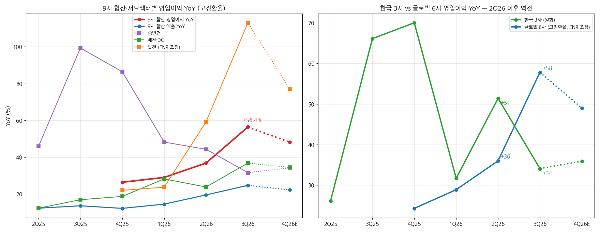
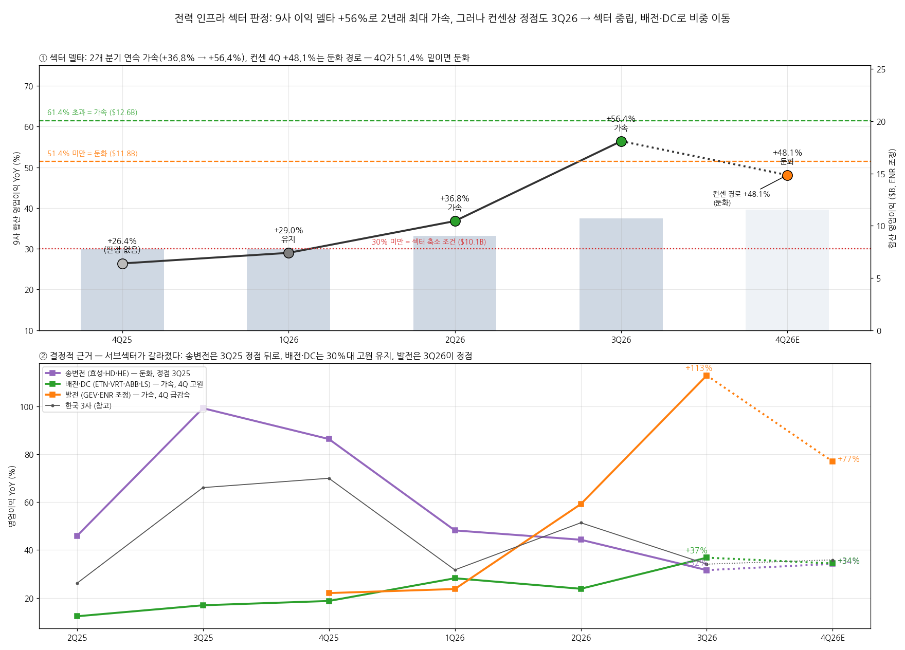

# 전력 인프라 · 글로벌 섹터 통합 리뷰

> 현재 상태 (최신 분기 기준)
> 최신 분기: 2026-Q3
> 섹터 델타: 가속 | 내러티브: 유지
> 모멘텀 신호: 없음
> 활성 테마: 없음
> 포지셔닝: 섹터 중립 | 한국 언더퍼폼 | 선호 Vertiv, LS일렉트릭
> 델타 근거: 3Q 9사 영업이익 YoY(고정환율) +36.8→+56.4%(+19.7%p) 가속 → 4Q 컨센 +48.1%로 둔화, 정점 3Q26
> 내러티브 근거: 9사 중 7사 추정 상향에도 전 종목 멀티플 하향과 텍사스 모라토리엄 정책 리스크가 상쇄해 유지
> PM 근거: 섹터 중립, 가속 분기가 컨센 정점과 겹치고 정책 이벤트 대기, 한국은 정점 지난 송변전 비중이 커 언더퍼폼
> 편입 종목: 11사 — 합산 9사(GE Vernova, Siemens Energy, Hitachi Energy, Eaton, Vertiv, ABB, 효성중공업, HD현대일렉트릭, LS일렉트릭) + 비교만 2사(Schneider Electric — 분기 이익 미공시, 두산에너빌리티 발전 파트 — 가스터빈 이익 미공시)
> 갱신 시각: 2026-11-15 16:30 KST

## 누적 시계열

| 분기 | 편입 종목 | 합산 매출 | 합산 영업이익 | OPM | 매출 YoY | 영업이익 YoY | 영업이익 YoY 델타 (%p) | 섹터 델타 | 내러티브 | 모멘텀 신호 | 활성 테마 |
|---|---|---|---|---|---|---|---|---|---|---|---|
| 2Q24 | 합산 9사 (ETN·VRT·ABB·LS·효성·HD·HE·GEV·ENR) | 544,637억원 ($39.7B) | 62,718억원 ($4.58B) | 11.5 | — | — | — | — | - | - | - |
| 3Q24 | 동일 | 563,206억원 ($41.5B) | 55,787억원 ($4.11B) | 9.9 | — | — | — | — | - | - | - |
| 4Q24 | 동일 | 606,229억원 ($43.4B) | 79,115억원 ($5.66B) | 13.0 | — | — | — | — | - | - | - |
| 1Q25 | 동일 | 594,171억원 ($40.9B) | 80,034억원 ($5.50B) | 13.4 | — | — | — | — | - | - | - |
| 2Q25 | 동일 | 633,405억원 ($45.1B) | 84,323억원 ($6.01B) | 13.3 | +12.3 | — | — | — | - | - | - |
| 3Q25 | 동일 | 663,533억원 ($47.8B) | 88,469억원 ($6.38B) | 13.3 | +13.6 | — | — | — | - | - | - |
| 4Q25 | 동일 | 715,173억원 ($49.5B) | 111,673억원 ($7.74B) | 15.6 | +12.2 | +26.4 | — | — | - | - | - |
| 1Q26 | 동일 | 705,829억원 ($48.1B) | 112,077억원 ($7.65B) | 15.9 | +14.5 | +29.0 | +2.6 | 유지 | - | - | - |
| 2Q26 | 동일 | 811,533억원 ($54.0B) | 136,088억원 ($9.07B) | 16.8 | +19.5 | +36.8 | +7.7 | 가속 | - | - | - |
| **3Q26** | 동일 | **840,693억원 ($59.2B)** | **149,112억원 ($10.50B)** | **17.7** | **+24.7** | **+56.4** | **+19.7** | **가속** | **유지** | **없음** | **없음** |

→ **표본 (11/15 기준)**: 합산 9사 = 송변전 3사(효성·HD·HE) + 배전·DC 4사(ETN·VRT·ABB·LS) + 발전 2사(GEV·ENR). 세 서브섹터 리뷰(`송변전_섹터리뷰.md`, `배전·DC 전력관리_섹터리뷰.md`, `발전_섹터리뷰.md`)의 합산을 그대로 더했다. 종목 중복 합산은 없다
→ **합산에서 뺀 2사**
→ Schneider Electric: 1Q·3Q는 매출만 내고 이익은 반기에만 공시한다. 스킬 규칙대로 모든 분기에서 뺐고(전년 동기 포함), 매출·수주로만 비교한다
→ 두산에너빌리티(발전 파트): 가스터빈 매출·이익을 따로 공시하지 않는다. 수주·슬롯으로만 비교한다 (주 섹터 리뷰는 원전 — `2026-Q3_두산에너빌리티_리뷰.md` 가스터빈 블록)
→ **이익 지표**: 한국 3사 연결 영업이익 / GEV Adj. EBITDA / ENR Profit before Special items / HE 달러 Adj. EBITA / ETN 세그먼트 영업이익 / VRT 조정 영업이익 / ABB Operational EBITA(4Q26E는 매각익 제외)
→ **영업이익 YoY(판정 기준)** = 고정환율 + ENR은 Gamesa 제외 사업부 이익. 레벨(합산 영업이익 열)은 ENR 보고치(Gamesa 포함)다. ENR 조정 이익이 4Q24부터 있어 9사 YoY는 4Q25부터 나온다. 서브섹터 YoY에서 직전 연도 금액을 역산해 더한 값이다 [계산]
→ **적용 환율** (분기 평균): 원/달러 2Q24 1,371 · 3Q24 1,358 · 4Q24 1,397 · 1Q25 1,453 · 2Q25 1,404 · 3Q25 1,387 · 4Q25 1,444 · 1Q26 1,466 · 2Q26 1,502 · 3Q26 1,420 · 4Q26E 1,340. 달러/유로 2Q24 1.077 · 3Q24 1.098 · 4Q24 1.068 · 1Q25 1.052 · 2Q25 1.134 · 3Q25 1.168 · 4Q25 1.163 · 1Q26 1.170 · 2Q26 1.163 · 3Q26 1.14 [근사] · 4Q26E 1.12. 엔/달러 2Q24~1Q25 155.9·149.0·152.4·152.6 [근사], 이후 HE 회사 달러 공시 사용 (BNK·하나·골드만 리포트 가정치, FRED/OECD)
→ **11/14판과 달라진 점**: Vertiv를 넣고 Schneider 추정치(반기 마진 × 분기 매출)를 뺐다. 그 결과 3Q26 합산 영업이익 YoY가 +46.3% → **+56.4%**, 2Q26이 +32.0% → +36.8%, 4Q26E가 +38.6% → +48.1%로 올라갔다. 방향(2개 분기 연속 가속, 3Q26 정점, 4Q 둔화 경로)은 그대로다. 11/14판 9사 표본(SU 추정 포함, VRT 없음) 시계열은 아래 참고 표로 보존한다

참고 — 11/14판 표본 (Schneider 추정 포함, Vertiv 없음, 수정하지 않음)

| 분기 | 편입 종목 | 합산 매출 | 합산 영업이익 | OPM | 매출 YoY | 영업이익 YoY | 영업이익 YoY 델타 (%p) | 섹터 델타 | 내러티브 | 모멘텀 신호 | 활성 테마 |
|---|---|---|---|---|---|---|---|---|---|---|---|
| 2Q24 | 글로벌 9사 | 659,184억원 ($48.1B) | 83,766억원 ($6.11B) | 12.7 | — | — | — | — | - | - | - |
| 3Q24 | 동일 | 673,876억원 ($49.6B) | 75,809억원 ($5.58B) | 11.2 | — | — | — | — | - | - | - |
| 4Q24 | 동일 | 732,622억원 ($52.4B) | 101,523억원 ($7.27B) | 13.9 | — | — | — | — | - | - | - |
| 1Q25 | 동일 | 707,126억원 ($48.7B) | 101,079억원 ($6.96B) | 14.3 | — | — | — | — | - | - | - |
| 2Q25 | 동일 | 755,757억원 ($53.8B) | 106,466억원 ($7.58B) | 14.1 | +9.7 | +14.1† | — | — | - | - | - |
| 3Q25 | 동일 | 783,899억원 ($56.5B) | 110,596억원 ($7.97B) | 14.1 | +11.0 | +28.2† | +14.1 | 가속 | - | - | - |
| 4Q25 | 동일 | 859,912억원 ($59.6B) | 137,988억원 ($9.56B) | 16.0 | +9.8 | +20.9 | -7.4 | 둔화 | - | - | - |
| 1Q26 | 동일 | 834,506억원 ($56.9B) | 136,332억원 ($9.30B) | 16.3 | +11.8 | +22.9 | +2.0 | 유지 | - | - | - |
| 2Q26 | 동일 | 962,526억원 ($64.1B) | 163,636억원 ($10.89B) | 17.0 | +18.2 | +32.0 | +9.1 | 가속 | - | - | - |
| **3Q26** | 동일 | **964,963억원 ($68.0B)** | **171,336억원 ($12.07B)** | **17.8** | **+21.6** | **+46.3** | **+14.4** | **가속** | **유지** | **없음** | **없음** |

---

## 2026-Q3 섹터 리뷰

> 대상: 2026-Q3 서브섹터 리뷰 3건 — `송변전_섹터리뷰.md`(둔화 | 약화), `배전·DC 전력관리_섹터리뷰.md`(가속 | 유지), `발전_섹터리뷰.md`(가속 | 유지). 종목 리뷰 11건 — `earnings-review/2026-Q3_{효성중공업|HD현대일렉트릭|HE|ETN|VRT|ABB|SU|LS일렉트릭|GEV|ENR|두산에너빌리티}_리뷰.md`
> 2층 구조 (2026-11-15): 서브섹터 리뷰가 종목 순위(3단계)를 맡고, 이 통합 리뷰는 섹터 비중(1단계)·서브섹터 순위(2단계)·서브섹터 × 국가 프레임을 맡는다
> 11/14판 ⑦ 콜 체크: 섹터 중립 · 배전·DC 확대 > 발전 유지 > 송변전 축소 · 한국 언더퍼폼(LS 예외) — **세 콜 모두 유지**. 새 표본에서도 섹터 가속 + 정점 3Q26 구조가 같고, 서브섹터 리뷰 세 건이 같은 순위를 냈다. 전환 조건(12월 FERC, 4Q 실적)은 아직 오지 않았다

① 섹터 합산 숫자와 델타

| 항목 | 4Q25 | 1Q26 | 2Q26 | **3Q26** | 4Q26E |
|---|---|---|---|---|---|
| 합산 매출 ($B) | 49.5 | 48.1 | 54.0 | **59.2** | 60.3 |
| 합산 매출 (조원) | 71.5 | 70.6 | 81.2 | **84.1** | 80.8 |
| 합산 영업이익 — 보고 ($B) | 7.74 | 7.65 | 9.07 | **10.50** | 11.45 |
| 합산 영업이익 — 보고 (조원) | 11.17 | 11.21 | 13.61 | **14.91** | 15.34 |
| 합산 영업이익 — 조정, ENR Gamesa 제외 ($B) | 7.79 | 7.75 | 9.03 | **10.69** | 11.52 |
| OPM — 보고 (%) | 15.6 | 15.9 | 16.8 | **17.7** | 19.0 |
| 매출 YoY (고정환율) | +12.2 | +14.5 | +19.5 | **+24.7** | +22.2 |
| **영업이익 YoY (고정환율, ENR 조정)** | +26.4 | +29.0 | +36.8 | **+56.4** | +48.1 |
| **영업이익 YoY 델타 (%p)** | — | +2.6 | +7.7 | **+19.7** | -8.3 |
| 판정 | — | 유지 | 가속 | **가속** | 둔화 (컨센) |

서브섹터별 합산 행 (서브섹터 리뷰 ① 표 인용)

| 서브섹터 (합산 종목) | 3Q26 매출 ($B) | 3Q26 영업이익 ($B) | OPM | 영업이익 YoY 2Q26 → 3Q26 | 델타 (%p) | 4Q26E YoY | 판정 |
|---|---|---|---|---|---|---|---|
| 송변전 (효성·HD·HE) | 7.66 | 1.26 | 16.5 | +44.3 → **+31.6** | -12.7 | +34.2 | 둔화 |
| 배전·DC (ETN·VRT·ABB·LS) | 24.28 | 5.54 | 22.8 | +23.8 → **+36.8** | +13.0 | +34.4 | 가속 |
| 발전 (GEV·ENR 조정) | 27.26 | 3.70 (조정 3.89) | 13.6 | +59.2 → **+113.0** | +53.8 | +77.0 | 가속 |
| **9사 합산** | **59.20** | **10.50 (조정 10.69)** | **17.7** | +36.8 → **+56.4** | **+19.7** | +48.1 | **가속** |

→ (출처: 서브섹터 리뷰 3건 ① 표 [계산]. 4Q26E 출처: 한국 3사 FnGuide 컨센 / GEV Bloomberg 컨센 / HE 하반기 가이던스 균등 분할 / ETN·VRT 4Q 가이던스 / ABB 매각익 제외 역산 / ENR FY27 가이던스 비례 [추정])
→ **3Q26 합산**: Schneider·두산 제외 9사. 2Q26·4Q26E·전년 동기도 같은 9사다
→ **이익 레벨**: 3Q26 합산 영업이익 $10.5B(14.9조원), OPM 17.7%로 분기 사상 최대다. 4Q26E $11.5B·19.0%로 다시 최대 경로다
→ **델타**: 영업이익 YoY +29.0% → +36.8% → +56.4%로 2개 분기 연속 가속했고, 매출 YoY(+14.5% → +19.5% → +24.7%)도 같이 올라 "강한 가속"이다
→ **증가분 기여 (3Q26 +$3.86B)**: 발전 +$2.06B(53%), 배전·DC +$1.49B(39%), 송변전 +$0.30B(8%) [계산]. 국가로는 글로벌 6사 +$3.72B(96%), 한국 3사 +$0.14B(4%)
→ **컨센 경로상 섹터 YoY 정점은 3Q26**이다. 4Q26E +48.1%(-8.3%p)로 둔화한다. 서브섹터별로는 발전이 4Q에 -36%p로 급감속하고, 배전·DC는 -2.5%p로 고원을 지키며, 송변전은 +2.6%p로 바닥권 유지다. 9사 중 VRT·ETN·LS·GEV·ENR·HE 6사의 YoY 정점이 3Q26이다

→ (출처: 서브섹터 리뷰 3건 [계산]. 왼쪽 = 9사 합산 영업이익·매출 YoY(고정환율, ENR 조정)와 서브섹터별 영업이익 YoY / 오른쪽 = 한국 3사(원화) vs 글로벌 6사(고정환율, ENR 조정) 영업이익 YoY. 점선 = 4Q26E)

② 서브섹터 델타 순위

| 순위 | 서브섹터 | 영업이익 YoY 2Q26 → 3Q26 | 델타 (%p) | 판정 (서브섹터 리뷰) | 4Q26E 경로 | 서브섹터 1등 종목 (서브섹터 리뷰 ⑦(3)) |
|---|---|---|---|---|---|---|
| 1 | 발전 | +59.2 → +113.0 | **+53.8** | 가속 · 유지 | +77.0 (둔화, -36%p) | 글로벌 GE Vernova (가스 부문 기준 Siemens Energy) · 한국 두산에너빌리티 발전 파트 (이익 미공시) |
| 2 | 배전·DC 전력관리 | +23.8 → +36.8 | **+13.0** | 가속 · 유지 | +34.4 (유지, -2.5%p) | 글로벌 Vertiv · 한국 LS일렉트릭 (서브섹터 델타 1위) |
| 3 | 송변전 | +44.3 → +31.6 | **-12.7** | 둔화 · 약화 | +34.2 (유지, +2.6%p) | 글로벌 Hitachi Energy · 한국 HD현대일렉트릭 |

→ (출처: 서브섹터 리뷰 3건 ④·⑦ 판정 그대로)
→ **델타 크기 순위와 비중 순위는 다르다**. 이번 분기 델타는 발전이 가장 크지만, 다음 분기 경로(4Q -36%p)와 신규 계약 감속(GEV 21 → 11GW, ENR 확정 2GW)을 넣으면 비중 1순위는 배전·DC다. 배전·DC는 정점 이후에도 30%대 고원을 지키는 유일한 서브섹터다 [판단] — ⑦(3)
→ **선행 서브섹터는 송변전**이다. 정점이 3Q25(+99%)로 가장 빨랐고 한국 2사(효성 정점 2Q25, HD 4Q25)가 먼저 꺾였다. 납기가 긴 순서(초고압 변압기 → 가스터빈 가격 반영 → 단납기 배전)대로 정점을 지나는 패턴이 9사로 넓혀도 그대로다

③ 섹터 공통 쟁점

(1) 북미 데이터센터 수주 — 둔화하고 있나 (11사 공통)

| 종목 | 3Q26 데이터센터·북미 신호 | 해석 |
|---|---|---|
| Eaton | 데이터센터 수주 +101%, 파이프라인 307 → 366GW, Electrical Americas 분기 수주 사상 최대. 롤링 수주 증가율만 +41% → +39% | 수요 가속, 증가율만 정점권 |
| Vertiv | 3Q 유기적 수주 +100%+, 미주 파이프라인 분기 증가 속도 사상 최고, 선수금 1년 새 3.6배($4.12B). 2026년부터 수주 공시 중단 | 가속 (배전·DC 피어 중 수주 증가율 최고) |
| ABB | Electrification 북미 수주 +117%, 2개 분기 연속 세 자릿수 | 가속 |
| Schneider | 데이터센터 수주 4개 분기 중 3개 분기 세 자릿수, 북미 organic +23% → +20% | 고원 |
| LS일렉트릭 | 미국 수주 비중 66%, 누적 수주의 50% 이상이 데이터센터 | 가속 (단납기라 바로 매출) |
| Hitachi Energy | 데이터센터는 매출의 10%대 초반, "지연·결제 문제 없음", FY27 데이터센터 수주 5배 목표 | 유지 |
| Siemens Energy | 데이터센터 잔고 €15B(전체의 10% 미만), 미국 수주 +70% | 비중은 작고 북미는 가속 |
| 두산에너빌리티 (발전 파트) | 가스터빈 2031년 슬롯까지 예약, 3Q 확정 수주 GT 1기. 미국 첫 출하(xAI) | 확정 둔화 + 예약 증가 — GEV·ENR과 같은 패턴 |
| 효성중공업 | 중공업 미국 수주 +308%, 하이퍼스케일러 직접 발주, STATCOM 진입 | 수주 강함, 매출은 이연 |
| HD현대일렉트릭 | 수주 -19%(생산 슬롯 소진), 빅테크 B·C·D사 장기공급계약 11월 말 | 공급 제약 |
| GE Vernova | 데이터센터 수주 1Q $2.4B → 3Q 약 $1.4B, 가스 신규 계약 11GW(1Q 21GW) | 둔화. 단 SRA·슬롯 선점 구조 |

→ (출처: 각 종목 2026-Q3 리뷰 2번 쟁점)
→ **공통 결론: 수요 둔화의 증거는 없다**. 수주가 줄어든 곳은 GEV 데이터센터와 HD 두 곳인데, 둘 다 공급(슬롯)과 타이밍 문제로 설명된다. 배전·DC 4사와 북미 수주를 따로 공시한 ENR·효성은 모두 가속했다
→ 갈리는 지점은 **증가율의 정점**이다. ETN 롤링 수주(+41% → +39%)와 SU 북미 organic(+23% → +20%)이 꺾이기 시작했다. 레벨은 사상 최대지만 증가율은 고원에 들어섰다
→ **[판단]** "북미 데이터센터 수주 둔화"는 수요가 아니라 납기 순서의 문제다. 리드타임이 긴 품목(대형 변압기·가스터빈)은 2029~2030년 슬롯까지 선점돼 있어 신규 확정 수주가 덜 잡힌다. 리드타임이 짧은 품목(배전반·UPS·차단기)은 수주가 바로 늘어난다. 그래서 3Q26 수주 숫자는 배전·DC > 발전·송변전 순서로 강하게 나왔다

(2) 이익 추정은 올라가고 멀티플은 내려간다 (11사 공통)

| 종목 | 평균 TP 변화 | 이익 추정 방향 | 주가 (고점 대비) | 밸류에이션 |
|---|---|---|---|---|
| GE Vernova | $1,120 → $1,061 (-5.2%) | 상향 | -28% (11/2) | 12M Fwd P/E 55배 → 38배 (키움) |
| Siemens Energy | €207.5 → €198 (-4.4%) | 상향 (JPM FY29까지 최대 +21%) | 약 -31% | FY27 가이던스 기준 약 25배 (aktiencheck) |
| Hitachi (6501) | 컨센 TP ¥6,600 변화 없음 | 가이던스 2회 상향 | 발표 후 1주 -12% | PER 30배 (그룹 전체) |
| Schneider | €329~333, 변경 소수 | 상향 | 약 -21% (증자가 기준) | 2026E PER 약 23배 |
| ABB | CHF 80.8 → 78.7 (-2.7%) | 유지 | -20% | 2026E PER 22.3배 (2025년 33.2배) |
| Eaton | $490.7 → 약 $477 | 상향 (2026·27 EPS) | -15% | Fwd P/E 약 27~29배 |
| Vertiv | 컨센 TP 7월 $381 → 11/9 $338 | 상향 (2027 EPS $9.17 → $9.45) | 선거 후 1주 -23% (일부 회복) | Fwd P/E 5월 55배 → 11/9 약 22배 (TIKR) |
| 효성중공업 | 371만원 → 315만원 (-15.2%) | 하향 (-4~5%) | -61% | 2027F PER 15~16배 |
| HD현대일렉트릭 | 104만원 → 81만원 (-21.7%) | 하향 (-3%) | -68% | 12M Fwd PER 15배 |
| LS일렉트릭 | 28.2만원 → 27.0만원 (-4.2%) | 상향 (+9~10%) | -48% | 적용 멀티플 약 -12% |

→ (출처: 각 종목 리뷰 2-4 표. GEV·ETN·ENR 멀티플은 웹 보도 보완 — TIKR·Insider Monkey·Simply Wall St, 11월 초)
→ **공통 결론: TP 하향은 9사 모두 멀티플 때문이다**. 이익 추정이 내려간 곳은 효성·HD 두 곳뿐이고 폭도 -3~5%다. 나머지 7곳은 이익 추정이 올라갔는데도 TP가 유지되거나 내려갔다
→ **[판단]** 섹터가 "이익 상향 + 멀티플 하향" 국면에 있다. 시장은 12월 FERC·ERCOT 결론과 AI capex 센티먼트를 먼저 가격에 넣고 있다. 9사 주가가 고점 대비 -15~-68% 빠지는 동안 이익 추정은 내려가지 않았다. 멀티플 디레이팅이 이익 경로를 앞서 간 상태다

(3) 공급 병목 — 슬롯과 증설이 매출 속도를 정한다 (송변전·발전 공통)

→ 송변전: HD 수주 -19%(슬롯 소진, 잔고는 2026E 송배전 매출의 2.9배), 효성 잔고 18.9조원(멤피스 증설 2026년 말 4억달러 → 2028년 7억달러), HE 잔고 $66.9B(매출 약 3년치, "납기 단축 어려움")
→ 발전: GEV 가스 확정 수주 3GW + SRA 8GW, ENR 확정 2GW + SRA 39GW. 두 회사 모두 같은 분기에 "확정 수주는 줄고 예약은 쌓이는" 패턴이었다. 가격은 엇갈렸다: ENR은 "FY27 수주 가격 > FY26", GEV는 "4Q kW당 가격 하락"이라고 했다
→ 배전·DC는 반대다. 단납기라 수주가 바로 매출이 된다. ETN 25개 증설 중 18개 완료, LS 배전반 +30% 증설
→ **[판단]** 2027년 섹터 델타는 수요보다 증설 속도가 정한다. 증설이 앞서 있는 글로벌 피어(ETN·ABB·HE·ENR)와 2027년 이후 가동되는 한국(효성 멤피스 2028, HD 알라바마 2Q27·울산 11월)의 차이가 매출 성장률 격차로 나타난다

(4) 12월 FERC·ERCOT와 텍사스 모라토리엄 — 데이터센터 전력을 누가, 어디에 짓게 하나 (11사 공통 이벤트)

| 노출도 | 종목 | 근거 |
|---|---|---|
| 높음 | Vertiv, Eaton, Schneider, ABB, LS일렉트릭 | 데이터센터 직접 매출. Vertiv는 데이터센터 비중이 가장 높다. 온사이트 전원·모듈형은 계통 우회 수요로 일부 헤지 |
| 중간 | HD현대일렉트릭, GE Vernova, 두산에너빌리티(발전) | 빅테크 패키지·데이터센터 수주. GEV·두산은 규제 강화 시 자가발전(가스터빈) 수혜, 텍사스 모라토리엄에는 부정 |
| 낮음 | 효성중공업, Hitachi Energy, Siemens Energy | 765kV·HVDC 등 규제 투자 중심. 데이터센터 비중 10% 안팎 |

→ **새 변수 — 텍사스 데이터센터 모라토리엄**: 11/3 중간선거 후 텍사스 주지사 당선인이 신규 데이터센터 모라토리엄을 공약했다(1/19 취임). 텍사스는 미국 계획 데이터센터 전력의 약 27~30%다. 텍사스는 9월부터 전력망 감사를 이유로 주 인허가를 멈춘 상태다. Vertiv 주가는 선거 후 1주일 새 약 23% 빠졌다가 일부 회복했다 (`2026-Q3_VRT_리뷰.md` 2번 (4), Trefis·TIKR 11/4~10)
→ 대상은 "신규 승인"이라 기존 잔고·3Q 수주에는 영향이 없다. 영향이 나온다면 2027년 하반기 이후 수주다 [판단]
→ 일정: FERC RTO 보고 11/16~20 → ERCOT 감사 12/10 → FERC 반론 시한 12/16 → 텍사스 주지사 취임 1/19
→ **[판단]** 두 이벤트는 방향이 다르다. FERC 결론이 데이터센터 비용 부담 강화 쪽이면 섹터 안에서 발전(자가발전)·송변전(규제 투자)이 상대적으로 낫고 배전·DC 센티먼트가 가장 나쁘다. 반면 텍사스 모라토리엄은 전원 방식과 무관하게 데이터센터 개발 자체를 막는다 — 배전·DC와 텍사스 온사이트 발전(두산 xAI, GEV 항공파생형)이 같이 맞는다. 완화 쪽이면 멀티플 할인이 가장 큰 종목(HD·효성·GEV·VRT)의 반등 폭이 크다

(5) 마진 — 글로벌은 사상 최고, 한국은 둘이 후퇴

| 종목 | 3Q26 마진 | 전년 대비 | 방향 |
|---|---|---|---|
| Eaton | 25.3% (세그먼트) | +0.3%p, 사상 최고 | ↑ |
| Vertiv | 25.2% (조정 영업이익) | +2.9%p | ↑ |
| HD현대일렉트릭 | 24.1% | -0.7%p (2Q 25.1%) | ↓ |
| ABB | 20.8% (Op EBITA) | +1.6%p | ↑ |
| Schneider | 1H26 19.3% → 2H26E 20.3% | +1.0%p | ↑ |
| Hitachi Energy | 15.9% ($ Adj. EBITA) | +2.7%p | ↑ |
| GE Vernova | 15.4% (Adj. EBITDA) | +7.3%p | ↑ |
| 효성중공업 | 14.0% | +0.5%p (2Q 15.7%) | ↓ |
| LS일렉트릭 | 12.4% | +4.1%p | ↑ |
| Siemens Energy | 12.0% (PbSI) / GT 20.1% | +7.5%p | ↑ |

→ **[판단]** 마진 레벨로는 HD(24%)가 ETN 다음이다. 한국의 문제는 마진 레벨이 아니라 방향이다. 9사 중 3Q26 마진이 전분기보다 내려간 곳은 효성·HD 두 곳이다. 원화 강세(3Q26 1,420원, 2Q26 1,502원), BESS·국내 믹스, 건설 충당금이 원인이었다. 글로벌 피어는 가격·생산성 레버로 마진을 계속 올리고 있다

(6) 한국이 먼저 꺾이는 것은 산업 구조인가 — 변압기 선행 둔화 (요약, 상세는 `송변전_섹터리뷰.md` ③)

→ 구조적 경향은 맞다: 변압기는 부족 사태가 가장 먼저 왔고(2022~23년), 증설이 가스터빈·HVDC보다 쉽고, 수주에서 매출까지가 짧아 고가 수주가 먼저 소진된다. 2008~2012년 사이클도 같은 순서였다 [판단]
→ 다만 같은 송변전의 Hitachi Energy는 +41% 고원을 지킨다. 차이는 사업 구성 — HVDC·시스템 프로젝트(늦게 꺾임) vs 단품 변압기·차단기 수출(먼저 꺾임)이다. 3Q26 한국 2사 둔화 폭에는 효성 이연·충당금, HD 저마진 BESS, 원화 강세 같은 일회성도 섞였다
→ 구조적 둔화 확인 지표: 미국 변압기 PPI 하락 전환, 대형 변압기 납기 단축, 한국 신규 수주 단가 < 기존 잔고 단가 (⑥ 6순위)

(7) 종목 고유 이슈
→ GE Vernova: 4Q 가스 계약 13GW+ 달성 여부, Prolec 인수 통합
→ Siemens Energy: Gamesa 3분기 연속 흑자(기업개요 분류 조건 ①), TI 분리
→ Hitachi Energy: 엔화 환산 왜곡. 모회사 6501 DSS 일회성 손실
→ Schneider: PTC 인수·증자 오버행
→ ABB: 2027 가이던스 "low teens" 유지 여부(1월)
→ Eaton: Boyd 3월 organic 편입, Mobility-Dana RMT
→ Vertiv: 수주 공시 중단(선수금으로 대체 확인), 텍사스 노출, 2027 가이던스 2/10
→ 두산에너빌리티(발전 파트): 2030년 슬롯 예약의 확정 전환, 2차 증설 발표 — 주가는 원전 수주(SMR·AP1000)가 정한다
→ 효성중공업: 이연분 2,650억원의 4Q 인식, 건설 추가 충당
→ HD현대일렉트릭: 빅테크 B·C·D 장기공급계약(11월 말)
→ LS일렉트릭: 중국 법인 정리, SST 첫 수주

④ 섹터 판정

> 섹터 델타: **가속** | 내러티브: **유지** → **9사 이익 델타는 3Q26에 2년래 최대 가속(+56%, 고정환율) — 그러나 컨센 경로상 섹터 YoY 정점도 3Q26이고 4Q는 +48%로 감속. 서브섹터가 갈라졌다: 배전·DC는 30%대 고원 유지, 발전은 4Q 급감속, 송변전(한국 2사 중심)은 이미 정점 뒤. 섹터 베타는 유지하고 배전·DC로 비중을 옮기는 구간. 4Q26 합산 영업이익 YoY 51.4% 미만이면 둔화, 1Q27까지 이어지면 꺾임**

→ (출처: 서브섹터 리뷰 3건 [계산]. 상단 = 9사 합산 영업이익 YoY(고정환율, ENR 조정. 점 색 = 분기별 판정, 막대 = 조정 합산 영업이익 $B)와 4Q26 판정선(51.4% 둔화 / 61.4% 가속 / 30% 섹터 축소 조건) / 하단 = 서브섹터별 영업이익 YoY와 한국 3사(참고) — 서브섹터 간 정점 시차)

→ **델타 판정 근거**: 합산 영업이익 YoY가 2Q26 +36.8%에서 3Q26 +56.4%로 19.7%p 커져 "가속"이다. 1Q26(+29.0%, 유지) → 2Q26(가속) → 3Q26(가속)으로 2개 분기 연속 확대했고 매출 YoY도 같이 올랐다. 컨센 4Q26E +48.1%(-8.3%p)는 "둔화" 경로다
→ **내러티브 판정 근거**: 서브섹터 내러티브는 유지 2(배전·DC·발전), 약화 1(송변전)이다. 종목 단위로는 강화 5(ETN·VRT·ENR·HE·LS), 유지 3(GEV·ABB·SU), 약화 2(효성·HD)다. 이익 추정은 9사 중 7사가 올라갔지만 11사 모두 TP 기준 멀티플이 내려갔다(③(2)). 텍사스 모라토리엄이라는 새 정책 리스크도 생겼다. 상향과 하향이 상쇄돼 "유지"다
→ **[판단] 결정적 근거는 서브섹터가 갈라졌다는 점이다**. 섹터 가속의 53%는 발전, 39%는 배전·DC가 만들었다. 발전은 4Q에 +113% → +77%로 급감속하는 경로이고, 송변전은 3Q25 정점 뒤로 내려오는 중이다. 정점 이후에도 30%대를 지키는 것은 배전·DC뿐이다. 그래서 섹터 판정은 "가속"이지만 매매 결론은 "섹터 베타 확대"가 아니라 "섹터 안에서 배전·DC로 이동"이다
→ 직전 판정 대비: 11/14판(9사, SU 추정·VRT 없음) "가속 | 유지" → 11/15판(9사, VRT 포함·SU 제외) "가속 | 유지". 표본이 바뀌어 수치는 +46.3% → +56.4%로 올라갔지만 판정·국면은 같다. 소급 궤적은 유지(1Q26) → 가속(2Q26) → 가속(3Q26) → 둔화(4Q26E 컨센)다

⑤ 모멘텀 신호

→ **없음** — 활성 테마가 없어 "테마 종료 후보"는 해당하지 않는다
→ 델타 급증 후보 조건 대조
→ ① 섹터 영업이익 YoY 델타 확대 — **충족**. +19.7%p, 2개 분기 연속 확대
→ ② 편입 종목 과반 가속 — **충족**. 합산 9사 중 6사 가속(GEV·ENR·ETN·VRT·ABB·LS)
→ ③ 내러티브 형성·강화 — **미충족**. 유지
→ 3개 중 2개 충족이지만 후보로 올리지 않는다. 내러티브가 못 따라오고 컨센 경로상 섹터 YoY 정점이 이번 분기라 "새 델타 급증"이 아니라 "가속의 마지막 분기"로 본다 [판단]
→ 다음 분기 후보로 올릴 조건: 4Q26 합산 영업이익 YoY 61.4% 초과(가속 유지) + 12월 FERC 결론이 데이터센터 접속 허용 쪽 + 텍사스 모라토리엄 미실행 + TP 상향 전환
→ **반대 논거**
→ (1) 서브섹터 단위로는 배전·DC가 가장 후보에 가깝다. 정점 이후에도 30%대 고원, Vertiv·Eaton 내러티브 강화, 수주 +100%대. 레이어상 하이퍼스케일러 capex의 공급 측이라 capex가 꺾이지 않는 한 2027년에도 고원이 이어질 수 있다
→ (2) 발전은 델타 크기로는 조건을 넘지만 4Q에 바로 -36%p 감속하고 신규 계약 델타가 먼저 꺾였다
→ 테마 키워드 제안 (제안일 뿐): "AI 데이터센터 배전·온사이트 전원 — 단납기 배전반·UPS·액체냉각·800V DC·가스터빈 자가발전" (VRT·ETN·ABB·LS·GEV)

⑥ 다음 분기 섹터 관전 포인트

| 순위 | 무엇을 (변수·임계값) | 어떤 데이터로 | 언제 |
|---|---|---|---|
| 1 | **4Q26 9사 합산 영업이익 YoY(고정환율, ENR 조정) 51.4% 이상 — 미만이면 둔화**. 금액으로 약 $11.8B 이상(4Q26 환율 기준). 61.4%($12.6B) 초과면 가속. 컨센·가이던스 합 $11.5B(+48.1%)는 둔화 경로. 30% 미만($10.1B)이면 1Q27에 꺾임 확정 위험이자 섹터 축소 조건 | 9사 4Q26 실적 | 2027-01 말(한국 3사·GEV·ABB·HE) ~ 2/10(VRT)·2/11(ENR) |
| 2 | 서브섹터 판정선 — 송변전 26.6% 미만이면 꺾임 / 배전·DC 31.8% 미만이면 둔화 / 발전 108% 미만이면 둔화(컨센 +77%가 기본 경로) | 서브섹터 리뷰 ⑥ 1순위 | 2027-01 말 ~ 2월 |
| 3 | 12월 FERC·ERCOT 결론 + 1/19 텍사스 주지사 취임 후 모라토리엄 실행 여부 — 노출도 배전·DC > HD·GEV·두산 > 효성·HE·ENR | FERC RTO 보고(11/16~20), ERCOT 감사(12/10), FERC 반론 시한(12/16), 텍사스 첫 행정명령 | 11월 중순 ~ 1월 말 |
| 4 | 북미 데이터센터 수주 증가율 — ETN 롤링 수주 35% 이상, ABB·SU 북미 세 자릿수 유지, VRT 선수금 $4.1B 이상(수주 공시 중단), GEV 4Q 가스 계약 13GW+, ENR SRA 확정 전환 10GW+ | 4Q 보도자료·컨콜 | 2027-01 말 ~ 2월 |
| 5 | 한국 3사 4Q 정상화 — 효성 이연분 인식(영업이익 3,800억원+), HD 빅테크 B·C·D 계약(11월 말)·북미 비중 45%+, LS 이익 YoY +89% 경로 | 3사 4Q 잠정실적, HD 공시 | 11월 말 ~ 2027-01 말 |
| 6 | 변압기 선행 둔화가 구조적인지 — 미국 변압기 PPI 하락 전환, 대형 변압기 납기 단축, 한국 3사 신규 수주 단가 < 기존 잔고 단가. 하나라도 확인되면 송변전 축소·한국 언더퍼폼 강화 | BLS PPI, 납기 조사, 한국 3사 컨콜, 관세청 HS 8504 수출 단가 | 매월, 1월 말 컨콜 |

→ 1순위 판정선(51.4%)은 ④ 키 차트와 같다. 근거: 3Q26 +56.4%에서 "유지" 범위(±5%p)를 뺀 값이다. 이 아래면 둔화이고, 1Q27까지 둔화가 이어지면 "2개 분기 연속 둔화 + 정점(3Q26) 통과"로 꺾임이다

⑦ 글로벌 PM 포지셔닝 — 결론

> **섹터: 비중 유지(중립) — 확대는 12월 FERC 완화 + 4Q 합산 YoY 51.4% 이상 확인 후** | **서브섹터: 배전·DC 확대 > 발전 유지 > 송변전 축소** | **한국: 언더퍼폼 (LS일렉트릭 예외) = 믹스 효과 크다 + 서브섹터 내 효과 작다(송변전 -, 배전·DC + 상쇄)**

(1) 섹터 비중 — 확대 / 중립 / 축소

| 판단 축 | 3Q26 근거 | 방향 |
|---|---|---|
| 이익 델타 (1순위) | 9사 합산 영업이익 YoY +36.8% → +56.4%, 2개 분기 연속 가속 | 확대 |
| YoY 정점 시점 | 컨센 경로상 섹터 정점 3Q26, 4Q26E +48.1%. 합산 9사 중 6사가 3Q26 정점 | 축소 |
| 수주·잔고 선행지표 | 잔고 사상 최대(HE $66.9B, ENR €164B, 효성 18.9조원), 데이터센터 수주 VRT +100%·ETN +101%·ABB 북미 +117%. 단 증가율은 정점권(ETN 롤링 +41% → +39%), 가스 신규 계약 감속(GEV 21 → 11GW) | 확대~중립 |
| 최종 수요 | 하이퍼스케일러 capex 지속. 수요 둔화 증거 없음(둔화 사례는 슬롯·타이밍) | 확대 |
| 이벤트·정책 | 12월 FERC·ERCOT 결론, 1/19 텍사스 모라토리엄 — 신규 데이터센터 승인 리스크가 새로 생김 | 축소 (이벤트 전) |
| 밸류에이션·멀티플 (2순위) | 11사 모두 TP 하향 = 멀티플. VRT Fwd P/E 55 → 22배, GEV 55 → 38배, ABB 33 → 22배, 한국 15~16배 | 확대 |
| 주가 낙폭 | 고점 대비 -15%(ETN) ~ -68%(HD), VRT 선거 후 1주 -23% | 중립 |

→ **결론: 비중 유지(중립)** [판단]. 델타만 보면 확대다. 그러나 "가속이 확인된 분기"가 "컨센상 정점 분기"와 겹치고, 다음 분기 안에 정책 이벤트 두 개(12월 FERC, 1/19 텍사스)가 몰려 있다. 섹터 베타는 유지하고 섹터 안에서 델타 고원이 가장 긴 배전·DC로 옮긴다
→ **확대 전환 조건**: ① 12월 FERC 결론이 데이터센터 접속 허용·비용 분담 명확화 쪽 + 텍사스 모라토리엄 미실행(1/19 이후) ② 4Q26 합산 영업이익 YoY 51.4% 이상(1월 말~2/11). ①+② 충족 시 확대
→ **축소 전환 조건**: ① FERC가 대형부하 비용을 데이터센터에 전가하거나 텍사스 모라토리엄 실행 ② 4Q26 합산 YoY 30% 미만 ③ ETN 롤링 수주 증가율 30% 미만 또는 GEV 4Q 가스 계약 10GW 미만. 2개 이상 충족 시 축소

(2) 국가 프레임 — 서브섹터 × 국가

| 서브섹터 | 한국 (종목 · 영업이익 YoY 2Q26 → 3Q26 · 델타) | 글로벌 (종목 · 영업이익 YoY · 델타) | 서브섹터 내 우위 | 한국 매출 비중 (3Q26) | 글로벌 6사 매출 비중 |
|---|---|---|---|---|---|
| 송변전 | 효성·HD 합산 +47.6% → **+13.1%** (-34.5%p) | Hitachi Energy +42.9% → **+41.3%** (-1.6%p) | **글로벌** (격차 28%p) | 61% | 10% |
| 배전·DC | LS일렉트릭 +64% → **+132%** (+67.3%p) | ETN·VRT·ABB 합산 **+35%** (델타 합 +12.1%p) | **한국** | 39% | 41% |
| 발전 | 두산에너빌리티 발전 파트 — 이익 미공시, 수주 가속·매출 램프업 초입 | GEV·ENR(조정) +59.2% → **+113.0%** (+53.8%p) | 비교 불가 (근거 얇음) — 수주·슬롯으로는 중립 | 0% (합산 기준) | 49% |
| **합계** | 한국 3사 **+51.4% → +34.1%** (둔화) | 글로벌 6사 **+36.0% → +57.8%** (가속) | 글로벌 +23.7%p | | |

→ (출처: 서브섹터 리뷰 3건 ⑦(2), 종목 리뷰 1-1 표 [계산]. 한국 매출 비중 = 3Q26 효성 17,406억 + HD 11,799억 / LS 18,778억 (합 47,983억원). 글로벌 6사 매출 비중 = HE $5.60B / ETN·VRT·ABB $22.96B / GEV·ENR $27.26B (합 $55.82B))
→ **분해 [계산]**: 3Q26 한국 3사 YoY(+34.1%)와 글로벌 6사 YoY(+57.8%)의 격차 -23.7%p를 둘로 나눴다 (전년 동기 이익 비중 가중)
→ **믹스 효과 -17.6%p**: 한국 3사가 글로벌과 같은 서브섹터 성장률을 냈다고 가정해도 +40.2%다. 한국은 이익의 82%가 정점을 지난 송변전에 있고, 섹터 가속의 절반을 만든 발전에는 합산 노출이 0이다(두산 발전 파트는 이익 미공시)
→ **서브섹터 내 효과 -6.1%p**: 송변전에서 한국 2사가 HE보다 28%p 낮아 -23.2%p, 배전·DC에서 LS가 글로벌 3사보다 97%p 높아 +17.2%p. 두 효과가 대부분 상쇄된다
→ **결론: 한국 언더퍼폼 = 믹스 효과 크다(-17.6%p) + 서브섹터 내 효과 작다(-6.1%p, 송변전 열위를 배전·DC의 LS가 상쇄)** [판단]
→ 시사점: 한국 언더퍼폼은 "한국 기업이 못해서"보다 "한국 상장 전력기기가 송변전에 쏠려 있고 발전 노출이 없어서"가 더 크다. 그래서 한국 비중을 지키려면 종목 선택(LS)으로 믹스를 바꾸는 것이 답이다. 같은 송변전 안에서의 열위(효성·HD vs HE)는 일회성이 섞여 있어 4Q 이연분 인식으로 일부 되돌아올 수 있다
→ **반대 논거**: 밸류에이션 할인이 가장 크다(효성·HD PER 15~16배 vs 글로벌 22~38배), 주가 낙폭 -61~-68%가 사이클 정점을 이미 반영했다. 12월 FERC 완화·HD 빅테크 계약 확정 시 반등 탄력은 한국 송변전이 가장 크다. 언더퍼폼은 델타 프레임 결론이다
→ **비교 범위**: 글로벌 편입 종목 숫자 중심 리뷰 9건(SU 포함) + 두산 원전 리뷰의 가스터빈 블록. 송변전 글로벌 표본은 HE 한 곳뿐이라 서브섹터 내 비교의 근거가 얇다

(3) 서브섹터 순위와 비중

| 순위 | 서브섹터 | 비중 | 근거 |
|---|---|---|---|
| 1 | 배전·DC 전력관리 | **확대** | 델타 +13.0%p로 가속, 4Q26E -2.5%p로 30%대 고원 유지 — 정점 이후 높이가 가장 높다. 마진 22.8%로 서브섹터 최고, 데이터센터 수주 +100%대, 단납기라 수주가 바로 매출. FERC·텍사스 노출은 가장 크다 |
| 2 | 발전 | **유지** | 델타 +53.8%p로 이번 분기 최대지만 4Q -36%p 급감속 경로. 이익은 2028~29년 슬롯이 정하는데 주가는 신규 계약 델타(21 → 11GW)가 정한다. FERC 강화 시 자가발전 헤지, 텍사스 모라토리엄은 부정 |
| 3 | 송변전 | **축소** | 정점(3Q25 +99%) 뒤로 내려오는 중(+44% → +32%), 한국 2사 둔화·약화. HE만 고원(+41%) — 순수 노출 수단 없음(Hitachi 6501) |

(4) 서브섹터별 1등 종목

| 서브섹터 | 글로벌 1등 | 한국 1등 | 비중 판단 |
|---|---|---|---|
| 배전·DC | **Vertiv** — 가속·강화, 영업이익 YoY +51% → +83%(+31.6%p), 4Q E +70%. 수주 +100%+, 선수금 3.6배 | **LS일렉트릭** — 가속·강화, +64% → +132%(+67.3%p, 서브섹터 델타 1위). 단 4Q 감속폭 최대(-42%p) | **선호** (Vertiv·LS, 다음 Eaton) |
| 발전 | **GE Vernova** — 가속·유지, 회사 단위 델타 +77%p로 1위 | 두산에너빌리티 발전 파트 — 수주 가속·이익 미공시 | 유지 — GEV 1등, ENR 차선 (아래 정리) |
| 송변전 | **Hitachi Energy** — 유지·강화, 델타 -1.6%p로 송변전 1위, +41% 고원 | HD현대일렉트릭 — 둔화·약화, -22.1%p로 효성보다 덜 꺾임 | 축소 — HE만 유지, HD는 반등 후보(이벤트 드리븐) |

→ **GE Vernova vs Siemens Energy 정리** [판단]: 11/14판은 Siemens Energy 선호, GE Vernova 비선호였다. 이번에 **발전 1등·선호를 GE Vernova로 바꾸고 Siemens Energy는 차선으로 둔다.** 이유는 3단 판단의 3단계 기준이 "회사 영업이익 YoY 델타"이고 GEV가 +77%p로 ENR(+35%p)의 두 배라서다. ENR이 앞서는 가스 부문 델타(GS +107%p vs GEV Power +68%p), 내러티브 강화, 낮은 P/E(25배 vs 38배)는 2순위 변수다. 다만 두 회사 모두 4Q부터 감속(GEV 4Q E +120% → 1Q27 +104%, ENR 1Q FY27 약 +40%)하고 발전 서브섹터 비중이 "유지"라서, 발전 안에서는 GEV 단일 선택보다 GEV > ENR 순서로 들고 비중은 늘리지 않는다. 11/14판에서 GEV를 비선호로 둔 근거(신규 가스 계약 감속)는 서브섹터 "유지" 판단에 반영돼 있다
→ **글로벌 선호**: Vertiv, Eaton(배전·DC) > GE Vernova(발전) > Hitachi Energy(송변전, 6501 수단 한계). **비선호**: Schneider(분기 이익 미공시·PTC 오버행)
→ **한국 선호**: LS일렉트릭(유일한 가속·강화, 배전·DC). **반등 후보(이벤트 드리븐)**: HD현대일렉트릭 — 11월 말 빅테크 B·C·D 계약, 12월 FERC 결론 확인 후. **비선호**: 효성중공업 — 4Q 이연분 인식 확인 전까지. 두산에너빌리티는 원전 변수가 주가를 정해 발전 노출 수단으로는 순도가 낮다

(5) 콜을 바꾸는 조건과 일정

| 시점 | 이벤트 | 섹터 비중 | 한국 콜 |
|---|---|---|---|
| 11/16~20 | FERC RTO 보고 | 완화 신호면 확대 준비 | — |
| 11월 말 | HD 빅테크 B·C·D 장기공급계약 | — | 확정 시 HD를 중립으로 |
| 12/10, 12/16 | ERCOT 감사 → FERC 반론 시한 | 완화 → 확대 조건 ① 충족 / 강화 → 축소 검토 (배전·DC 먼저 영향) | 완화 → 한국 송변전 반등 탄력 최대(중립 상향 검토) / 강화 → UW 유지 |
| 1/19 | 텍사스 주지사 취임 — 데이터센터 모라토리엄 실행 여부 | 실행 시 축소 조건 ① 충족, 배전·DC 확대 속도 조절 | 두산(텍사스 xAI 집중) 하향 검토, LS 노출 점검 |
| 2027-01 말 | 한국 3사·GEV·ABB·HE 4Q 실적 | 9사 합산 YoY 51.4% 이상이면 유지, 61.4% 초과 + FERC 완화면 확대, 30% 미만이면 축소 | 한국 3사 YoY가 글로벌을 다시 웃돌면 아웃퍼폼 전환 검토 |
| 2027-02 초 ~ 2/11 | ETN·VRT(2/10)·ENR(2/11) 4Q·2027 가이던스 | 가이던스 컨센 이상 + TP 상향 전환 시 확대 | — |
| 상시 | 원/달러 1,300원 하회 | — | HD·LS 2027E 하향 → UW 강화 |

→ 출처: 서브섹터 리뷰 3건 ⑦, 종목 리뷰 4번 항목. 밸류에이션은 웹 보도(11월 초, 소스 간 차이가 커 범위로 인용)
→ [TIKR — Vertiv 11/10](https://www.tikr.com/blog/vertiv-sinks-11-in-a-week-as-midterm-sweep-hits-data-center-stocks)
→ [TIKR — GE Vernova·Eaton 11/3](https://www.tikr.com/blog/ge-vernova-soars-6-eaton-up-7-on-record-orders-and-bernsteins-data-center-call)
→ [Insider Monkey — GEV 47x vs ETN 29x](https://www.insidermonkey.com/news/ge-vernova-vs-eaton-which-ai-power-stock-can-earn-its-47x-or-29x-price-1849746/)
→ [Simply Wall St — GE Vernova·Siemens Energy](https://simplywall.st/stocks/de/capital-goods/fra-y5c/ge-vernova-shares/valuation)
→ [FRED — 유로 분기 평균 환율](https://fred.stlouisfed.org/series/CCUSMA02PTQ618N)

### (서브) 비교만 하는 2사 — 어떻게 되고 있나

→ 합산·판정에는 넣지 않음
→ **Schneider Electric** (배전·DC, 유지 | 유지): 3Q26 매출 +17.9%, 1H26 이익 +16.6%(반기). 데이터센터 수주 4개 분기 중 3개 분기 세 자릿수, 북미 organic +23% → +20%로 고원 상단. PTC 인수·증자가 주가를 누른다. 2H26 이익은 4Q 리뷰(2월)에서 합산 대상이 될 수 있지만 분기 비교가 안 돼 계속 제외한다
→ **두산에너빌리티 발전 파트** (발전, 수주 가속 | 강화 — 주 섹터 원전 리뷰는 가속 | 약화): 가스터빈 2031년 슬롯까지 예약, 3Q 확정 수주는 1기로 GEV·ENR과 같은 "확정 둔화 + 예약 증가" 패턴. 생산능력 연 12기(+50%, 2028년). 매출·마진은 2026~28년 램프업 단계로 피어보다 사이클이 1~2년 뒤 (`2026-Q3_두산에너빌리티_리뷰.md` 1번 ③)

---

## (서브) 한국 전력기기 3사 — 2026-Q3 (2026-11-03 작성분 보존)

> 합산·판정은 위 글로벌 9사 기준으로 바뀌었다. 아래는 한국 3사만 묶었던 이전 판정(둔화 | 약화)과 분석을 그대로 남긴 서브 시리즈다. 한국 3사 원화 시계열은 ①의 그룹별 표 "한국 3사" 행에서 이어 본다. 아래 본문의 차트 2개는 이번 갱신 때 글로벌판 차트로 덮어썼으므로 빼고 남겼다

### 한국 3사 2026-Q3 섹터 리뷰 (원 판정: 둔화 | 약화)

> 대상: 효성중공업 3Q26, HD현대일렉트릭 3Q26, LS일렉트릭 3Q26 — `earnings-review/2026-Q3_{효성중공업|HD현대일렉트릭|LS일렉트릭}_리뷰.md`
> 첫 섹터 리뷰 — 직전 분기 섹터 관전 포인트 체크 없음

① 섹터 합산 숫자와 델타 (단위: 억원, %)

| 항목 | 1Q25 | 2Q25 | 3Q25 | 4Q25 | 1Q26 | 2Q26 | **3Q26** | 4Q26E |
|---|---|---|---|---|---|---|---|---|
| 합산 매출 | 31,229 | 36,245 | 38,358 | 44,306 | 37,713 | 44,058 | **47,983** | 55,245 |
| 합산 영업이익 | 4,079 | 4,820 | 5,677 | 7,111 | 5,372 | 7,298 | **7,615** | 9,666 |
| OPM | 13.1 | 13.3 | 14.8 | 16.0 | 14.2 | 16.6 | **15.9** | 17.5 |
| 매출 YoY | +10.6 | +11.8 | +29.8 | +18.2 | +20.8 | +21.6 | **+25.1** | +24.7 |
| 영업이익 YoY | +46.3 | +26.1 | +66.1 | +70.0 | +31.7 | +51.4 | **+34.1** | +35.9 |
| 영업이익 YoY 델타 (%p) | — | −20.2 | +40.0 | +3.8 | −38.3 | +19.7 | **−17.3** | +1.8 |

→ (출처: 3사 2026-Q3 리뷰의 1-1 분기 표 단순 합산 [계산]. 4Q26E는 각 리뷰의 컨센 평균(효성 5곳·HD 11곳·LS 12곳)의 합)
→ 이익 레벨은 사상 최고다. 3Q26 합산 영업이익 7,615억원은 분기 최대이고, 4Q26E 9,666억원은 다시 최대를 갱신하는 경로다
→ 델타는 4Q25(+70%)가 정점이다. 그 뒤로는 +32% → +51% → +34%로 30~50% 구간을 오가고 있고, 4Q26E도 +36%로 같은 구간이다
→ 매출 YoY는 반대로 +21% → +22% → +25%로 조금씩 올라가고 있다. 매출은 늘지만 이익 증가율이 따라오지 못하는 구간이다. 3Q26 OPM은 2Q26 대비 −0.7%p다
→ 연간으로는 2026E 합산 영업이익 3조 88억원(+38.7%), 2027E 4조 841억원(+35.7%)이다 [계산, 3사 리뷰 1-3 컨센 합. 2025년 2조 1,687억원]. 컨센이 그리는 섹터 YoY는 "정점 통과 후 30%대 고원"이다

② 종목별 델타 판정표

| 종목 | 매출 YoY | 영업이익 YoY | 영업이익 YoY 델타 | 델타 판정 | 내러티브 | 한 줄 |
|---|---|---|---|---|---|---|
| 효성중공업 | +7.2% | +10.8% | −50.1%p | 둔화 | 약화 | 미국 GIS 등 매출 2,650억원 이연과 건설 충당금 400억원. 수주잔고 18.9조원은 사상 최대 |
| HD현대일렉트릭 | +18.5% | +15.1% | −22.1%p | 둔화 | 약화 | BESS·국내 믹스와 원화 강세로 OPM 24.1%. 수주 −19%는 슬롯 소진 |
| LS일렉트릭 | +54.4% | +131.7% | +67.3%p | 가속 | 강화 | 미국 데이터센터 배전반이 끈 분기 최대 실적. 컨센 대비 영업이익 +20% |

→ (출처: 각 종목 2026-Q3 리뷰 0번 판정 그대로)
→ **섹터 델타를 끄는 것은 LS일렉트릭 하나다**. 3Q26 합산 영업이익 YoY 증가분 1,938억원 중 LS일렉트릭이 1,327억원(68%)이다 [계산]. 효성중공업(+237억원)과 HD현대일렉트릭(+374억원)의 기여는 합쳐도 32%다
→ **선행 종목은 효성중공업**이다. 영업이익 YoY 정점이 2Q25(+162%)로 3사 중 가장 빨랐고, 이후 +97% → +97% → +49% → +61% → +11%로 내려왔다. 다음이 HD현대일렉트릭(정점 4Q25 +93%)이다. LS일렉트릭은 컨센 기준 3Q26(+132%)이 정점이다
→ 정점 순서가 납기 순서와 같다. 리드타임 3년인 초고압 변압기(효성·HD)가 먼저 정점을 지났고, 리드타임 6~12개월인 데이터센터 배전(LS)이 마지막이다 [판단]

③ 섹터 공통 쟁점

(1) 이익 추정보다 멀티플이 더 깎였다 — 3사 공통 (TP 하향 = 멀티플)

| 종목 | 평균 TP 변화 | 2026E 영업이익 컨센 변화 | 2027E 영업이익 컨센 변화 | 주가 (52주 고점 대비) |
|---|---|---|---|---|
| 효성중공업 | −15.2% (하향 5/7) | −4.1% | −5.0% | −61% |
| HD현대일렉트릭 | −21.7% (하향 12/14) | −2.7% | −3.5% | −68% |
| LS일렉트릭 | −4.2% (하향 4/12) | +8.8% | +9.7% | −48% |

→ (출처: 3사 리뷰 2-4 표)
→ 3사 모두 TP 하향의 주원인이 멀티플이다. JPM은 효성·HD 둘 다 전력기기 PER을 30배에서 25배로 내렸고, NH는 HD·LS 둘 다 자기자본비용을 올렸다. 현대차증권은 LS의 글로벌 배전 피어 PER을 56배에서 44배로 내렸다
→ 갈리는 것은 이익 방향이다. 효성·HD는 이익이 3~5% 내려갔고, LS는 9~10% 올라갔다. 그런데도 LS까지 TP가 내려간 것은 회사가 아니라 업종 문제라는 뜻이다
→ **[판단]** 시장은 이미 "전력기기 사이클 정점"을 가격에 넣고 있다. 3사 주가는 고점 대비 48~68% 빠졌고, HSBC는 10/14 효성을 "Cycle concerns taking hold"로 Hold 하향했다. 이번 분기 셀사이드 하향은 주가를 따라간 것에 가깝다. 이익 경로(2026E +39%, 2027E +36%)와 멀티플 방향이 반대로 움직이는 구간이다

(2) 일회성·믹스를 빼면 정상 마진은 몇 %인가 — 3사 공통

| 종목 | 보고 OPM | 일회성·믹스 요인 | 조정 OPM [추정] |
|---|---|---|---|
| 효성중공업 | 14.0% | 건설 충당금 400억원 (−), 매출 이연 2,650억원 | 16.3% (건설 충당 제외), 16.8% (이연분 포함) |
| HD현대일렉트릭 | 24.1% | 안좌 BESS 1,250억원 (저마진), 원화 강세 | 25.8~27.0% (BESS 제외) |
| LS일렉트릭 | 12.4% | 관세 환급 (+), 중국 법인 손실 −485억원 | 12.4% (연결, 상쇄). 전력인프라 17.1%는 경상 12~14% |

→ (출처: 3사 리뷰 2번 쟁점 (1)·(2))
→ 3사 모두 "일회성을 빼면 마진은 꺾이지 않았다"는 결론이 나온다. 효성·HD는 일회성·믹스가 마진을 깎았고, LS는 일회성끼리 상쇄했다
→ **[판단]** 이 결론은 3사 모두 4Q26에 확인돼야 한다. 효성은 이연분 인식, HD는 북미 비중 회복(45% 이상), LS는 중국 손실 재발 여부가 같은 질문의 종목별 버전이다. 3사가 동시에 "4Q 정상화"를 가정하고 있어, 한 곳이라도 빗나가면 섹터 델타가 꺾임 판정선 근처로 내려간다

(3) 수주는 강한데 매출 성장이 capa에 묶인다 — 효성·HD 공통, LS는 반대

→ 효성중공업: 수주 3.2조원(+122%), 잔고 18.9조원(+71%). 그런데 중공업 매출 YoY는 +20% → +7% → +4%로 둔화했다. 멤피스 capa가 2026년 말 4억달러, 2028년 6월 7억달러로 늘어나야 잔고가 매출이 된다
→ HD현대일렉트릭: 수주 −19%는 슬롯 소진 때문이다. 잔고 88.4억달러(사상 최대)는 2026E 송배전 매출의 2.9배다. 울산 신공장(11월)과 알라바마 증설(2Q27)이 2027년 성장 속도를 정한다
→ LS일렉트릭: 반대 구조다. 잔고는 7.04조원으로 QoQ +0.6%에 그쳤지만, 단납기 배전반이 수주 즉시 매출로 빠져나간 결과다. 수주(1.59조원)와 매출(1.55조원)이 같은 속도로 움직였다
→ **[판단]** 섹터 성장의 병목은 수요가 아니라 생산능력이다. 그래서 2027년 섹터 델타는 수주 공시보다 증설 일정(효성 멤피스, HD 울산·알라바마·초고압 추가 증설, LS 배전반 +30%·유타 공장)이 결정한다. 수요 측 지표(수주·잔고)만 보면 델타 둔화를 놓친다

(4) 미국 데이터센터 규제 — 11/3 중간선거부터 12월 FERC·ERCOT까지, 3사 공통 이벤트

| 종목 | 데이터센터 직접 노출 | 리드타임 | 12월 결론의 의미 |
|---|---|---|---|
| 효성중공업 | 하이퍼스케일러 직접 발주 4억달러+ (잔고의 약 3%) | 3년 | 데이터센터향 일부 물량의 할인율 |
| HD현대일렉트릭 | 빅테크 A사 1.12조원 + B·C·D사 협의 (11월 말 확정 예정) | 3년 (배전은 짧음) | 두 번째 성장축(빅테크 패키지)의 할인율 |
| LS일렉트릭 | 잔고 7.04조원의 50% 이상이 데이터센터향 | 6~12개월 | 2027년 수주·매출 경로 자체 |

→ (출처: 3사 리뷰 4번 (3)항. 중간선거 데이터 = Axios 10/31·Forbes 11/2·Ballotpedia 11/2, FERC·ERCOT 일정 = 대신증권)
→ 세 이벤트(11/3 중간선거 주민투표 41~50건, 11/16~20 RTO 보고, 12/10 ERCOT 감사 완료·12/16 FERC 반론 시한)는 모두 "데이터센터 전력 비용을 누가 내나"를 다룬다
→ **[판단]** 노출도는 LS > HD > 효성 순이다. 섹터 델타를 끄는 유일한 엔진(LS)이 이 이벤트에 가장 민감하다는 점이 섹터 전체의 리스크다. 765kV 송전망(RTO 승인 규제 투자)은 3사 모두 영향이 작다. 다만 LS일렉트릭의 Bloom Energy 연료전지(누적 5,043억원)처럼 계통에 붙지 않는 온사이트 전원향 수주는 FERC 규제가 강화될 때 부분 헤지가 된다

(5) 원화 강세 — HD·LS 공통

→ HD현대일렉트릭: QoQ 환율이 OPM을 0.3~0.4%p, 영업외(외환손실 약 480억원)로 순이익을 깎았다. 4Q26 약 200억원, 2027년 약 1,000억원 역풍(골드만)이다
→ LS일렉트릭: YoY로는 환율 효과가 거의 없었지만, QoQ로 원화 6~8% 강세가 매출 약 450억원, 수주잔고 2,100~2,800억원을 깎았다 [추정]. 환헤지가 어려운 전력기기 OPM은 15.6%에서 14.3%로 내려갔다
→ 효성중공업 리뷰에서는 환율이 쟁점으로 다뤄지지 않았다 (대신증권 4Q26 가정 1,340원/달러)
→ **[판단]** 2027년 컨센에 환율 역풍이 아직 덜 들어가 있을 수 있다. 원/달러가 1,300원 아래로 내려가면 HD부터 2027E 추가 하향이 나온다

(6) 종목 고유 이슈
→ 효성중공업: 중동 이연분(700~800억원)의 4Q 인식 불확실성, 건설 부문 추가 충당금 여부
→ HD현대일렉트릭: 빅테크 B·C·D사 장기공급계약 11월 말 확정 여부, 배전 확대에 따른 마진 희석 논쟁
→ LS일렉트릭: 중국 법인 정리 완료 여부, SST 첫 수주, 전력기기 OPM 16% 회복

④ 섹터 판정

> 섹터 델타: **둔화** | 내러티브: **약화** → **이익 레벨은 사상 최고, 합산 델타는 4Q25에 정점 통과 — 초고압(효성·HD)에서 배전(LS)으로 엔진이 넘어가는 경계 구간. 섹터 베타보다 종목 선별 구간이며, 4Q 합산 영업이익 YoY 29% 미만(9,180억원 미만)이면 꺾임**

→ **델타 판정 근거**: 합산 영업이익 YoY가 2Q26 +51.4%에서 3Q26 +34.1%로 17.3%p 축소됐고 플러스를 유지해 "둔화"다. 1Q26 둔화 → 2Q26 가속으로 끊겼기 때문에 "2개 분기 연속 둔화"에는 아직 해당하지 않는다. 컨센 4Q26E는 +35.9%(+1.8%p)로 "유지" 경로다. 4Q가 29.1% 미만이면 2개 분기 연속 둔화에 정점(4Q25 +70%) 통과가 겹쳐 "꺾임"이다
→ **내러티브 판정 근거**: 종목별로는 약화 2(효성·HD), 강화 1(LS)이다. 섹터 공통 스토리인 "미국 전력망·데이터센터 수요 → 수주잔고 → 증설 → 마진 확장"에서 수요와 잔고는 3사 모두 숫자로 확인됐다. 하지만 마진 확장(일회성·환율·믹스)과 멀티플(3사 모두 TP 하향)에서 의문이 생겼다. 섹터 이익 추정은 효성·HD 하향이 LS 상향을 일부 상쇄했고, 멀티플은 3사 모두 내려갔다. 기준표의 "약화"에 해당한다
→ **[판단] 결정적 근거는 종목별 정점 시차**다. 효성(2Q25) → HD(4Q25) → LS(3Q26 컨센)로 납기가 긴 순서대로 정점을 지났다. 지금 섹터 델타를 받치는 것은 LS 하나이고, 그 LS도 컨센상 4Q26부터 YoY가 −42%p 내려간다. 섹터 전체로 보면 "새 가속"이 아니라 "마지막 엔진의 정점" 구간이다
→ 분류 변경 영향 [계산]: LS일렉트릭을 빼고 송변전 2사(효성·HD)만 합산하면 영업이익 YoY는 2Q26 약 +48% → 3Q26 약 +13%로 꺾임에 가까운 둔화다. 3사 합산 "둔화"는 LS 배전의 가속이 송변전 2사의 둔화를 가린 결과다
→ 직전 분기 대비 변화: 첫 섹터 리뷰. 소급 시계열상 판정은 둔화(2Q25) → 가속(3Q25) → 유지(4Q25) → 둔화(1Q26) → 가속(2Q26) → 둔화(3Q26)로 분기마다 교차했다. 분기 실적 변동성(효성의 이연, HD의 납품 타이밍)이 커서 단일 분기 판정보다 2개 분기 흐름을 보는 편이 맞다

⑤ 모멘텀 신호

→ **없음** — 활성 테마가 없어 "테마 종료 후보"는 해당하지 않는다
→ 델타 급증 후보 조건 대조: ① 섹터 영업이익 YoY 델타 확대 — 미충족(−17.3%p) ② 편입 종목 과반 가속 — 미충족(1/3, LS만) ③ 내러티브 형성·강화 — 미충족(약화) → 후보로 올리지 않음
→ 다음 분기 후보로 올릴 조건: 4Q26 합산 영업이익 YoY 39.1% 초과(9,890억원 이상)로 가속 전환 + 효성·HD 중 1곳 이상이 가속 + 12월 FERC 결론이 데이터센터 접속 허용 방향
→ 반대 논거: (1) 종목 단위로는 LS일렉트릭이 델타 급증(+67%p) 조건을 충족한다. "AI 데이터센터 단납기 배전"은 섹터와 별개로 볼 만한 키워드다. 다만 컨센상 LS의 YoY 정점이 3Q26이라, 이 키워드로 테마를 열면 진입 시점이 정점과 겹친다 [판단] (2) 레이어 성격상 전력기기는 데이터센터 capex의 공급 측이다. 하이퍼스케일러 섹터의 capex가 꺾이지 않는 한 수요는 이어지고, 이번 둔화는 수요가 아니라 capa·타이밍 요인이다. 증설이 매출로 들어오는 1H27에 재가속할 수 있다
→ 테마 키워드 제안 (제안일 뿐): "AI 데이터센터 배전 — 단납기 배전반·SST·온사이트 전원" (LS일렉트릭 중심, 하이퍼스케일러 capex와 연결)

⑥ 다음 분기 섹터 관전 포인트

| 순위 | 무엇을 (변수·임계값) | 어떤 데이터로 | 언제 |
|---|---|---|---|
| 1 | **4Q26 섹터 합산 영업이익 YoY 29.1% 이상 (9,180억원 이상) — 미만이면 꺾임**. 39.1% 초과(9,890억원 이상)면 가속. 컨센 9,666억원(+35.9%)은 유지. 종목별 꺾임선 합(효성 3,500·HD 3,200·LS 2,200 = 8,900억원, +25%)이면 꺾임 | 3사 4Q26 잠정실적 | 2027년 1월 말~2월 초 |
| 2 | 12월 미국 대형부하 접속 제도 결론 — 데이터센터 접속을 막는 방향인지 (노출도 LS > HD > 효성) | 11/3 주민투표·PUC 선거 결과, FERC RTO 보고(11/16~20), ERCOT 감사(12/10), FERC 반론 시한(12/16) | 11/3 ~ 12월 중순 |
| 3 | 4Q 정상화 가정 3종 확인 — 효성 이연분 2,650억원 인식, HD 북미 비중 45% 이상, LS 중국 손실 재발 없음 | 3사 4Q 실적·IR 지역별 매출·부문별 손익 | 2027년 1월 말~2월 초 |
| 4 | 증설 발표와 가동 — 효성 국내 초고압 추가 증설, HD 초고압 변압기·고압차단기 추가 증설과 울산 신공장 가동, LS 배전반 +30%·유타 공장 일정 | 신규 시설투자 공시, 컨콜 | 4Q26 ~ 1H27 |
| 5 | 원/달러 1,300원대 역풍 — HD 2027E 추가 하향 여부, LS 전력기기 OPM 회복 여부 | 원/달러 분기 평균, 증권사 2027E 추정 변경 | 상시 |

→ 1순위 판정선은 ④ 키 차트의 판정선(29.1%)과 같다. 근거: 3Q26 합산 영업이익 YoY 34.1%에서 판정 기준의 "유지" 범위(±5%p)를 뺀 값이다. 이 아래면 둔화가 2개 분기 이어지고, 정점(4Q25 +70%)을 이미 지났으므로 "꺾임" 조건을 충족한다
