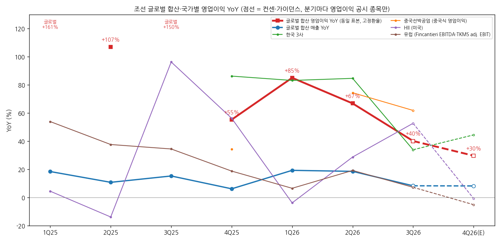
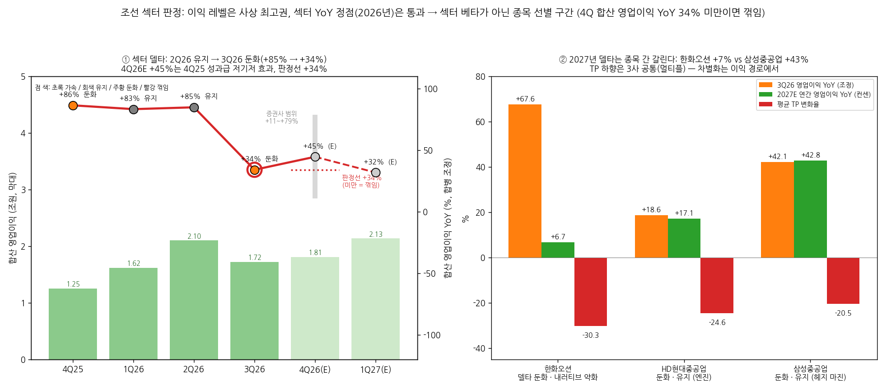

# 조선 · 조선 섹터 리뷰

> 현재 상태 (최신 분기 기준)
> 최신 분기: 2026-Q3
> 섹터 델타: 둔화 | 내러티브: 약화
> 모멘텀 신호: 없음
> 활성 테마: K조선 미해군×LNG (2026-Q4~)
> 포지셔닝: 섹터 축소 | 한국 언더퍼폼 | 선호 삼성중공업
> 편입 종목: 한화오션, 삼성중공업, HD현대중공업
> 갱신 시각: 2026-11-14 16:35 KST

## 누적 시계열

| 분기 | 편입 종목 | 합산 매출 | 합산 영업이익 | OPM | 매출 YoY | 영업이익 YoY | 영업이익 YoY 델타 (%p) | 섹터 델타 | 내러티브 | 모멘텀 신호 | 활성 테마 |
|---|---|---|---|---|---|---|---|---|---|---|---|
| 1Q24 | 3사 (HD는 미포 합산 PF) | 86,196억원 | 1,411억원 | 1.6 | +30.9 | n.m. | — | — | - | - | - |
| 2Q24 | 동일 | 100,812억원 | 3,340억원 | 3.3 | +28.2 | n.m. | — | — | - | - | - |
| 3Q24 | 동일 | 97,130억원 | 3,869억원 | 4.0 | +24.7 | +149.6 | — | n.m. | - | - | - |
| 4Q24 | 동일 | 113,820억원 | 6,723억원 | 5.9 | +24.0 | +548.3 | n.m. | n.m. | - | - | - |
| 1Q25 | 동일 | 106,437억원 | 8,839억원 | 8.3 | +23.5 | +526.4 | n.m. | n.m. | - | - | - |
| 2Q25 | 동일 | 113,586억원 | 11,374억원 | 10.0 | +12.7 | +240.5 | -285.9 | 둔화† | - | - | - |
| 3Q25 | 동일 | 113,764억원 | 12,860억원 | 11.3 | +17.1 | +232.4 | -8.2 | 둔화† | - | - | - |
| 4Q25 | 동일 | 122,209억원 | 12,526억원 | 10.2 | +7.4 | +86.3 | -146.1 | 둔화 | - | - | - |
| 1Q26 | 동일 (HD 보고치 = 합병 후) | 120,285억원 | 16,196억원 | 13.5 | +13.0 | +83.2 | -3.1 | 유지 | - | - | - |
| 2Q26 | 동일 | 150,061억원 | 21,010억원 | 14.0 | +32.1 | +84.7 | +1.5 | 유지 | - | - | - |
| **3Q26** | 동일 | **123,179억원** | **17,233억원** | **14.0** | **+8.3** | **+34.0** | **-50.7** | **둔화** | **약화** | **없음** | **K조선 미해군×LNG (2026-Q4~)** |

→ **합산 방식**: 3사 연결 매출·영업이익 단순 합산(원화, 억원). 한화오션·삼성중공업은 각 종목 리뷰 1-1 표(OpenDART), HD현대중공업은 HD현대중공업 리뷰 1-1 표와 HD현대미포 OpenDART 연결 재무를 썼다
→ **동일 표본(HD현대미포 합병 조정)**: HD현대미포는 2025.12.01 HD현대중공업에 흡수합병됐다(과거 재작성 없음). 그래서 2025년 이전 분기는 HD현대중공업 + HD현대미포를 더한 PF로 넣었다. 4Q25는 HD현대중공업 리뷰의 PF 추정치(매출 6조 600억원, 영업이익 7,089억원 — 미포 10~11월을 3Q25 run-rate로 추정)를 썼다 [추정]. 양사 내부거래는 빼지 않았다
→ **3Q26 중 삼성중공업·HD현대중공업은 잠정치다**(분기보고서 기한 11/16). 한화오션은 11/11 분기보고서 확정치다
→ **n.m.**: 2023년 합산 영업이익이 분기 -1,121억~+1,550억원(OPM -2~2%)이라 2024년~1Q25 YoY는 저기저·적자 기저 효과로 의미가 없다. **†** 2Q25·3Q25도 기저 OPM이 3~4%라 YoY 레벨은 부풀려져 있다. 판정은 규칙대로 계산했다
→ 참고 — 합병 미조정(HD 보고치) 합산 영업이익 YoY: 1Q26 +98.6% · 2Q26 +100.5% · 3Q26 +58.8% · 4Q26E +61.8%
→ 소급 행의 내러티브·모멘텀 신호·테마 열은 당시 섹터 리뷰가 없어 `-`로 두었다

---

## 2026-Q3 섹터 리뷰

> 대상: 2026-Q3 실적 리뷰 3건 — `earnings-review/2026-Q3_{한화오션|삼성중공업|HD현대중공업}_리뷰.md` (모두 2026-11-14 작성·배포)
> 직전 섹터 리뷰: 없음 (첫 섹터 리뷰). 편입 종목은 워치리스트 "섹터 리뷰 단위" 표의 조선 핵심 3사와 같다 (BT 지시)
> 활성 테마: `earnings-theme/K조선_미해군-LNG_테마분석.md` (2026-11-03 작성, status active, 테마 리뷰 미실시)

① 섹터 합산 숫자와 델타

| 항목 | 1Q25 | 2Q25 | 3Q25 | 4Q25 | 1Q26 | 2Q26 | **3Q26** | 4Q26E | 1Q27E |
|---|---|---|---|---|---|---|---|---|---|
| 합산 매출 (억원) | 106,437 | 113,586 | 113,764 | 122,209 | 120,285 | 150,061 | **123,179** | 134,961 | 132,230 |
| 합산 영업이익 (억원) | 8,839 | 11,374 | 12,860 | 12,526 | 16,196 | 21,010 | **17,233** | 18,106 | 21,343 |
| OPM (%) | 8.3 | 10.0 | 11.3 | 10.2 | 13.5 | 14.0 | **14.0** | 13.4 | 16.1 |
| 매출 YoY | +23.5 | +12.7 | +17.1 | +7.4 | +13.0 | +32.1 | **+8.3** | +10.4 | +9.9 |
| 영업이익 YoY | +526.4 | +240.5 | +232.4 | +86.3 | +83.2 | +84.7 | **+34.0** | +44.5 | +31.8 |
| **영업이익 YoY 델타 (%p)** | n.m. | -285.9 | -8.2 | -146.1 | -3.1 | +1.5 | **-50.7** | +10.5 | -12.8 |
| 판정 | n.m. | 둔화† | 둔화† | 둔화 | 유지 | 유지 | **둔화** | (가속 경로) | (둔화 경로) |

→ (출처: 3사 2026-Q3 리뷰 1-1 표 + HD현대미포 OpenDART [계산]. 4Q26E는 각 리뷰의 컨센 평균 합산 — 한화오션 15곳 3,988억원, 삼성중공업 14곳 4,210억원, HD현대중공업 12곳 9,908억원. 1Q27E는 한화오션 2곳·삼성중공업 4곳·HD현대중공업 3곳 평균이라 소수 의견이다)
→ **이익 레벨**: 3Q26 합산 영업이익 1조 7,233억원은 2Q26(2조 1,010억원, 한화오션 P-79 FPSO 일괄 인식 포함)에 이어 두 번째로 많다. OPM은 14.0%로 2Q26과 같다. 2Q26 매출 급증(+32%)은 한화오션 FPSO 일회성 매출(약 2조원)이라 3Q26 매출 YoY +8.3%가 실제 외형 속도에 가깝다
→ **델타**: 영업이익 YoY가 +83%(1Q26) → +85%(2Q26) → +34%(3Q26)로 한 분기에 51%p 내려왔다. 3사 모두 둔화했다(②)
→ **컨센 경로상 섹터 YoY 정점은 이미 지났다**: 4Q26E +44.5%는 4Q25 기저(1조 2,526억원 — 한화오션 성과급 반영, 미포 PF 추정)가 낮아서 나오는 반등이다. 1Q27E +31.8%, 연간으로는 2026E +59.1% → 2027E +19.0% → 2028E +14.4%다(아래 연간 표). 이익 레벨은 2028년까지 오르지만 증가율은 2026년이 정점이다

연간 합산 (억원, %)

| 항목 | 2025 PF | 2026E | 2027E | 2028E |
|---|---|---|---|---|
| 합산 매출 | 455,996 | 528,449 | 560,507 | 601,916 |
| 합산 영업이익 | 45,599 | 72,560 | 86,343 | 98,782 |
| OPM | 10.0 | 13.7 | 15.4 | 16.4 |
| 매출 YoY | — | +15.9 | +6.1 | +7.4 |
| 영업이익 YoY | — | +59.1 | +19.0 | +14.4 |

→ (출처: 3사 리뷰 1-3 연간 표 [계산]. 2025 PF = 한화오션 + 삼성중공업 + HD현대중공업 PF(HD 리뷰 추정치 2조 5,301억원). 2026E·2027E는 각 리뷰의 컨센 평균(한화오션 15곳·삼성중공업 14곳·HD현대중공업 12곳), 2028E는 표본이 다르다(13·14·10곳))

→ (출처: 3사 2026-Q3 리뷰, HD현대미포 OpenDART [계산]. 굵은 선 = 섹터 합산, 가는 선 = 종목별 영업이익 YoY(HD현대중공업은 미포 합병 조정), 점선 = 컨센. 1Q25~3Q25 섹터 영업이익 YoY는 저기저라 수치만 표기)

② 종목별 델타 판정표

| 종목 | 매출 YoY | 영업이익 YoY | 영업이익 YoY 델타 | 델타 판정 | 내러티브 | 한 줄 |
|---|---|---|---|---|---|---|
| 한화오션 | +12.9 | +67.6 | -30.4%p | 둔화 | 약화 | 상선 OPM 17.4%로 버텼지만 특수선 적자(-706억원)·MASGA 할증 소멸. 2027E 영업이익 +6.7%로 3사 중 가장 먼저 평탄화 |
| 삼성중공업 [잠정] | +19.6 | +42.1 | -16.6%p | 둔화 | 유지 | 100% 환헤지로 OPM 3개 분기 연속 상승(10.7%). 둔화는 2H25 기저 탓, 1Q27E +74%로 컨센상 정점 미도달 |
| HD현대중공업 [잠정, 합병 조정] | +0.6 | +18.6 | -66.8%p | 둔화 | 유지 | 상선 OPM 14.7%는 조업중단·환율·임단협 선반영 일회성. 발전엔진 3GW로 내러티브 무게중심 이동 |

→ (출처: 각 종목 리뷰 0번 판정·1-1 표. HD현대중공업 보고 기준은 매출 +30.2%·영업이익 +61.3%)
→ **섹터 델타를 끄는 곳 = HD현대중공업**: 3Q26 합산 영업이익의 52%다. 조정 영업이익 YoY가 +85% → +19%로 가장 크게 내려와 섹터 둔화 폭(-51%p)의 대부분을 만들었다. 다만 3Q25 기저의 미포 영업이익(OPM 15.4%)이 이례적으로 높았던 영향이 섞여 있다(HD 리뷰)
→ **선행 종목 = 한화오션**: 2Q26 +98%로 3사 중 가장 늦게 정점을 찍었지만, 컨센 경로상 가장 먼저 평탄해진다(2027E 영업이익 YoY +6.7%, 2Q27E -24% — SK). 섹터의 "꺾임"이 오면 한화오션이 먼저다 [판단]
→ **후행 종목 = 삼성중공업**: 마진 개선이 가장 늦게 시작돼 가장 오래 간다(2027E +42.8%). 섹터 안에서 델타가 남아 있는 유일한 종목이다

③ 섹터 공통 쟁점

(1) 원화 강세와 헤지 정책 — 같은 환율, 다른 마진 (3사)
→ 한화오션: 상선 OPM 22.7% → 17.4%(-5.3%p). 환헤지를 2025년 말부터 시작해 6월에 확대했다. 순노출의 약 50%를 1,400원 후반에 헤지했다 (한화오션 리뷰 쟁점 1)
→ HD현대중공업: 상선 OPM 17.8% → 14.7%. 원화 강세 영향은 약 450억원이고, 조업중단(약 500억원)·임단협 선반영이 겹쳤다. 영업외 외환관련손익 -4,006억원 (HD 리뷰 쟁점 1)
→ 삼성중공업: 100% 환헤지로 OPM 10.1% → 10.7% 상승. 매출 적용 평균환율 약 1,300원이 2Q27 1,398원으로 오르는 경로 (삼성중공업 리뷰 쟁점 1)
→ 셀사이드 해석 차이: 한화오션은 "2027년 상선 OPM 14~20%"로 가장 넓게 갈리고(JPM 14% vs 다올 20.4%), HD는 "일회성이라 2027년 16~19.5%", 삼성중공업은 "환율과 무관한 계단식 상승, 2027E 13.2%"로 수렴한다
→ [판단] 원/달러 1,320~1,350원대가 이어지면 헤지 비율이 낮은 순서(한화오션 → HD → 삼성중공업)대로 2027년 마진 추정이 깎인다. 피어 간 OPM 격차(3Q26 한화오션 14.2% vs 삼성중공업 10.7%, 3.5%p)는 2027년 안에 좁혀질 가능성이 크다

(2) 상선 피크아웃·중국 LNG선 경쟁 → 업종 멀티플 하향 (3사)
→ 평균 TP 변화: 한화오션 -30.3%, HD현대중공업 -24.6%, 삼성중공업 -20.5%. 같은 기간 2026·2027년 영업이익 추정 변화는 각각 -7%/-9%, -4%/-4%, -1%/-3%다. 3사 모두 TP 하향의 주원인은 멀티플이다
→ 공통 근거: 중국 조선소 캐파 증설과 LNG선 수주 점유율 확대, 2027년 발주 감소(클락슨 -30%), JPM의 평가 방식 변경(수주잔고 → P/E, 중국 조선사 8배 수준). 유안타는 3사 모두 상선 P/O 0.7배(업종 공통)를 적용했다
→ 해석 차이: 한화오션은 특수선 할증까지 함께 걷혀 하향폭이 가장 크고, HD는 엔진 가치가 일부 상쇄했으며, 삼성중공업은 방산 할증이 원래 없어 하향폭이 가장 작다
→ [판단] 셀사이드는 상선 이익의 "레벨"이 아니라 "지속 기간"(2029년 이후)을 할인하고 있다. 2030년 슬롯 LNG선 선가(최근 삼성중공업 2.47억달러)가 이 할인의 방향을 정할 첫 데이터다

(3) 미 해군·MASGA — 기대가 "지연"으로 재분류 (한화오션·HD현대중공업)
→ 한화오션: 캐나다 잠수함 탈락(7월), 미 의회 해외건조 반대(노무라, 2027 NDAA)로 함정 가치를 0으로 두는 곳(JPM·노무라)이 생겼다. 11/3 필리조선소 LSM 1척(2.69억달러) 수주는 규모가 작다
→ HD현대중공업: 키윗 JV로 방향은 정해졌지만 투자 구조(HHI vs 중간지주)·시점이 미정이다. 유안타·다올은 가치를 깎고, 메리츠만 2027년 미 해군 2척을 실적에 넣었다
→ 삼성중공업: 방산이 없어 "MASGA 기대의 반영과 하락에서 자유롭다"(유안타)
→ [판단] 테마 "K조선 미해군×LNG"의 미 해군 다리는 3Q 실적 시즌에 숫자로 확인된 것이 없고, 셀사이드 밸류에서 빠지는 중이다. 11월 말~12월 FY27 국방예산·NDAA 최종본이 다음 확인 지점이다

(4) 4Q 일회성(임단협·성과급) — 반영 방식이 4Q 숫자를 가른다 (3사)
→ 한화오션: 타결금·성과급을 기말(4Q)에 한 번에 반영 → 4Q26E 범위 1,560~5,550억원으로 가장 넓다
→ HD현대중공업: 임단협 비용 75%를 3Q에 선반영, 25%만 4Q
→ 삼성중공업: 월할 선반영으로 4Q 일회성 없음 (회사 설명)
→ [판단] 4Q26 섹터 합산 영업이익의 불확실성은 대부분 한화오션 일회성에서 나온다. 섹터 판정선(⑥)을 볼 때 한화오션은 "일회성 제외 상선 OPM"을 따로 봐야 한다

(5) 상선 외 성장축 — 3사가 서로 다른 다리를 찾는 중
→ 한화오션: Venus FPSO·해외 함정(태국 호위함 연내 본계약) — 아직 수주 전
→ 삼성중공업: FLNG(점유율 64%, 델핀 2호기 연내)·FDC(50MW 첫 본계약 4Q26 전망) — 수주 전
→ HD현대중공업: 발전엔진 3GW 수주 완료, 2028년 1.5GW·2029년 3GW 생산 — **유일하게 숫자로 확인된 다리**
→ [판단] 섹터 공통 스토리(상선 + 미 해군)가 약해지는 대신, 종목별 고유 스토리가 주가를 가르기 시작했다. 섹터 베타보다 종목 선별의 중요성이 커진 이유다

(6) 종목 고유 이슈
→ 한화오션: 특수선 공사손실충당부채(-706억원), 산업은행 영구전환사채 전환 시 15.9~18.9% 희석 (노무라)
→ 삼성중공업: 러시아 계약 해지 관련 선물환 청산이익 약 2,800억원(세전이익 일회성), 토건 부문 이익 급감
→ HD현대중공업: 미포 합병 기저 왜곡(2026년 보고 YoY 과대), 3Q 중대재해 조업중단 4일

④ 섹터 판정

(1) 판정 한 줄

> 섹터 델타: **둔화** | 내러티브: **약화** → **이익 레벨은 사상 최고권이지만 섹터 영업이익 YoY의 정점(2026년)은 통과 — 섹터 베타가 아닌 종목 선별 구간 (델타가 남은 순서: 삼성중공업 > HD현대중공업 > 한화오션). 4Q26 합산 영업이익 YoY +34% 미만이면 꺾임**

(2) 키 차트

→ (출처: 3사 2026-Q3 리뷰, HD현대미포 OpenDART [계산]. 왼쪽 = 섹터 합산 영업이익(막대, 조원)과 합병 조정 YoY(선, 점 색 = 분기별 판정), 4Q26E 판정선 +34%와 증권사 추정 범위(+11~+79%) / 오른쪽 = 종목별 3Q26 영업이익 YoY(HD 조정), 2027E 연간 영업이익 YoY(컨센), 평균 TP 변화율)

(3) 근거
→ **델타 = 둔화**: 합산 영업이익 YoY가 +84.7%(2Q26) → +34.0%(3Q26)로 -50.7%p 축소됐지만 플러스다. 직전 분기는 +1.5%p로 "유지"였으므로 2개 분기 연속 둔화가 아니라 "꺾임" 기준에는 아직 걸리지 않는다. 컨센 경로는 4Q26E +44.5%(재가속 — 4Q25 저기저)다. 그러나 연간으로는 2026E +59% → 2027E +19%로 정점을 지났다. 4Q26이 +34%를 밑돌면 "2개 분기 연속 둔화 + 정점 통과"로 꺾임이다
→ **내러티브 = 약화**: 종목별 판정은 약화 1(한화오션)·유지 2(삼성중공업·HD)다. 그러나 섹터 공통 스토리 두 개가 모두 약해졌다. 미 해군·MASGA는 "지연"으로 재분류됐고(③(3)), LNG선은 중국 점유율 확대와 선가 정체로 상선 피크아웃 우려가 커졌다(③(2)). 3사 모두 TP를 20~30% 내린 이유가 멀티플이라는 점이 공통 스토리 약화의 증거다. 종목 판정의 "유지"는 엔진(HD)·헤지 마진(삼성중공업)이라는 종목 고유 다리 덕분이다
→ **직전 대비**: 첫 섹터 리뷰다. 소급 시계열상 2025년은 저기저 해소 과정의 둔화(+526% → +86%), 2026년 상반기는 +83~85%의 유지, 3Q26에 첫 정상 기저 둔화다

⑤ 모멘텀 신호

→ **없음** (조건 대조)
→ ① 활성 테마(K조선 미해군×LNG)가 걸린 섹터의 델타가 둔화로 전환 — **충족** (2Q26 유지 → 3Q26 둔화)
→ ② 선행 종목 꺾임 — **미충족** (3사 모두 "둔화", 꺾임 종목 없음)
→ 조건 일부만 충족하므로 후보로 올리지 않는다. **다음 분기에 ①과 함께 아래 중 하나가 나오면 "테마 종료 후보 — K조선 미해군×LNG"로 올린다**: 4Q26 합산 영업이익 YoY +34% 미만(섹터 꺾임), 또는 한화오션 4Q26 영업이익 2,475억원 미만(선행 종목 꺾임)
→ 반대 논거: (a) 4Q26E 컨센은 +44.5%로 재가속 경로이고, 1Q27E 삼성중공업 +74%처럼 델타가 남은 종목이 있다 (b) 테마의 미 해군 다리는 실적이 아니라 이벤트(FY27 예산·NDAA, 키윗 JV, LSM 옵션) 주도라, 섹터 이익 델타와 무관하게 다시 살아날 수 있다 (c) LNG선 다리는 2030년 슬롯 발주(미국 LNG FID)가 2027년에 몰려 있어, 지금의 선가 정체가 바닥일 수 있다(회사·메리츠)
→ 레이어 구분: 이 테마는 조선 한 섹터에 걸려 있다(테마 분석 active_companies의 HII는 워치리스트 밖). 따라서 이 섹터의 신호는 곧 테마 전체의 신호다

⑥ 다음 분기 섹터 관전 포인트

| 순위 | 무엇을 (변수·임계값) | 어떤 데이터로 | 언제 |
|---|---|---|---|
| 1 | **4Q26 섹터 합산 영업이익 YoY +34% 이상 (합산 1조 6,785억원 이상)** — 미만이면 꺾임. 컨센 1조 8,106억원(+44.5%), 증권사 범위 1조 3,853억~2조 2,365억원 | 3사 4Q26 잠정실적, HD는 미포 PF 기저 7,089억원 대비 | 2027년 1월 말~2월 초 |
| 2 | 한화오션 4Q26 영업이익 2,475억원 이상 + 일회성 제외 상선 OPM 17%대 — 미만이면 선행 종목 꺾임 → 테마 종료 후보 | 한화오션 4Q 잠정실적·IR, 임단협 타결금 공시 | 임단협 11~12월, 실적 1월 말 |
| 3 | 미 해군 해외건조 허용 여부 — FY27 국방예산·NDAA 최종본 조항, 키윗 JV 투자계획(HHI 지분), LSM 옵션 3척, 태국 호위함 본계약 | 미 의회 예산·NDAA, 공급계약·투자 공시 | 11월 말~12월 |
| 4 | 2030년 인도 LNG선 선가 2.5억달러 이상 회복 + 중국 LNG선 수주 점유율 (2026년 39%) | 3사 LNG선 수주 공시(척당 선가), 클락슨 신조선가·점유율 | 월간, 1Q27 |
| 5 | 상선 외 다리의 첫 숫자: 델핀 2호기 FLNG·FDC 첫 본계약(삼성중공업), 발전엔진 추가 수주(HD), Venus FPSO(한화오션) | 수주 공시 | 4Q26~1Q27 |

→ 판정선 근거: 3Q26 합산 영업이익 YoY(+34.0%)를 4Q25 합산 기저(1조 2,526억원)에 적용한 값이다 [계산]. 4Q26이 3Q26보다 낮은 YoY면 2개 분기 연속 둔화가 되고, 컨센 연간 경로상 정점(2026년)은 이미 지났으므로 "꺾임" 기준을 충족한다

⑦ 글로벌 PM 포지셔닝 — 결론

> **섹터: 비중 축소 — 4Q26 합산 영업이익 YoY +44.5%(컨센) 이상 + 미 해군·FLNG/FDC 계약 중 하나가 확인되면 중립 복귀** | **종목: 삼성중공업 유지 > HD현대중공업 중립 > 한화오션 축소** | **한국: 언더퍼폼 vs 중국 조선 (삼성중공업만 예외)**

→ 비교 범위: 편입 종목이 한국 3사뿐이라 글로벌 피어는 종목 리뷰에 인용된 피어 표를 쓴다 — 중국선박공업(CSSC)·양쯔장조선(중국), 미쓰비시중공업·가와사키중공업(일본). 출처는 신한투자증권 한화오션 3Q26 리뷰(10/28)의 Bloomberg 피어 표, 중국 LNG선 점유율은 테마 분석(`K조선_미해군-LNG_테마분석.md`, 클락슨)이다. 피어의 분기 영업이익은 확보하지 않아 EPS 성장률로 비교한다

(1) 조선 섹터 비중 — 확대 / 중립 / 축소

| 판단 축 | 3Q26 근거 | 방향 |
|---|---|---|
| 이익 델타 (1순위) | 합산 영업이익 YoY +85% → +34%(-51%p), 3사 모두 둔화 | 축소 |
| YoY 정점 시점 | 연간 컨센 2026E +59% → 2027E +19% → 2028E +14%. 분기 정점은 2Q26, 4Q26E +45%는 4Q25 성과급 저기저 반등 | 축소 |
| 수주·잔고 선행지표 | 잔고 레벨은 사상 최대권(한화오션 362억달러, 삼성중공업 363억달러, 3년치+). 그러나 2026년 상선 수주는 선별 기조, 해양·특수선 수주는 한화오션·HD 모두 목표 미달(HD 해양 5%, 삼성중공업 해양 54%) | 중립 |
| 최종 수요 지표 | 클락슨 2027년 신조 발주 -30% 전망. LNG선은 2030년 이후 슬롯 수요(미국 LNG FID)가 견조하지만 최근 선가 2.47억달러로 눈높이 하회, 중국 LNG선 점유율 8%(2025) → 39%(2026) | 축소 |
| 이벤트·정책 | FY27 미 국방예산·NDAA 최종본(11월 말~12월), 태국 호위함 본계약·델핀 2호기 FID·FDC 첫 계약(연내) — 모두 미확인 | 중립 (이벤트 전) |
| 밸류에이션·멀티플 (2순위) | 3사 평균 TP -20~30%, 이익 추정 -1~-9% → 멀티플 하향. 2027F PER 한국 9.8~10.8배 vs 중국 8.5~9.9배(신한 피어 표) — 중국 대비 할증 거의 소멸 | 확대 (2순위 변수) |
| 주가 낙폭 | 52주 고점 대비 한화오션 -68%, HD현대중공업 -65%, 삼성중공업 -52%. 디레이팅이 이익 경로(2027E +19%)보다 크게 앞섰다 | 중립 |

→ **결론: 비중 축소** [판단]. BT 프레임의 1순위인 델타가 둔화이고, 컨센 경로상 연간 YoY 정점(2026년)이 이미 지났다. 4Q26E 재가속(+45%)은 기저 효과라 "가속 재개"로 읽기 어렵다. 공통 스토리(미 해군·LNG선)도 약해져(④ 내러티브 약화) 섹터 베타를 들고 갈 이유가 줄었다
→ 밸류에이션(중국과 같은 PER)과 낙폭(-52~-68%)은 하방을 줄여주지만 2순위 변수다. 가치 프레임이라면 "중립~확대"가 나올 수 있다. 이 결론은 델타 프레임 결론이다
→ 섹터를 줄이는 대신 **섹터 안에서는 델타가 남은 삼성중공업으로 비중을 옮긴다**(3)
→ **중립 복귀 조건**: ① 4Q26 합산 영업이익 YoY +44.5%(컨센, 1조 8,106억원) 이상 ② FY27 국방예산·NDAA에서 해외건조 허용, 또는 델핀 2호기·FDC·태국 호위함 중 하나 이상 본계약. ①+② 충족 시 중립
→ **확대 전환 조건**: 위에 더해 2030년 인도 LNG선 수주 선가 2.5억달러 이상 회복과 2027E 합산 영업이익 추정 상향 전환(1Q27)
→ **축소 유지·강화 조건**: 4Q26 합산 YoY +34%(판정선, 1조 6,785억원) 미만 → 섹터 꺾임. ④ 키 차트·⑥ 1순위와 같은 값이다

(2) 한국 vs 글로벌 — 아웃퍼폼 / 중립 / 언더퍼폼

| 경쟁력 축 | 한국 3사 | 글로벌 (중국·일본) | 우위 |
|---|---|---|---|
| 델타 방향 (1순위) | 합산 영업이익 YoY +85% → +34% 둔화, 3사 모두 둔화. EPS 성장률 2026F 68~93% → 2027F -1.8~+57%(3사 평균 +24.0%) | 중국 EPS 2026F 29~93% → 2027F 14~34%(평균 +24.3%). 일본 2027F 15~17% | 중국 (근소) |
| 마진 레벨 | 3Q26 OPM 14.0%(합산), 상선 14.7~17.4% | 양쯔장 ROE 31%(한국 평균 26%), 중국선박공업 ROE 13~16% | 비슷 (분기 영업이익 미확보) |
| 마진 방향 | 한화오션·HD 상선 OPM 하락(환율·일회성), 삼성중공업만 상승 | 미확보 (중국 위안화 기반, 원화 강세 영향 없음) | 판단 보류 |
| 수주·점유율 | 선별 수주. LNG선 점유율 하락 | 중국 LNG선 수주 점유율 8% → 39%, 캐파 공격적 증설 | 중국 |
| 고부가 선종·해양 | FLNG(삼성중공업 점유율 64%)·FDC·발전엔진(HD)·미 해군 MRO는 한국만 가능 | 중국은 미 해군 사업 배제, FLNG 실적 제한적 | 한국 |
| 가격 | 2030년 슬롯 LNG선 2.47억달러로 눈높이 하회 | 저가·자국 발주로 점유율 확대(NH) | 중국 |
| 관세·규제 | 미 해군 해외건조는 NDAA가 막는 중(노무라). 대중 항만 수수료 등 미국 규제는 한국에 우호 | 미국 규제 노출 | 한국 |
| 환율 | 원화 강세(분기 평균 -79원)가 한화오션·HD 마진·영업외를 깎음 | 위안화 안정 | 중국 |
| 이익 추정 방향 | 발표 후 3사 모두 하향(-1~-9%) | 미확보 | 판단 보류 |
| 밸류에이션·낙폭 (2순위) | 2027F PER 9.8~10.8배, 6개월 -33~-52% | 중국 8.5~9.9배, 양쯔장 6개월 +27%·중국선박공업 +9% | 한국 (2순위) |

→ (출처: 피어 PER·ROE·EPS 성장률·수익률은 신한투자증권 한화오션 3Q26 리뷰 p.4 Bloomberg 표(10/28 기준), 한국 3사 숫자는 각 종목 리뷰. 중국 LNG선 점유율은 테마 분석(클락슨))
→ **결론: 한국 언더퍼폼 (vs 중국 조선)** [판단]
→ 이유 (1) 델타가 중국보다 빠르게 내려온다. 2027F EPS 성장률 평균은 한국 3사 +24.0% vs 중국 +24.3%로 비슷하지만, 2026F 대비 감속 폭은 한국(평균 83% → 24%)이 중국(61% → 24%)보다 크다. 한국 안에서는 한화오션(-1.8%)이 가장 먼저 평탄해진다 [계산]
→ 이유 (2) 이익 추정이 한국만 내려갔다. 3사 모두 발표 후 하향했고, 원인(원화 강세·일회성·특수선 손실)이 4Q·2027년에도 남는다
→ 이유 (3) 구조 요인이 중국 쪽으로 움직였다. LNG선 점유율(39%)과 캐파 증설로 한국의 LNG선 프리미엄이 희석되고, 셀사이드가 한국에 중국 조선사 수준 PER(JPM 8배)을 적용하기 시작했다
→ 반대 논거: (a) PER 기준 중국 대비 할증이 사라져 밸류 하방은 작다 (b) 미 해군·FLNG·발전엔진처럼 중국이 들어올 수 없는 영역은 한국만의 이벤트 상방이다. NDAA가 해외건조를 허용하면 반등 탄력은 한국이 압도적이다 (c) 중국 피어의 분기 영업이익·마진 방향을 확보하지 못해 비교가 EPS·주가에 치우쳐 있다. 이 결론은 델타 프레임이고, 가치 프레임이라면 반대일 수 있다
→ **예외: 삼성중공업**. 한국 3사 중 유일하게 마진이 오르고(OPM 3개 분기 연속 상승), 2027E 영업이익 +43%로 중국 피어 EPS 성장률을 웃돈다. FLNG는 중국과 경쟁하지 않는 영역이다

(3) 종목 순위와 선호 종목

| 순위 | 종목 | 비중 | 근거 (델타 방향·마진·수요 노출) |
|---|---|---|---|
| 1 | 삼성중공업 | 유지 (섹터 내 선호) | 델타 둔화지만 기저 탓, 1Q27E +74%로 정점 미도달. 100% 환헤지로 원화 강세 면역, OPM 3개 분기 연속 상승. 방산 할증이 없어 MASGA 실망에서 자유롭다 |
| 2 | HD현대중공업 | 중립 | 조정 영업이익 YoY +85% → +19%로 가장 크게 둔화. 다만 상선 감익은 일회성(조업중단·임단협 선반영) 성격이 크고, 발전엔진 3GW가 상선 피크아웃을 상쇄할 유일한 확인된 다리. 2027E +17% |
| 3 | 한화오션 | 축소 | 2027E 영업이익 +6.7%로 3사 중 가장 먼저 평탄화(선행 꺾임 후보). 특수선 적자·MASGA 할증 소멸, 4Q 일회성 불확실성이 가장 크다 |

→ **한국 선호**: 삼성중공업 — 델타가 남은 유일한 종목, 마진 궤적이 환율과 무관
→ **한국 비선호**: 한화오션 — 선행 꺾임 후보, 내러티브 약화
→ **반등 후보 (이벤트 드리븐, 델타 프레임 밖)**: 한화오션 — FY27 NDAA 해외건조 허용·LSM 옵션 3척·태국 호위함 본계약이 겹치면 낙폭(-68%)이 가장 커 탄력도 가장 크다. HD현대중공업 — 키윗 JV 투자계획(HHI 지분 귀속)과 발전엔진 추가 수주
→ **글로벌 비교 메모**: 델타·점유율 기준으로는 양쯔장조선(ROE 31%, 6개월 +27%)이 한국 3사보다 우위다. 다만 워치리스트·리뷰 커버리지 밖이라 선호 종목으로 올리지 않는다

(4) 콜을 바꾸는 조건과 일정

| 시점 | 이벤트 | 섹터 비중 | 한국 콜 |
|---|---|---|---|
| 11/16 | 삼성중공업·HD현대중공업 3Q26 분기보고서(확정치) | 잠정 대비 차이가 크면 ①·② 재계산 | — |
| 11월 말~12월 | FY27 미 국방예산·NDAA 최종본 해외건조 조항 | 허용 → 중립 복귀 조건 ② 충족 / 금지 유지 → 축소 유지 | 허용 → 한국 중립 상향 검토(중국 배제 영역) / 금지 → 언더퍼폼 유지 |
| 12월 | 태국 호위함 본계약(한화오션), 델핀 2호기 FID·FDC 첫 본계약(삼성중공업), 키윗 JV 투자계획(HD) | 1건 이상 + 4Q 판정선 통과 시 중립 | 삼성중공업 계약 시 예외 강화, 한화오션 계약 시 반등 후보 → 중립 |
| 1Q27 | 2030년 인도 LNG선 수주 선가, 클락슨 중국 점유율 | 2.5억달러 이상 → 확대 전환 조건 | 중국 점유율 하락 반전 시 한국 중립 |
| 2027-01 말~02 초 | 3사 4Q26 실적 | 합산 YoY +44.5% 이상 → 중립 복귀 조건 ① / +34% 미만 → 꺾임, 축소 강화 | 한화오션 2,475억원 미만 → 테마 종료 후보, 한국 언더퍼폼 강화 |
