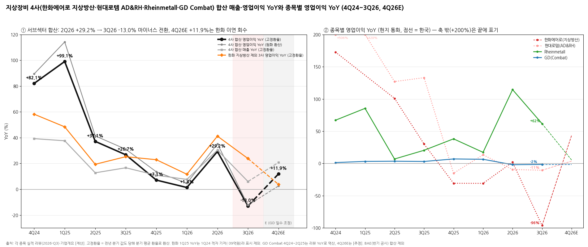
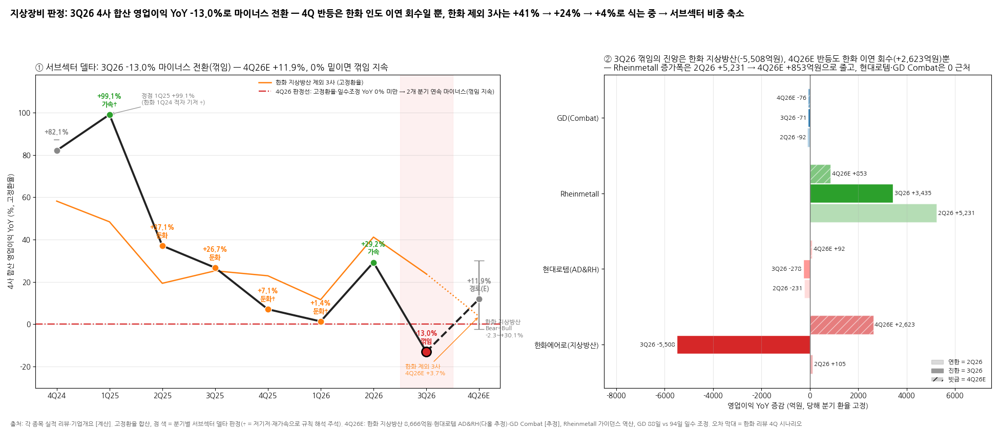

# 방산 · 지상장비 섹터 리뷰

> 현재 상태 (최신 분기 기준)
> 최신 분기: 2026-Q3
> 섹터 델타: 꺾임 | 내러티브: 약화
> 모멘텀 신호: 없음
> 활성 테마: 없음
> 포지셔닝: 서브섹터 축소 | 한국 언더퍼폼 | 선호 Rheinmetall(상대)
> 편입 종목: 한화에어로스페이스(지상방산), 현대로템(AD&RH), Rheinmetall, General Dynamics(Combat Systems) — 3Q26 합산 4사, BAE Systems 제외(반기 공시)
> 갱신 시각: 2026-11-15 11:40 KST

## 누적 시계열

| 분기 | 편입 종목 | 합산 매출 | 합산 영업이익 | OPM | 매출 YoY | 영업이익 YoY | 영업이익 YoY 델타 (%p) | 섹터 델타 | 내러티브 | 모멘텀 신호 | 활성 테마 |
|---|---|---|---|---|---|---|---|---|---|---|---|
| 4Q24 | 4사 (한화 지상방산·로템 AD&RH·RHM·GD Combat) | 120,516억원 ($8.6B) | 27,900억원 ($2.00B) | 23.2 | +44.7 / +39.2 | +89.4 / +82.1 | — | —† | - | - | - |
| 1Q25 | 4사 (동일) | 77,164억원 ($5.3B) | 12,091억원 ($0.83B) | 15.7 | +46.6 / +37.6 | +114.3 / +99.1 | +17.0 | 가속† | - | - | - |
| 2Q25 | 4사 (동일) | 88,088억원 ($6.3B) | 16,379억원 ($1.17B) | 18.6 | +16.5 / +12.8 | +41.4 / +37.1 | -62.0 | 둔화 | - | - | - |
| 3Q25 | 4사 (동일) | 99,008억원 ($7.1B) | 18,541억원 ($1.34B) | 18.7 | +21.4 / +16.7 | +31.0 / +26.7 | -10.4 | 둔화 | - | - | - |
| 4Q25 | 4사 (동일) | 141,507억원 ($9.8B) | 31,674억원 ($2.19B) | 22.4 | +17.4 / +10.9 | +13.5 / +7.1 | -19.6 | 둔화† | - | - | - |
| 1Q26 | 4사 (동일) | 86,986억원 ($5.9B) | 12,656억원 ($0.87B) | 14.5 | +12.7 / +7.6 | +4.7 / +1.4 | -5.7 | 둔화† | - | - | - |
| 2Q26 | 4사 (동일) | 121,985억원 ($8.1B) | 22,150억원 ($1.48B) | 18.2 | +38.5 / +30.3 | +35.2 / +29.2 | +27.8 | 가속 | - | - | - |
| **3Q26** | **4사 (동일) — BAE 제외(반기)** | **105,934억원 ($7.5B)** | **16,255억원 ($1.15B)** | **15.3** | **+7.0 / +6.0** | **-12.3 / -13.0** | **-42.2** | **꺾임** | **약화** | **없음** | **없음** |

→ **표기**: YoY 칸은 `원화 환산 / 고정환율`. 판정은 방산 섹터 리뷰와 같은 **고정환율 기준**(전년 분기 값도 당해 분기 평균 환율로 환산)이다. 델타 칸 = 고정환율 영업이익 YoY의 직전 분기 대비 변화. 4사 구성이 전 분기 같아 표본 조정은 없다 [계산]
→ **합산 기준 (이 서브섹터 전용)**: 한화에어로스페이스 = **지상방산 부문만**(항공우주·한화시스템·한화오션·기타 제외 — 방산 섹터 리뷰의 "본체"와 다름) / 현대로템 = **AD&RH 부문**(구 방산부문, 2026.7 수소·로보틱스 편입) / Rheinmetall = **계속사업 연결**(Power Systems 제외) / General Dynamics = **Combat Systems 부문** (Marine·Technologies·걸프스트림 제외)
→ **합산에서 빠지는 종목**: BAE Systems — 반기 손익만 공시. 전년 동기에서도 빼서 동일 표본이며, 지상 관련 Platforms & Services 부문 반기 숫자는 맨 아래 `(서브) BAE Systems`에 참고로 둔다
→ **†** 4Q24는 소급 첫 행이라 판정 없음. 1Q25 +99.1%(가속)는 한화 지상방산 1Q24 영업이익 -39억원(적자) 기저가 섞인 숫자다. 4Q25·1Q26은 둔화가 3~4개 분기 이어졌지만 2Q26에 재가속해 정점 통과(꺾임)로 보지 않고 "둔화"로 두었다(방산 섹터 리뷰와 같은 해석). 소급 행의 내러티브·모멘텀·테마 열은 당시 리뷰가 없어 `-`

분기 평균 환율 (원, 일간 종가 평균 — 방산 섹터 리뷰와 같은 값)

| 통화 | 4Q23 | 1Q24 | 2Q24 | 3Q24 | 4Q24 | 1Q25 | 2Q25 | 3Q25 | 4Q25 | 1Q26 | 2Q26 | 3Q26 | 4Q26 (10/1~11/13) |
|---|---|---|---|---|---|---|---|---|---|---|---|---|---|
| USD/KRW | 1,318.7 | 1,328.2 | 1,370.1 | 1,354.4 | 1,395.5 | 1,449.5 | 1,397.1 | 1,385.8 | 1,447.7 | 1,462.9 | 1,500.9 | 1,417.0 | 1,338.1 |
| EUR/KRW | 1,415.5 | 1,440.2 | 1,471.0 | 1,485.5 | 1,487.0 | 1,525.7 | 1,582.7 | 1,618.5 | 1,683.4 | 1,712.1 | 1,743.7 | 1,627.8 | 1,497.1 |

→ (출처: 방산 섹터 리뷰 환율표 — Yahoo Finance `KRW=X`·`EURKRW=X` 일간 종가 분기 평균 [계산], 2026-11-14 조회. 4Q26E 환산은 10/1~11/13 평균)

---

## 2026-Q3 섹터 리뷰 — 지상장비 (전차·자주포·장갑차·탄약)

> 대상: 2026-Q3 실적 리뷰 4건 + 2026-Q2 리뷰 1건 — `earnings-review/2026-Q3_{한화에어로스페이스|현대로템|RHM|GD}_리뷰.md`, `2026-Q2_BAE_리뷰.md`(반기 리뷰, 11/12 Market update 덧붙임)
> 편입 범위: 워치리스트 `방산 | 지상장비` 핵심 3사(한화에어로스페이스·현대로템·Rheinmetall) + 확장 2사(General Dynamics·BAE Systems) — BT 지시. 국가 그룹 = 한국 2 / 유럽 1(+BAE 참고) / 미국 1. 트래킹 피어 없음
> 상위 리뷰: `sector-review/방산_섹터리뷰.md`(글로벌 15사, 2026-11-14) — 합산 방식·환율·고정환율 YoY·동일 표본 규칙을 그대로 썼다. 결론: 섹터 델타 둔화 · 내러티브 유지 · 섹터 중립 · 한국 언더퍼폼
> 직전 섹터 리뷰: 없음 (지상장비 첫 서브섹터 리뷰) | 활성 테마: 없음
> 보조 데이터: 현대로템 AD&RH 분기 시계열 = `company-overview/현대로템_기업개요.md` v1.1(회사 IR·DART), 한화 지상방산 분기 영업이익 = `company-overview/한화에어로스페이스_기업개요.md`(방산 섹터 리뷰 계산 스크립트와 같은 값)

① 섹터 합산 숫자와 델타

(1) 4사 합산 (억원·$B)

| 항목 | 4Q24 | 1Q25 | 2Q25 | 3Q25 | 4Q25 | 1Q26 | 2Q26 | **3Q26** | 4Q26E |
|---|---|---|---|---|---|---|---|---|---|
| 합산 매출 (억원) | 120,516 | 77,164 | 88,088 | 99,008 | 141,507 | 86,986 | 121,985 | **105,934** | 156,521 |
| (달러 환산, $B) | 8.6 | 5.3 | 6.3 | 7.1 | 9.8 | 5.9 | 8.1 | **7.5** | 11.7 |
| 합산 영업이익 (억원) | 27,900 | 12,091 | 16,379 | 18,541 | 31,674 | 12,656 | 22,150 | **16,255** | 32,479 |
| (달러 환산, $B) | 2.00 | 0.83 | 1.17 | 1.34 | 2.19 | 0.87 | 1.48 | **1.15** | 2.43 |
| OPM (%) | 23.2 | 15.7 | 18.6 | 18.7 | 22.4 | 14.5 | 18.2 | **15.3** | 20.8 |
| 매출 YoY — 원화 환산 (%) | +44.7 | +46.6 | +16.5 | +21.4 | +17.4 | +12.7 | +38.5 | **+7.0** | +10.6 |
| 매출 YoY — 고정환율 (%) | +39.2 | +37.6 | +12.8 | +16.7 | +10.9 | +7.6 | +30.3 | **+6.0** | +20.8 (조정) |
| 영업이익 YoY — 원화 환산 (%) | +89.4 | +114.3 | +41.4 | +31.0 | +13.5 | +4.7 | +35.2 | **-12.3** | +2.5 |
| **영업이익 YoY — 고정환율 (%)** | +82.1 | +99.1† | +37.1 | +26.7 | +7.1 | +1.4 | +29.2 | **-13.0** | +11.9 (조정) |
| **영업이익 YoY 델타 (%p, 고정환율)** | — | +17.0 | -62.0 | -10.4 | -19.6 | -5.7 | +27.8 | **-42.2** | +24.9 |
| 판정 | — | 가속† | 둔화 | 둔화 | 둔화† | 둔화† | 가속 | **꺾임** | (반등 경로) |
| ㄴ 한화 지상방산 제외 3사 (고정환율) | +58.4 | +48.4 | +19.4 | +25.3 | +22.9 | +11.6 | +41.2 | **+23.8** | +3.7 (조정) |
| ㄴ 한국 2사 (고정환율 = 원화) | +216.7 | +1,097.6† | +108.7 | +51.2 | -26.8 | -13.6 | -1.6 | **-69.2** | +31.8 |
| ㄴ 글로벌 2사 (RHM·GD Combat, 고정환율) | +39.4 | +26.0 | +5.1 | +11.9 | +29.2 | +11.2 | +54.5 | **+32.6** | +3.7 (조정) |

→ (출처: 각 종목 리뷰 1번 표·사업부 표의 서브섹터 기준 값을 분기 평균 환율로 원화 환산해 합산 [계산]. 한국 2사 값은 원화라 고정환율 = 원화 환산)
→ **종목별 원값 출처**: 한화 지상방산 매출 = 한화 리뷰 1-(1) 표(회사 IR), 영업이익 = 한화 기업개요 사업부 영업이익(회사 IR — 3Q26 217억원은 리뷰 1-(2)와 일치, 2Q26 5,330억원은 리뷰 OPM 25.3%와 일치) / 현대로템 AD&RH = 기업개요 v1.1 19분기 사업부 표(회사 IR·DART), 3Q25~3Q26은 리뷰 1-② 표와 같음 / Rheinmetall = 리뷰 1-① 계속사업 표(4Q23 = 4Q24 ÷ (1 + 리뷰 YoY) [계산]) / GD Combat = 리뷰 1-② 사업부 표(3Q25~3Q26)와 (2-1) 사업부 YoY로 4Q23~2Q25 역산 [계산 — 방산 섹터 리뷰 GD 역산과 같은 방법]
→ **현대로템 기준 혼재**: 회사 IR은 1Q26만 신부문(AD&RH 8,196 / 2,199억원)으로 재작성했고 2Q25~4Q25는 구 방산부문 값을 그대로 쓴다(기업개요 v1.1). 리뷰의 3Q26 YoY(-10.5%)와 같은 IR 기준을 따랐다. DART 신기준 2Q25 재작성값(2,473억원)으로 보면 2Q26 YoY는 -9.1%(IR 기준 -9.3%)로 차이가 작다 [계산]
→ **4Q26E**: 한화 지상방산 8,666억원 = **방산 섹터 리뷰의 [추정]**(지상방산 매출 3.94조원 — 리뷰 4-(2-2) 발표 후 7개사 평균 × OPM 22% — 리뷰 독자 Base) / 현대로템 AD&RH 매출 11,250억원·영업이익 2,599억원 = **다올 단일 추정**(리뷰 (2-1) 표: 수출 7,410 + 내수 3,840억원, OPM 23.1%) [계산] / Rheinmetall €4,824m·€1,103m = 리뷰 가이던스 역산 / **GD Combat은 리뷰에 E가 없어 [추정]** = 4Q25 × (1 + 3Q26 Combat YoY 매출 +6.0%·영업이익 -1.5% 유지) × 88/94(회계일수) = $2,516M·$351M
→ **4Q26E 일수 조정**: GD 4Q26은 88일(전년 94일, GD 리뷰)이라 Combat 4Q26E를 × 94/88로 환산한 "조정" YoY를 판정에 쓴다. 미조정 고정환율 YoY는 +10.8%, 원화 환산은 +2.5%(원화 강세)
→ **이익 레벨**: 3Q26 4사 합산 영업이익 16,255억원($1.15B), OPM 15.3% — 1Q26(14.5%)에 이어 소급 시계열 둘째로 낮다. 3Q26 영업이익 비중은 Rheinmetall 55.4% · GD Combat 28.8% · 현대로템 AD&RH 14.5% · 한화 지상방산 1.3% [계산]. 방산 섹터 리뷰 12사 합산 영업이익(95,801억원)의 17.0%다
→ **델타**: 고정환율 영업이익 YoY +29.2%(2Q26) → **-13.0%(3Q26), -42.2%p, 마이너스 전환 → 꺾임**. 3Q26 4사 합산 이익 증감 -2,422억원(3Q26 환율 고정) = 한화 지상방산 -5,508 + 현대로템 AD&RH -278 + GD Combat -71 + Rheinmetall +3,435억원 [계산]. **한화 지상방산 하나가 Rheinmetall 증가분을 다 지웠다.** 다만 한화를 빼도 3사는 +41.2% → +23.8%로 둔화이고, 4Q26E는 +3.7%(조정)로 더 내려간다
→ **컨센 경로상 서브섹터 YoY 정점은 1Q25(+99.1%, 적자 기저 포함)로 이미 지났다** [판단]. 4Q26E +11.9%(조정)는 한화 폴란드 인도 이연분(지상방산 YoY +43.4% [추정])의 회수가 받치는 숫자이고, 한화 제외 3사는 Rheinmetall 4Q26G +5.4%·현대로템 AD&RH +3.7%(다올)·GD Combat -1.5%([추정])로 모두 한 자릿수 이하다. 회사 리뷰 기준으로 YoY 정점을 지난 종목은 4사 전부(한화 본체·현대로템 1Q25, Rheinmetall 2Q26, GD Combat 4Q25 +7.0%)

→ (출처: 각 종목 리뷰·기업개요 [계산]. 왼쪽 = 4사 합산(검은 굵은 선 = 고정환율 영업이익 YoY, 짙은 회색 = 원화 환산, 연한 회색 사각 = 매출 YoY), 주황 = 한화 지상방산 제외 3사. 오른쪽 = 종목별 영업이익 YoY(현지 통화, 점선 = 한국), +200% 밖은 끝에 표기, 한화 1Q25는 적자 기저라 제외. 4Q26E 점선, GD 일수 조정)

② 종목별 델타 판정표

| 종목 (서브섹터 기준) | 국가 | 매출 YoY | 영업이익 YoY (2Q26 → 3Q26) | 영업이익 YoY 델타 | 델타 판정 (리뷰 0번) | 내러티브 | 4Q26E 영업이익 YoY | 서브섹터 내 델타 순위 | 한 줄 |
|---|---|---|---|---|---|---|---|---|---|
| Rheinmetall (계속사업) | 유럽 | +36.4 | +114.5 → **+61.7** | -52.8%p | 둔화 | 약화 | +5.4 (가이던스 역산) | **1위** | 유일한 두 자릿수 증익(9M OP +69%), 그러나 2026 가이던스 2차 하향·Arminius 2027 이연. 4Q 한 자릿수로 꺾임 경로 |
| General Dynamics (Combat Systems) | 미국 | +6.0 | -1.9 → **-1.5** | +0.4%p | 가속 (회사 — 방산 3사업부 기준) | 강화 (회사) | -1.5 ([추정], 일수 조정) | **2위** | 미국 차량 9M -$203M을 유럽(ELS +28%)·탄약(+16%)이 메우는 정체. Combat 잔고 $18.7B → $28.7B(+53%) |
| 현대로템 (AD&RH) | 한국 | -10.1 | -9.3 → **-10.5** | -1.2%p | 꺾임 | 약화 | +3.7 (다올 추정) | **3위** | 방산 OPM 28.1%로 수출 마진 회복, 그러나 K2 3Q 인도 14대(보도 46대)·AD&RH 잔고 4분기 연속 감소·2027 감익 인정 |
| 한화에어로스페이스 (지상방산) | 한국 | -41.0 | +2.0 → **-96.2** | -98.2%p | 꺾임* | 약화* | +43.4 ([추정]) | **4위** | 영업이익 217억원(OPM 1.7%) — 폴란드 4Q 쏠림·대전 사고·비폴란드 수출 마진 10%대. 4Q 반등은 이연 회수 |
| BAE Systems (2026-Q2 리뷰) | 유럽 | H1 그룹 +7.9 (cc +9) / P&S +10.1 | H1 P&S EBIT +10.6 (cc +11) | — (반기) | 판정 제외 | 유지 | — | 순위 제외 | 반기만 공시. 미 육군 자주포에서 Archer 탈락, CV90 6개국 공동구매 계약 대기. 합산 제외 |

→ (출처: 각 종목 리뷰 0번 판정·1번 표. 매출·영업이익 YoY는 서브섹터 기준 부문 값의 현지 통화 YoY [계산] — 현대로템 -10.1%·-10.5%, GD Combat +6.0%·-1.5%, Rheinmetall +36.4%·+61.7%는 리뷰 수치와 같다)
→ **\* 한화에어로스페이스**: 리뷰가 v11 이전 형식이라 0번 판정이 없다. 방산 섹터 리뷰가 본체(지상방산+항공우주) 기준으로 산정한 "꺾임·약화"를 그대로 옮겼다. 지상방산만 보면 +2.0% → -96.2%(-98.2%p)로 같은 결론이다 [계산]
→ **GD 판정 주의**: 리뷰 0번 "가속·강화"는 방산 3사업부(OP YoY 5.5% → 12.0%) 기준이고 델타를 끈 것은 Marine(+34.4%)이다. **이 서브섹터 기준인 Combat은 2개 분기 연속 영업이익 역성장**(-1.9% → -1.5%)이라 판정을 그대로 옮기면 지상장비 실태를 과대평가한다 — 순위는 Combat 숫자로 매겼다
→ **델타 순위 기준** [판단]: ① 서브섹터 기준 영업이익 YoY의 레벨과 방향 ② 4Q26E 경로 ③ 리뷰 판정. Rheinmetall은 둔화지만 레벨(+61.7%)이 압도적이고 4Q26G도 플러스라 1위, GD Combat은 마이너스 정체(±1%대)지만 잔고가 늘어 2위, 현대로템은 마진은 지켰지만 이익이 2개 분기 연속 마이너스라 3위, 한화는 이익이 사실상 0이라 4위. **4사 중 "가속"은 하나도 없다**
→ **판정 분포 (리뷰 0번, BAE 제외 4사)**: 가속 1(GD — 방산 3사업부 기준) / 둔화 1(Rheinmetall) / 꺾임 2(한국 2사). 내러티브: 강화 1(GD 회사) / 유지 1(BAE) / 약화 3(한화·현대로템·Rheinmetall)
→ **선행 종목**: 먼저 꺾인 쪽 = **한국 2사**(현대로템 2Q26 마이너스 전환, 한화 지상방산 4Q25·1Q26 -31% 후 3Q26 -96%) — 폴란드 1차 사이클 종료가 가장 먼저 숫자로 나왔다. 글로벌에서 먼저 둔화한 쪽 = Rheinmetall(2Q26 +114.5% 정점, 4Q26G +5.4%). GD Combat은 2024~2025년 내내 +1~7%의 저성장이라 사이클 선행·후행 개념이 약하다 [판단]

③ 섹터 공통 쟁점

(1) 인도·집행 타이밍 → 4Q 쏠림 (4사 공통)
→ 한화: 고마진 폴란드 K9·천무 인도가 4Q로 몰림(3Q 지상방산 수출 매출 -50%), 대전 사업장 사고(2027H1 정상화), 회사는 2026 천무 인도를 40대+ → 60대+로 상향, K9 30문+는 4Q 집중 (한화 리뷰 ③(1))
→ 현대로템: 3Q 폴란드 K2 인도 14대(보도 46대), 4Q 44대 예정 → 연 58대. EC2 GF 116대 = 2H26 58대 + 2027 58대(SK) (현대로템 리뷰 2-③(1))
→ Rheinmetall: Arminius(Boxer, Rheinmetall 몫 ~€12.4bn) 발주 2027 이연, 155mm 포탄 로트 인수 지연 → 2026 가이던스 2차 하향(매출 ~€13.2bn). 연간 OP의 50~57%가 4Q에 몰리는 구조 (RHM 리뷰 2-③(1)(2))
→ GD Combat: 미 육군 재편·M10 Booker 종료로 미국 차량 9M -$203M (GD 리뷰 2-③(3))
→ 셀사이드 해석 차이: 한국은 "4Q에 다 들어오나"(한화 4Q 지상방산 매출 3.3조 vs 4.9조원 추정 편차), 독일은 "지연인가 신뢰 문제인가"(Citi·Jefferies "지연" vs JPM·Bernstein "신뢰"), 미국은 "차세대(M1E3·XM30) 양산 전 공백"이다
→ `[판단]` 지상장비는 **수요가 아니라 실행이 이익을 결정하는 분기**였다. 4사 모두 연간 물량·잔고는 유지한다고 말하지만, 숫자로는 4Q 한 분기에 연간 판정이 걸려 있다 — 4Q26 판정선을 0%로 두는 이유

(2) 잔고 방향 — 한국·Rheinmetall 감소 vs GD Combat 증가 (market_signals "잔고 연속 감소")
→ 한화 지상방산 잔고 37.2조원(2025말) → 35.0조원(스페인 K9 미반영) / 현대로템 AD&RH 잔고 10.79조원(3Q25) → 9.52조원, 4분기 연속 감소, 3Q 누계 방산 신규수주 3,445억원(전년 9.14조원) (각 리뷰)
→ Rheinmetall Backlog €80.5bn → €78.0bn(F126 €2.15bn 제거 포함), 3Q Nomination/매출 0.92 — 단 9M 독일 외 유럽 수주 비중 16.2% → 47.2% (RHM 리뷰 1-(2-1))
→ GD Combat 잔고 $18.7B → $28.7B(+53% YoY), 매출 약 3.0년치 / BAE P&S 잔고 £14.2bn 정체(CV90 계약 전) (GD·BAE 리뷰)
→ `[판단]` 지상장비 4사 중 잔고가 늘어난 곳은 GD Combat 하나다. 방산 섹터 전체가 "잔고 사상 최대"인 것과 달리 **지상장비는 수주가 이익보다 먼저 식었다** — 2027년 델타의 근거가 다른 방산 제품군보다 약하다

(3) 유럽 지상 시장 — SAFE·역내 조달 (market_signals "EU 역내 조달" 6종목)
→ 수혜: Rheinmetall 루마니아 SAFE €5.7bn(Lynx 298대·함정 4척 — 방산 섹터 리뷰 ③(2)), GD European Land Systems 매출 +28%, BAE CV90 MkIV 6개국 공동구매 이행협정(국가별 계약 2026 하반기)·Hägglunds 2026년 약 300대 → 2027년 400대+ (각 리뷰)
→ 한국: 루마니아 IFV 패배(한화 레드백 — 방산 섹터 리뷰 ③(2)), 반면 스페인 K9(8월, 유안타 128문)·핀란드 K9·노르웨이·크로아티아 천무 등 기존 플랫폼 후속 수주. 현대로템 루마니아 전차 RFP는 정국 불안으로 지연 (한화·현대로템 리뷰)
→ `[판단]` 유럽 신규 **궤도형 IFV는 역내 업체(Lynx·CV90)가 가져갔고**, 한국이 이기는 곳은 이미 운용 중인 플랫폼(K9·천무·K2)의 후속·확장이다. 이 구도는 가격·납기 우위로 뒤집기 어렵다(규제 요인)

(4) 미국 지상 시장 — 육군 재편과 K9 선정
→ 미 육군 차세대 자주포(SPH-M) 시제: 한화 차륜형 K9 선정(6대, 최대 $233m, 옵션 12대), BAE Archer·Rheinmetall RCH155·KNDS Caesar·Elbit Sigma 비선정 (BAE 리뷰 2-③(4), Breaking Defense 2026-08-18). 한화는 2~3년 시험 후 양산, 매출화 2029년 이후 (한화 리뷰 ③(3-1))
→ GD Combat: M10 Booker 종료로 미국 차량 감소, M1E3·XM30 양산 전환은 2028년 이후 [전망] (GD 리뷰). 신임 CEO Danny Deep(전 Land Systems 사장)이 2027-01-01 취임
→ `[판단]` 미국 자주포는 한국 지상장비가 글로벌 피어를 이긴 유일한 대형 레퍼런스이자 BAE M109A7 후속 시장을 잠식하는 구조적 이벤트다. 다만 이번 사이클(2026~2027) 델타에는 기여가 없다

(5) 마진 — 한국 수출형의 레벨 우위, 다만 폴란드 의존
→ 3Q26 부문 OPM: 현대로템 AD&RH 28.1%(수출 OPM 30% 후반 추정 — 다올·미래에셋), Rheinmetall 17.6%(Vehicle Systems 13.0%), GD Combat 13.8%, BAE P&S H1 11.8%, 한화 지상방산 1.7%(일회성 제외 5.5~6.4%, 2025년 연간 24.6%) (각 리뷰)
→ 한화: 폴란드 직수출 30%대 vs 비폴란드(이집트·호주 현지 생산형) 10%대가 이번 분기 처음 수치로 드러남 / 현대로템: 수출 비중 72%(2025) → 63%(2027E) → 55%(2028E, 다올)로 내려가면 같은 수출 마진으로도 방산 OPM 하락 (각 리뷰)
→ `[판단]` 한국 지상장비의 마진 레벨 우위(20%대 vs 글로벌 10%대)는 **폴란드 직수출이라는 한 고객의 마진**이다. 현지 생산형 전환과 수출 비중 하락이 레벨을 글로벌 쪽으로 끌어내리는 중이다

(6) 멀티플 디레이팅 — 4사 공통 (market_signals 8종목)
→ 한화 13개사 평균 TP -13.4%(직전 확인 11사), 현대로템 7곳 평균 TP -32%(2027E OP -16%), Rheinmetall 직전 확인 4곳 평균 TP -16%·등급 하향 2건·주가 연초 대비 약 -51%, GD 10월 TP 하향 4건(EPS 가이던스는 상향) (각 리뷰)
→ `[판단]` 한국 2사·Rheinmetall은 이익 하향 + 멀티플 하향 동반, GD는 멀티플만 하향이다. 델타 프레임에서 진입 기회는 이익 추정이 버티는 GD 쪽이지만 Combat 부문 자체의 델타는 없다

(7) 종목 고유 이슈
→ 한화에어로스페이스: 순차입금 9.85조원(연초 +5.36조원), 대전 사업장 정상화 2027H1, 미국 아칸소 탄약 거점(2026.9)
→ 현대로템: 현대위아 특수사업부 인수 3,584억원(2025년 영업이익 456억원, 2027.3 종결), 다목적무인차량·KF-21 공대공 유도탄 입찰 실패
→ Rheinmetall: 11/26~27 CMD 2030 목표(매출 ~€50bn·OPM 20%+) 재설정, 9M Operating FCF €-1,698m·순차입 €2.9bn, Air Defence만 가이던스 상향
→ GD: 4Q26 회계일수 88일(전년 94일), 2027 가이던스 1월, 그룹 델타는 Marine(잠수함 $71.6B)이 끈다
→ BAE: Maritime 마진 3개 반기 연속 하락(지상과 무관), 11월 미 국방예산 우려로 ATH 대비 -20%

④ 섹터 판정

(1) 판정 한 줄

> 섹터 델타: **꺾임** | 내러티브: **약화** → **지상장비 4사 합산 영업이익 YoY +29.2% → -13.0%로 마이너스 전환 — 한화 지상방산 공백이 진앙이지만 한화를 빼도 3사는 +41% → +24% → 4Q26E +4%로 식는 중. 4Q 반등(+11.9%)은 한화 인도 이연 회수뿐이고 잔고는 GD 하나만 늘었다 → 방산 안에서 서브섹터 비중 축소. 4Q26 4사 고정환율·일수조정 YoY 0% 미만이면 꺾임 지속**

(2) 키 차트

→ (출처: 각 종목 리뷰·기업개요 [계산]. 왼쪽 = 4사 합산 영업이익 YoY(고정환율, 검은 선 — 점 색 = 분기별 판정, 3Q26 강조), 주황 = 한화 지상방산 제외 3사, 빨간 일점쇄선 = 4Q26 판정선 0%, 오차 막대 = 한화 리뷰 4Q 시나리오(Bear 지상방산 OP 4,500억원 ~ Bull 1.4조원)에 따른 4사 YoY -2.3%~+30.1% / 오른쪽 = 종목별 영업이익 YoY 증감액(억원, 당해 분기 환율 고정), 연한 = 2Q26, 진한 = 3Q26, 빗금 = 4Q26E)

(3) 근거
→ **델타 = 꺾임**: 4사 고정환율 영업이익 YoY +29.2%(2Q26) → -13.0%(3Q26), -42.2%p로 마이너스 전환 → 규칙상 꺾임. 원화 환산으로도 +35.2% → -12.3%로 같다. 컨센 경로상 4Q26E +11.9%(조정)는 숫자상 반등이지만 한화 제외 3사는 +3.7%로 내려가 **반등의 질이 낮다** — 한화 지상방산 Bear(4,500억원)면 4사 -2.3%로 2개 분기 연속 마이너스 [계산]
→ **방산 전체 대비**: 3Q26 지상장비 4사 -13.0% vs 방산 섹터 12사 +11.6%(같은 고정환율 기준) = **-24.6%p**. 2Q26에는 +29.2% vs +17.8%로 +11.4%p 높았다 [계산]
→ **내러티브 = 약화**: 판정 대상 4사 중 3사(한화·현대로템·Rheinmetall)가 약화, GD는 회사 기준 강화지만 Combat은 "약화 요인"으로 분류됐다(GD 리뷰 3-②). 공통 스토리("유럽 재무장 → 지상장비 수출·증산")는 수요 면에서 유지되지만, 숫자로는 인도 이연(③(1))·잔고 감소(③(2))·역내 조달 블록(③(3))이 동시에 나왔다
→ **직전 대비·궤적**: 첫 서브섹터 리뷰. 소급 시계열은 1Q25 +99.1%(정점, 적자 기저) → 2Q25~1Q26 4개 분기 둔화(+37 → +27 → +7 → +1%) → 2Q26 +29.2%(Rheinmetall 2Q25 저기저 +114.5% 덕) → 3Q26 -13.0%. **2Q26 재가속은 Rheinmetall 한 종목의 기저 효과였고, 한국 2사는 4Q25부터 4개 분기 연속 마이너스**다 [판단]

⑤ 모멘텀 신호

→ **없음** (조건 대조)
→ 테마 종료 후보: **해당 없음** — 지상장비에 걸린 활성 테마가 없다
→ 델타 급증 후보: **미충족** — ① 서브섹터 영업이익 YoY 델타 확대 — 미충족(-42.2%p) ② 편입 종목 과반 가속 — 미충족(가속 1/4, 그것도 GD 방산 3사업부 기준) ③ 내러티브 형성·강화 — 미충족(약화)
→ **다음에 아래가 함께 나오면 "델타 급증 후보"로 올린다**: 한화 제외 3사 합산 YoY가 2개 분기 연속 확대 + 대형 신규 수주가 잔고 증가로 확인(Arminius ~€12.4bn 계약, 폴란드 K2 EC3, 페루 K2, CV90 국가별 계약 중 2건 이상) + 4사 합산 YoY +20% 이상. 연결될 만한 테마 키워드 제안: **"유럽 지상장비 2차 발주(Boxer·Lynx·K2PL·CV90) → 2027~2028 양산"** (제안일 뿐, 판단은 BT)
→ 반대 논거: (a) 4Q26E +11.9%는 숫자상 "가속" 판정이 나올 수 있는 경로다 — 다만 한화 이연 회수라 델타 급증 신호로 읽으면 안 된다 (b) Arminius가 12월 예산위를 통과하고 선수금 >€3bn이 들어오면 Rheinmetall 2027 VS 성장이 다시 붙는다 (c) 한국 2사는 2027년 폴란드 인도 증가(한화 "내년 K9·천무 인도 모두 증가", 로템 2027 K2 58대)로 저기저 반등 여지가 있다

⑥ 다음 분기 섹터 관전 포인트

| 순위 | 무엇을 (변수·임계값) | 어떤 데이터로 | 언제 |
|---|---|---|---|
| 1 | **4Q26 4사 합산 영업이익 YoY (고정환율·GD 일수 조정) 0% 이상** — 미만이면 2개 분기 연속 마이너스로 **꺾임 지속**. 컨센 경로 +11.9%, 한화 Bear~Bull -2.3~+30.1%. 레벨로는 4Q25 기저(4Q26 QTD 환율 환산) **약 2.93조원**(29,308억원) 이상 | 4사 4Q26 실적 | 2027-01 하순(현대로템 잠정·GD) ~ 02(한화) ~ 03-11(Rheinmetall AR, 1월 pre-close) |
| 2 | **한화 제외 3사 4Q26 YoY +10% 이상** — 4Q 반등이 한화 이연 회수만인지 판별. Rheinmetall 4Q OP ~€1.1bn(+5.4%) 달성·W&A 4Q 매출 €1.7bn+, 현대로템 AD&RH 4Q 매출 1조원 안팎(K2 44대 인도), GD Combat OPM 14% 회복 | 각 사 4Q·FY 실적 | 2027-01 ~ 03 |
| 3 | 한화 지상방산 4Q 매출 3.58조원+·OPM 20%+ (리뷰 1순위), 폴란드 K9 30문+·천무 60대+ 인도 | 관세청 월별 수출(폴란드·루마니아향), 4Q 실적 | 11~12월 수출 통계, 2027-02 |
| 4 | **수주 → 잔고 반전**: Arminius 예산위(12월), 폴란드 K2 EC3 협상 초청장(연내 목표), 페루 2027 예산(11월 국회) → 1H27 이행계약, CV90 국가별 계약 | 독일 의회·폴란드 군비청·페루 의회 발표, 회사 공시 | 11월 ~ 2027-1H |
| 5 | 이벤트: Rheinmetall CMD 2030 목표(11/26~27), 현대위아 주총(11/27), 미 FY27 세출·CR(12/11 만료), GD 2027 가이던스·신임 CEO(1월) | 회사 발표, 의회 | 11/26 ~ 2027-01 |

→ 판정선 근거: 3Q26이 -13.0%(마이너스)라 4Q26이 0% 미만이면 2개 분기 연속 마이너스 + 1Q25 정점 통과 → 규칙상 **꺾임 지속**. 0% 이상이면 마이너스 탈출(델타 +13%p 이상 → 규칙상 "가속")이지만, 2순위(한화 제외 3사 +10%)가 함께 충족되지 않으면 "이연 회수 반등"으로 각주를 단다. ④ 키 차트의 판정선과 같은 값이다
→ 원화 환산 숫자는 판정선으로 쓰지 않는다 — 4Q26 QTD 환율이 이어지면 원화 환산 YoY는 고정환율보다 약 8%p 낮게 나온다(4Q26E +2.5% vs 미조정 +10.8%) [계산]

⑦ 글로벌 PM 포지셔닝 — 결론

> **서브섹터: 비중 축소 (방산 내) — 4Q26 4사 YoY 0% 이상 + 한화 제외 3사 +10% 이상이면 유지로 복귀, 대형 수주 2건 이상으로 잔고 반전 시 확대 검토** | **한국: 언더퍼폼** | **선호: Rheinmetall (상대 — 서브섹터 내 유일한 두 자릿수 증익, 3Q OP +61.7%. 단 4Q26G +5.4%)**

→ 비교 범위: **글로벌 편입 종목 3사(숫자 중심 리뷰)** — Rheinmetall·GD(Combat 부문)·BAE(반기, P&S 참고). 국가 표본이 한국 2 / 유럽 1 / 미국 1로 작아 **국가별 판정은 소수 표본 경고**를 붙인다. 보조로 BAE H1 P&S(유럽)와 방산 섹터 리뷰의 국가 소계를 함께 봤다. 트래킹 피어 없음(KNDS 등 비상장 제외)
→ 직전 콜 체크: 첫 서브섹터 리뷰. 상위 방산 섹터 리뷰 콜(섹터 중립 · 한국 언더퍼폼)과의 관계 — 섹터 중립 안에서 **지상장비는 비중을 덜어낼 서브섹터**, 한국 언더퍼폼은 지상장비에서도 같은 결론

(1) 서브섹터 비중 — 확대 / 유지 / 축소 (방산 내)

| 판단 축 | 3Q26 근거 | 방향 |
|---|---|---|
| 이익 델타 (1순위) | 4사 고정환율 영업이익 YoY +29.2% → -13.0%(꺾임), 방산 12사 대비 -24.6%p. 한화 제외 3사도 +41.2% → +23.8% → 4Q26E +3.7%. 가속 종목 0(부문 기준) | 축소 |
| YoY 정점 시점 | 서브섹터 정점 1Q25(+99.1%), 종목 정점 4사 모두 통과. 4Q26E +11.9%는 한화 이연 회수 | 축소 |
| 수주·잔고 선행지표 | 한화 지상방산 37.2 → 35.0조원, 로템 AD&RH 10.79 → 9.52조원(4분기 연속↓), Rheinmetall €80.5 → €78.0bn(B/B 0.92) / 증가는 GD Combat $18.7B → $28.7B 하나, BAE P&S £14.2bn 정체 | 축소 |
| 최종 수요 지표 | 유럽 노후 전차 교체(유진 "1.1만 대"), 독일 Arminius 총 잠재 €37.5bn, SAFE 루마니아 €5.7bn, CV90 6개국 — 수요는 4사 리뷰 모두 "부재 아님" | 유지 |
| 이벤트·정책 | 12월 Arminius 예산위·폴란드 EC3 초청장·페루 예산, 11/26~27 RHM CMD — 모두 "시점" 이벤트, 방향 미정 | 유지 (상방 옵션) |
| 밸류에이션·멀티플 (2순위) | 한화 2027E P/E 12.5배·12MF 14.3배, 현대로템 2026E 약 11배, Rheinmetall 22.5배(한화투자증권) — TP 하향은 4사 모두 멀티플 비중이 큼 | 유지 |
| 주가 낙폭 | 한화 ATH -51%, 현대로템 발표 후 -24%(52주 최저권), Rheinmetall 연초 대비 약 -51%, GD ATH -9% (각 리뷰) | 유지~확대 (가치 프레임) |

→ **결론: 서브섹터 비중 축소 (방산 내)** [판단]. BT 프레임 1순위인 이익 델타가 꺾임이고, 다음 분기 반등 경로도 한 종목(한화)의 이연 회수에 의존한다. 선행지표인 잔고가 4사 중 3사에서 줄어 2027년 델타 근거도 약하다
→ 델타(꺾임)와 정점 시점(이미 통과)이 같은 쪽을 가리키고 수주(감소)도 같은 방향이라 세 축이 일치한다. 축소를 "중립"으로 완화할 근거는 수요 지표와 낙폭(가치 프레임)뿐이다
→ **유지 복귀 조건**: ① 4Q26 4사 고정환율·일수조정 YoY 0% 이상(④ 판정선·⑥ 1순위와 같은 값) ② 한화 제외 3사 4Q26 YoY +10% 이상(⑥ 2순위) — 둘 다 충족 시
→ **확대 검토 조건**: 위 ①② + Arminius·폴란드 K2 EC3·페루 K2·CV90 중 2건 이상 계약으로 4사 중 3사 이상 잔고 증가 전환
→ **추가 축소(최저 비중) 조건**: 4Q26 4사 YoY 0% 미만(한화 Bear 시나리오) 또는 Rheinmetall CMD에서 2030 목표 대폭 하향 + Arminius 2027 1H 이후로 재이연

(2) 국가별 — 한국 vs 글로벌 (소수 표본)

국가별 델타 표 (고정환율)

| 국가 | 합산 편입 종목 (3Q26) | 영업이익 YoY 2Q26 → 3Q26 | 델타 판정 | 수주·잔고 방향 | 제외 종목 (공시 주기) |
|---|---|---|---|---|---|
| 유럽 | Rheinmetall (1사 — 소수 표본) | +114.5% → +61.7% | 둔화 | 감소 — Backlog €80.5 → €78.0bn, 단 독일 외 유럽 수주 비중 47% | BAE(반기 — H1 P&S EBIT +10.6%·cc +11%, 잔고 £14.2bn 정체) |
| 미국 | GD Combat (1사 — 소수 표본) | -1.9% → -1.5% | 마이너스 정체 (2개 분기 연속 역성장) | 증가 — Combat 잔고 +53% YoY | — |
| 한국 | 한화 지상방산·현대로템 AD&RH | -1.6% → **-69.2%** | 꺾임 | 감소 — 두 회사 모두 잔고 감소 | — |
| 글로벌 2사 합계 (RHM·GD Combat) | | +54.5% → +32.6% | 둔화 | 엇갈림 | |

→ (출처: ① (1) 표 [계산], 수주·잔고는 각 리뷰. 소수 표본 보조 판정: BAE P&S 반기 EBIT YoY H1 25 +35% → H1 26 +10.6%(둔화, 기저 소멸), 방산 섹터 리뷰 국가 소계(미국 유지·유럽 둔화·한국 꺾임)와 방향이 같다)

한국 vs 글로벌 경쟁력 축 (지상장비)

| 경쟁력 축 | 한국 (한화 지상방산·현대로템 AD&RH) | 글로벌 (Rheinmetall·GD Combat·BAE P&S) | 우위 |
|---|---|---|---|
| 델타 방향 (1순위) | 영업이익 YoY -1.6% → -69.2%(꺾임), 4개 분기 연속 마이너스. 4Q26E +31.8%는 한화 이연 회수 | 2사 +54.5% → +32.6%(둔화), 4Q26E +3.7%(조정) | 글로벌 (3Q26), 4Q26E는 한국 숫자 우위이나 질 낮음 |
| 마진 레벨 | 3Q26 2사 합산 OPM 12.3%(로템 AD&RH 28.1%, 한화 1.7%), 정상 레벨 20%대 후반(2025 한화 지상 24.6%, 로템 29.7%) | Rheinmetall 17.6%(VS 13.0%), GD Combat 13.8%, BAE P&S 11.8% | 한국 (정상 레벨 기준) |
| 마진 방향 | 한화 25.3% → 1.7%, 로템 24.5% → 28.1%(QoQ) / 수출 비중 하락(로템 68% → 65%), 비폴란드 10%대 | Rheinmetall 14.8% → 17.6%(YoY), GD Combat 14.9% → 13.8%(YoY), BAE P&S 11.8% 유지 | 엇갈림 (근소 글로벌) |
| 수주·잔고 증가율 | 2사 모두 감소(한화 -5.9% YTD, 로템 AD&RH -11.7% YoY [계산]), 3Q 대형 수출 신규 0건(스페인 K9 잔고 미반영) | GD Combat +53%, Rheinmetall 감소(-3.1% QoQ), BAE P&S 정체 | 글로벌 (근소) |
| 생산 능력·현지화 | 대전 사고(2027H1 정상화), 이집트·호주·폴란드 현지 생산 전환 초기(저마진), 미국 아칸소 탄약 거점 | Rheinmetall 포탄 검수 지연·재고 €6.8bn, GD 포탄·고체로켓모터 2028 마일스톤, Hägglunds 2027 400대+ | 비슷 |
| 가격·납기·경쟁 | 납기·가격 우위 — **미 육군 자주포 K9 선정(BAE Archer·RCH155 탈락)**, 스페인·핀란드 K9, 노르웨이·크로아티아 천무 | 유럽 신규 IFV(루마니아 Lynx, CV90 6개국)는 역내 업체 | 지역별 상이 (미국 자주포 = 한국, 유럽 IFV = 글로벌) |
| 관세·규제 | EU SAFE 역내 조달로 루마니아 IFV 패배, 루마니아 전차 RFP 지연 | SAFE 수혜(Rheinmetall 독일 외 유럽 수주 47%), 미 육군 재편은 GD 단기 역풍 | 글로벌 |
| 환율 | 원화 강세 — 한화 3Q 영업이익 약 -10%(회사), 로템 2027 감익 요인 | 원화 기준 투자자에겐 €·$ 환산 역풍(4Q26 EUR/KRW -11.1% YoY), 현지 통화 이익 영향 없음 | 글로벌 |
| 이익 추정 방향 | 한화 2026E OP -17%·2027E -8%, 로템 2027E -16% | Rheinmetall 2026 OP 가이던스 -8%(8월 대비), GD EPS 가이던스 상향(Combat 개별 추정 없음) | 비슷 (둘 다 하향 우위) |
| 밸류에이션·낙폭 (2순위) | 한화 2027E P/E 12.5배, 로템 2026E 약 11배, 고점 대비 -51%·52주 최저권 | Rheinmetall 22.5배·연초 대비 -51%, GD ATH -9% | 한국 (2순위) |

→ (출처: 각 종목 리뷰, 방산 섹터 리뷰 환율표. 잔고 증가율 = 리뷰 수치로 [계산]. 밸류에이션 기준일 2026-10-30~11-13)
→ **결론: 한국 언더퍼폼 (지상장비 안에서)** [판단]
→ 이유 (1) **델타 방향**: 3Q26 한국 2사 -69.2%(꺾임) vs 글로벌 2사 +32.6%(둔화). 한국은 4Q25부터 4개 분기 연속 마이너스이고, 글로벌은 둔화지만 플러스다
→ 이유 (2) **이익 추정**: 한국 2사 모두 2027E가 하향됐고 현대로템은 회사가 2027 방산 감익을 안내했다. 글로벌도 Rheinmetall 하향이 있지만 GD는 상향이다
→ 이유 (3) **구조 요인**: 한국 마진 우위는 폴란드 직수출 한 고객에서 나오고(③(5)), 다음 수출국(폴란드 EC3·페루·루마니아·이라크·중동)은 모두 "시점 불명"이다. 유럽 신규 IFV는 SAFE로 막혔다(③(3)). 한국이 이긴 미국 자주포는 매출화가 2029년 이후다(③(4))
→ **국가 렌즈 메타 인지 — 이 제품군에서 한국은 지금 지고 있다.** 지는 이유는 **델타(폴란드 인도 타이밍·대전 사고)와 수주(잔고 감소)·규제(SAFE)**이고, **가격·납기·마진 레벨에서는 이기고 있다**(미 육군 K9 선정, 로템 OPM 28.1% vs 글로벌 11~18%). 이기는 축이 이익으로 바뀌는 시점(2027~2029)이 지는 축의 회복(4Q26~1H27 수주)보다 늦다 [판단]
→ 반대 논거: (a) 4Q26E 한국 2사 +31.8%로 4개국 그룹 중 가장 높은 반등 경로이고, 폴란드 EC3·페루 계약이 나오면 이벤트 탄력은 한국이 크다 (b) 밸류에이션(11~12.5배 vs Rheinmetall 22.5배)과 고점 대비 -51%로 하방이 작다 (c) 글로벌 표본이 1~2사라 Rheinmetall 한 회사의 가이던스 하향·CMD 결과에 국가 판정이 흔들린다. 이 결론은 델타 프레임이고, 가치 프레임이라면 반대일 수 있다
→ **예외 종목**: 없음 — 한국 2사 모두 꺾임·약화. 현대로템은 방산 마진이 회복됐지만(QoQ +3.6%p) 이익 YoY는 마이너스다

(3) 서브섹터 안 종목 순위와 선호 종목

| 순위 | 종목 (서브섹터 기준) | 비중 | 근거 (델타 방향·마진·수주) |
|---|---|---|---|
| 1 | Rheinmetall | 상대 선호 (서브섹터 내) | 3Q OP +61.7%(유일한 두 자릿수), OPM 14.8% → 17.6%, Air Defence 가이던스 상향. 약점: 둔화·약화, 4Q26G +5.4%로 꺾임 경로, Backlog 감소·FCF 적자 |
| 2 | General Dynamics (Combat) | 중립 | Combat OP -1.5% 정체지만 잔고 +53%·유럽 +28%·탄약 +16%. 회사 전체는 가속·강화(Marine). 약점: Combat 2개 분기 역성장, 미국 차량 공백 |
| 3 | 현대로템 (AD&RH) | 비선호 | 꺾임·약화. 방산 OPM 28.1% 회복은 긍정, AD&RH 잔고 4분기 연속 감소·2027 감익 |
| 4 | 한화에어로스페이스 (지상방산) | 비선호 (이벤트 반등 후보) | 꺾임·약화. 지상방산 OPM 1.7%, 4Q26E +43%([추정])는 이연 회수 |

→ **글로벌 선호**: **Rheinmetall (상대)** — 서브섹터 4사 중 유일하게 이익이 두 자릿수로 늘고, 9M OP +69%·OPM +2.9%p. 단 이것은 "지상장비 안의 상대 순위"이고 **델타 판정은 둔화·약화**다. 방산 섹터 리뷰(15사)에서는 다른 방산 종목 대비 비선호였다 — 서브섹터 비중을 줄인 상태에서 남기는 종목이라는 뜻이다 [판단]
→ **글로벌 비선호**: 없음(편입 글로벌 2사 중). GD는 Combat 부문만 보면 델타가 없지만 회사 전체 델타는 가속이라, 지상장비 노출 목적이라면 GD 대신 Rheinmetall이 순수하다
→ **한국 선호**: 없음 / **한국 비선호**: **현대로템** — 먼저 꺾였고(2Q26 마이너스 전환), 회사가 2027 방산 감익을 안내했다. 한화는 4Q 숫자 반등이 확실한 대신 1Q27E가 "이연 소진 후 공백"으로 더 크게 하향됐다(한화 리뷰 1-(1-2))
→ **반등 후보 (이벤트 드리븐, 델타 프레임 밖)**: 한화에어로스페이스 — 11~12월 관세청 폴란드향 수출(K9 30문+·천무 60대+)과 4Q 지상방산 OPM 20%+ 확인, UAE·사우디 중동 수주 / 현대로템 — 페루 2027 예산(11월) → 1H27 계약, 폴란드 EC3 협상 초청장(연내) / Rheinmetall — 11/26~27 CMD + 12월 Arminius 예산위 상정

(4) 콜을 바꾸는 조건과 일정

| 시점 | 이벤트 | 서브섹터 비중 | 한국 콜 |
|---|---|---|---|
| 11월 | 페루 국회 2027 예산(K2), 관세청 11월 수출(폴란드향 K9·천무) | 변화 없음 | 페루 예산 반영 + 수출 급증 시 중립 검토 조건 ① |
| 11/26~27 | Rheinmetall CMD 2030 목표 | 대폭 하향 시 추가 축소 / 근거 있는 연 20%대 경로면 유지 | — |
| 11/27 | 현대위아 주총(특수사업부 양도) | 변화 없음 | — |
| 12월 | 독일 예산위 Arminius, 폴란드 K2 EC3 협상 초청장, 미 FY27 세출·CR(12/11), CV90 국가별 계약 | Arminius 승인 + 대형 수주 2건 이상이면 확대 검토 조건 | EC3 초청장 수령 시 중립 검토 조건 ② |
| 2027-01 | Rheinmetall pre-close, 현대로템 4Q 잠정(하순), GD 4Q + 2027 가이던스·신임 CEO | 4사 판정선(0%)·한화 제외 3사(+10%) 1차 확인 | 로템 4Q 영업이익 2,762억원(+3%) 미달 시 언더퍼폼 강화 |
| 2027-02 | 한화 4Q26(지상방산 3.58조원·OPM 20%), BAE FY(2/19 — P&S·CV90) | 4사 판정 확정 | 한화 4Q OPM 20%+ + 2027 가이던스 유지 시 중립 검토 조건 ③ |
| 2027-03-11 | Rheinmetall Annual Report(FY2026, 2027 가이던스) | 4Q 표본 완성 | — |

→ 한국 콜 중립 상향 조건: ①~③ 중 둘 이상 충족 + 한국 2사 4Q26 합산 YoY 플러스 + 2027E 하향 멈춤
→ 다음 섹터 리뷰(2026-Q4)에서는 위 유지 복귀·확대 조건과 한국 콜 조건 충족 여부를 먼저 체크한다

### (서브) BAE Systems — 어떻게 되고 있나 (합산·판정 제외)

→ **합산·판정에는 넣지 않음** — 반기 손익만 공시. 리뷰 단독 판정: 성장 델타 **판정 제외**, 내러티브 **유지** (2026-Q2 BAE 리뷰 0번)
→ 지상 관련 부문 Platforms & Services(H1 26): Sales £2,728m(+10.1% / cc +12%), Underlying EBIT £323m(+10.6% / cc +11%), 마진 11.8%(전년 같음). EBIT YoY는 H1 25 +35% → H1 26 +10.6%로 둔화 — 기저(H1 24 마진 10.4%) 효과 소멸 (BAE 리뷰 1-②)
→ 유럽 지상(Hägglunds·Bofors) 매출은 약 +30%이지만 P&S 매출의 약 23%뿐이다. Hägglunds 2026년 약 300대 → 2027년 400대+, Bofors 생산 3~4배. P&S 잔고 £14.2bn 정체 — CV90 6개국 공동구매(국가별 계약 2026 하반기)가 아직 미반영, H2 수주로 AMPV 약 $0.8bn·탄약공장 약 $0.5bn (BAE 리뷰 (2-1)·(4))
→ 서브섹터 관점 [판단]: ① 유럽 궤도형 IFV(CV90)는 BAE·Rheinmetall(Lynx)이 역내 조달로 지키는 시장이라 한국 진입 장벽 ② 반대로 미국 자주포에서는 Archer가 한화 K9에 졌다 — BAE M109A7 후속 시장의 2030년대 매출 위협 ③ P&S 반기 EBIT +10%대는 4사 합산(-13.0%)보다 안정적이지만 Rheinmetall(+61.7%)보다 낮다 — 지상장비 안에서 "저델타·안정" 위치. 다음 확인은 2027-02-19 FY 실적의 P&S H2와 CV90 계약
