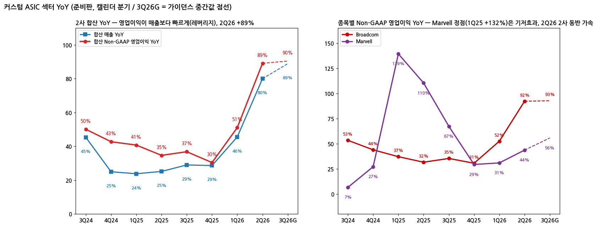
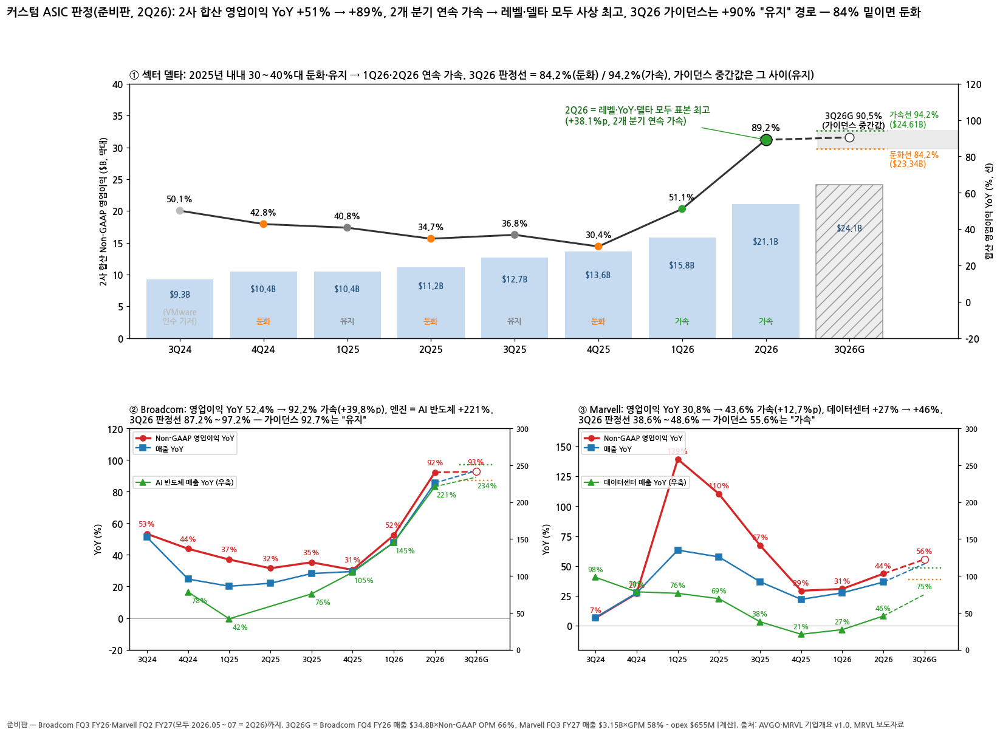

# 반도체 · 커스텀 ASIC 섹터 리뷰

> 현재 상태 (최신 분기 기준)
> 최신 분기: 2026-Q2
> 섹터 델타: 가속 | 내러티브: 강화
> 모멘텀 신호: 델타 급증 후보 — 2Q26 합산 영업이익 YoY +51.1% → +89.2%, 2사 모두 가속 — BT 보류 (테마 전체 종료 상태, 신규 테마 후보로 관찰)
> 활성 테마: 없음
> 포지셔닝: 서브섹터 확대 | 한국 해당 없음 | 1등 Broadcom
> 편입 종목: Broadcom, Marvell
> 갱신 시각: 2026-11-23 10:00 KST

**[준비판] 3Q26 실적 전에 미리 쓴 판이다 (BT 지시 "미리 섹터 리뷰 작성해서 추후 업데이트", 2026-11-22).** 판정은 이미 발표된 2Q26 숫자(Broadcom FQ3 FY26·Marvell FQ2 FY27, 둘 다 2026년 5～7월)로 냈다. 3Q26 실적이 나오면 이 문서를 갱신한다 — Marvell FQ3 FY27은 2026-12-01(ET, 한국 12/2 오전), Broadcom FQ4 FY26은 2026-12-09(ET, 한국 12/10 오전). 두 종목 모두 v11 실적 리뷰(earnings-review)가 아직 없다. 그래서 숫자는 기업개요(`company-overview/AVGO_기업개요.md`·`MRVL_기업개요.md`, v1.0 2026-11-15)에서 가져왔고, 종목별 판정도 리뷰 0번 인용이 아니라 같은 기준을 이 문서에서 직접 적용한 값이다 [준비판]. 셀사이드 해석은 반영하지 않았다

## 누적 시계열

| 분기 | 편입 종목 | 합산 매출 | 합산 영업이익 | OPM | 매출 YoY | 영업이익 YoY | 영업이익 YoY 델타 (%p) | 섹터 델타 | 내러티브 | 모멘텀 신호 | 활성 테마 |
|---|---|---|---|---|---|---|---|---|---|---|---|
| 3Q23 | AVGO·MRVL | $10,714M | $6,170M | 57.6 | — | — | — | — | - | - | - |
| 4Q23 | 동일 | $13,388M | $7,313M | 54.6 | — | — | — | — | - | - | - |
| 1Q24 | 동일 | $13,648M | $7,416M | 54.3 | — | — | — | — | - | - | - |
| 2Q24 | 동일 | $14,345M | $8,280M | 57.7 | — | — | — | — | - | - | - |
| 3Q24 | 동일 | $15,570M | $9,261M | 59.5 | +45.3 | +50.1 (VMware 인수 기저) | — | — | - | - | - |
| 4Q24 | 동일 | $16,733M | $10,440M | 62.4 | +25.0 | +42.8 | -7.3 | 둔화 | - | - | - |
| 1Q25 | 동일 | $16,899M | $10,440M | 61.8 | +23.8 | +40.8 | -2.0 | 유지 | - | - | - |
| 2Q25 | 동일 | $17,958M | $11,154M | 62.1 | +25.2 | +34.7 | -6.1 | 둔화 | - | - | - |
| 3Q25 | 동일 | $20,090M | $12,674M | 63.1 | +29.0 | +36.8 | +2.1 | 유지 | - | - | - |
| 4Q25 | 동일 | $21,530M | $13,618M | 63.3 | +28.7 | +30.4 | -6.4 | 둔화 | - | - | - |
| 1Q26 | 동일 | $24,605M | $15,775M | 64.1 | +45.6 | +51.1 | +20.7 | 가속 | - | - | - |
| **2Q26** | **AVGO·MRVL** | **$32,330M** | **$21,098M** | **65.3** | **+80.0** | **+89.2** | **+38.1** | **가속** | **강화** | **델타 급증 후보** | **에이전트AI (2026-Q2～)** |

→ **합산 기준 — Non-GAAP 영업이익, 달러 단일 통화.** 두 회사 모두 Non-GAAP을 주 지표로 쓴다(Broadcom은 FQ3 FY26부터 가이던스 지표를 조정 EBITDA에서 Non-GAAP 영업이익으로 바꿨다). GAAP은 인수 무형상각(Broadcom 분기 약 $2.0B, Marvell 연 $0.9～1.1B)·SBC·Marvell 구조조정(3Q24 GAAP OPM -46%)으로 Marvell이 2024년 내내 적자라 YoY가 n.m.이다 (각 기업개요 ① 기업 분류·12분기 표)
→ **캘린더 정렬**: 두 회사 회계분기가 같은 달에 끝나 그대로 맞춘다. 2Q26 = Broadcom FQ3 FY26(2026-05-04 ～ 08-02) = Marvell FQ2 FY27(2026-05-03 ～ 08-01). 3Q23 = Broadcom FQ4 FY23 = Marvell FQ3 FY24 (기업개요 12분기 표의 캘린더 기간 열)
→ **Broadcom 숫자**: `AVGO_기업개요.md` 12분기 시계열의 매출·Non-GAAP 영업이익(회사 보도자료)을 그대로 썼다
→ **Marvell 숫자**: 1Q25·2Q25·4Q25·1Q26·2Q26은 보도자료 원문의 Non-GAAP 영업이익이다($647.3M·$698.8M·$791.8M·$846.9M·$1,003.2M — `company-overview-source/MRVL_Marvell/ex99_Q1FY27.htm`·`pr_FQ2FY27.htm`). 나머지 분기는 기업개요 12분기 표의 Non-GAAP OPM(소수 첫째 자리) × 매출로 계산했다 [계산 — 반올림 오차 ±$1M]
→ **비영업 요인**: Broadcom 3Q24 YoY(+50.1%)는 VMware 편입(2023-11-22) 전 분기(3Q23)와 비교한 값이라 인수 효과가 섞여 있다. 그래서 델타 판정은 4Q24부터 한다(4Q23부터 양쪽 모두 VMware 포함). Marvell은 2025-08-14 자동차 이더넷 사업을 Infineon에 팔아 3Q25 이후 매출 기저가 낮아졌다 — 2Q26 YoY는 매각 사업이 남아 있던 2Q25와 비교한 값이라 오가닉 기준보다 약간 낮다 (매각 사업 매출 미공시, `MRVL_기업개요.md` 최종시장 표 주석). 2Q26에 인수가 주도한 가속은 없다
→ **표본 쏠림**: 2Q26 합산 영업이익의 95%가 Broadcom($20,095M vs Marvell $1,003M)이고, 합산 YoY 증가분 +$9,944M 중 97%(+$9,640M)도 Broadcom이다 [계산]. 섹터 판정은 사실상 Broadcom 판정이다. Marvell 방향은 ②에서 따로 본다
→ 내러티브·모멘텀·테마 열은 소급 분기에 섹터 리뷰가 없어 `-`. 2Q26 활성 테마는 같은 반도체 서브섹터(메모리·로직·CPU·파운드리) 리뷰와 같은 기준이다. 단 Broadcom·Marvell은 에이전트AI 테마분석 `active_companies`에 없다 (⑤ 참고)

---

## 2026-Q2 섹터 리뷰

> 대상: Broadcom FQ3 FY26, Marvell FQ2 FY27 (둘 다 2026년 5～7월). 개별 v11 실적 리뷰 없음 — 기업개요 v1.0 기준 [준비판]
> 2층 구조의 서브섹터 리뷰다. 섹터 비중(1단계)과 서브섹터 순위(2단계)는 반도체 통합 리뷰(`반도체_섹터리뷰.md`, 잠정판)가 맡는다. 이 문서는 커스텀 ASIC 판정, 서브섹터 안 대비, 1등 종목(3단계)에 답한다
> 첫 커스텀 ASIC 리뷰라 직전 분기 관전 포인트·⑦ 콜 체크는 없다
> 참고: `earnings-review/2026-Q2_AVGO_리뷰.md`는 FQ2 FY26(2026년 2～4월)을 "2026-Q2"로 적은 옛 형식 리뷰다. 이 문서의 캘린더 기준으로는 **1Q26**에 해당한다

① 섹터 합산 숫자와 델타

| 항목 | 3Q24 | 4Q24 | 1Q25 | 2Q25 | 3Q25 | 4Q25 | 1Q26 | **2Q26** | 3Q26G |
|---|---|---|---|---|---|---|---|---|---|
| 합산 매출 ($M) | 15,570 | 16,733 | 16,899 | 17,958 | 20,090 | 21,530 | 24,605 | **32,330** | 37,950 |
| 합산 Non-GAAP 영업이익 ($M) | 9,261 | 10,440 | 10,440 | 11,154 | 12,674 | 13,618 | 15,775 | **21,098** | 24,140 |
| OPM (%) | 59.5 | 62.4 | 61.8 | 62.1 | 63.1 | 63.3 | 64.1 | **65.3** | 63.6 |
| 매출 YoY (%) | +45.3 | +25.0 | +23.8 | +25.2 | +29.0 | +28.7 | +45.6 | **+80.0** | +88.9 |
| 영업이익 YoY (%) | +50.1 | +42.8 | +40.8 | +34.7 | +36.8 | +30.4 | +51.1 | **+89.2** | +90.5 |
| **영업이익 YoY 델타 (%p)** | — | -7.3 | -2.0 | -6.1 | +2.1 | -6.4 | +20.7 | **+38.1** | +1.3 |
| 판정 | — | 둔화 | 유지 | 둔화 | 유지 | 둔화 | 가속 | **가속** | 유지 (가이던스 경로) |

→ (출처: `AVGO_기업개요.md`·`MRVL_기업개요.md` 12분기 표, Marvell 보도자료 원문 [계산]. 3Q26G = 회사 가이던스 중간값 — Broadcom FQ4 FY26 매출 약 $34.8B × Non-GAAP OPM 약 66% = $22,968M (2026-09-02 보도자료·컨콜), Marvell FQ3 FY27 매출 $3,150M × Non-GAAP GPM 중간값 58% - Non-GAAP 영업비용 약 $655M = $1,172M (기업개요 계산 방식 그대로) [계산])
→ 컨센서스는 확보하지 못했다. 3Q26E는 가이던스 중간값만 쓴다. 두 회사 모두 최근 분기에 가이던스를 넘겼다는 점은 기업개요에서 확인된다(예: Broadcom FQ2 FY26 매출 $22.2B vs 가이던스 $22.0B — `2026-Q2_AVGO_리뷰.md`) [준비판]
→ **이익 레벨**: 2Q26 합산 Non-GAAP 영업이익 $21.1B, OPM 65.3%로 둘 다 표본 내 최고다. QoQ 증가액 +$5.3B도 표본 최대다 [계산]
→ **2025년 = 30～40%대 고원**: 합산 영업이익 YoY는 4Q24부터 4Q25까지 +43% → +30%로 천천히 내려왔다(둔화 3번·유지 2번). 1Q26(+51%)에 방향을 틀었고 2Q26(+89%)에 크게 뛰었다. Broadcom AI 반도체 매출이 $5.2B → $16.7B(+221%)로 늘어난 분기다
→ **컨센 경로상 정점**: 가이던스 경로로는 3Q26 +90.5%로 YoY가 한 번 더 높아진다(델타 +1.3%p = 유지). 반면 OPM은 65.3% → 63.6%로 표본에서 처음 꺾인다 — XPU·랙 매출 비중이 커지면서 매출총이익률이 희석되기 때문이다(③(3)). 4Q26 경로는 Broadcom이 12/9 내놓을 FQ1 FY27 가이던스가 정한다. 회사 전망대로 FY2027 AI 매출이 약 $115B(FY2026 약 $58B의 2배)면 2027년 내내 YoY가 높은 수준에 머무는 경로다 [판단]

→ (출처: 기업개요 2종 [계산]. 왼쪽 = 2사 합산 매출 YoY·Non-GAAP 영업이익 YoY / 오른쪽 = 종목별 Non-GAAP 영업이익 YoY. 점선 = 3Q26 가이던스 중간값)

② 종목별 델타 판정표

| 델타 순위 | 종목 | 구분 | 매출 YoY | Non-GAAP 영업이익 YoY | 영업이익 YoY 델타 | 3Q26 가이던스 YoY (델타) | 델타 판정 | 내러티브 | 비영업 요인 | 한 줄 |
|---|---|---|---|---|---|---|---|---|---|---|
| 1 | Broadcom | 핵심 · XPU + AI 네트워킹 + 소프트웨어 | +85.5% | +92.2% | +39.8%p (1Q26 +52.4%) | 약 +92.7% (+0.5%p) | 가속 [준비판] | 강화 [준비판] | 없음 (VMware 효과는 4Q24부터 소멸) | AI 반도체 $16.7B(+221%), 반도체 사업부 영업이익 +145%. FY27 AI 약 $115B·FY28 약 $230B 전망 |
| 2 | Marvell | 핵심 · 인터커넥트 + 커스텀 | +36.5% | +43.6% | +12.7%p (1Q26 +30.8%) | 약 +55.6% (+12.0%p) | 가속 [준비판] | 강화 [준비판] | 자동차 이더넷 매각(2025-08) — 기저 축소, YoY 하향 방향 | 데이터센터 +46%(1Q26 +27%), 3Q26 데이터센터 약 +75% 가이던스. Google 커스텀 계약(2026-07) |

→ (출처: 기업개요 12분기 표·사업부 표·가이던스 표 [계산]. **판정은 종목 리뷰 0번 인용이 아니다** — 두 종목 모두 v11 리뷰가 없어 섹터 기준(±5%p)을 이 문서에서 적용했다. 12/1·12/9 실적 리뷰가 나오면 그 판정으로 교체한다 [준비판])
→ **내러티브 판정 근거 (종목)** [판단]: Broadcom — 2Q26 분기 안에 Google 차세대 TPU 장기공급계약(최장 2031)·Anthropic 확대(4/6 8-K), AI XPV 플랫폼(6월), Apple 커스텀 ASIC 계약 연장(7/6 8-K)이 나왔고, 발표 때 FY2027·2028 AI 전망을 처음 제시했다 → 강화. Marvell — Google TPU 생태계 커스텀 계약(7/29, 워런트 최대 5,897만 주)·Nvidia 전환우선주 $2.0B(3/31)가 나왔고, FY2027 매출 약 $12B·FY2028 약 $18B를 제시했다 → 강화. **단 분기가 끝난 뒤 나온 악재(Broadcom 잔존가치 보증 최대 약 $43B 10/27, Marvell Lumentum 전액 주식 인수 11/2, 11/5 섹터 급락)는 3Q26 판정에서 반영한다**
→ **델타 순위**: 2Q26 델타는 Broadcom(+39.8%p) > Marvell(+12.7%p). 3Q26 가이던스 델타로 보면 Marvell(+12.0%p) > Broadcom(+0.5%p)으로 순서가 바뀐다 — Broadcom은 2Q26에 +92%까지 올라간 뒤 그 수준을 유지하는 경로이고, Marvell은 데이터센터 커스텀 매출이 하반기에 가속하는 경로다(FY2026 커스텀 약 $1.5B → "FY2027 하반기 급가속", 기업개요 ③ 사업 개요)
→ **섹터 델타를 끈 것**: Broadcom 반도체 사업부. 2Q26 반도체 사업부 영업이익 $12,770M(+144.8% YoY)로, 소프트웨어 $7,325M(+39.8%)의 3.6배를 더 늘렸다(증가액 +$7,553M vs +$2,087M) [계산 — 기업개요 사업부 분기 원자료]. Non-AI 반도체는 $4.2B(+5%)로 보탬이 거의 없다
→ **선행 종목은 Broadcom**이다. 가속이 1Q26에 먼저 시작됐고(Broadcom +52.4% vs Marvell +30.8%), 가이던스로 보면 YoY 고점(3Q26 약 +93%)에도 먼저 다가선다. Marvell은 1Q25에 +139%를 찍었지만 이는 통신 재고조정 저점(1Q24 OPM 23.3%) 기저효과였고, 이후 4Q25 +29%까지 내려왔다가 다시 가속 중이다 — 두 회사의 이익 사이클이 1～2개 분기 어긋나 있다 [판단]

③ 섹터 공통 쟁점

> **기업개요 기반 정리다 — 셀사이드 해석 미반영 [준비판].** 쟁점은 두 회사 기업개요의 공시·컨콜 사실에서 뽑았다. "셀사이드 해석이 종목 간 어떻게 다른지"는 12월 실적 리뷰에 첨부되는 리포트로 채운다

(1) 하이퍼스케일러 커스텀 실리콘 프로그램 — 같은 고객 안에서 겹친다 (2사 공통)

| 고객 | Broadcom | Marvell | 출처 |
|---|---|---|---|
| Google | TPU 설계·공급 10년 파트너. Ironwood(v7) 대량 출하, v8i 출하 시작. 차세대 TPU 장기공급계약 + AI 랙 네트워킹 공급보장(최장 2031) | 2026-07-29 커스텀 실리콘 계약 — TPU 생태계 부속(추론 가속기·NIC·스토리지 컨트롤러·메모리 인터페이스). 워런트 $500M 매출당 1트랜치(총 240), 전량 베스팅 = 누적 커스텀 매출 $120B [기업개요 계산] | AVGO 8-K 2026-04-06, MRVL 8-K 2026-08-19 |
| AWS | (공시 범위에 없음) | 5년·다세대 협력(Trainium 계열 커스텀·광 DSP·AEC), 워런트 최대 418만 주 | MRVL 8-K 2024-12-02 |
| Meta | MTIA — 2027년 말까지 3개 세대, 2028년까지 3GW | — | AVGO FQ2·FQ3 FY26 컨콜 |
| OpenAI | 1세대 XPU 출하 시작, 2027년 1.3GW·2028년 5GW 이상 | — | AVGO FQ2·FQ3 FY26 컨콜 |
| Anthropic | TPU 랙 주문 $10B + $11B, 2027년 v8i 5GW → "2027년 최대 XPU 고객" 전망 | — | AVGO FQ4 FY25·FQ3 FY26 컨콜 |
| Microsoft | — | "또 다른 미국 하이퍼스케일러 차세대 XPU" — Maia로 추정 [추정·언론 보도] | MRVL 기업개요 |

→ 공통: 두 회사 모두 하이퍼스케일러 자체 설계 칩의 외주 설계·공급자다. 2026년에 장기계약(LTA)과 워런트 형태로 고객을 묶는 계약이 늘었다
→ 갈리는 지점: Broadcom은 **메인 XPU**(Google TPU 본체·Meta·OpenAI·Anthropic)이고, Marvell은 AWS 외에는 **XPU 부속(attach)** 위주다. Google 안에서는 Broadcom이 본체, Marvell이 주변 칩으로 함께 들어간다
→ **[판단]** 2Q26 델타 차이(+39.8%p vs +12.7%p)는 이 위치 차이를 그대로 보여준다. 메인 XPU는 랙·GW 단위로 매출이 붙고(Broadcom: GW당 콘텐츠 $20～30B), 부속 칩은 그보다 늦고 작게 붙는다. Marvell의 커스텀 매출이 데이터센터의 25%(FY2026 약 $1.5B / $6.1B)에서 회사 목표(FY2029 $12B 초과)대로 커지기 전까지 서브섹터 델타는 Broadcom이 정한다

(2) 고객 집중 (2사 공통)

| 종목 | 집중도 | 출처 |
|---|---|---|
| Broadcom | 단일 고객 21%(FY23) → 28%(FY24) → **32%(FY25)**, 상위 5개 최종 고객 약 40%, 유통사 경유 48%, XPU 고객 6곳 | 10-K FY2025 |
| Marvell | **상위 10대 고객 82%**, 유통사 A 37%·직접 고객 A 14% | 10-K FY2026 |

→ 공통: 두 회사 모두 고객 수가 적고, 고객의 데이터센터 CapEx·부지·전력 일정에 따라 출하가 움직인다(Broadcom FQ3 FY26 컨콜 "다차원 병목", Marvell 10-Q가 데이터센터 입지 반대·전력·물 문제를 리스크로 새로 적음)
→ **[판단]** 고객 집중은 델타 가속 구간에서는 레버리지(대형 프로그램 하나가 YoY를 수십 %p 움직인다)이고, 둔화 구간에서는 급락 요인이다. Broadcom 재분류 트리거가 "단일 고객 50% 초과"인데, 2027년 Anthropic이 최대 XPU 고객이 된다는 전망이 맞으면 FY2026 10-K(12월 중순)부터 고객 구성이 바뀐다 — ⑥ 관전 포인트

(3) 매출총이익률 희석 — XPU·랙 믹스 (2사 공통)

| 종목 | GPM 방향 | OPM 방향 | 회사 코멘트 |
|---|---|---|---|
| Broadcom | Non-GAAP GPM 약 78%(1년 전) → 75%(FQ3 FY26) → 약 73%(FQ4 가이던스, HBM 등 메모리 원가 포함) | 67.9%(FQ3) → 약 66%(FQ4 가이던스) | "총이익률 말고 영업이익률을 보라" |
| Marvell | Non-GAAP GPM 64.9%(FY2022) → 58.9%(FQ2 FY27) → 57.5～58.5%(FQ3 가이던스) | 36.6%(FQ2) → 약 37%(FQ3 계산) → FQ4 FY27에 장기 목표 38～40% 진입 | 커스텀 확대가 FQ3 GPM 하락 요인 |

→ (출처: 각 기업개요 ④ 밸류에이션·⑥ 가이던스·③ 리스크)
→ 공통: 커스텀 비중이 커질수록 GPM이 내려간다. Broadcom은 XPU에 HBM 같은 메모리까지 묶어 랙 단위로 팔기 시작했다
→ 갈리는 지점: OPM 방향이 반대다. Broadcom은 이미 OPM 66～68%라 GPM 희석이 OPM을 끌어내리고(3Q26 가이던스 -1.9%p), Marvell은 OPM이 30%대라 opex 레버리지가 GPM 희석을 이긴다(3Q26 +0.4%p, 4Q26 38～40%)
→ **[판단]** 섹터 합산 OPM이 3Q26에 처음 꺾이는 이유가 이것이다(65.3% → 63.6%). 영업이익 YoY는 매출 성장으로 유지되지만, "매출 YoY > 영업이익 YoY"로 뒤집히는 분기가 오면 델타가 꺾이는 신호다. 3Q26 가이던스상 매출 +88.9% vs 영업이익 +90.5%로 차이가 1.6%p까지 좁아진다 [계산]. NVDA 리뷰의 "ASIC 경쟁 속 GPU 가격결정력" 쟁점(`2026-Q3_NVDA_리뷰.md` 쟁점 3, SK증권: "모델사들은 엔비디아의 높은 마진을 좋아하지 않는다")은 이 마진 구조의 반대편이다 — 고객이 ASIC을 쓰는 이유가 낮은 마진(Broadcom: "XPU는 GPU 대비 절반 이하 비용")이다

(4) AI 네트워킹·광 — 둘 다 수직계열화로 간다 (2사 공통)

| 종목 | 2Q26 현황 | 다음 단계 |
|---|---|---|
| Broadcom | AI 네트워킹 출하 YoY 2.5배 이상(Tomahawk 6·Tomahawk Ultra·광 DSP·레이저), XPU가 AI 매출의 73% | 싱가포르 기판 공장 FY2027 가동, GaAs/InP 레이저 자체 팹, FQ4 CapEx $1.4B |
| Marvell | 데이터센터 최대 제품군은 인터커넥트(PAM4·코히어런트 DSP·AEC) [추정], FY2027 인터커넥트 +50% 초과, 스위치 $600M 초과 | Celestial AI CPO(2028년 연환산 $500M 목표), **Lumentum 인수(EV $115B, 2028년 상반기 종결 예정)** → 팹리스에서 부분 제조형으로 |

→ (출처: 각 기업개요 ② 회사 개요·③ 비즈니스 모델·⑥ Corporate Action)
→ 공통: 커스텀 XPU 다음 병목이 광·레이저·기판이라고 보고, 두 회사 모두 그 앞단 공정을 직접 갖기 시작했다
→ 갈리는 지점: Broadcom은 자체 증설(CapEx)로, Marvell은 대형 주식 인수로 간다. Marvell은 인수가 끝나면 주식 수가 약 1.5배가 되고(Marvell 67% : Lumentum 33%) 광부품 업황 사이클을 떠안는다 [기업개요 계산]
→ **[판단]** 광 사이클은 테마 연결 후보다. 같은 반도체 섹터의 파운드리 리뷰가 CoWoS·첨단 패키징을 에이전트AI의 구조적 병목으로 보고 있고(`2026-Q3_TSM_리뷰.md` — HPC 매출 +68% YoY, 비중 68%), 커스텀 ASIC 두 회사의 2027년 공급 확보(Broadcom "FY2027 공급 확보 완료", Marvell 공급 선급금 약 $1B)도 같은 병목을 상대한다

(5) 주가 — 2Q26 실적 발표 뒤 이익과 반대로 갔다 (2사 공통)

| 종목 | 사상 최고 → 2026-11-13 | 계기 | 밸류에이션 (2026-11-13) |
|---|---|---|---|
| Broadcom | 종가 $481.57(6/2) → $347.01, **-27.9%** (11/5 52주 최저 $291.53) | 6/4 FQ2 발표 후 -12.6%, 9/2 FQ3 발표 후 3개월 하락, 11/5 -10.4% | TTM Non-GAAP P/E 약 35.6배, 회사 목표 FY2028 EPS $30 초과 기준 약 11.6배 |
| Marvell | 종가 $316.43(6/4) → $156.76, **약 -50%** | 11/2 Lumentum 인수 발표 -12.7%, 11/5 AI 데이터센터 규제 우려 -16.4% | TTM Non-GAAP P/E 약 47.5배 |

→ (출처: 각 기업개요 주가 역사·밸류에이션 [Yahoo Finance v8, 계산])
→ **[판단]** 2Q26 이익은 가속했는데 주가는 고점에서 30～50% 빠졌다. 원인은 이익 경로가 아니라 (a) 분기 이후 나온 재무 구조 이벤트(보증·인수)와 (b) 11/5 AI 데이터센터 규제 우려에 따른 섹터 멀티플 축소다. 로직·CPU 리뷰의 "이익보다 멀티플이 먼저 빠졌다"(쟁점 4)와 같은 그림이다. 델타 프레임에서는 3Q26 숫자가 가이던스 경로(+90%)를 지키는지가 먼저다

(6) 종목 고유 이슈
→ Broadcom: AI XPV 플랫폼(금융 파트너가 AI 연구소용 XPU 설비 자금을 대는 구조)과 **잔존가치 보증 Backstop 최대 약 $43B**(2026-10-27 8-K) — 고객 리스 불이행 시 손실 가능. VMware 구독 전환(ARR +19% → +17% → +15%로 둔화), 총차입 $59.4B
→ Marvell: **Lumentum 전액 주식 인수**(교환비율 4.5, 해지수수료 Marvell $5.8B·규제 해지 $3.2B), Celestial AI 조건부 대가 평가손익(FQ1 FY27 -$256M, 영업외), 선적지 기준 중국 42%

④ 섹터 판정

> 섹터 델타: **가속** | 내러티브: **강화** → **2Q26 합산 영업이익 YoY +51% → +89%로 2개 분기 연속 가속, 레벨·성장률·델타 모두 표본 최고 — Broadcom AI 반도체(+221%)가 혼자 만든 가속. 3Q26 가이던스는 +90.5%로 "유지" 경로이고 OPM은 처음 꺾인다. 3Q26 합산 영업이익 YoY 84.2% 미만이면 둔화 [준비판]**

→ (출처: 기업개요 2종·Marvell 보도자료 [계산]. 상단 = 2사 합산 Non-GAAP 영업이익(막대, 3Q26G 빗금 = 가이던스 중간값)과 YoY(선, 점 색 = 분기 판정), 3Q26 판정선(둔화 84.2% / 가속 94.2%) / 하단 왼쪽 = Broadcom Non-GAAP 영업이익·매출·AI 반도체 매출 YoY / 하단 오른쪽 = Marvell Non-GAAP 영업이익·매출·데이터센터 매출 YoY. 하단 점선 가로선 = 종목별 3Q26 판정선(2Q26 YoY ±5%p))

→ **델타 판정 근거**: 1Q26 → 2Q26 합산 Non-GAAP 영업이익 YoY가 +51.1% → +89.2%(+38.1%p)로 기준(+5%p 초과)을 크게 넘었다. 1Q26(+20.7%p)에 이은 2개 분기 연속 확대이고 두 종목 모두 가속이다 — "가속"
→ **다음 분기 예고**: 가이던스 중간값 합산은 3Q26 +90.5%(+1.3%p)로 "유지" 경로다. Broadcom은 +92.2% → +92.7%(유지), Marvell은 +43.6% → +55.6%(가속)이다. 섹터 "가속" 판정을 이어가려면 3Q26 합산 영업이익이 $24.61B 이상이어야 하고, 이는 Broadcom이 가이던스보다 영업이익을 약 $0.47B 더 내야 한다는 뜻이다(Marvell 가이던스 달성 전제: Broadcom 매출 $34.8B에서 Non-GAAP OPM 약 67.3%, 또는 OPM 66%에서 매출 약 $35.5B) [계산]
→ **내러티브 판정 근거**: 두 종목 모두 강화(②)다. 서브섹터 공통 스토리("하이퍼스케일러·AI 연구소가 자체 칩을 늘리면서 커스텀 XPU 외주 설계 수요가 GPU보다 빠르게 큰다")가 2Q26 숫자로 확인됐다 — Broadcom AI 반도체 +221%, XPU 출하 YoY 3.5배 이상, Marvell 데이터센터 +46%. 장기계약(Google 최장 2031·Apple 2031·Marvell Google 워런트 FY2033까지)으로 가시성도 길어졌다 → "강화" [판단]. 분기 이후 악재(보증·인수·주가 급락)는 내러티브 약화 후보로 3Q26에서 다시 본다
→ **직전 판정 대비**: 첫 커스텀 ASIC 리뷰다. 소급 궤적은 4Q24 둔화 → 1Q25 유지 → 2Q25 둔화 → 3Q25 유지 → 4Q25 둔화(+30.4%, 표본 저점) → 1Q26 가속 → 2Q26 가속. 2025년 1년 동안 30～40%대 고원에서 천천히 내려오다 2026년 상반기에 위로 튀었다. 표본 기간에 "꺾임"은 없었다

⑤ 모멘텀 신호

→ **델타 급증 후보 — BT 판단 필요**

| 근거 | 2Q26 | 충족 여부 |
|---|---|---|
| 섹터 델타 뚜렷한 확대 | 합산 영업이익 YoY +30.4%(4Q25) → +51.1%(1Q26) → +89.2%(2Q26), 델타 +20.7%p → +38.1%p — 2개 분기 연속 확대 | 충족 |
| 편입 종목 과반 가속 | Broadcom 가속(+39.8%p)·Marvell 가속(+12.7%p) — 2/2 | 충족 |
| 내러티브 형성·강화 | 2사 모두 강화 (장기계약·FY27～28 전망) | 충족 |

→ 연결 테마 제안 (제안일 뿐): **"에이전트AI 추론 수요 → 커스텀 XPU(TPU·MTIA·Trainium·OpenAI XPU)" 레이어**. 에이전트AI는 반도체 섹터에 이미 활성 테마(2026-Q2～)로 걸려 있지만, 테마분석 `active_companies`(dominant 8·challenger 2·macro 4)에 Broadcom·Marvell이 없다. 테마분석 본문은 Broadcom ASIC을 "하이퍼스케일러 30%+, Google·Meta"로 적고 있다(`earnings-theme/에이전트AI_테마분석.md` 병목 표). 새 테마를 여는 것이 아니라 **기존 에이전트AI 테마에 커스텀 ASIC 레이어를 넣을지**가 BT 판단 대상이다
→ **반대 논거**
→ (1) 신호가 늦다: 2Q26 숫자는 9월 초에 나왔고, 그 뒤 두 종목 주가가 고점 대비 -28%·-50%다. 시장은 이미 다음 분기(보증·인수·규제)를 가격에 넣고 있다. 12/1·12/9 숫자로 다시 확인해야 한다
→ (2) 표본 쏠림: 가속의 97%가 Broadcom 한 회사, 그 안에서도 AI 반도체(고객 6곳)에서 나왔다. 고객 하나의 랙 일정이 미뤄지면 신호가 사라진다
→ (3) 3Q26 가이던스 경로가 "유지"(+1.3%p)이고 OPM이 처음 꺾인다. "델타 급증"은 2Q26 한 분기의 점프일 수 있다 — 3Q26이 84.2% 밑이면 후보를 거둔다
→ (4) 레이어 성격: 커스텀 ASIC의 가속은 Nvidia GPU의 마진 압력(NVDA 리뷰 쟁점 3)과 한 쌍이다. 로직(GPU) 레이어 둔화와 커스텀 레이어 가속이 같이 나오면 테마 전체 강화가 아니라 테마 안 점유율 이동일 수 있다 [판단]
→ 테마 종료 후보 조건 대조 (활성 테마 에이전트AI): ① 섹터 델타 둔화·꺾임 전환 — 미충족(가속) ② 선행 종목 꺾임 — 미충족(Broadcom 가속) → 해당 없음

(1) BT 판단 (2026-11-23)
→ **보류 — "우선 지켜보자".** 델타 급증 후보 유지, 에이전트AI 테마에 커스텀 ASIC 레이어를 넣을지는 12/1 Marvell·12/9 Broadcom 3Q26 실적을 보고 판단

(테마) BT 판단 (2026-11-23)
→ **에이전트AI 포함 시장 전체 테마 종료** (BT). 이 서브섹터의 델타 급증 후보는 종료된 테마의 레이어가 아니라 **신규 테마 후보**로 관찰 — 12/1·12/9 실적 후 BT 판단

⑥ 다음 분기 섹터 관전 포인트

| 순위 | 무엇을 (변수·임계값) | 어떤 데이터로 | 언제 |
|---|---|---|---|
| 1 | **3Q26 2사 합산 Non-GAAP 영업이익 YoY 84.2% 이상 — 미만이면 둔화.** 금액으로는 $23.34B 이상(3Q25 $12,674M 기준). 94.2%($24.61B) 이상이면 가속. 가이던스 중간값 합산 $24.14B(+90.5%)는 유지. 종목별 기준선(각 2Q26 YoY ±5%p): Broadcom $22.32B(+87.2%) ～ $23.51B(+97.2%), 가이던스 $22.97B / Marvell $1,043M(+38.6%) ～ $1,119M(+48.6%), 가이던스 $1,172M | Marvell FQ3 FY27, Broadcom FQ4 FY26 보도자료 | **2026-12-01 (ET) / 12-09 (ET)** |
| 2 | **Marvell 3Q26 데이터센터 YoY 약 +75%·FQ4 가이던스** — 매출 $3.15B ±2%(11/2 예비 공시 $3.087～3.213B) 안인지, 데이터센터 QoQ +20% 초과인지, FQ4 Non-GAAP OPM 38～40% 진입 가이던스가 유지되는지, Lumentum 합병 일정·주식 수 가정 | Marvell 보도자료·컨콜 | 2026-12-01 (ET) |
| 3 | **Broadcom AI 반도체 $21.7B(+236%)와 FQ1 FY27 가이던스** — 4Q26 섹터 판정을 정하는 숫자. FY2027 AI 약 $115B 유지·상향 여부, Non-GAAP OPM 66%·GPM 73% 하단 방어, 잔존가치 보증(Backstop) 회계 처리, FY2026 10-K 고객 집중도(단일 고객 32% → ?) | Broadcom 보도자료·컨콜, FY2026 10-K(12월 중순) | 2026-12-09 (ET) ～ 12월 중순 |
| 4 | **매출 YoY vs 영업이익 YoY 역전 여부** — 3Q26 가이던스상 격차 +1.6%p. 영업이익 YoY가 매출 YoY 밑으로 내려가면 마진 희석이 델타를 깎기 시작한 신호 | 2사 3Q26 실적 [계산] | 12-01 / 12-09 |
| 5 | **수요 측 교차 확인** — 하이퍼스케일러 4Q CapEx·2027 가이던스, Nvidia GPM(ASIC 경쟁), TSMC CoWoS 증설 | 하이퍼스케일러 4Q 실적, Nvidia 4Q FY27, TSMC 4Q26 | 2027-01 하순 ～ 02 |

→ 1순위 판정선(84.2%)은 ④ 키 차트와 같다. 근거: 2Q26 합산 YoY +89.2%에서 "유지" 범위(±5%p)를 뺀 값이다. 2Q26이 "가속"이라 3Q26이 둔화여도 2개 분기 연속 둔화는 아니다 — 3Q26 둔화에 4Q26(Broadcom FQ1 FY27 가이던스 경로)도 둔화면 "꺾임" 후보다
→ **갱신 순서** [준비판]: 12/1 Marvell 발표 → Marvell v11 실적 리뷰 → 이 문서 ②의 Marvell 행·⑥ 2순위만 먼저 갱신(합산 판정은 보류) → 12/9 Broadcom 발표 → Broadcom 리뷰 → 이 문서에 `## 2026-Q3 섹터 리뷰` 섹션을 맨 위에 추가하고 상태 블록·누적 시계열 3Q26 행을 갱신 → 반도체 통합 리뷰(`반도체_섹터리뷰.md`) 글로벌 재판정

⑦ 글로벌 PM 포지셔닝 — 결론

> **서브섹터: 확대 — 3Q26 합산 YoY 84.2% 이상 유지 시 확대 유지, 미만이면 유지로 하향** | **서브섹터 내: 한국 해당 없음 (대체 축 = AI·데이터센터 > 비AI)** | **1등: Broadcom (글로벌) / 한국 비교 불가 — 편입 종목 없음** [준비판]

(1) 서브섹터 판정 — 확대 / 유지 / 축소

| 판단 축 | 2Q26 근거 | 방향 |
|---|---|---|
| 이익 델타 (1순위) | 합산 +51.1% → +89.2%(가속, 2개 분기 연속), 2사 모두 가속 | 확대 |
| YoY 정점 시점 | 가이던스 경로상 3Q26 +90.5%가 표본 최고 — 정점 미도래. Broadcom은 3Q26 고원, Marvell은 상승 중 | 확대 (3Q26 이후 고원 경계) |
| 선행지표 | Broadcom RPO $179.2B(FQ3 FY26), FY27 AI 약 $115B(공급 확보 완료)·FY28 약 $230B / Marvell FY27 매출 약 $12B·FY28 약 $18B(Investor Day 약 $20B, 2차 보도) | 확대 |
| 최종 수요 | 하이퍼스케일러·AI 연구소 GW 단위 계약(Anthropic 2027 5GW, OpenAI 2028 5GW, Meta 2028 3GW). TSMC HPC +68%(3Q26) | 확대 |
| 이벤트·정책 | Broadcom 보증 최대 약 $43B, Marvell Lumentum 인수, 11/5 AI 데이터센터 규제 우려 | 축소 쪽 |
| 이익 추정 방향 | 셀사이드 미확보 [준비판] — 회사 가이던스는 2사 모두 상향 이력(Broadcom FY26 AI $56B → $58B, Marvell FY28 $18B → $20B) | 확대 (근거 얇음) |
| 밸류에이션·낙폭 (2순위) | Broadcom TTM P/E 약 35.6배·고점 -27.9%, Marvell 약 47.5배·고점 약 -50% | 중립 (낙폭은 이익 경로보다 앞섰다) |

→ **결론: 서브섹터 확대** [판단]. 델타가 2개 분기 연속 가속했고, 가이던스 경로상 YoY 정점이 아직 앞(3Q26)에 있다. 같은 반도체 섹터에서 파운드리(확대)와 함께 델타가 가장 좋은 서브섹터 후보다(로직·CPU 유지, 메모리 축소 — 각 섹터 리뷰 상태 블록). 단 3Q26 가이던스는 "유지" 경로라 확대 근거는 2Q26 한 분기의 점프와 회사 전망에 기대고 있다. 12월 숫자로 재확인 전까지는 잠정이다
→ **확대 유지 조건**: 3Q26 합산 영업이익 YoY 84.2% 이상($23.34B) + Broadcom FY2027 AI 약 $115B 유지·상향. 94.2%($24.61B) 이상이면 3개 분기 연속 가속으로 확대 강화
→ **유지(하향) 전환 조건**: 3Q26 84.2% 미만(둔화) 또는 Broadcom FQ1 FY27 가이던스 영업이익 YoY가 3Q26보다 5%p 이상 낮음 → 유지. 둔화 + FY2027 AI 전망 하향이면 축소 검토

(2) 같은 서브섹터 안 한국 vs 글로벌 — **한국 해당 없음**

→ 편입 종목에 한국 종목이 없어 `비교 불가 — 편입 종목 없음`이다. 결론에서 국가 판단은 뺀다
→ **편입 후보 점검 (구멍)** [판단]: 커스텀 ASIC 설계 매출을 분기 손익으로 따로 공시하는 한국 상장사 중 Broadcom·Marvell과 비교할 만한 규모의 회사는 확인하지 못했다. 아이디어 수준으로만 남긴다: (a) 삼성 파운드리 디자인솔루션파트너(DSP) 계열 국내 디자인하우스 — 매출 규모·고객(하이퍼스케일러 노출) 미확인, 편입하려면 분기 실적 공시·발표일부터 확인 필요 (b) 국내 AI 반도체 팹리스(리벨리온·퓨리오사 등)는 자체 칩 회사라 외주 설계 모델이 아니고 상장·분기 공시도 확인 필요. 한국 투자자가 이 서브섹터의 델타를 담는 실제 경로는 공급망이다 — 삼성전자(삼성-Broadcom 5년 $200B 메모리·파운드리 수주, `에이전트AI_테마분석.md` 2026-07-25 SF AI Summit), SK하이닉스·삼성전자 HBM(Broadcom은 HBM 직접 발주처 — `earnings_calendar.md` 종목 메모). 이는 메모리·파운드리 서브섹터 리뷰에서 다룬다
→ 대체 대비 축 — **AI·데이터센터 vs 비AI** (서브섹터 안 승패를 가르는 축)

| 경쟁력 축 | AI·데이터센터 | 비AI | 우위 |
|---|---|---|---|
| 델타 방향 (1순위) | Broadcom AI 반도체 $16.7B(+221%, 1Q26 +145%), Marvell 데이터센터 $2,171.5M(+45.7%, 1Q26 +27.2%) | Broadcom Non-AI 반도체 $4.2B(+5%), Marvell 통신·기타 $567.8M(+10.1%, 1Q26 +28.7%) | AI·데이터센터 |
| 다음 분기 방향 | Broadcom AI $21.7B(+236%), Marvell 데이터센터 약 +75% | Broadcom Non-AI 약 $4.3B, Marvell 통신·기타 QoQ 10%대 초중반 감소 | AI·데이터센터 |
| 소프트웨어 (Broadcom만) | — | 인프라 소프트웨어 $8,752M(+29.0%), 사업부 영업이익 +39.8%, OPM 83.7% / ARR +15%로 둔화 | 안정 현금원 (델타 기여 작음) |
| 마진 | Broadcom 반도체 사업부 OPM 61.3%, 커스텀은 GPM 희석 | Broadcom 소프트웨어 OPM 83.7% | 마진은 비AI, 증가율은 AI |
| 매출 비중 | Broadcom AI 56%(전사), Marvell 데이터센터 79% | Broadcom Non-AI 14%·소프트웨어 30%, Marvell 21% | — |

→ (출처: 각 기업개요 사업부·최종시장 분기 표 [계산])
→ **결론: 서브섹터 안 승패 = AI 매출 비중과 그 안의 메인 XPU 비중** [판단]. Broadcom은 전사 매출의 56%가 AI이고 그 73%가 XPU다. Marvell은 데이터센터가 79%지만 커스텀은 그 25% 수준이다 — 2Q26 델타 순서(Broadcom > Marvell)와 같다
→ 이유 (1) 델타 방향: AI 반도체 +221% vs 데이터센터 +46% vs 비AI 한 자릿수～10%
→ 이유 (2) 이익 추정: 회사 전망 상향 폭 — Broadcom은 FY27 AI 전망을 처음 제시했고(약 $115B, FY26의 2배), Marvell은 FY28 매출 $18B → $20B(2차 보도)
→ 이유 (3) 구조: 메인 XPU는 GW 단위 계약(GW당 $20～30B)으로 붙는다
→ **반대 논거**: Marvell의 커스텀 매출이 하반기에 급가속하면(회사: FY2027 하반기, FY2028 2배 이상) 3Q26～4Q26 델타는 Marvell이 앞설 수 있다 — 3Q26 가이던스 델타는 이미 Marvell 우위(+12.0%p vs +0.5%p)다. 주가 낙폭도 Marvell이 더 크다(-50% vs -28%). 이것은 델타 프레임 안의 1등 교체 시나리오다
→ **비교 범위**: 두 회사 기업개요(SEC 10-K·10-Q·8-K, 보도자료, 컨콜)만 썼다. 셀사이드 리포트·컨센서스 없음. 대만 디자인하우스(Alchip·GUC)·MediaTek(TPU 일부 세대)은 숫자가 없어 비교에서 뺐다 — 근거 얇음 [준비판]

(3) 커스텀 ASIC 1등 종목

| 구분 | 종목 | 델타 판정 | 근거 한 줄 |
|---|---|---|---|
| **글로벌 1등 (서브섹터 1등)** | Broadcom | 가속 · 강화 [준비판] | 2Q26 델타 1위(+39.8%p, 영업이익 YoY +92.2%), 합산 이익의 95%, AI 반도체 +221%, FY27 AI 약 $115B. 3Q26 가이던스는 고원(+92.7%) |
| 2위 | Marvell | 가속 · 강화 [준비판] | 2Q26 델타 2위(+12.7%p, +43.6%), 3Q26 가이던스 델타 1위(+12.0%p → +55.6%). Lumentum 희석·광 사이클 노출이 변수 |
| 한국 1등 | 비교 불가 — 편입 종목 없음 | — | — |

→ **1등을 Broadcom으로 둔 이유** [판단]: 2Q26 델타·이익 레벨·장기계약 가시성 모두 Broadcom이 앞선다. 다만 3Q26 가이던스 델타는 Marvell이 앞서므로, 12월 실적에서 Broadcom이 가이던스 경로(+92.7%, 유지)에 서고 Marvell이 가이던스(+55.6%, 가속)를 지키면 **3Q26 리뷰에서 1등 교체를 검토**한다
→ **선호 / 비선호** (커스텀 ASIC 안)
→ 선호: Broadcom — 12/9 AI $21.7B 달성 + FY2027 AI 전망 유지·상향 확인 시
→ 반등 후보 (이벤트 드리븐, 델타 프레임 안·밖 경계): Marvell — 12/1 데이터센터 +75% 확인 + FQ4 OPM 38～40% 가이던스 + Lumentum 합병 조건(주식 수·시너지) 구체화. 주가 낙폭(-50%)이 이익 경로보다 크게 앞서 있다
→ 비선호: 없음 (2사 모두 가속)

(4) 콜을 바꾸는 조건과 일정

| 시점 | 이벤트 | 서브섹터 판정 | 1등 종목 |
|---|---|---|---|
| 2026-12-01 (ET) | Marvell FQ3 FY27 실적·FQ4 가이던스 | 영업이익 $1,043M(+38.6%) 미만이면 Marvell 둔화 — 합산 영향은 작지만 2사 중 1사 둔화로 "과반 가속" 조건이 깨짐 | $1,172M(가이던스) 이상 + FQ4 가속 가이던스 → 1등 교체 후보 |
| 2026-12-09 (ET) | Broadcom FQ4 FY26 실적·FQ1 FY27 가이던스·FY27 AI 전망 | 합산 84.2% 미만 → 유지로 하향 / 94.2% 이상 → 확대 강화 | AI $21.7B 미달 또는 FY27 AI 하향 → Broadcom 1등 재검토 |
| 2026-12 중순 | Broadcom FY2026 10-K (고객 집중도·Backstop 주석) | 단일 고객 비중 급등·보증 손실 충당 → 내러티브 약화 후보 | — |
| 2027-01 하순 ～ 02 | 하이퍼스케일러 4Q 실적·2027 CapEx, Nvidia 4Q FY27, TSMC 4Q26 | CapEx 하향이면 축소 쪽 | — |
| 2028 상반기 (예정) | Marvell-Lumentum 합병 종결 | 종결 시 Marvell 재분류(부분 제조형) — 합산 기준 재검토 | — |

→ (출처: 각 기업개요 가이던스·Corporate Action·주의 표, `earnings_calendar.md` 발표일)

---

> Sources: `company-overview/AVGO_기업개요.md`(v1.0 2026-11-15 — SEC XBRL·10-K/10-Q/8-K, 보도자료, 컨콜 FQ3 FY26), `company-overview/MRVL_기업개요.md`(v1.0 — SEC XBRL·10-K/10-Q/8-K, Ex-99.1, 컨콜 FQ2 FY27), `company-overview-source/MRVL_Marvell/ex99_Q1FY27.htm`·`pr_FQ2FY27.htm`(Non-GAAP 영업이익 원문), `earnings-review/2026-Q2_AVGO_리뷰.md`(옛 형식, FQ2 FY26 = 캘린더 1Q26), `earnings-review/2026-Q3_NVDA_리뷰.md`(쟁점 3 — ASIC 경쟁·GPM), `earnings-review/2026-Q3_TSM_리뷰.md`(HPC +68%, CoWoS 병목), `sector-review/로직·CPU_섹터리뷰.md`·`파운드리_섹터리뷰.md`·`메모리_섹터리뷰.md`·`반도체_섹터리뷰.md`(형식·활성 테마·서브섹터 판정), `earnings-theme/에이전트AI_테마분석.md`(active_companies·Broadcom ASIC·삼성-Broadcom $200B), `earnings_calendar.md`(발표일 12/1·12/9). 셀사이드 리포트·컨센서스 미반영 [준비판]
