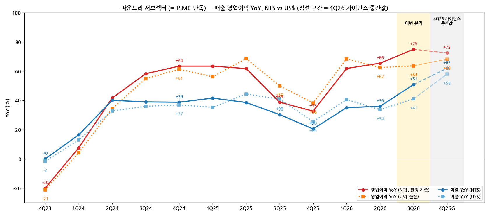
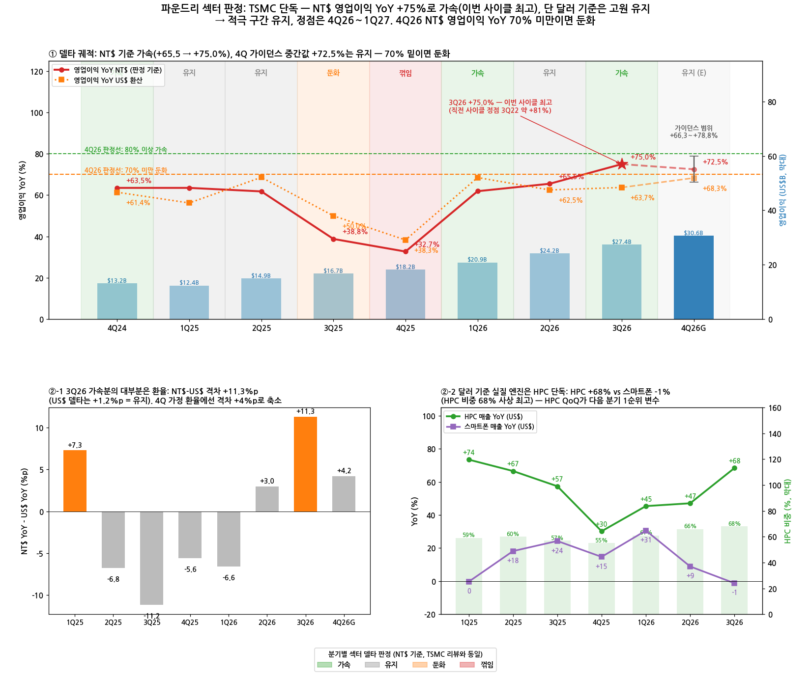

# 반도체 · 파운드리 섹터 리뷰

> 현재 상태 (최신 분기 기준)
> 최신 분기: 2026-Q3
> 섹터 델타: 가속 | 내러티브: 강화
> 모멘텀 신호: 테마 종료 — 에이전트AI (2026-11-23, BT: 시장 전체 테마 종료)
> 활성 테마: 없음
> 포지셔닝: 서브섹터 확대 | 한국 해당 없음 | 1등 TSMC
> 델타 근거: 3Q NT$ 영업이익 YoY +65.5→+75.0%(+9.5%p) 가속, 대부분 환율 효과 → 4Q 가이던스 +72.5%로 유지 경로
> 내러티브 근거: AI 반도체 제조 독점·물량과 가격 동시 상승이 HPC +22% QoQ·성장률 세 번째 상향으로 확인돼 강화
> PM 근거: 서브섹터 확대, 메모리가 정점을 지날 때 파운드리는 정점 전(4Q26~1Q27), 한국 비교 불가(삼성 미분리)
> 편입 종목: TSMC
> 갱신 시각: 2026-11-23 10:00 KST

## 누적 시계열

| 분기 | 편입 종목 | 합산 매출 | 합산 영업이익 | OPM | 매출 YoY | 영업이익 YoY | 영업이익 YoY 델타 (%p) | 섹터 델타 | 내러티브 | 모멘텀 신호 | 활성 테마 |
|---|---|---|---|---|---|---|---|---|---|---|---|
| 4Q23 | TSMC | $19.62B (NT$625.5십억) | $8.16B (NT$260.2십억) | 41.6 | +0.0 (US$ −1.6) | −20.0 (US$ −21.2) | +6.5 (US$ +8.4) | 꺾임 | - | - | - |
| 1Q24 | 동일 | $18.87B (NT$592.6십억) | $7.93B (NT$248.9십억) | 42.0 | +16.5 (US$ +12.9) | +7.6 (US$ +4.2) | +27.6 (US$ +25.4) | 가속 | - | - | - |
| 2Q24 | 동일 | $20.82B (NT$673.5십억) | $8.85B (NT$286.2십억) | 42.5 | +40.1 (US$ +32.8) | +41.7 (US$ +34.4) | +34.2 (US$ +30.2) | 가속 | - | - | - |
| 3Q24 | 동일 | $23.50B (NT$759.7십억) | $11.16B (NT$360.9십억) | 47.5 | +39.0 (US$ +36.0) | +58.3 (US$ +54.9) | +16.5 (US$ +20.5) | 가속 | - | - | - |
| 4Q24 | 동일 | $26.88B (NT$868.5십억) | $13.17B (NT$425.5십억) | 49.0 | +38.8 (US$ +37.0) | +63.5 (US$ +61.4) | +5.3 (US$ +6.5) | 가속 | - | - | - |
| 1Q25 | 동일 | $25.53B (NT$839.2십억) | $12.38B (NT$407.0십억) | 48.5 | +41.6 (US$ +35.3) | +63.5 (US$ +56.2) | 0.0 (US$ −5.2) | 유지 | - | - | - |
| 2Q25 | 동일 | $30.07B (NT$933.8십억) | $14.91B (NT$463.2십억) | 49.6 | +38.6 (US$ +44.4) | +61.8 (US$ +68.6) | −1.7 (US$ +12.4) | 유지 | - | - | - |
| 3Q25 | 동일 | $33.10B (NT$989.9십억) | $16.75B (NT$500.7십억) | 50.6 | +30.3 (US$ +40.9) | +38.8 (US$ +50.0) | −23.1 (US$ −18.6) | 둔화 | - | - | - |
| 4Q25 | 동일 | $33.73B (NT$1,046.1십억) | $18.21B (NT$564.9십억) | 54.0 | +20.5 (US$ +25.5) | +32.7 (US$ +38.3) | −6.0 (US$ −11.7) | 꺾임 | - | - | - |
| 1Q26 | 동일 | $35.90B (NT$1,134.1십억) | $20.86B (NT$658.9십억) | 58.1 | +35.1 (US$ +40.6) | +61.9 (US$ +68.5) | +29.1 (US$ +30.2) | 가속 | - | - | - |
| 2Q26 | 동일 | $40.20B (NT$1,270.4십억) | $24.24B (NT$766.6십억) | 60.3 | +36.0 (US$ +33.7) | +65.5 (US$ +62.5) | +3.6 (US$ −6.0) | 유지 | - | - | 에이전트AI |
| **3Q26** | 동일 | **$46.72B (NT$1,494.2십억)** | **$27.42B (NT$876.4십억)** | **58.7** | **+50.9 (US$ +41.1)** | **+75.0 (US$ +63.7)** | **+9.5 (US$ +1.2)** | **가속** | **강화** | **없음** | **에이전트AI** |

→ **편입 = TSMC 1개사.** 워치리스트 `| 반도체 | 파운드리 | TSMC | - | - |` 그대로라 "섹터 합산 = TSMC 단독"이다. 인텔 파운드리·삼성 파운드리는 합산에 넣지 않고 끝의 (트래킹) 표에만 둔다 (인텔은 로직·CPU, 삼성전자는 메모리 서브섹터에 이미 들어가 있어 중복 합산 금지)
→ **표기 통화 = US$, 판정 기준 = NT$.** 금액은 달러를 앞에 쓰고 NT$를 괄호에 넣었다. US$ 영업이익 = US$ 매출 × 회사 OPM [계산]. YoY·델타는 NT$ 값을 앞에, US$ 값을 괄호에 적었다. **섹터 델타 판정은 TSMC 리뷰 0번과 같은 NT$(보고 통화) 영업이익 YoY 기준**이다 — 단일 종목 서브섹터라 판정을 종목 리뷰와 다르게 둘 수 없다. 달러 기준이면 3Q26은 "유지"(+1.2%p)라 그 차이를 ④·②-1 차트에 따로 보여 준다
→ **적용 환율** (NT$/US$, 분기 평균 = NT$ 매출 ÷ US$ 매출 [계산]): 4Q24 32.3 · 1Q25 32.9 · 2Q25 31.1 · 3Q25 29.9 · 4Q25 31.0 · 1Q26 31.6 · 2Q26 31.6 · 3Q26 32.0 · 4Q26G 31.8 (회사 가이던스 가정)
→ (출처: `earnings-review/2026-Q3_TSM_리뷰.md` 1-① 분기 표(TSMC 보도자료, 3Q25·2Q26·3Q26 영업이익 = 메리츠 표, 그 외 = 매출 × 회사 OPM). 4Q23 델타는 3Q23 영업이익 YoY −26.5%(NT$)·−29.6%(US$) 기준 [계산: `company-overview/TSM_기업개요.md` 분기 원자료])
→ **판정 소급**: TSMC 리뷰 표의 NT$ 영업이익 YoY 델타에 섹터 규칙(±5%p 유지 / 축소 + 플러스 = 둔화 / 마이너스 또는 2개 분기 연속 둔화 + 정점 통과 = 꺾임)을 그대로 적용했다. 4Q24(+5.3%p)는 경계선 바로 위라 "가속"이다. **4Q25 "꺾임"은 규칙 적용 결과**다 — 3Q25·4Q25 연속 둔화에 정점(4Q24·1Q25 +63.5%) 통과가 겹쳤다. 그러나 YoY는 +33%로 플러스였고 바로 다음 분기(1Q26 +61.9%)에 재가속했다. 송변전 1Q26 꺾임과 같은 "규칙상 꺾임"이다
→ 내러티브·모멘텀 신호 열은 당시 섹터 리뷰가 없어 `-`. 활성 테마 2Q26은 메모리 섹터리뷰와 같은 기준(에이전트AI 2026-Q2～)

---

## 2026-Q3 섹터 리뷰

> 대상: `earnings-review/2026-Q3_TSM_리뷰.md` (+ 장기 시계열 `company-overview/TSM_기업개요.md`). 비교 참고: `2026-Q3_INTC_리뷰.md`(Intel Foundry 부문), `2026-Q3_삼성전자_리뷰.md`(S.LSI·Foundry 추정), `2026-Q3_AMD_리뷰.md`·`2026-Q3_ARM_리뷰.md`(고객 측)
> 2층 구조의 서브섹터 리뷰다. 반도체 섹터 비중(1단계)과 서브섹터 순위(2단계)는 반도체 통합 리뷰가 맡는다(미작성). 이 문서는 파운드리 판정, 서브섹터 안 대비, 파운드리 1등 종목(3단계)에 답한다
> 첫 파운드리 리뷰라 직전 분기 관전 포인트·⑦ 콜 체크는 없다
> **국가 프레임 구멍**: 한국 종목 없음 (삼성전자 파운드리는 실적 미분리 — S.LSI와 묶인 증권사 추정치만 있음) → ⑦(2)는 `비교 불가 — 편입 종목 없음`으로 두고, 대체 축으로 TSMC vs Intel Foundry(트래킹 비교)를 쓴다. 편입 후보는 ⑦(2) 끝에 제안

① 섹터 합산 숫자와 델타

| 항목 | 4Q24 | 1Q25 | 2Q25 | 3Q25 | 4Q25 | 1Q26 | 2Q26 | **3Q26** | 4Q26G |
|---|---|---|---|---|---|---|---|---|---|
| 합산 매출 (US$B) | 26.88 | 25.53 | 30.07 | 33.10 | 33.73 | 35.90 | 40.20 | **46.72** | 53.3 (52.3～54.3) |
| 합산 영업이익 (US$B) [계산] | 13.17 | 12.38 | 14.91 | 16.75 | 18.21 | 20.86 | 24.24 | **27.42** | 30.65 |
| 합산 영업이익 (NT$십억) | 425.5 | 407.0 | 463.2 | 500.7 | 564.9 | 658.9 | 766.6 | **876.4** | 974.6 |
| OPM (%) | 49.0 | 48.5 | 49.6 | 50.6 | 54.0 | 58.1 | 60.3 | **58.7** | 57.5 |
| 매출 YoY (NT$) | +38.8 | +41.6 | +38.6 | +30.3 | +20.5 | +35.1 | +36.0 | **+50.9** | +62.0 |
| 매출 YoY (US$) | +37.0 | +35.3 | +44.4 | +40.9 | +25.5 | +40.6 | +33.7 | **+41.1** | +58.0 |
| 영업이익 YoY (NT$, 판정 기준) | +63.5 | +63.5 | +61.8 | +38.8 | +32.7 | +61.9 | +65.5 | **+75.0** | +72.5 |
| 영업이익 YoY (US$ 환산) | +61.4 | +56.2 | +68.6 | +50.0 | +38.3 | +68.5 | +62.5 | **+63.7** | +68.3 |
| **영업이익 YoY 델타 (%p, NT$)** | +5.3 | 0.0 | −1.7 | −23.1 | −6.0 | +29.1 | +3.6 | **+9.5** | −2.5 |
| 영업이익 YoY 델타 (%p, US$) | +6.5 | −5.2 | +12.4 | −18.6 | −11.7 | +30.2 | −6.0 | **+1.2** | +4.6 |
| NT$−US$ 영업이익 YoY 격차 (%p) [계산] | +2.1 | +7.3 | −6.8 | −11.2 | −5.6 | −6.6 | +3.0 | **+11.3** | +4.2 |
| 판정 (NT$) | 가속 | 유지 | 유지 | 둔화 | 꺾임 | 가속 | 유지 | **가속** | 유지 (가이던스) |

→ (출처: `2026-Q3_TSM_리뷰.md` 1-① 표. 4Q26G = 가이던스 중간값(US$53.3B × NT$31.8, OPM 57.5%) [계산, TSMC 리뷰와 같은 값])
→ **이익 레벨**: 3Q26 영업이익 US$27.4B(NT$876.4십억)로 분기 최대. OPM 58.7%는 2Q26 60.3%(사상 최고) 대비 −1.6%p — 2nm 램프 희석 (TSMC 리뷰 1-①(2))
→ **델타**: NT$ 영업이익 YoY는 4Q25 +32.7% 바닥 → +61.9% → +65.5% → **+75.0%**로 3개 분기 연속 상승. 직전 사이클 정점(3Q22 약 +81.6%, NT$ 매출 × OPM [계산: 기업개요 원자료])에 근접했다
→ **환율 왜곡**: 3Q 평균 환율이 NT$29.9 → NT$32.0으로 대만달러 약 7% 약세라 NT$ YoY가 달러 YoY보다 약 10%p 부풀었다 (TSMC 리뷰 1-①(1)). 영업이익 기준 격차는 +11.3%p로 기간 중 최대 [계산]. 달러로 보면 영업이익 YoY는 +62.5% → +63.7%, "고원 유지"다
→ **컨센 경로상 정점**: 4Q26 가이던스 중간값 NT$ +72.5%(US$ +68.3%) → 영업이익 YoY 정점은 4Q26～1Q27, 2027 연간 영업이익 YoY는 FactSet +27% / BofA +45%로 감속 (TSMC 리뷰 1-③) [전망]. 4Q 가정 환율(NT$31.8)은 4Q25(NT$31.0) 대비 약세 폭이 약 2.6%로 줄어 환율 순풍이 3Q의 1/3 수준으로 작아진다 [계산]

→ (출처: `2026-Q3_TSM_리뷰.md` 1-① [계산]. 빨강 실선 = 영업이익 YoY NT$(판정 기준), 주황 점선 = 영업이익 YoY US$ 환산, 파랑 = 매출 YoY NT$·US$. 노란 음영 = 3Q26, 회색 음영 = 4Q26 가이던스 중간값. 단일 종목 서브섹터라 섹터 합산선 = 종목선)

② 종목별 델타 판정표

| 델타 순위 | 종목 | 국가 | 매출 YoY | 영업이익 YoY | 영업이익 YoY 델타 | 델타 판정 | 내러티브 | 한 줄 |
|---|---|---|---|---|---|---|---|---|
| 1 | TSMC | 글로벌 (대만) | +50.9% (NT$) / +41.1% (US$) | +75.0% (NT$) / +63.7% (US$) | +9.5%p (NT$) / +1.2%p (US$) | 가속 | 강화 | HPC +22% QoQ·비중 68% 사상 최고, 4Q 가이던스 컨센 +5.9% 상회, 2026 달러 성장률 +44%로 세 번째 상향. 단 GPM −1.3%p·해외 팹 희석 3～4%p 예고 |

→ (출처: `2026-Q3_TSM_리뷰.md` 0번 판정 그대로 — "가속 (… 단, 달러 환산 영업이익 YoY는 +62.5% → +63.7%로 사실상 유지, 4Q 가이던스상 약 +68%로 재가속)")
→ 한 종목이라 순위는 1행뿐이다. 선행·후행 종목 구분도 없다 — 대신 반도체 다른 서브섹터와의 시차를 적는다: 메모리는 2Q26에 합산 영업이익 YoY 정점을 지나 3Q26 "둔화"(`메모리_섹터리뷰.md`), 파운드리는 3Q26에 아직 오르는 중. **파운드리는 메모리보다 델타 정점이 1～2개 분기 늦은 후행 레이어**다 [판단]
→ 서브섹터 안 델타를 끄는 곳은 플랫폼 HPC 단독이다 — HPC 매출 YoY(US$) +47% → +68%, 스마트폰 +9% → −1% (TSMC 리뷰 1-②(1) [계산]). 노드로는 2nm+3nm 매출 US$19.2B(+152% YoY)

③ 섹터 공통 쟁점

> 편입 종목이 1개라 "2개 종목 이상 공통 쟁점"은 성립하지 않는다. 아래는 TSMC 쟁점 4개를 그대로 쓰고, 같은 분기 다른 리뷰(Intel·삼성전자·AMD·ARM)에서 같은 쟁점이 어떻게 보였는지 교차 확인한 것이다

(1) AI 수요 > 공급 — 고객 측 리뷰도 "제약은 공급"

| 리뷰 | 같은 쟁점이 어떻게 나왔나 |
|---|---|
| TSMC | "수요 둔화 신호 없음, 자체 평가 수요 > 공급", 2027 선단 가동률 100% 초과(BofA). HPC +22% QoQ (TSMC 리뷰 2-2(1)) |
| AMD | 2027 매출 +80% 가이던스, "수요가 공급보다 많다 — 웨이퍼·기판·어드밴스드 패키징·메모리를 함께 계획", 웨이퍼 투입이 매출로 이어지는 데 약 6개월(Citi). 증권사 8/8이 "제약은 수요가 아니라 공급" (`2026-Q3_AMD_리뷰.md` 2번 쟁점 1) |
| Intel | 서버 CPU TAM 5배·2028까지 공급 부족, 다만 인텔 자체 공급 제약이 DCAI 성장을 묶음 (`2026-Q3_INTC_리뷰.md`) |
| ARM | AGI CPU 출시, TSMC·삼성전자 등과 추가 부품 공급 계약 (`2026-Q3_ARM_리뷰.md`, NH) |

→ **[판단]** 고객 측(AMD 2027 +80%, 인텔 서버 TAM 5배)의 수요 가이던스는 TSMC가 말한 "수요 > 공급"과 같은 방향이다. AMD의 "웨이퍼 투입 → 매출 6개월"은 TSMC 매출이 고객 매출을 2분기가량 앞선다는 뜻이라, 고객 2027 가이던스가 꺾이기 전에는 파운드리 물량 델타가 먼저 꺾일 근거가 약하다. 위험은 수요가 아니라 TSMC 리뷰가 짚은 "HPC 한 곳 집중"이다

(2) 마진 희석 — 선단 램프 + 해외 팹 (TSMC 고유이지만 경쟁사와 레벨 차이가 결론)
→ TSMC: GPM 66.4%(−1.3%p QoQ), 해외 팹 희석 2026 약 2%p → 향후 수년 3～4%p, 2027 OPM 추정 FactSet 55.8% vs BofA 60.8% (TSMC 리뷰 2-2(2))
→ Intel Foundry: OPM −45.0% → −36.2% → −27.7%로 3개 분기 연속 개선, 18A 원가 1Q 대비 −40% (`2026-Q3_INTC_리뷰.md` 1-②)
→ 삼성 S.LSI·Foundry: 3Q 적자 지속(영업손실 약 −1.3～−2.0조원 [추정, 메리츠·DS투자·BNK]), 8나노 이하 Full capa·HBM4 베이스 다이로 적자 축소 중 (`2026-Q3_삼성전자_리뷰.md` 1-②)
→ **[판단]** 경쟁사가 "적자를 줄이는" 단계에서 TSMC는 OPM 58.7%로 희석 논쟁을 한다. 희석 3～4%p가 다 들어와도 OPM 50%대 중반 — 파운드리 서브섹터 안에서 마진 축의 순위는 바뀌지 않는다

(3) CapEx 한 단계 상승 — 2027 US$80～90B
→ TSMC: 2026 US$60～64B 유지, 이사회 예산 +116% YoY, BofA 2027E US$80～90B, "매출 성장률 > CapEx 증가율" (TSMC 리뷰 2-2(3))
→ 삼성전자: 2027 CapEx 108조원(2026 84.2조원, 유안타) — "파운드리 보유로 자본집약도 높음", 美 Taylor 첫 팹 2027 가동 (`2026-Q3_삼성전자_리뷰.md`)
→ **[판단]** 파운드리 공급 측 증설은 TSMC(선단 N3 신규 팹 3곳·애리조나 2팹 3Q27 앞당김)와 삼성(Taylor 2027)이 같은 해에 겹친다. 다만 삼성 2nm 수주는 "고객명·규모 미공개, 적자 지속"(삼성 리뷰 2-0)이라 2027 가격 경쟁 변수로 보기엔 이르다

(4) 2027 가이던스 공백 — 주가가 실적과 어긋남
→ TSMC: 비트·레이즈에도 ADR US$422.3(10/15) → US$388.62(11/10) −8.0%, EPS 컨센 2027E는 +4% 상향 → "실적 하향이 아니라 멀티플 압축" (TSMC 리뷰 2-2(4)·2-4)
→ 같은 분기 AI 공급 측 전반(메모리 3사 고점 대비 −22～−49%, `메모리_섹터리뷰.md` ⑤)에서 나타난 "숫자는 좋은데 주가는 빠진다" 흐름과 같은 모양
→ **[판단]** 파운드리는 메모리와 달리 델타가 꺾이지 않았는데 주가가 같이 빠졌다 — 델타 프레임에서는 파운드리가 AI 공급 측 안에서 상대적으로 유리한 자리다

(5) 종목 고유 이슈
→ 환율: 대만달러 약세가 NT$ 델타를 부풀림 (3Q 격차 +11.3%p) — 판정 라벨(가속 vs 유지)이 환율에 걸려 있다
→ 스마트폰 YoY −1%: "가격 민감 소비자 수요 둔화", 1Q27 비수기가 시험대 (TSMC 리뷰 1-②)
→ Section 232 반도체 관세 최종 세율, 인텔 14A·삼성 2nm 외부 대형 수주 (TSMC 리뷰 3-⑤)

④ 섹터 판정

> 섹터 델타: **가속** | 내러티브: **강화** → **파운드리(= TSMC)는 AI 공급 측에서 델타가 아직 위로 열린 레이어 — NT$ 영업이익 YoY +75%로 이번 사이클 최고지만 가속분의 대부분은 환율이고 달러 기준은 +63%대 고원이다. 적극 구간 유지, 정점은 4Q26～1Q27. 4Q26 NT$ 영업이익 YoY 70% 미만이면 둔화**

→ (출처: `2026-Q3_TSM_리뷰.md` 1-①·1-② [계산], 플랫폼 비중 = `TSM_기업개요.md` 분기 원자료. 상단 = 영업이익 YoY NT$(실선, 판정 기준)·US$(점선)와 영업이익 US$ 막대, 배경 색 = 분기별 판정(NT$), 4Q26 판정선 70%/80%와 가이던스 범위 / 하단 왼쪽 = NT$−US$ 영업이익 YoY 격차(환율 효과) / 하단 오른쪽 = HPC vs 스마트폰 매출 YoY(US$)와 HPC 비중)

→ **델타 판정 근거**: NT$ 영업이익 YoY +65.5% → +75.0%(+9.5%p)로 ±5%p를 넘어 "가속". TSMC 리뷰 0번 판정과 같다. 달러 기준이면 +62.5% → +63.7%(+1.2%p)로 "유지"다 — 판정 라벨은 환율 순풍(격차 +11.3%p)에 기대고 있다. 4Q26 가이던스 중간값은 NT$ +72.5%(−2.5%p, 유지) / US$ +68.3%(+4.6%p, 유지·가속 경계)로, 두 통화 기준이 4Q에 다시 가까워진다
→ **내러티브 판정 근거**: TSMC 리뷰 "강화" 그대로. "AI 인프라 반도체 제조 독점 + 공급 부족 속 물량·가격 동시 상승" 스토리가 HPC +22% QoQ·4Q 가이던스 상회·2026 성장률 세 번째 상향으로 숫자로 확인됐다. 고객 측(AMD·Intel) 리뷰도 "제약은 공급"으로 같은 방향
→ **[판단] 결정적 근거는 두 가지가 겹친다**: ① 환율을 빼도 고원(+60%대)이 4개 분기째 유지된다 — 꺾임 신호가 없다 ② 그 고원을 HPC 단독이 만든다(스마트폰 −1%). 그래서 다음 분기 판정은 환율보다 **HPC QoQ**가 정한다
→ 직전 판정 대비: 첫 파운드리 리뷰. 소급 궤적은 가속(1Q24～4Q24) → 유지 → 유지 → 둔화(3Q25) → 꺾임(4Q25, 규칙상) → 가속(1Q26) → 유지 → **가속(3Q26)**. 2025년 하반기의 "규칙상 꺾임"은 스마트폰·환율 역풍(NT$ 강세, 격차 −11.2%p)이 겹친 결과였고, 1Q26에 바로 되돌았다

⑤ 모멘텀 신호

→ **없음** — 테마 종료 후보는 해당 없음(델타 가속). 델타 급증 후보 조건은 판정 기준(NT$)으로는 대부분 충족하지만, 달러 기준으로 "뚜렷한 확대"가 아니고 걸릴 테마(에이전트AI)가 이미 켜져 있어 후보로 올리지 않는다
→ 델타 급증 후보 조건 대조
→ ① 섹터 영업이익 YoY 델타 뚜렷한 확대 — **부분 충족** (NT$ +3.6 → +9.5%p, 2개 분기 연속 확대 / US$ −6.0 → +1.2%p, 확대 아님. 4Q 가이던스 NT$ −2.5%p)
→ ② 편입 종목 과반 가속 — **충족** (1/1)
→ ③ 내러티브 형성·강화 — **충족** (강화)
→ **에이전트AI와의 관계**: 에이전트AI 테마분석은 "첨단 노드 wafer(TSMC N3/N2)"와 "CoWoS·첨단 패키징"을 **(A) 구조적 메가 병목**으로 분류하고 TSMC를 병목 1위로 둔다(`earnings-theme/에이전트AI_테마분석.md` 3-2-7·병목 표). 그러나 frontmatter `active_companies`에는 TSMC가 없다(dominant 8사 + challenger AMD·Intel). → **제안(BT 판단)**: 파운드리를 에이전트AI의 레이어로 정식 편입(TSMC를 active_companies에 추가)할지. 메모리 레이어가 2026-Q3에 "레이어 모멘텀 종료"로 표기된 상황에서, 파운드리는 같은 테마 안에서 델타가 아직 살아 있는 공급 측 레이어다 [판단]
→ 다음 분기 후보로 올릴 조건: 4Q26 영업이익 YoY가 NT$ 80% 이상 **그리고** US$ 68.7% 이상(두 통화 모두 가속) + 1월 2027 가이던스 매출 +35% 이상·CapEx US$80B 이상
→ **반대 논거**
→ (1) 정점이 가깝다: 컨센 경로상 영업이익 YoY 정점은 4Q26～1Q27이고 2027 연간 +27%(FactSet)로 감속한다. 델타 급증이 아니라 "정점 직전 고원"일 수 있다
→ (2) 마진 희석이 델타를 먼저 깎는다: 해외 팹 희석 3～4%p가 2027에 들어오면 매출이 +35%여도 영업이익 YoY는 매출보다 낮게 나올 수 있다(2027 OPM 55.8% 시나리오)

(테마) BT 판단 (2026-11-23)
→ **에이전트AI 테마 종료** — BT: "지금 모든 테마는 종료됐다고 보는게 맞다. 반도체뿐 아니라 시장의 모든 테마가 지금은 종료 상태". 상태 블록 `활성 테마`를 없음으로 변경. 섹터 리뷰는 상시 레이어로 계속 누적하고, 다음 델타 급증 후보가 나오면 BT가 새 테마를 연다

⑥ 다음 분기 섹터 관전 포인트

| 순위 | 무엇을 (변수·임계값) | 어떤 데이터로 | 언제 |
|---|---|---|---|
| 1 | **4Q26 영업이익 YoY(NT$) 70% 이상 — 미만이면 둔화**. 금액으로 NT$960.3십억 이상(4Q25 564.9 × 1.70 [계산]). 80%(NT$1,016.8십억) 이상이면 가속. 가이던스 범위 +66.3～+78.8%, 중간값 +72.5%는 유지. 참고 달러 기준: US$ 영업이익 YoY 58.7% 미만 둔화 / 68.7% 이상 가속(US$30.7B), 가이던스 중간값 +68.3% | TSMC 월매출(11월분 12/10, 12월분 1/10) → 4Q26 실적 | 2026-12-10 / 2027-01-10 / 2027-01 중순 |
| 2 | **HPC QoQ 두 자릿수 유지** — 한 자릿수 초반이면 델타가 바로 꺾인다(TSMC 리뷰 2-2(1)). 스마트폰 YoY 마이너스 확대 여부 | 4Q26 실적 플랫폼 비중 | 2027-01 중순 |
| 3 | **2027 가이던스** — 매출 성장률(FactSet +35%) 이상, CapEx US$80B 이상, "매출 성장률 > CapEx 증가율" 유지, 장기 GPM 목표 문구 | 4Q26 컨콜 | 2027-01 중순 |
| 4 | **환율 순풍 축소** — 4Q 가정 NT$31.8 기준 NT$−US$ 격차 약 +4%p. 대만달러가 4Q25 수준(NT$31.0)으로 돌아오면 NT$ 판정이 달러 판정(유지)에 수렴 | 4Q 평균 환율, 4Q26 실적 | 2027-01 중순 |
| 5 | **경쟁 구도 (트래킹)** — Intel Foundry OPM −27.7% 개선 지속·EMIB 외부 고객 발표, 삼성 2nm 대형 수주 실체 | INTC·삼성전자 4Q26 실적 | 2027-01 말 |

→ 1순위 판정선(70%)은 ④ 키 차트와 같다. 근거: 3Q26 NT$ +75.0%에서 "유지" 범위(±5%p)를 뺀 값. 3Q26이 가속이라 4Q가 70% 밑이어도 "꺾임"이 아니라 "둔화"다(2개 분기 연속 둔화 아님). 월매출 역산: 4Q OPM 57.5%(가이던스 중간값) 가정 시 70%선 = 4Q 매출 NT$1,670십억 → 10월 NT$586.9십억을 빼면 11+12월 합 NT$1,083십억 이상 [계산]. 12/10 11월 매출이 첫 체크포인트

⑦ 글로벌 PM 포지셔닝 — 결론

> **서브섹터: 확대 — 4Q26 NT$ 영업이익 YoY 70% 미만이거나 1월 2027 가이던스가 매출 +30% 미만이면 유지로 하향** | **서브섹터 내: 한국 해당 없음 (삼성 파운드리 미분리 — 비교 불가)** | **1등: TSMC (글로벌) / 한국 1등 없음**

(1) 서브섹터 판정 — 확대 / 유지 / 축소

| 판단 축 | 3Q26 근거 | 방향 |
|---|---|---|
| 이익 델타 (1순위) | 영업이익 YoY NT$ +65.5% → +75.0% 가속 (US$ +62.5% → +63.7% 고원), 3개 분기 연속 상승 | 확대 |
| YoY 정점 시점 | 컨센 경로상 4Q26～1Q27 정점, 2027 연간 +27～45% 감속. 이번 분기는 정점 전 | 확대 (정점 근접 경계) |
| 선행지표 (가이던스·가동률) | 4Q 매출 가이던스 컨센 +5.9%, 2027 선단 가동률 100% 초과(BofA), 10월 매출 +59.7% YoY | 확대 |
| 최종 수요 | 고객 AMD 2027 +80%·"제약은 공급", 인텔 서버 CPU TAM 5배. 스마트폰은 −1%로 둔화 | 확대 (HPC 집중) |
| CapEx·공급 | 2027 CapEx US$80～90B — 증설이 물량 델타를 받친다, 마진은 희석 3～4%p | 중립 |
| 밸류에이션 (2순위) | BofA 2027E P/E 약 14～15x(역사 범위 11～21x), EPS 컨센 2027E +4% 상향 | 확대 |
| 주가 낙폭 | ADR 11/13 US$398.73, 종가 고점(10/05 US$485.80) 대비 −17.9% [계산: 기업개요] — 이익보다 멀티플이 먼저 빠짐 | 확대 |

→ **결론: 서브섹터 확대** [판단]. 반도체 안에서 메모리가 정점을 지난(3Q26 둔화) 반면 파운드리는 아직 오르고 있다 — 델타 1순위 프레임에서 AI 공급 측 비중을 메모리에서 파운드리로 옮기는 근거다. 가속 라벨이 환율에 기댄 점은 알지만, 환율을 빼도 +60%대 고원이 4개 분기째라 "축소" 근거는 없다
→ 델타 방향과 정점 시점이 엇갈리는 지점: 3Q26 가속 확인 분기가 컨센상 정점 1～2분기 전이다. 확대는 1월 2027 가이던스까지의 콜이다
→ **유지로 하향 조건**: ① 4Q26 NT$ 영업이익 YoY 70% 미만(둔화) ② 1월 2027 가이던스 매출 +30% 미만 또는 장기 GPM 목표 하향 ③ HPC QoQ 한 자릿수 초반. 하나라도 충족 시
→ **축소 조건**: 4Q26 둔화 + 1Q27 가이던스 QoQ 마이너스(2개 분기 연속 둔화 경로 = 꺾임)

(2) 같은 서브섹터 안 한국 vs 글로벌

→ **한국: 비교 불가 — 편입 종목 없음.** 삼성전자 파운드리는 실적을 따로 공시하지 않는다. 삼성전자 리뷰의 "S.LSI·Foundry" 숫자는 매출 약 6.3조원(키움 추정)·영업손실 약 −1.3～−2.0조원(메리츠·DS투자·BNK 추정)뿐이고, 삼성전자는 이미 메모리 서브섹터에 DS(메모리) 기준으로 들어가 있다. 한국 국가 판단은 결론에서 뺀다
→ **대체 대비 축: 선단 파운드리 1위(TSMC) vs 추격자(Intel Foundry)** — 트래킹 비교. Intel Foundry는 로직·CPU 서브섹터(Intel)의 부문 숫자라 합산에 넣지 않는다

| 경쟁력 축 | TSMC | Intel Foundry (트래킹) | 우위 |
|---|---|---|---|
| 델타 방향 (1순위) | 영업이익 YoY NT$ +75.0% (가속) | 적자 축소 (손실 YoY +$0.47B 개선) — YoY 델타 산정 불가 | TSMC |
| 매출 규모·성장 | US$46.72B, +41.1% (US$) | $6.70B, +58.1% — 대부분 내부 CPU 물량 | TSMC (외부 매출 기준) |
| 마진 레벨 | OPM 58.7% | OPM −27.7% | TSMC |
| 마진 방향 | −1.6%p QoQ (2nm 희석) | +8.5%p QoQ (3개 분기 연속 개선) | Intel (방향만) |
| 외부 고객 | 상위 10대 고객 78%(2025, 20-F) | 외부 매출 $0.41B, 일회성 고객 프로그램(NH) | TSMC |
| 선단 노드 | 2nm 8%·3nm 33%, A16 2027 | 18A 클라이언트 CPU 약 1/3, 14A 1.0 PDK 1Q27 | TSMC |
| 점유율 | 72.5% (2Q26, TrendForce) | 미확인 (Samsung 5.9%) | TSMC |

→ (출처: `2026-Q3_TSM_리뷰.md`, `2026-Q3_INTC_리뷰.md` 1-② 부문 표(GAAP, 하나·IBK·대신·유진 $6,697M 기준), `TSM_기업개요.md` 점유율·고객 집중도)
→ **결론**: 서브섹터 내 대비는 TSMC 일방 우위. Intel Foundry의 유일한 우위는 "마진 방향"인데, 레벨이 −27.7%라 델타 프레임 비교 대상이 아니다 [판단]
→ **비교 범위**: 글로벌 편입 TSMC 1개(풀 리뷰) + 트래킹 Intel Foundry 1개(인텔 리뷰 부문 숫자). 한국 비교 없음, 성숙 노드 비교 없음 — 근거 얇음
→ **편입 후보 제안 (BT 판단)**
→ Intel Foundry: 워치리스트 파운드리 행 `트래킹 피어` 열에 등재 제안 — 이미 인텔 리뷰에 부문 숫자가 있어 추가 작업 없이 (트래킹) 표 갱신 가능
→ UMC·GlobalFoundries: **성숙 노드 트래킹 피어**로 제안 — 노션 실적 캘린더 발표일 UMC 10/28, GFS 11/04(3Q26 이미 발표). 선단(TSMC) vs 성숙(UMC·GF) 대비가 생기면 "AI 독점 vs 사이클형" 축으로 ⑦(2)를 쓸 수 있다. 기업개요상 UMC·GF는 가격 경쟁·중국 증설에 노출된 사이클형(점유율 3.9%·3.2%)
→ 삼성 파운드리: 공시 분리 전까지 한국 칸은 계속 `비교 불가`

(3) 파운드리 1등 종목

| 구분 | 종목 | 델타 판정 | 근거 한 줄 |
|---|---|---|---|
| **글로벌 1등 (서브섹터 1등)** | TSMC | 가속 · 강화 | 델타 순위 1위(유일), NT$ 영업이익 YoY +75%, OPM 58.7%, 점유율 72.5%, 4Q 가이던스 컨센 +5.9% |
| 한국 1등 | 없음 | — | 삼성 파운드리 미분리 (삼성전자는 메모리 서브섹터 편입) |

→ **선호**: TSMC (ADR TSM / 2330.TW)
→ **비선호**: 해당 없음 (편입 1개)
→ 반등 후보(이벤트 드리븐): 없음. 참고로 Intel(로직·CPU 서브섹터, 델타 "꺾임")의 파운드리 스토리 트리거는 EMIB 외부 고객 발표(2개 분기 내)·14A 1.0 PDK(1Q27) — 인텔 리뷰 판정상 숫자 트리거는 아님

(4) 콜을 바꾸는 조건과 일정

| 시점 | 이벤트 | 서브섹터 판정 | 비고 |
|---|---|---|---|
| 2026-12-10 | TSMC 11월 매출 | 10+11월 합이 4Q 70%선 경로(11+12월 합 NT$1,083십억 이상)인지 1차 확인 | 미달 경로면 확대 → 유지 검토 |
| 2027-01-10 | TSMC 12월 매출 | 4Q 매출 확정 — 70%선 통과 여부 사실상 확정 | |
| 2027-01 중순 | TSMC 4Q26 실적·2027 가이던스 | NT$ 영업이익 YoY 80% 이상 + 2027 매출 +35% 이상 → 확대 유지·델타 급증 후보 검토 / 70% 미만 또는 매출 +30% 미만 → 유지로 하향 | ⑥ 1～3순위 |
| 2027-01 말 | Intel·삼성전자 4Q26 실적 | 경쟁 구도 확인 — Intel Foundry 적자 축소 지속, 삼성 2nm 수주 실체 | (트래킹) 표 갱신 |
| 2027-04 | TSMC 기술 심포지엄·1Q27 실적 | AI CAGR 재정의(CPU 포함)·CoWoS capa — 상향 시 확대 유지 | 1Q27 가이던스 QoQ 마이너스면 꺾임 경로 |
| 미정 | 미국 Section 232 반도체 관세 최종 세율 | 고율이면 마진 희석 논쟁 확대 → 유지 검토 | TSMC 리뷰 3-⑤ |

→ 출처: `2026-Q3_TSM_리뷰.md` 4번 항목, `2026-Q3_INTC_리뷰.md`·`2026-Q3_삼성전자_리뷰.md` 4번 항목, `메모리_섹터리뷰.md`(반도체 서브섹터 간 시차)

### (트래킹) 파운드리 피어

> 합산·판정 제외. 숫자 표만 분기마다 갱신. 출처 등급: 각 회사 3Q26 실적 리뷰(증권사 부문 표 인용) — 회사 원문 직접 확인 아님

| 피어 | 3Q26 매출 | 매출 YoY | 3Q26 영업이익 | OPM | OPM 추이 (1Q26 → 2Q26 → 3Q26) | 방향 | 출처 |
|---|---|---|---|---|---|---|---|
| Intel Foundry | $6,697M | +58.1% | −$1,853M | −27.7% | −45.0 → −36.2 → −27.7 | 적자 축소 (내부 물량) | `2026-Q3_INTC_리뷰.md` 1-② (하나·IBK·대신·유진. 삼성·NH는 $6,657M) |
| 삼성 S.LSI·Foundry (합산) | 약 6.3조원 [추정] | +2% | 약 −1.3～−2.0조원 [추정] | 적자 | 미확인 | 적자 지속 | `2026-Q3_삼성전자_리뷰.md` 1-② (매출 키움, 손실 메리츠·DS투자·BNK) |

→ Intel Foundry 매출 YoY 추이: 1Q25 +7.1 → 2Q25 +3.2 → 3Q25 −2.4 → 4Q25 +3.8 → 1Q26 +16.2 → 2Q26 +30.5 → 3Q26 +58.1 (인텔 리뷰 1-②(2))
→ 다음 분기 E 공란 (트래킹 규칙)
