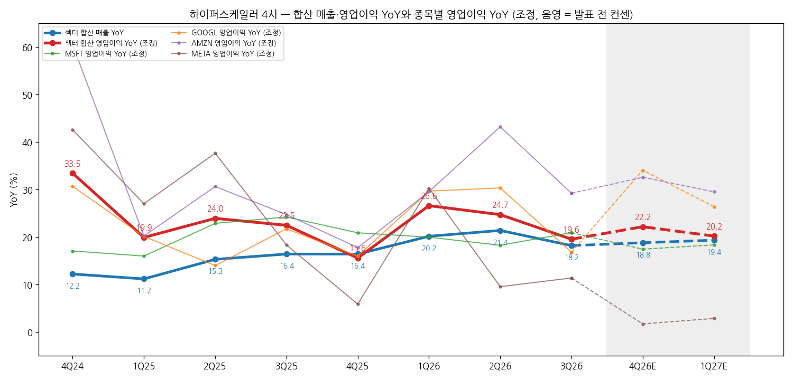
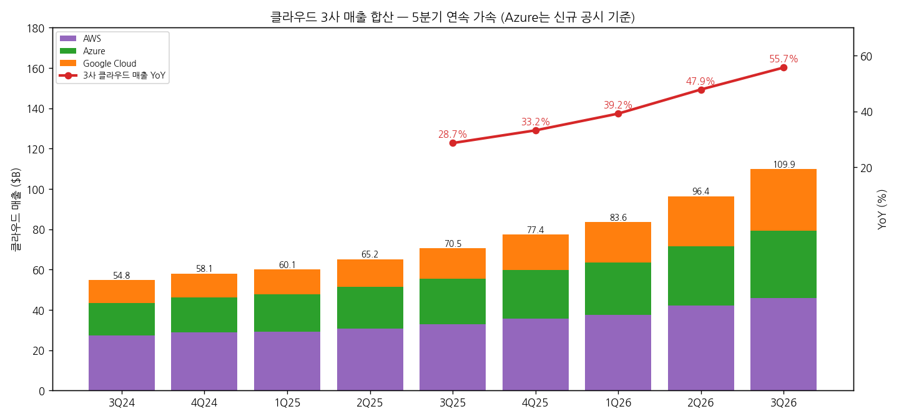
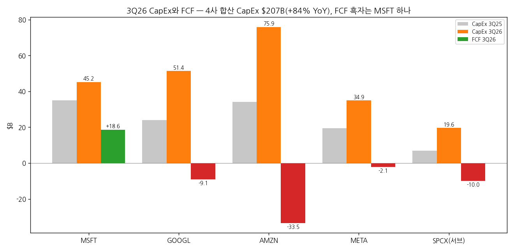
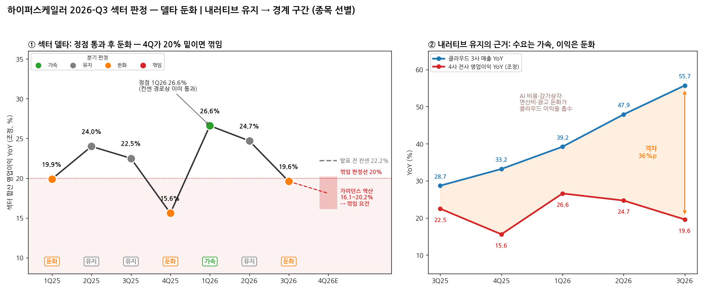
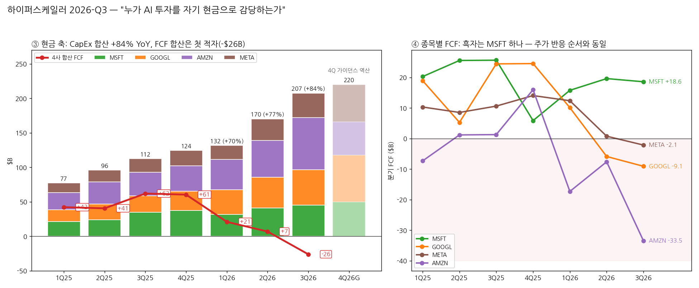

# 미국 빅테크 · 하이퍼스케일러 섹터 리뷰

> 현재 상태 (최신 분기 기준)
> 최신 분기: 2026-Q3
> 섹터 델타: 둔화 | 내러티브: 유지
> 모멘텀 신호: 없음
> 활성 테마: 에이전트AI (2026-Q2~)
> 편입 종목: Microsoft, Alphabet, Amazon, Meta
> 갱신 시각: 2026-11-01 17:30 KST

---

## 누적 시계열

| 분기 | 편입 종목 | 합산 매출 ($B) | 합산 영업이익 ($B, 조정) | OPM | 매출 YoY | 영업이익 YoY | 영업이익 YoY 델타 (%p) | 섹터 델타 | 내러티브 | 모멘텀 신호 | 활성 테마 |
|---|---|---|---|---|---|---|---|---|---|---|---|
| 2024-Q4 | MSFT·GOOGL·AMZN·META | 402.3 | 107.2 | 26.6% | 12.2% | 33.5% | - | - | - | - | - |
| 2025-Q1 | MSFT·GOOGL·AMZN·META | 358.3 | 98.6 | 27.5% | 11.2% | 19.9% | -13.6 | 둔화 | - | - | - |
| 2025-Q2 | MSFT·GOOGL·AMZN·META | 388.1 | 105.2 | 27.1% | 15.3% | 24.0% | +4.1 | 유지 | - | - | - |
| 2025-Q3 | MSFT·GOOGL·AMZN·META | 411.4 | 114.9 | 27.9% | 16.4% | 22.5% | -1.5 | 유지 | - | - | - |
| 2025-Q4 | MSFT·GOOGL·AMZN·META | 468.4 | 123.9 | 26.5% | 16.4% | 15.6% | -6.9 | 둔화 | - | - | - |
| 2026-Q1 | MSFT·GOOGL·AMZN·META | 430.6 | 124.8 | 29.0% | 20.2% | 26.6% | +11.0 | 가속 | - | - | - |
| 2026-Q2 | MSFT·GOOGL·AMZN·META | 471.2 | 131.2 | 27.9% | 21.4% | 24.7% | -1.9 | 유지 | - | - | 에이전트AI |
| 2026-Q3 | MSFT·GOOGL·AMZN·META | 486.4 | 137.4 | 28.3% | 18.2% | 19.6% | -5.1 | 둔화 | 유지 | 없음 | 에이전트AI |

→ (출처: 각 종목 2026-Q3 실적 리뷰의 분기 표(회사 공시). 4사 모두 달러라 환산 없음. MSFT는 회계분기를 캘린더 분기로 재배열(FQ1 27 = 2026-Q3). 조정 영업이익 = 일회성 비용 가산: GOOGL 3Q25 EC 과징금 $3.5B, AMZN 3Q25 FTC 합의금·퇴직금 $4.3B, META 2Q26 법적비용 약 $3.6B(다올 조정치 기준 `[추정]`)·3Q26 $9.89B. GAAP 기준 합산 영업이익 3Q25 $107.1B·3Q26 $127.6B)
→ 2024-Q4~2026-Q1 행은 첫 작성 시 소급 산정(판정 열은 같은 기준 적용, 내러티브·신호는 알 수 없어 `-`). 2024-Q4 델타는 2023-Q3 데이터 부재로 미산정. 활성 테마 시작 분기는 에이전트AI 테마분석 v5 통합본(2026-06-21) 기준

---

## 2026-Q3 섹터 리뷰

### ① 섹터 합산 숫자와 델타

(1) 전사 합산 (4사 동일 표본)

| 항목 ($B) | 4Q24 | 1Q25 | 2Q25 | 3Q25 | 4Q25 | 1Q26 | 2Q26 | **3Q26** | 4Q26E | 1Q27E |
|---|---|---|---|---|---|---|---|---|---|---|
| 합산 매출 | 402.3 | 358.3 | 388.1 | 411.4 | 468.4 | 430.6 | 471.2 | **486.4** | 556.6 | 514.0 |
| 합산 영업이익 (조정) | 107.2 | 98.6 | 105.2 | 114.9 | 123.9 | 124.8 | 131.2 | **137.4** | 151.4 | 150.1 |
| OPM (조정) | 26.6% | 27.5% | 27.1% | 27.9% | 26.5% | 29.0% | 27.9% | **28.3%** | 27.2% | 29.2% |
| 매출 YoY | 12.2% | 11.2% | 15.3% | 16.4% | 16.4% | 20.2% | 21.4% | **18.2%** | 18.8% | 19.4% |
| 영업이익 YoY (조정) | 33.5% | 19.9% | 24.0% | 22.5% | 15.6% | 26.6% | 24.7% | **19.6%** | 22.2% | 20.2% |
| **영업이익 YoY 델타 (%p)** | - | -13.6 | +4.1 | -1.5 | -6.9 | +11.0 | -1.9 | **-5.1** | +2.6 | -2.0 |

→ (출처: 각 종목 리뷰. 4Q26E·1Q27E = 4사 발표 전 Bloomberg 컨센 합산(키움 인용, MSFT 10/28·GOOGL 10/28·AMZN 10/29·META 10/21). 3Q26 매출 YoY는 AMZN Prime Day 2Q 이동(약 -4%p 영향) 왜곡 포함)
→ **컨센 경로상 섹터 영업이익 YoY 정점은 1Q26(+26.6%)으로 이미 지났다.** 발표 전 컨센 4Q +22.2%는 GOOGL(+34%)·META(+1.7%) 발표 전 숫자가 섞여 있다. 회사 가이던스로 다시 쌓으면 MSFT $45.2B(가이던스 중간값)·AMZN $31.0B(중간값)·META $24.6B(역산) + GOOGL 컨센 $48.2B = $149.0B(+20.2%), GOOGL을 회사가 예고한 역풍 반영 +20%로 낮추면 $143.9B(+16.1%) `[전망]` — 4Q가 16~20% 범위면 "2개 분기 연속 둔화 + 정점 통과"로 **꺾임 요건 충족**

(2) 클라우드 부문 합산 (AWS + Azure + Google Cloud, META 제외)

| 항목 ($B) | 3Q25 | 4Q25 | 1Q26 | 2Q26 | **3Q26** |
|---|---|---|---|---|---|
| 3사 클라우드 매출 | 70.5 | 77.4 | 83.6 | 96.4 | **109.9** |
| └ YoY | 28.7% | 33.2% | 39.2% | 47.9% | **55.7%** |
| AWS / Azure / GCP YoY | 20.2 / 39.7 / 33.5% | 23.6 / 39.2 / 47.8% | 28.4 / 40.3 / 63.4% | 36.8 / 42.0 / 81.8% | **39.3 / 48.2 / 102.6%** |
| 클라우드 영업이익 (AWS + GCP) | 15.0 | 17.8 | 20.8 | 25.4 | **28.9** |
| └ YoY | 21.3% | 39.7% | 51.3% | 95.9% | **92.3%** |

→ (출처: AMZN·MSFT·GOOGL 리뷰(회사 공시). Azure는 FQ1 27부터 공시된 신규 기준 매출(FQ1 25까지 소급), Azure 개별 영업이익은 미공개라 클라우드 영업이익은 AWS+GCP만)
→ `[판단]` **같은 섹터 안에서 두 개의 델타가 반대로 움직인다.** 클라우드 매출 YoY는 5분기 연속 가속(28.7% → 55.7%)인데, 전사 영업이익 YoY는 둔화. 클라우드에서 번 이익을 AI R&D·감가상각·연산비·광고 둔화가 먹는 구조. 섹터 델타 판정은 BT 매매 대상(종목 주가)과 직결되는 전사 영업이익 기준으로 한다

→ (출처: 각 종목 리뷰의 분기 표, 음영 구간 = 발표 전 Bloomberg 컨센)

→ (출처: AMZN·MSFT·GOOGL 리뷰(회사 공시))

### ② 종목별 델타 판정표

| 종목 | 매출 YoY | 영업이익 YoY (조정) | 영업이익 YoY 델타 | 델타 판정 | 내러티브 | 한 줄 |
|---|---|---|---|---|---|---|
| Microsoft | 18.8% | 21.0% | +2.7%p | 가속 (완만) | 강화 | 증설 없이 효율로 Azure 48%, FCF 흑자로 "현금으로 감당하는 유일한 하이퍼스케일러" |
| Alphabet | 24.7% | 16.8% | -13.6%p | 둔화 | 약화 | 클라우드 +103%에도 검색 +12%·FCF -$9.1B, 상장 후 최대 일간 하락 |
| Amazon | 12.1% | 29.3% | -13.9%p | 둔화 | 유지 | AWS 6분기 연속 가속(39.3%)이지만 분기 FCF -$33.5B·순부채 전환 |
| Meta | 26.1% | 11.4% | +1.8%p | 유지 (꺾임 경계) | 형성 | Muse 신규 스토리 vs 4Q 이익 YoY 0%·$95B 주식 조달 |

→ (출처: 각 종목 2026-Q3 리뷰 0번 판정)
→ **선행 종목은 Meta**: 조정 영업이익 YoY가 1Q26 +30.3% → 2Q +9.6%로 4사 중 가장 먼저 급감속했고, 4Q 가이던스 역산 -0.6%로 가장 먼저 꺾임에 닿는다. 그다음 Alphabet(3Q26 급감속)
→ **섹터 델타를 받치는 건 Amazon(+29%)과 Microsoft(+21%, 유일한 가속)**. 다만 AMZN의 29%도 2Q 43%에서 내려온 숫자라, 4사 중 3사가 직전 분기 대비 이익 YoY가 낮아지거나 정체

### ③ 섹터 공통 쟁점

(1) CapEx와 FCF — "누가 자기 현금으로 감당하는가" (4사 + SpaceX 공통)

| 종목 | 3Q26 CapEx | YoY | 3Q26 FCF | 조달 | 4Q CapEx 가이던스 | 실적 후 주가 |
|---|---|---|---|---|---|---|
| Microsoft | $45.2B (리스 포함) | +30% | **+$18.6B** | 신규 차입 없음, 회사채 $4.85B 상환 | $50B+ | 시간외 +4% → 10/30 발표 전 대비 -1.7% |
| Alphabet | $51.4B | +114% | -$9.1B | 회사채 $28.7B + ATM $12.4B, 자사주 0 | 연간 $195~205B 유지 | 10/29 -12.6% |
| Amazon | $75.9B | +122% | -$33.5B | 9개월 장기채 $115B, 순부채 전환 | 약 $48B(연간 $220B 역산) | 10/30 -1.4%(장중 -5.9%) |
| Meta | $34.9B | +80% | -$2.1B | Class C 신설 → $35B 공모 + $60B ATM | $49~59B | 발표 전 대비 -10.5% |
| (서브) SpaceX | $19.6B | +185% | -$10.0B | 투자등급 채권·NVIDIA $40B 조달 보도 | $35~40B | 락업에 상승분 반납 |

→ (출처: 각 종목 리뷰. AMZN·GOOGL 3Q25 CapEx는 YoY 증가율 기준)
→ 4사 합산 CapEx $207.4B(3Q25 $112.5B 대비 **+84%**), 합산 FCF -$26.1B
→ 셀사이드 해석 차이: MSFT는 "투자 이연 효과가 섞인 흑자"(키움·신한), GOOGL은 "자본 구조가 내부 현금 → 외부 조달로 전환"(키움·대신), AMZN은 "2027 조달 믹스가 디스카운트 해소 조건"(삼성), META는 "희석 vs 불확실성 제거"(대신 vs 미래에셋)
→ `[판단]` 이번 분기 4사 주가 반응의 순서는 **FCF 순서와 정확히 같다**(MSFT > AMZN > META > GOOGL, AMZN은 순부채 전환에도 AWS 가속으로 일부 상쇄). 2027 CapEx가 4사 모두 "상당한 증가"로 예고된 상황에서, 4Q 실적(1~2월)의 2027 CapEx 수치와 조달 구성이 섹터 멀티플을 결정한다

→ (출처: 각 종목 리뷰(회사 공시))

(2) 클라우드 가속과 공급 제약 (MSFT·GOOGL·AMZN + SpaceX)
→ 3사 모두 "수요 > 공급". MSFT는 외부 용량 인도 지연을 GPU·CPU 효율과 토큰 단가로 메워 Azure 48%, GOOGL은 외부 브릿지 컴퓨팅을 써서 4Q 클라우드 마진 역풍 예고, AMZN은 "14초마다 가속기 1개 설치"에도 QoQ 증분이 $4.65B → $3.75B로 축소
→ 공급자 쪽에선 SpaceX가 GPU 임대 단가 $50/W+ 를 받고 Google·Anthropic에 용량을 빌려준다 — **하이퍼스케일러의 공급 부족이 곧 SpaceX의 매출**
→ 셀사이드 해석 차이: 증분 축소를 AMZN은 "설치 타이밍"(NH·키움) vs "AI ARR 미공시 = 약화"(SK)로, MSFT 효율 개선은 "구조적"(SK·키움) vs "분기 변동성"(하나·삼성)으로 갈림
→ `[판단]` 클라우드 매출 가속은 섹터에서 가장 강한 숫자이고 4Q에도 이어질 가능성이 높다(Azure 가이던스 49~50%, AWS 백로그 +$82B, GCP 백로그 $561B). 다만 외부 용량을 빌릴수록 마진은 희생된다 — 4Q 클라우드 영업이익 YoY가 매출 YoY 아래로 내려오는지가 체크 포인트

(3) AI 비용이 이익 레버리지를 잠식 (GOOGL·META·AMZN)
→ GOOGL: 클라우드 영업이익 +$2.3B QoQ를 전사 AI R&D +$1.9B가 상쇄, R&D +36%. META: 매출원가율 7개 분기 18% → 21%(Muse 연산비), 조정 OPM 41% → 35%. AMZN: "AI 매출 비중 확대가 AWS 이익률 부담" 회사 인정
→ 예외는 MSFT: 영업비용 +6%로 OPM 49.8%(+0.9%p YoY)
→ `[판단]` 4사 중 3사에서 "매출 YoY > 영업이익 YoY" 또는 OPM 하락이 동시에 나타났다. 감가상각(2025~26 CapEx의 6년 상각)은 이제 막 손익에 들어오기 시작했으므로 이 쟁점은 2027년 상반기까지 섹터 델타를 누르는 구조적 요인 `[전망]`

(4) AI 랩 집중도와 지분 평가 변동성 (MSFT·AMZN·GOOGL + SpaceX)
→ MSFT: OpenAI 관련 매출 $10B(전사 10.8%), RPO 정체. AMZN: OpenAI·Anthropic 약정이 AWS 백로그 최대 43%(키움), 동시에 두 회사 지분 투자 $60B. GOOGL: SpaceX 지분(약 6.8%) 평가손 -$8.2B로 EPS -$0.55. SpaceX: Anthropic 컴퓨팅 계약 $84.5B
→ `[판단]` 하이퍼스케일러 4사·SpaceX·AI 랩이 서로의 고객·주주·공급자로 얽혔다. 한 축(OpenAI·Anthropic 펀딩, SpaceX 락업)의 이벤트가 매출(백로그)과 영업외손익(지분 평가)을 동시에 흔든다

(5) 광고 — AI가 광고 단가를 올리는가 (GOOGL·META·AMZN)
→ META 광고 단가 +14%(북미 +23%)·광고 매출 +26% vs GOOGL 검색 +12%(QoQ 0%)·유튜브 +9% vs AMZN 광고 +11%(2Q+3Q 합산 +18%)
→ `[판단]` 같은 분기·같은 환율 조건에서 **AI 광고 효과는 Meta에만 숫자로 보였다.** 광고 축에서는 Meta가 섹터 내 상대 강자, Alphabet이 상대 약자로 갈렸다

(6) 종목 고유 이슈
→ MSFT: Copilot 좌석 수 공시 중단·사업부 재편으로 수익화 검증 난이도 상승
→ GOOGL: TPU 시스템 판매가 재고 선축적 → 현금 후행("선출 후입")
→ AMZN: Prime Day 2Q 이동으로 매출 YoY 왜곡, LEO 비용 자산화 2027년 1Q로 지연
→ META: 법적비용 2분기 연속($2.4~3.6B → $9.9B) + 뉴멕시코 $25B 판결

### ④ 섹터 판정

> 섹터 델타: **둔화** | 내러티브: **유지** → **경계 구간 — 섹터 베타보다 종목 선별(클라우드·FCF 상위) 구간. 4Q 합산 영업이익 YoY 16~20%면 꺾임**

→ (출처: ①의 섹터 합산·클라우드 합산 표. 왼쪽 = 분기별 섹터 델타 판정과 4Q 시나리오(발표 전 컨센 22.2% vs 회사 가이던스 역산 16.1~20.2%), 오른쪽 = 클라우드 3사 매출 YoY와 4사 전사 영업이익 YoY의 격차)

→ (출처: 각 종목 리뷰·회사 공시. CapEx는 회사 발표 기준(MSFT 금융리스 포함, AMZN 1Q25~1Q26 PP&E 총액·2Q26~3Q26 순액), 4Q26G = 회사 가이던스 역산(MSFT $50B+, GOOGL 연간 $195~205B 중간값 역산 약 $68B, AMZN 연간 $220B 역산 약 $48B(키움), META 연간 $135~145B 중간값 역산 약 $54B). FCF는 회사 발표 분기치, AMZN은 3Q26 분기치와 TTM 차분·9개월 누계(키움)로 역산 `[추정]`, GOOGL 2Q26 -$5.9B는 웹 보완(Reuters 경유))

| 항목 ($B) | 1Q25 | 2Q25 | 3Q25 | 4Q25 | 1Q26 | 2Q26 | **3Q26** | 4Q26G |
|---|---|---|---|---|---|---|---|---|
| 4사 CapEx 합산 | 77.3 | 95.9 | 112.4 | 124.4 | 131.6 | 170.1 | **207.4** | 약 220 |
| └ YoY | — | — | — | — | +70% | +77% | **+84%** | — |
| 4사 FCF 합산 | 42.3 | 40.6 | 62.1 | 60.5 | 21.0 | 7.0 | **-26.1** | — |
| FCF 흑자 종목 수 | 3/4 | 4/4 | 4/4 | 4/4 | 3/4 | 2/4 | **1/4** | — |

→ **현금 축의 판정**: CapEx YoY는 +70% → +77% → +84%로 3분기 연속 가속인데, FCF 합산은 $60B대(2025년 하반기) → $21B → $7B → **-$26B**로 3분기 연속 감소해 처음 적자. 4Q 가이던스상 CapEx는 약 $220B로 또 늘어난다 — **이익 델타 둔화(①)와 현금 축 악화가 같은 방향**이라 섹터 판정을 "둔화"에서 낙관적으로 볼 근거가 없다
→ 종목 간 분화가 곧 주가 분화: 3Q26 FCF 흑자는 MSFT 하나(+$18.6B), 나머지 3사는 외부 조달(GOOGL 회사채·ATM, AMZN 장기채, META $95B 주식)로 전환. 섹터 안에서는 "FCF 흑자 유지 여부"가 종목 선별의 1차 필터 `[판단]`

→ 섹터 합산 조정 영업이익 YoY 24.7% → 19.6%(-5.1%p)로 ±5%p 밴드를 벗어난 축소, 플러스 유지 → **둔화**. 컨센 경로상 정점(1Q26 +26.6%)은 이미 통과
→ 내러티브: 종목별로 강화(MSFT)·유지(AMZN)·형성(META)·약화(GOOGL)로 분화. 섹터 공통 스토리("AI 수요 → 클라우드 가속")는 숫자로 더 강해졌지만 "그 투자를 현금으로 감당한다"는 전제는 4사 중 3사에서 약해짐 → 합쳐서 **유지**
→ 현금 축: CapEx 합산 +84% YoY(3분기 연속 가속) vs FCF 합산 -$26.1B(첫 적자) — 이익 둔화와 같은 방향
→ 직전 분기 대비 변화: **유지(2Q26) → 둔화(3Q26)**. 소급 시계열상 2025-Q4 둔화 → 2026-Q1 가속 → 유지 → 둔화로, 2026-Q1 가속이 한 분기 반짝이었던 형태

### ⑤ 모멘텀 신호 (후보 — 판단은 BT)

→ 판정: **없음** (단, 테마 종료 조건 일부 충족 — 4Q 재판정). 확장 종목 SpaceX는 합산에서 제외하고 본문 끝 서브 섹션에서 별도 점검

→ 테마 종료 후보 조건 대조: ① 섹터 델타 둔화 전환 — **충족**(유지 → 둔화) ② 선행 종목 꺾임 — **미충족**(META는 "유지(꺾임 경계)", 공식 꺾임 아님). 두 조건이 다 갖춰지지 않아 후보로 올리지 않음
→ 반대 방향 근거: 활성 테마(에이전트AI)에서 하이퍼스케일러는 **수요 측(macro_layer)**이다. 이 섹터의 이익 둔화는 상당 부분 CapEx·AI 비용 증가의 결과이고, 그 CapEx(+84% YoY)와 클라우드 매출 가속(55.7%)은 테마의 공급 측(메모리·로직·전력) 입장에선 수요 강화 신호 `[판단]`
→ **BT 판단 필요**: 4Q 실적에서 ① 섹터 합산 영업이익 YoY 20% 미만(꺾임) + ② META 조정 YoY 마이너스(선행 종목 꺾임)가 동시에 나오면 다음 분기에 "테마 종료 후보 — 에이전트AI"로 올림. 단 그때도 2027 CapEx 가이던스가 상향이면 "하이퍼스케일러 주가 모멘텀 종료 ≠ 에이전트AI 수요 종료"로 분리해 판단하는 것을 제안

### ⑥ 다음 분기 섹터 관전 포인트 (2026-Q4)

| 순위 | 무엇을 (변수·임계값) | 어떤 데이터로 | 언제 |
|---|---|---|---|
| 1 | **섹터 합산 조정 영업이익 YoY 20% 이상** — 가이던스 역산 16~20%. 20% 미만이면 꺾임. META 4Q 조정 YoY 플러스 유지(-0.6% 역산), GOOGL 20% 이상 | 4사 4Q26 실적 | 2027년 1월 하순~2월 초 |
| 2 | **2027 CapEx 가이던스와 조달 구성** — 4사 모두 "상당한 증가" 예고. OCF 대비 CapEx 비율, 주식 발행(META ATM·GOOGL ATM) 규모 | 4Q 컨콜, SEC 424B·8-K | 2027년 1월 하순~2월 초 / 수시 |
| 3 | **클라우드 3사 매출 YoY 55% 유지 + 클라우드 영업이익 YoY ≥ 매출 YoY** — Azure 49~50%, AWS 증분 $3.58B+, GCP OPM 33%+ | 4Q 클라우드 실적 | 2027년 1월 하순~2월 초 |
| 4 | **광고 축 분화 지속 여부** — GOOGL 검색 +10% 사수 vs META 노출 +10%·단가 +14% | 4Q 광고 KPI, 홀리데이 광고 지표 | 11~12월 / 실적 |
| 5 | **AI 랩·SpaceX 이벤트** — OpenAI·Anthropic 펀딩·IPO, SpaceX 12/9 락업(53억 주)·GPU 임대 단가 | 뉴스, SPCX 주가, 4Q 영업외손익 | 12/9 / 수시 |

### (서브) SpaceX — 어떻게 되고 있나

> 합산·판정에는 넣지 않고 하이퍼스케일러와 비교 관점만 정리 (SpaceX 단독 판정: 성장 델타 **가속** | 내러티브 **강화**, `2026-Q3_SPCX_리뷰.md`)

| 비교 | SpaceX SI(AI 인프라) | 하이퍼스케일러 클라우드 |
|---|---|---|
| 3Q26 매출 | $7.6B (+830% YoY, +195% QoQ) | AWS $46.0B · Azure $33.2B · GCP $30.7B |
| 3Q26 마진 | SI 조정 EBITDA 마진 65.5%, SI 영업이익 $0.43B(Cursor 주식보상 제외 약 $1.6B) | AWS OPM 38.7% · GCP 36.2% |
| 용량 | 1.7GW → 연말 2.5~3GW → 2027년 말 13GW+ | 각사 수 GW, 외부 용량 차입 중 |
| 계약 구조 | 180일 단기·현물 임대, 단가 $50/W+ | 다년 약정(백로그 AWS $578B·GCP $561B·MSFT RPO $677B) |
| CapEx / FCF | $19.6B / -$10.0B, 4Q $35~40B | 4사 합산 $207B / -$26B |
| 1Q27 가이던스 | 전사 매출 $33~37B(컨센 +43%) | — |

→ (출처: SPCX·AMZN·MSFT·GOOGL 리뷰)
→ `[판단]` SpaceX의 SI는 **하이퍼스케일러의 공급 부족을 현물 단가로 팔아 성장하는 "용량 공급자"**다. SI 매출 $7.6B는 3사 클라우드 합산의 약 7%지만 증분 속도는 압도적이고, 1Q27 가이던스대로면 SI 단독으로 GCP 규모에 근접한다(키움 계산 SI $25~30B 필요)
→ 하이퍼스케일러와의 관계는 고객(Google·Anthropic이 SpaceX 용량 임차)이자 경쟁자(같은 GPU·전력을 두고 경쟁)이며, Alphabet은 주주(약 6.8%). **하이퍼스케일러 공급 부족이 풀리는 순간 SpaceX의 단기 계약 구조는 가장 먼저 단가 하락에 노출**된다 — 하이퍼스케일러 4Q 컨콜의 "수요 > 공급" 문구 유지 여부가 SpaceX의 선행 지표
→ 다음 분기 확장 편입 여부: SI 매출이 4Q에도 하이퍼스케일러 클라우드 대비 높은 증분을 유지하고 BT가 원하면 2026-Q4부터 확장 종목으로 합산 편입 검토(편입 시 동일 표본 YoY 별도 계산)
