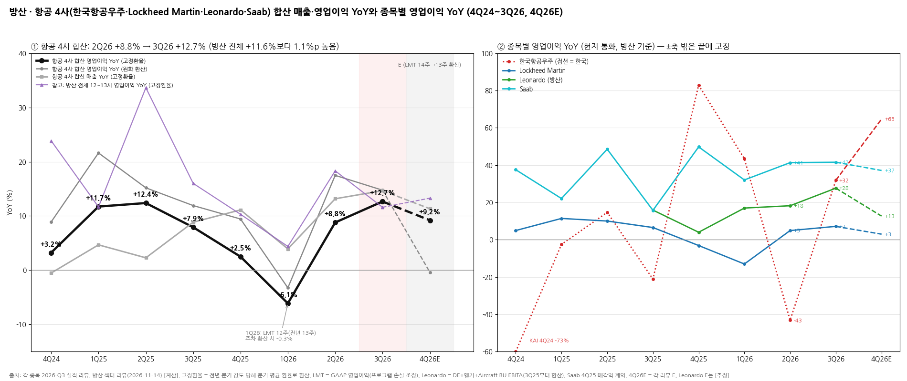
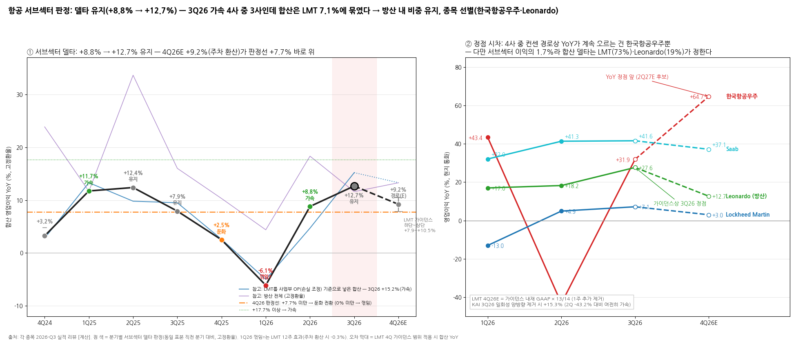

# 방산 · 항공 섹터 리뷰

> 현재 상태 (최신 분기 기준)
> 최신 분기: 2026-Q3
> 섹터 델타: 유지 | 내러티브: 유지
> 모멘텀 신호: 없음
> 활성 테마: 없음
> 포지셔닝: 서브섹터 중립 | 한국 아웃퍼폼 | 선호 한국항공우주, Leonardo
> 델타 근거: 3Q 4사 합산 YoY(고정환율) +8.8→+12.7%(+3.9%p) 유지 → 4Q 컨센 +9.2%로 둔화 예상, 판정선 +7.7%와 1.5%p 차
> 내러티브 근거: 강화 2·유지 2지만 강화 근거가 미사일·전자 수주이고 기체 계약 3건이 2027년으로 밀려 유지
> PM 근거: 방산 내 중립, 3Q 정점 추정·델타 원천이 비기체라 확대 보류. 한국항공우주가 유일하게 YoY 정점이 앞이라 한국 아웃퍼폼
> 편입 종목: 한국항공우주, Lockheed Martin (핵심) + Leonardo, Saab (확장) — 3Q26 합산 4사
> 갱신 시각: 2026-11-15 11:40 KST

## 누적 시계열

| 분기 | 편입 종목 | 합산 매출 | 합산 영업이익 | OPM | 매출 YoY | 영업이익 YoY | 영업이익 YoY 델타 (%p) | 섹터 델타 | 내러티브 | 모멘텀 신호 | 활성 테마 |
|---|---|---|---|---|---|---|---|---|---|---|---|
| 4Q24 | 3사 (KAI·LMT·Saab) — Leonardo 방산 기준 전년 기저 없음 | 297,821억원 ($21.3B) | 36,526억원 ($2.62B) | 12.3 | +4.9 / -0.5 | +8.9 / +3.2 | — | —† | - | - | - |
| 1Q25 | 3사 (동일) | 288,838억원 ($19.9B) | 36,827억원 ($2.54B) | 12.7 | +13.7 / +4.7 | +21.6 / +11.7 | +8.5 | 가속 | - | - | - |
| 2Q25 | 3사 (동일) | 290,530억원 ($20.8B) | 36,723억원 ($2.63B) | 12.6 | +5.0 / +2.3 | +15.2 / +12.4 | +0.6 | 유지 | - | - | - |
| 3Q25 | 4사 (+Leonardo 방산 기준) | 353,701억원 ($25.5B) | 41,403억원 ($2.99B) | 11.7 | +13.2 / +8.9 | +11.9 / +7.9 | -4.5 | 유지 | - | - | - |
| 4Q25 | 4사 (동일) | 444,334억원 ($30.7B) | 52,587억원 ($3.63B) | 11.8 | +18.5 / +11.1 | +9.4 / +2.5 | -5.4 | 둔화 | - | - | - |
| 1Q26 | 4사 (동일) | 374,514억원 ($25.6B) | 40,416억원 ($2.76B) | 10.8 | +7.9 / +3.9 | -3.2 / -6.1 | -8.6 | 꺾임† | - | - | - |
| 2Q26 | 4사 (동일) | 440,229억원 ($29.3B) | 52,126억원 ($3.47B) | 11.8 | +22.3 / +13.2 | +17.5 / +8.8 | +14.9 | 가속 | - | - | - |
| **3Q26** | **4사 (동일)** | **412,844억원 ($29.1B)** | **47,512억원 ($3.35B)** | **11.5** | **+16.7 / +14.7** | **+14.8 / +12.7** | **+3.9** | **유지** | **유지** | **없음** | **없음** |

→ **표기**: YoY 칸은 `원화 환산 / 고정환율`. 서브섹터 델타 판정은 방산 전체 리뷰와 같은 **고정환율 기준**(전년 분기 값도 당해 분기 평균 환율로 환산)이다 [계산]
→ **합산 기준 (방산 전체 리뷰 `sector-review/방산_섹터리뷰.md` ①의 방산 기준 값 그대로)**: 한국항공우주 = 연결 영업이익(K-IFRS) / Lockheed Martin = 전사 GAAP 영업이익 + 프로그램 손실(1Q24 약 $100M, 4Q24 약 $1,710M, 2Q25 $1,615M) 가산 / Leonardo = Defence Electronics + 헬기 + Aeronautics 중 Aircraft BU EBITA(3Q24부터 산출 → 3Q25부터 YoY 합산) / Saab = 그룹 EBIT(4Q25 TransponderTech 매각익 336m 제외 조정 2,925m). 값은 각 종목 2026-Q3 리뷰 1번 표
→ **델타 칸 = 같은 표본 직전 분기 대비**: 3Q25는 Leonardo의 2Q25 YoY 기저(2Q24)가 없어 직전 분기를 3사로 계산했다(+12.4% → 4사 +7.9%) [계산]
→ **†** 4Q24는 소급 첫 행이라 판정 없음. **1Q26 꺾임†**는 규칙상 "마이너스 전환"이지만 LMT 1Q26이 12주(전년 13주)라 생긴 착시가 크다 — LMT를 ×13/12로 환산하면 1Q26 합산 YoY는 -0.3%로 거의 0이다 [계산]. 다음 분기(2Q26) 바로 재가속해 정점 통과로 보지 않는다
→ **LMT 이익 지표에 따라 판정이 갈린다 (경계 판정)**: LMT 리뷰는 회사 주 지표인 **조정 사업부 OP**(-1.1% → +9.9%)로 "가속"을 판정했다. 이 리뷰의 합산은 방산 전체 리뷰와 맞추려 GAAP 영업이익(손실 조정, +4.9% → +7.1%)을 썼다. LMT를 사업부 OP 기준으로 바꿔 넣으면 4사 합산은 2Q26 +4.7% → 3Q26 **+15.2%(+10.5%p, 가속)**다 [계산]. 차이는 FAS/CAS 연금 조정 등 Unallocated 항목이다(LMT 리뷰 1-②)
→ **소수 표본 경고**: 4사이고 LMT가 3Q26 합산 영업이익의 72.9%, Leonardo 19.5%, Saab 6.0%, 한국항공우주 1.7%다 [계산]. 서브섹터 델타는 사실상 LMT·Leonardo 2사가 정한다. 반기 공시 종목(BAE·Thales)은 항공 서브섹터에 편입되지 않아 반기 보조 판정 대상이 없다. 대신 LMT를 뺀 3사 합산을 보조로 병기한다: 2Q26 +19.9% → 3Q26 **+30.7%(+10.8%p, 가속)** [계산]

분기 평균 환율 (원, 일간 종가 평균) — 방산 전체 리뷰와 같은 값

| 통화 | 4Q23 | 1Q24 | 2Q24 | 3Q24 | 4Q24 | 1Q25 | 2Q25 | 3Q25 | 4Q25 | 1Q26 | 2Q26 | 3Q26 | 4Q26 (10/1~11/13) |
|---|---|---|---|---|---|---|---|---|---|---|---|---|---|
| USD/KRW | 1,318.7 | 1,328.2 | 1,370.1 | 1,354.4 | 1,395.5 | 1,449.5 | 1,397.1 | 1,385.8 | 1,447.7 | 1,462.9 | 1,500.9 | 1,417.0 | 1,338.1 |
| EUR/KRW | 1,415.5 | 1,440.2 | 1,471.0 | 1,485.5 | 1,487.0 | 1,525.7 | 1,582.7 | 1,618.5 | 1,683.4 | 1,712.1 | 1,743.7 | 1,627.8 | 1,497.1 |
| SEK/KRW | 123.8 | 128.0 | 128.3 | 130.1 | 129.5 | 136.0 | 144.6 | 145.7 | 153.9 | 160.2 | 160.3 | 146.8 | 134.8 |

→ (출처: 방산 전체 리뷰 환율표 — Yahoo Finance `KRW=X`·`EURKRW=X` 일간 종가 분기 평균, SEK/KRW는 `KRW=X ÷ SEK=X` 교차 [계산], 2026-11-14 조회. 4Q26E 환산은 10/1~11/13 평균)

---

## 2026-Q3 섹터 리뷰 — 항공 4사

> 대상: 2026-Q3 실적 리뷰 4건 — `earnings-review/2026-Q3_{한국항공우주|LMT|LDO|SAAB}_리뷰.md` (모두 2026-11-14 작성. LMT·LDO·SAAB는 숫자 중심 리뷰 — 셀사이드 리포트 미첨부, 컨콜·웹 기사로 쟁점 구성)
> 편입 범위: 워치리스트 "섹터 리뷰 단위" 표 `방산 / 항공` — 핵심 한국항공우주·Lockheed Martin + 확장 Leonardo·Saab (BT 지시: 확장 포함). 국가 = 한국 1 / 미국 1 / 유럽 2. 트래킹 피어 없음
> 상위 섹터 리뷰: `sector-review/방산_섹터리뷰.md` (글로벌 15사, 2026-11-14) — 섹터 델타 둔화, 내러티브 유지, 섹터 중립, 한국 언더퍼폼(한국항공우주 예외)
> 직전 서브섹터 리뷰: 없음 (첫 작성)
> 활성 테마: 없음

① 섹터 합산 숫자와 델타

(1) 항공 4사 합산 (억원·$B, 고정환율 판정)

| 항목 | 4Q24 | 1Q25 | 2Q25 | 3Q25 | 4Q25 | 1Q26 | 2Q26 | **3Q26** | 4Q26E |
|---|---|---|---|---|---|---|---|---|---|
| 합산 편입 (사) | 3 | 3 | 3 | 4 | 4 | 4 | 4 | **4** | 4 |
| 합산 매출 (억원) | 297,821 | 288,838 | 290,530 | 353,701 | 444,334 | 374,514 | 440,229 | **412,844** | 452,557 |
| (달러 환산, $B) | 21.3 | 19.9 | 20.8 | 25.5 | 30.7 | 25.6 | 29.3 | **29.1** | 33.8 |
| 합산 영업이익 (억원) | 36,526 | 36,827 | 36,723 | 41,403 | 52,587 | 40,416 | 52,126 | **47,512** | 54,859 |
| (달러 환산, $B) | 2.62 | 2.54 | 2.63 | 2.99 | 3.63 | 2.76 | 3.47 | **3.35** | 4.10 |
| OPM (%) | 12.3 | 12.7 | 12.6 | 11.7 | 11.8 | 10.8 | 11.8 | **11.5** | 12.1 |
| 매출 YoY — 원화 환산 (%) | +4.9 | +13.7 | +5.0 | +13.2 | +18.5 | +7.9 | +22.3 | **+16.7** | +1.9 |
| 매출 YoY — 고정환율 (%) | -0.5 | +4.7 | +2.3 | +8.9 | +11.1 | +3.9 | +13.2 | **+14.7** | +11.3 |
| 영업이익 YoY — 원화 환산 (%) | +8.9 | +21.6 | +15.2 | +11.9 | +9.4 | -3.2 | +17.5 | **+14.8** | +4.3 (주차 환산 -0.4) |
| **영업이익 YoY — 고정환율 (%)** | +3.2 | +11.7 | +12.4 | +7.9 | +2.5 | -6.1† | +8.8 | **+12.7** | +14.4 (주차 환산 **+9.2**) |
| 직전 분기 YoY (같은 표본, 고정환율) | — | +3.2 | +11.7 | +12.4 | +7.9 | +2.5 | -6.1 | **+8.8** | +12.7 |
| **영업이익 YoY 델타 (%p, 고정환율)** | — | +8.5 | +0.6 | -4.5 | -5.4 | -8.6 | +14.9 | **+3.9** | -3.5 (주차 환산) |
| 판정 | — | 가속 | 유지 | 유지 | 둔화 | 꺾임† | 가속 | **유지** | (유지 경로) |
| ㄴ 한국 제외 3사 (고정환율) | +6.7 | +11.9 | +12.3 | +8.5 | +1.8 | -6.7 | +9.7 | **+12.4** | +8.3 (주차 환산) |
| ㄴ LMT 제외 3사 (고정환율, 보조) | -12.8 | +16.5 | +39.1 | +12.6 | +14.4 | +22.7 | +19.9 | **+30.7** | +20.8 |
| ㄴ 참고: LMT 사업부 OP 기준 합산 | +2.8 | +13.3 | +9.8 | +9.5 | +2.6 | -5.0 | +4.7 | **+15.2** | +13.3 (주차 환산) |
| ㄴ 참고: 한국항공우주 일회성 조정 기준 합산 | | | | | | | +8.8 | **+12.4** | |

→ (출처: 각 종목 2026-Q3 리뷰 1번 표의 방산 기준 값을 분기 평균 환율로 원화 환산해 합산 [계산]. 4Q26E = 한국항공우주 증권사 10곳 평균 1,268억원 / LMT 가이던스 내재 GAAP 영업이익 $2,585M / Leonardo 방산 기준 €908m [추정 — 방산 전체 리뷰와 같은 값: 4Q25 €806m × 그룹 가이던스 역산 4Q EBITA YoY +12.6%] / Saab MarketScreener 컨센 EBIT 4,011m)
→ **4Q26E 주차 환산**: LMT 4Q26은 14주(전년 13주) — 방산 전체 리뷰와 같이 ×13/14로 환산한 값을 판정 경로로 쓴다. 미환산 +14.4%는 1주 추가 효과가 섞인 값이다
→ **한국항공우주 일회성 조정**: 3Q26 보고 영업이익 794억원에서 일회성 비용 약 300억원(이라크 대손 120·하자보수 110·기체 손실충당 70)을 더하고 환율 예정원가 이익 약 400억원을 뺀 약 694억원(KAI 리뷰 1-(1) [추정]) — 합산 영향은 -0.3%p로 판정 불변
→ **이익 레벨**: 3Q26 합산 영업이익 47,512억원($3.35B), OPM 11.5%. 방산 전체 13사 합산(98,955억원)의 48.0%, 매출의 49.2%다 [계산]
→ **델타**: 고정환율 영업이익 YoY +8.8%(2Q26) → **+12.7%(3Q26), +3.9%p → 유지**(±5%p 이내). 3Q26 이익 증가(3Q26 환율 고정) +5,342억원 = LMT +2,310 + Leonardo +2,002 + Saab +838 + 한국항공우주 +192억원. 2Q26(+4,216억원)보다 커졌고, 4사 모두 플러스로 기여했다 [계산]
→ **컨센 경로상 서브섹터 YoY 정점은 3Q26(+12.7%)**으로 본다 [판단]. 4Q26E는 주차 환산 +9.2%로 내려온다 — LMT 가이던스 내재 GAAP(주차 환산 +3.0%)와 Leonardo 가이던스 역산(+12.7%)이 보수적이기 때문이다. 2027년은 LMT "high single digit" 매출 성장(LMT 리뷰), Saab EBIT +21%(Inderes), 한국항공우주 영업이익 +73%(10곳 평균) — 비중이 큰 LMT가 한 자릿수 후반 고원을 만들고, 정점이 앞에 있는 건 비중 1.7%의 한국항공우주뿐이다

(2) 국가 그룹별 소계 (고정환율)

| 국가 | 합산 편입 (3Q26) | 3Q26 매출 (억원) | 3Q26 영업이익 (억원) | OPM | 영업이익 YoY 2Q26 → 3Q26 | 델타 (%p) | 국가 델타 | 4Q26E YoY (주차 환산) |
|---|---|---|---|---|---|---|---|---|
| 한국 | 한국항공우주 | 10,643 | 794 | 7.5 | -43.2 → **+31.9** | +75.1 | **가속** | +64.7 |
| 미국 | Lockheed Martin | 293,465 | 34,616 | 11.8 | +4.9 → **+7.1** (사업부 OP -1.1 → +9.9) | +2.2 (+11.0) | **유지** (리뷰 판정 가속) | +3.0 (사업부 OP +8.8) |
| 유럽 | Leonardo(방산)·Saab | 108,736 | 12,102 | 11.1 | +24.5 → **+30.7** | +6.2 | **가속** | +18.7 |
| **4사 합계** | | **412,844** | **47,512** | **11.5** | **+8.8 → +12.7** | **+3.9** | **유지** | **+9.2** |

→ (출처: 위 (1)과 같은 방식 [계산]. 국가별 1~2사라 **소수 표본** — 국가 델타는 사실상 종목 델타다. LMT 사업부 OP 4Q26E 주차 환산 = $2,411M × 13/14 ÷ 4Q25 $2,058M [계산])
→ **미국 = 유지**: 합산용 GAAP(손실 조정) 기준으로는 +2.2%p라 유지, 리뷰 판정 지표(조정 사업부 OP)로는 +11.0%p 가속이다. 어느 쪽이든 OPM은 정체(사업부 10.8%, 전년 10.9%)이고 성장 원천은 MFC(미사일) 볼륨이다(LMT 리뷰 1-②)
→ **유럽 = 가속**: Leonardo 방산 기준 +18.2% → +27.6%(3개 분기 연속 확대), Saab +41.3% → +41.6%(유지). 레벨은 4개 그룹 중 가장 높은 축(+30%대)
→ **한국 = 가속**: 플러스 전환. 다만 3Q26 증가액은 +192억원(4사 증가분의 3.6%)으로 서브섹터 합산을 움직이지 못한다

(3) 참고 — 기체(플랫폼) 부문만 떼어 본 3Q26 (합산·판정에는 쓰지 않음)

| 부문 | 3Q25 매출 | 3Q26 매출 | 3Q26 영업이익 (현지) | 영업이익 YoY | 마진 | 원화 환산 영업이익 (억원) | YoY 증가액 (억원) |
|---|---|---|---|---|---|---|---|
| 한국항공우주 (전사 = 기체) | 7,021억원 | 10,643억원 | 794억원 | +31.9% | 7.5% | 794 | +192 |
| LMT Aeronautics | $7,256M | $8,214M | $743M | +8.9% | 9.0% | 10,528 | +864 |
| Leonardo 헬기 | €1,306m | €1,413m | €137m | +16.1% | 9.7% | 2,230 | +309 |
| Leonardo Aircraft BU | €729m | €776m | €93m [역산] | +9.4% | 12.0% | 1,514 | +130 |
| Saab Aeronautics | SEK 4,438m | SEK 4,844m | SEK 331m | +56.1% | 6.8% | 486 | +175 |
| **기체 부문 합계** | | | | **+12.0%** (매출 +13.6%) | | **15,552** | **+1,670** |

→ (출처: LMT 리뷰 1-②, LDO 리뷰 1-② (2-1), SAAB 리뷰 1-②, KAI 리뷰 1번 [계산 — 3Q26 환율 고정]. 2Q26 이전은 LMT Aero 2Q25 손실 분기·Leonardo 헬기 2Q25 미기재로 같은 표 불가)
→ **기체 부문만 봐도 3Q26 +12.0%로 4사 전사 기준(+12.7%)과 비슷하다**. 다만 4사의 이익 증가분 +5,342억원 중 기체 부문 몫은 +1,670억원(31%)이다 — **나머지 69%는 미사일(LMT MFC +23.7%)·방산전자(Leonardo DE +39.7%)·감시(Saab Surveillance +110.5%)가 냈다** [계산]. "항공" 서브섹터의 이익 델타는 기체가 아니라 같은 회사의 비항공 사업부가 끈다 [판단]

→ (출처: 각 종목 2026-Q3 리뷰, 방산 섹터 리뷰 [계산]. 왼쪽 = 4사 합산(검은 굵은 선 = 고정환율 영업이익 YoY, 회색 = 원화 환산, 연회색 사각 = 매출 YoY), 보라 = 방산 전체 12~13사 / 오른쪽 = 종목별 영업이익 YoY(현지 통화, 방산 기준, 점선 = 한국), 4Q26E 점선. LMT 4Q26E는 14주 → 13주 환산)

② 종목별 델타 판정표

| 서브섹터 내 델타 순위 | 종목 | 국가 | 매출 YoY | 영업이익 YoY | 영업이익 YoY 델타 | 델타 판정 | 내러티브 | 한 줄 |
|---|---|---|---|---|---|---|---|---|
| **1위** | 한국항공우주 | 한국 | +51.6 | +31.9 (일회성 양방향 제거 약 +15) | +75.1%p | 가속 | 유지 | KF-21 첫 양산 납품 2대(2,129억원) + 비공개 완제기 수출 1.45조원. 4Q26E +65%·2027E +73%, YoY 정점(2Q27E)이 아직 앞 |
| **2위** | Leonardo (방산 기준) | 유럽 | +19.0 | +27.6 (그룹 EBITA +43.1) | +9.4%p [계산] (그룹 +8.3%p) | 가속 | 유지 | 그룹 EBITA YoY 3개 분기 연속 확대, 동일범위(IDV 제외)도 +21.6% → +34.9%. 4Q 암묵 +12.6% 보수 가이던스 |
| **3위** | Lockheed Martin | 미국 | +11.3 | +9.9 (조정 사업부 OP) / GAAP +7.1 | +11.0%p | 가속 | 강화 | 잔고 $230.4B → $292.0B(PAC-3 MSE $52.5B). 가속 원천은 MFC, Aero는 OPM 9.0% 정체·F-35 Lot 20 미계약 |
| **4위** | Saab | 유럽 | +29.5 | +41.6 | +0.2%p | 유지 | 강화 | 레벨은 4사 최고(+40%대 고원), 수주 SEK 65.8bn(그리펜 우크라이나 24.6bn). 컨센상 정점은 2026년, 2027E +21% |

→ (출처: 각 종목 리뷰 0번 판정·1번 표. 현지 통화 기준)
→ **순위 기준** [판단]: ① 리뷰 델타 판정(가속 > 유지) ② 컨센 경로상 YoY 정점 위치(앞에 있을수록 상위) ③ 이익의 질(일회성·범위 변경 제거 후에도 가속인지). 한국항공우주는 ①②가 가장 좋고 ③은 일회성 양방향 제거 후에도 -43.2% → 약 +15%로 가속이 유지된다. Leonardo는 ③이 가장 깨끗하지만(동일범위 가속) ②에서 가이던스상 3Q26 정점. LMT는 4Q26 주차 환산 시 사업부 OP +8.8%로 내려가고 2027은 한 자릿수 후반 고원. Saab는 유지 판정에 4Q26E +37.1%·2027E +21%로 정점 통과 경로
→ **판정 기준 주석**: (a) LMT 델타는 리뷰 판정 지표(조정 사업부 OP)로 적었다. 합산용 GAAP(손실 조정) 기준은 +4.9% → +7.1%(+2.2%p) (b) Leonardo 델타는 방산 기준 값으로 다시 계산한 참고치, 판정은 리뷰 0번(그룹 EBITA) 그대로
→ **판정 분포**: 가속 3(한국항공우주·Leonardo·LMT) / 유지 1(Saab). 내러티브: 강화 2(LMT·Saab) / 유지 2(한국항공우주·Leonardo)
→ **서브섹터 델타를 끄는 곳**: 3Q26 이익 증가 LMT +2,310억원, Leonardo +2,002억원, Saab +838억원, 한국항공우주 +192억원 [계산]. 2Q26 대비 증가폭이 커진 곳 = LMT(+1,741 → +2,310)·Leonardo(+1,534 → +2,002)·한국항공우주(-368 → +192), 줄어든 곳 = Saab(+1,309 → +838)
→ **선행 종목**: 먼저 가속한 쪽 = Saab(2024년부터 +20~50% 고원, 2026년 정점 경로)·Leonardo(1Q26부터 3개 분기 연속 확대). 늦게 올라온 쪽 = 한국항공우주(3Q25 -21% 바닥 → 4Q25부터 플러스, 2Q26 LAH 차질로 일시 -43%) [판단]. LMT는 손실 기저(2024~25)를 벗어나 3Q26에야 정상 성장률을 확인한 회복형이다

참고 — 기체 부문 분기 추이 (합산 미사용, 각 리뷰 숫자)

| 부문 | 항목 | 3Q25 | 4Q25 | 1Q26 | 2Q26 | **3Q26** |
|---|---|---|---|---|---|---|
| LMT Aeronautics ($M) | 매출 / 영업이익 | 7,256 / 682 | 8,524 / 782 | 6,953 / 619 | 8,112 / 760 | **8,214 / 743** |
| | OPM / 영업이익 YoY | 9.4% / +3.5% | 9.2% / +80.2% | 8.9% / -14.0% | 9.4% / 흑전 | **9.0% / +8.9%** |
| Leonardo 헬기 (€m) | 매출 / EBITA | 1,306 / 118 | 1,738 / 203 | 1,307 / 76 | 1,597 / 134 | **1,413 / 137** |
| | ROS | 9.0% | 11.7% | 5.8% | 8.4% | **9.7%** (YoY +16.1%) |
| Leonardo Aircraft BU (€m) [역산] | 매출 / EBITA | 729 / 85 | 1,244 / 195 | 773 / 75 | 824 / 108 | **776 / 93** |
| | EBITA YoY [계산] | +7.6% | +8.3% | +11.9% | -4.4% | **+9.4%** |
| Saab Aeronautics (MSEK) | 매출 / EBIT | 4,438 / 212 | 5,746 / 349 | 5,199 / 328 | 5,813 / 337 | **4,844 / 331** |
| | 마진 | 4.8% | 6.1% | 6.3% | 5.8% | **6.8%** (YoY +56.1%) |

→ (출처: LMT 리뷰 1-②, LDO 리뷰 1-②·(2-1) — Aircraft BU YoY는 3Q24~2Q25 역산값 대비 [계산], SAAB 리뷰 1-②. LMT Aero 2Q26 "흑전"은 2Q25 기밀 프로그램 손실 $950M 기저)
→ LMT Aero는 매출 +13.2%(F-35 +$710M, C-130 +$270M)인데 F-16·C-130 불리한 조정으로 OPM 9.0%, 회사는 2026 Aero OP 가이던스를 소폭 하향했다. Saab Aero 마진 6.8%는 T-7 손실(연 약 SEK 5억)을 안은 값이고, T-7 제외 시 "high single-digit"(CEO)

③ 섹터 공통 쟁점

(1) 플랫폼 계약·인도 시점 이연 → 2026 숫자는 깎이고 2027로 쏠린다 (4사 공통)
→ 한국항공우주: LAH(미르온) 엔진 결함으로 3Q 납품 0대, 약 20대가 2027년으로 이연, 매출 차질 4,000~5,000억원(BNK) → 2026 매출 가이던스 5.73조원은 약 5.2조원으로 미달(6년 연속). 인니 KF-21 16대(약 4조원) 체결 가이드는 2Q26 → 4Q26으로 밀렸고 인니 재무부 예산 승인 대기 (KAI 리뷰 ③(2)·(3))
→ Lockheed Martin: F-35 10년·최소 850대 프레임워크는 합의됐지만 **Lot 20 이상 확정계약은 미체결**. 3Q부터 Lot 20 선행계약 원가가 승인 예산을 넘었고, 차기 Lot 매출 반영은 2027년으로 밀렸다. Aero 잔고는 FY25말 $59.4B → $57.3B로 감소, 9M26 F-35 인도 94대(9M25 143대) (LMT 리뷰 ③(2))
→ Saab: T-7은 보잉 출고 속도가 낮아 생기는 under-absorption으로 손실이 가이드(분기 SEK 1억)보다 커졌다(연 약 5억). 미 공군 IOC 2027-08 (SAAB 리뷰 ③(2))
→ Leonardo: 3Q 컨센 대비 EBITA +8.1% beat에도 매출·EBITA 가이던스 유지 → 4Q 암묵 EBITA +12.6% (LDO 리뷰 ③(1))
→ 셀사이드 해석 차이: 한국항공우주는 "물량 소멸이 아니라 시점 이동"(10곳 공통)이지만 인니 연내 체결 확률이 갈린다(국내 증권사 연내 기본 가정 vs 맥쿼리·JP모간 2027 지연 가능). LMT는 "물량 리스크 해소, 가격·현금 리스크 잔존"(Jefferies·TIKR). Leonardo는 "숨은 쿠션"(BofA) vs "실제 감속"(Equita)
→ `[판단]` 항공 4사는 공통으로 **2026년 숫자를 계약·인도 시점에 내주고 2027년에 몰아 두었다**. 그래서 4Q26E(주차 환산 +9.2%)는 낮게, 2027년은 이연 회수가 받치는 구조다. 4Q~1Q 안에 계약(F-35 Lot 20, 인니 KF-21, LAH 3차)이 나오느냐가 2027 델타의 신뢰도를 정한다

(2) 기체(플랫폼) 마진은 한 자릿수 — 이익 델타는 같은 회사의 비항공 사업부가 끈다 (LMT·Saab·Leonardo)
→ LMT: 전사 OP 증가분 $200M 중 $121M(60%)이 MFC(PAC-3·THAAD·GMLRS), Aero는 OPM 9.0% 정체 (LMT 리뷰 1-②)
→ Saab: 그룹 EBIT 증가분 571m 중 493m(86%)가 Surveillance, Aeronautics는 마진 6.8% (SAAB 리뷰 1-②)
→ Leonardo: 그룹 EBITA 증가분 €157m의 61%가 Defence Electronics, 헬기 +16%·Aircraft BU 9M 이익 +4% (LDO 리뷰 1-② (2-1), 쟁점 3)
→ 한국항공우주: 이익의 바닥은 기체구조물(OPM 13~18%)이 받치고, 방산(국내+완제기)은 한 자릿수 초반 OPM(증권사 추정) — 2027 성장 논리는 KF-21·LAH 양산으로 방산 OPM이 회복된다는 데 걸려 있다 (KAI 리뷰 1-(2-2))
→ `[판단]` 글로벌 3사는 "항공" 이름표를 달았지만 3Q26 델타는 미사일·전자·감시가 만들었다. **순수 기체 회사는 한국항공우주 하나**라, 기체 업황(전투기·헬기·훈련기 수출) 자체의 델타를 가장 직접 보여 주는 종목도 한국항공우주다

(3) 전투기·훈련기·헬기 수출 수주 — 신규 고객이 동시에 나왔다 (한국항공우주·Saab·Leonardo)
→ 한국항공우주: 3Q 비공개 완제기 수출 1조 4,527억원(신규 고객, 거래소 유보공시) → 완제기 잔고 5.0조 → 6.2조원 반등, 3Q 신규수주 1조 5,806억원(+502%). 파이프라인: 인니 KF-21 약 4조, 이집트 FA-50 약 2.8조, 말레이시아 FA-50 추가 약 1.4조, 페루 FA-50 약 2조, 이라크 KUH 약 1.5조(JP모간 정리). 다만 연 수주 목표 10.4조원 대비 누계 21% (KAI 리뷰 1-(2-3), ③(3)·(4))
→ Saab: 3Q 수주 SEK 65.8bn 중 **우크라이나 그리펜 16대 24.6bn(신규 고객)**, Aeronautics 3Q 수주 28.8bn. 그리펜 수출 콜롬비아·태국 진행, 캐나다 그리펜은 정치적 결정 대기 (SAAB 리뷰 ①·③(3))
→ Leonardo: 9M 수주에 M-346(오스트리아·이탈리아 PAN), 그리펜용 RAVEN AESA 레이더 수출, 영국 NMH AW149 23대, 이중용도 헬기 131대. 3Q 헬기 수주 €1,705m(전년 €1,485m), Aeronautics €1,011m(전년 쿠웨이트 유로파이터 대형 수주 기저 €2,805m) (LDO 리뷰 1-(2-3))
→ LMT: Aero 잔고 감소(F-35 Lot 20 미계약) — 전투기 신규 수주 공백은 오히려 미국 쪽 (LMT 리뷰 1-(1))
→ `[판단]` 제품군이 겹치는 경쟁 구도: **경전투기 = 그리펜(Saab) vs KF-21·FA-50(KAI)**, **고등훈련기·경공격기 = M-346(Leonardo) vs T-50/FA-50(KAI)**, 미 공군 고등훈련기 = T-7(보잉·Saab). 이번 분기 리뷰에 같은 입찰에서 맞붙은 결과 기록은 없다 — 확인된 것은 **3사가 같은 분기에 서로 다른 신규 고객을 확보했다**는 사실이다(KAI 비공개 1.45조, Saab 우크라이나, Leonardo 오스트리아 M-346). Leonardo는 그리펜 레이더 공급사이기도 해 그리펜 수출이 늘면 Leonardo DE도 수혜다

(4) 환율 — 원화 강세가 한국항공우주 이익을 위아래로 흔든다
→ 한국항공우주: 환율 하락 → 진행기준 수출사업 예정원가 재조정 이익 약 400억원(영업이익), 같은 환율로 외환손실 399억원(영업외). 앞으로 예정원가 환율을 분기 단위로 재조정 (KAI 리뷰 ③(1))
→ 글로벌: Leonardo DRS USD 약세 환산 역풍(가이던스 €/$ 1.18 가정) (LDO 리뷰 ③(2))
→ `[판단]` 원화 기준으로는 4Q26 4사 합산 YoY가 원화 환산 -0.4% vs 고정환율 +9.2%(주차 환산)로 약 10%p 깎인다 [계산]. 한국항공우주는 4Q에 원화가 다시 약해지면 예정원가 재조정이 반대로 작용한다

(5) 멀티플 — 이익 추정은 버티는데 배수가 움직였다, 방향은 회사마다 반대
→ 한국항공우주: 평균 TP -8.4%인데 2027E 영업이익은 -1.2% → **TP 하향의 대부분이 멀티플**(JP모간 PER 20 → 18배) (KAI 리뷰 ⑤)
→ Saab: TP는 4건 모두 상향(실적 +1~4%), 등급 하향 2건은 모두 밸류(2027~28 P/E 35·29배) (SAAB 리뷰 ③(4))
→ LMT: TP 4/4 상향(평균 +8.1%), forward P/E 약 18 → 19배 — **멀티플 확장** (LMT 리뷰 ⑤)
→ Leonardo: BofA 추정 소폭 하향에도 PO €71 유지(멀티플 상향), 주가 ATH 대비 -24% (LDO 리뷰 ⑤)
→ `[판단]` 같은 서브섹터 안에서 배수 방향이 갈렸다 — 미국(LMT)은 다년계약 가시성 프리미엄으로 확장, 한국·스웨덴은 수축. BT 프레임상 한국항공우주는 "이익 추정이 유지되는데 배수만 내린" 쪽이라 델타가 확인되면 되돌림 여지가 있다

(6) 종목 고유 이슈
→ 한국항공우주: 차입금 3조 522억원·외환손실·이자로 영업이익 794억원 중 순이익 190억원(24%), 이라크 수리온 채권 충당금 반복, 한화에어로스페이스 지분 15.9%(KB M&A 프리미엄 20%)
→ Lockheed Martin: PAC-3·THAAD 7년 고정가 계약 마진, Aero 기밀 프로그램 누적 손실 약 $1.8B·"추가 손실 가능성" 문구 유지, 차세대 Vectis(무인 협동전투기)
→ Leonardo: IDV 인수 범위 변경(3Q 매출 약 €332m), 항공구조물 적자 축소(9M -€88m), 2027-03-04 Industrial Plan
→ Saab: Dynamics EBIT -18%(R&D·믹스), GlobalEye NATO 약 10대·캐나다 6대 협상, 2027-05-12 CMD

④ 섹터 판정

(1) 판정 한 줄

> 섹터 델타: **유지** | 내러티브: **유지** → **항공 4사 합산 영업이익 YoY +8.8% → +12.7%(고정환율) — 4사 중 3사가 가속이지만 합산의 73%인 LMT(GAAP +7.1%)에 묶여 유지. 이익 델타는 기체보다 같은 회사의 미사일·전자가 끌고, 기체 계약(F-35 Lot 20·인니 KF-21·LAH 3차)은 2027로 밀렸다. 방산 내 비중 유지, 종목 선별(한국항공우주·Leonardo). 4Q26 +7.7% 미만이면 둔화 전환**

(2) 키 차트

→ (출처: 각 종목 2026-Q3 리뷰 [계산]. 왼쪽 = 4사 합산 영업이익 YoY(고정환율, 검은 선 — 점 색 = 분기별 판정, 3Q26 강조), 파란 선 = LMT를 사업부 OP 기준으로 넣은 합산(3Q26 +15.2%, 가속), 보라 = 방산 전체, 주황 일점쇄선 = 4Q26 둔화 판정선 +7.7%, 초록 점선 = 가속선 +17.7%, 오차 막대 = LMT 4Q 가이던스 하단~상단 적용 시 합산 +7.9~+10.5% / 오른쪽 = 종목별 영업이익 YoY 1Q26 → 4Q26E(현지 통화, 빈 점·점선 = E) — 정점 시차)

(3) 근거
→ **델타 = 유지**: 4사 고정환율 영업이익 YoY +8.8%(2Q26) → +12.7%(3Q26), +3.9%p로 ±5%p 이내 → 유지. 원화 환산으로는 +17.5% → +14.8%(원화 강세 영향). 판정은 경계에 있다 — LMT를 리뷰 판정 지표(조정 사업부 OP)로 넣으면 +4.7% → +15.2%(+10.5%p) **가속**이고, LMT를 빼면 3사 +19.9% → +30.7%(+10.8%p) **가속**이다 [계산]. 합산을 유지에 묶어 둔 것은 LMT GAAP 영업이익(연금 조정 포함)의 낮은 성장률 하나다
→ **방산 전체 대비**: 3Q26 항공 4사 +12.7% vs 방산 전체 13사 +12.1% → **+0.6%p 높다**. 델타는 항공 +3.9%p vs 방산 전체 -6.2%p로 방향이 반대다 [계산 — 방산 섹터 리뷰 ①]
→ **내러티브 = 유지**: 강화 2(LMT·Saab) / 유지 2(KAI·Leonardo). 그런데 LMT·Saab 강화의 근거는 PAC-3 다년계약·Surveillance 수주(비항공)이고, 기체 쪽 스토리는 엇갈렸다 — 강화(KAI 1.45조 신규 고객·KF-21 양산 개시, Saab 그리펜 우크라이나) vs 약화(F-35 Lot 20 미계약·Aero 잔고 감소, LAH 엔진 결함·가이던스 6년 연속 미달, 인니 지연, T-7 손실 확대) [판단]
→ **직전 대비·소급 궤적**: 첫 작성. 소급 시계열은 1Q25 가속(+11.7%) → 2Q25 유지 → 3Q25 유지 → 4Q25 둔화(+2.5%) → 1Q26 꺾임†(-6.1%, LMT 12주) → 2Q26 가속(+8.8%) → **3Q26 유지(+12.7%)**. **+0~+13% 박스권의 상단**이고, 2024~25 LMT 손실 기저와 회계 주차가 궤적을 크게 흔들었다 [판단]
→ **4Q26 예고**: 컨센 경로(주차 환산) +9.2%로 -3.5%p — "유지" 경로지만 둔화 판정선 +7.7%에 1.5%p 차이다. 한국항공우주 4Q E 범위(BofA 791억 ~ SK 1,587억원)를 넣으면 +8.2~+9.9%, LMT 가이던스 하단~상단을 넣으면 +7.9~+10.5% [계산]

⑤ 모멘텀 신호

→ **없음** (조건 대조)
→ 테마 종료 후보: **해당 없음** — 항공에 걸린 활성 테마가 없다
→ 델타 급증 후보: ① 서브섹터 영업이익 YoY 델타 뚜렷한 확대 — **미충족**(+3.9%p, 유지 범위. 사업부 OP 기준 +10.5%p는 충족) ② 편입 종목 과반 가속 — **충족**(3/4) ③ 내러티브 형성·강화 — **미충족**(유지) → 후보로 올리지 않음
→ **다음 분기에 아래가 함께 나오면 "델타 급증 후보"로 올린다**: 4Q26 4사 고정환율 YoY +17.7% 이상(주차 환산) + F-35 Lot 20 확정계약 또는 인니 KF-21 체결(기체 내러티브 강화) + 4사 중 3사 이상 가속 유지. 연결될 만한 테마 키워드 제안: **"전투기·훈련기 수출 신규 고객 확산(KF-21·FA-50·그리펜·M-346)"** — 제안일 뿐, 판단은 BT
→ 반대 논거: (a) 이연 물량(LAH 약 20대, F-35 차기 Lot)이 2027년에 몰려 있어 2027 상반기 분기 YoY는 숫자만으로 급증할 수 있다 — 이번 분기 조건 미충족이 "모멘텀 없음"을 뜻하지는 않는다 (b) 반대로 합산 델타의 실제 원천이 미사일·전자라, 항공 서브섹터의 급증 신호는 기체 업황이 아니라 방공 수요를 반영할 수 있다(③(2))

⑥ 다음 분기 섹터 관전 포인트

| 순위 | 무엇을 (변수·임계값) | 어떤 데이터로 | 언제 |
|---|---|---|---|
| 1 | **4Q26 4사 합산 영업이익 YoY (고정환율·LMT 주차 환산) +7.7% 이상** — 미만이면 **둔화**, 0% 미만이면 꺾임, +17.7% 이상이면 가속. 컨센 경로 +9.2%. 레벨로는 4Q25 기저(4Q26 QTD 환율 환산) 47,971억원 × 1.077 = **약 5.17조원** | 4사 4Q26 실적 | 2027-01 하순(LMT) ~ 02 초(한국항공우주 잠정, Saab 2/5) ~ 03-04(Leonardo) |
| 2 | **F-35 Lot 20+ 확정계약**과 LMT Aero 잔고 $57.3B 증가 전환 / LMT 2027 가이던스 매출 +8% 이상·사업부 OPM 11% 이상 | 미 국방부 계약 공시, LMT 4Q26 보도자료 | 4Q26 ~ 1H27 / 2027-01 하순 |
| 3 | **인니 KF-21 16대(약 4조원)·LAH 3차 108대(약 3조원) 연내 체결**, 한국항공우주 4Q 국내사업 매출 1조원 이상(LAH 납품 재개 확인) | 회사 공시, 방사청·인니 재무부 발표, 4Q26 잠정실적 | 2026-12 / 2027-02 초 |
| 4 | Leonardo 4Q EBITA 암묵치 €909m 초과(€960m+면 델타 유지) + 2027~2031 Industrial Plan / Saab 4Q EBIT 4,011m·2028~ 중기 목표 22% 이상 | 각 사 FY 발표 | 2027-02-05(Saab), 2027-03-04(Leonardo) |
| 5 | 수출 경쟁 이벤트: KAI 비공개 1.45조원 국가·기종 공개, 이집트·페루·말레이시아 FA-50, 캐나다 그리펜 결정, NATO GlobalEye, 폴란드 FA-50PL 2027-07 초도 인도 / 미 FY27 세출·CR(12/11 만료) | 회사 공시, 각국 국방부, 의회 | 11월 ~ 2027 상반기 |

→ 판정선 근거: 3Q26 +12.7%에서 ±5%p 안(7.7~17.7%)이면 유지, 17.7% 이상 가속, 7.7% 미만이면 축소 → **둔화**(플러스 유지 시). 3Q26이 유지라 4Q26 한 분기 축소로는 꺾임이 아니고, 4Q26 둔화 + 1Q27 재둔화 또는 마이너스 전환이면 꺾임이다. ④ 키 차트의 판정선과 같은 값이다
→ 원화 환산은 판정선으로 쓰지 않는다 — 4Q26 QTD 환율이면 원화 환산 YoY는 고정환율보다 약 10%p 낮다(4Q26E -0.4% vs +9.2%) [계산]
→ 보조선: LMT를 사업부 OP 기준으로 넣은 합산은 3Q26 +15.2%(가속) → 4Q26E 주차 환산 +13.3%(유지 경로) — 두 기준이 같은 방향이면 판정 신뢰도가 높다

⑦ 글로벌 PM 포지셔닝 — 결론

> **서브섹터: 비중 유지 (방산 내) — 4Q26 4사 YoY +17.7% 이상 + F-35 Lot 20·인니 KF-21 중 1건 체결 시 확대, +7.7% 미만 + 기체 계약 2027 상반기로 지연 시 축소** | **한국: 아웃퍼폼 (한국항공우주 — 델타 1위, 수주 확인 조건부)** | **선호: 한국항공우주 (유일하게 YoY 정점이 앞), Leonardo (3개 분기 연속 가속·동일범위 가속)**

→ 비교 범위: **글로벌 편입 종목 3사(숫자 중심 리뷰)** — 미국 1(LMT)·유럽 2(Leonardo·Saab) + 한국 1(한국항공우주). 반기 공시 종목 없음, 트래킹 피어 없음. 국가별 1~2사라 **소수 표본** — 국가 비교는 사실상 종목 비교다
→ 직전 콜 체크: 첫 서브섹터 리뷰. 상위 방산 섹터 리뷰의 "한국 언더퍼폼(한국항공우주 예외)·선호 GD·Aselsan, 한국 안에서는 KAI"와 일관된다 — 항공 서브섹터 안에서는 그 예외가 한국 콜 자체가 된다

(1) 항공 서브섹터 비중 (방산 내) — 확대 / 중립 / 축소

| 판단 축 | 3Q26 근거 | 방향 |
|---|---|---|
| 이익 델타 (1순위) | 4사 고정환율 YoY +8.8% → +12.7%(유지, +3.9%p) — 방산 전체(-6.2%p 둔화)보다 낫다. 가속 3 / 유지 1. LMT 사업부 OP 기준·LMT 제외 기준으로는 가속 | 중립 (확대 쪽) |
| YoY 정점 시점 | 서브섹터 정점 3Q26 판단, 4Q26E 주차 환산 +9.2%(판정선 +7.7%와 1.5%p). 정점이 앞인 종목은 비중 1.7%의 KAI뿐, Leonardo(가이던스)·Saab는 정점 통과 경로 | 중립 (축소 쪽) |
| 수주·잔고 선행지표 | 신규 고객 수출 3건(KAI 1.45조, Saab 그리펜 우크라이나 SEK 24.6bn, Leonardo M-346 오스트리아). LMT 전사 잔고 $292.0B 사상 최대지만 Aero 잔고는 $57.3B로 감소(F-35 Lot 20 미계약), KAI 연 수주 목표 대비 21% | 중립 |
| 최종 수요 지표 | F-35 10년·850대 프레임워크(연 156대 능력), KF-21 양산 40 → 60 → 80대(2026~28), Saab 2027 인도분 잔고 SEK 102.1bn(+63%), Leonardo 잔고 €60.4bn(2.7년치) | 확대 |
| 이벤트·정책 | 12월 인니 KF-21·LAH 3차, F-35 Lot 20(4Q26~1H27), 미 FY27 CR 12/11 만료 — 모두 미확인 | 중립 (이벤트 전) |
| 밸류에이션·멀티플 (2순위) | LMT forward P/E 약 19배(확장 중), Saab 2027~28 P/E 35·29배(등급 하향 2건), KAI 낙관 PER 30배(2028E)~보수 18배(JP모간), Leonardo BofA PO €71 | 중립 |
| 주가 낙폭 | KAI 11/03 97,300원(6개월 -42%, 52주 최저권) → 11/06 102,600원, Leonardo ATH -24%, LMT 10/29 고점 -7.4%, Saab 10/29 고점 대비 약 -8% [계산] | 중립~확대 |

→ (출처: 각 종목 리뷰. 밸류에이션 기준일 2026-10-22~11-13)
→ **결론: 비중 유지(중립)** [판단]. BT 프레임 1순위인 이익 델타는 서브섹터 유지로 방산 전체(둔화)보다 낫고, 기준을 바꾸면 가속까지 나온다. 확대가 아닌 이유는 (a) 합산을 정하는 LMT·Leonardo의 4Q 가이던스 경로가 내려가 서브섹터 정점이 3Q26으로 보이고 (b) 델타의 원천이 기체가 아니라 같은 회사의 미사일·전자이며(③(2)) (c) 기체 계약 3건(F-35 Lot 20·인니 KF-21·LAH 3차)이 모두 미체결이기 때문이다. 축소가 아닌 이유는 4사 모두 이익 증가가 플러스이고, 이연 물량이 2027년에 쌓여 있기 때문이다
→ **확대 전환 조건**: ① 4Q26 4사 고정환율 YoY +17.7% 이상(주차 환산, ④ 판정선·⑥ 1순위와 같은 표) ② F-35 Lot 20+ 확정계약 또는 인니 KF-21 체결 중 1건 이상 ③ LMT 2027 가이던스 매출 +8% 이상·사업부 OPM 11% 이상
→ **축소 전환 조건**: 4Q26 4사 고정환율 YoY +7.7% 미만(둔화) **+** F-35 Lot 20·인니 KF-21이 2027 상반기로 넘어감(기체 내러티브 약화)

(2) 한국 vs 글로벌 — 아웃퍼폼 / 중립 / 언더퍼폼

국가별 델타 표 (고정환율, 소수 표본)

| 국가 | 합산 편입 종목 (3Q26) | 영업이익 YoY 2Q26 → 3Q26 | 델타 판정 | 수주·잔고 방향 | 제외 종목 (공시 주기) |
|---|---|---|---|---|---|
| 한국 | 한국항공우주 | -43.2% → +31.9% | 가속 | 반등 — 3Q 신규수주 1.58조원(+502%), 완제기 잔고 5.0 → 6.2조원. 연 목표 대비 21% | — |
| 미국 | Lockheed Martin | +4.9% → +7.1% (사업부 OP -1.1% → +9.9%) | 유지 (리뷰 판정 가속) | 전사 급증($292.0B) / Aero 감소($57.3B) | — |
| 유럽 | Leonardo(방산)·Saab | +24.5% → +30.7% | 가속 | 증가 — Saab B/B 3.2배·잔고 SEK 364bn, Leonardo B/B 1.31·잔고 €60.4bn | — |

→ (출처: ① (2) 표 [계산], 수주·잔고는 각 리뷰)

한국 vs 글로벌 경쟁력 축

| 경쟁력 축 | 한국 (한국항공우주) | 글로벌 (LMT·Leonardo·Saab) | 우위 |
|---|---|---|---|
| 델타 방향 (1순위) | 영업이익 YoY -43.2% → +31.9%(가속, 일회성 제거 약 +15%). 4Q26E +64.7%, 2027E +73.4%, 정점 2Q27E 후보 | 한국 제외 3사 +9.7% → +12.4%(유지), 4Q26E 주차 환산 +8.3%. 가속 2(LMT·Leonardo)·유지 1(Saab), 3사 모두 컨센상 정점 통과 경로 | **한국** |
| 마진 레벨 | OPM 7.5%(일회성 제거 6.5%), 방산(국내+수출) 한 자릿수 초반·기체구조물 13~18%(증권사 추정) | 전사 LMT 11.8%·Leonardo 방산 11.8%·Saab 9.5% / 기체 부문 LMT Aero 9.0%·Leonardo 헬기 9.7%·Saab Aero 6.8% | 글로벌 |
| 마진 방향 | 4.1%(2Q26) → 7.5%, 전년 8.6% 대비 -1.1%p | Leonardo 방산 11.0% → 11.8%, Saab Aero 4.8% → 6.8% / LMT 사업부 OPM 10.9% → 10.8%, Aero 9.4% → 9.0% | 글로벌 (근소) |
| 수주·잔고 증가율 | 신규 고객 1.45조원, 완제기 잔고 2분기 만에 반등. 연 수주 목표 21%, 인니·LAH 3차 대기 | Saab 그리펜 우크라이나 24.6bn·B/B 3.2배, Leonardo 헬기 수주 +15%·M-346 / LMT Aero 잔고 감소 | 글로벌 (근소) |
| 생산 능력·병목 | LAH 엔진 결함(납품 0대 → 11월 재개), KF-21 양산 2대 개시, 양산 40 → 60 → 80대 계획 | F-35 연 156대 능력·Lot 20 선행 원가, Saab 증설 투자 R12 SEK 8bn+(2026~27 피크), T-7 under-absorption | 비슷 (양쪽 병목) |
| 경쟁 제품 | KF-21·FA-50(경전투기), T-50 계열(훈련기) — 신규 고객 확보 | 그리펜(경전투기), M-346(훈련기) — 같은 분기 신규 고객 확보 | 비슷 (맞대결 기록 없음) |
| 환율 | 원화 강세 → 예정원가 이익 +400억원이 외환손실 399억원과 상쇄, 4Q 원화 약세 시 역방향 | DRS USD 환산 역풍(Leonardo) — 영업이익 본체 영향 작음 | 글로벌 |
| 이익 추정 방향 | 2026E -3.1%, 2027E -1.2%(10곳 평균), TP 하향 6·유지 4 | LMT 가이던스 2분기 연속 상향·TP 4/4 상향, Saab 2026~28 +2~4%(Inderes)·TP 4/4 상향 / Leonardo BofA 소폭 하향 | 글로벌 |
| 밸류에이션·낙폭 (2순위) | 6개월 -42%, 평균 TP 15.1만원(11/03 종가 대비 +55%), 멀티플 수축 | LMT 약 19배(확장), Saab 35·29배, Leonardo ATH -24% | 한국 (2순위) |

→ (출처: 각 종목 리뷰. 밸류에이션 기준일 2026-11-03~11-13, 소스별 정의 차이)
→ **결론: 한국 아웃퍼폼 (한국항공우주)** [판단]
→ 이유 (1) **델타 방향**: 4사 중 유일하게 컨센 경로상 YoY가 계속 오른다(3Q26 +31.9% → 4Q26E +64.7% → 2027E +73%). 글로벌 3사는 3Q26이 가속·유지라도 4Q 가이던스·컨센 경로가 내려간다
→ 이유 (2) **이익 추정**: 2027E가 발표 후에도 -1.2%로 버텼다 — 하향은 LAH가 걸린 2026E(-3.1%)에 실렸고 그 물량은 2027로 넘어갔다. TP 하향(-8.4%)의 대부분은 멀티플이다
→ 이유 (3) **구조 요인**: 4사 중 유일한 순수 기체 회사라 KF-21 양산·FA-50 수출 물량이 이익에 그대로 들어온다. 글로벌 3사의 델타는 미사일·전자 쪽이고(③(2)), LMT 기체는 F-35 Lot 20 미계약으로 잔고가 줄었다
→ **반대 논거**: (a) 이익의 질 — 3Q26 가속이 환율 예정원가 이익(약 400억원)과 이연 물량에 기대고 있고, 순이익은 190억원(영업이익의 24%)에 그친다 (b) 수주 실행 — 인니 KF-21 체결 가이드가 이미 한 번 밀렸고(2Q → 4Q26), 맥쿼리(Underperform)·JP모간(Neutral)은 2027 지연 가능성을 본다 (c) 마진·이익 추정 방향은 글로벌이 우위다. 이 결론은 델타 프레임이고, 이익의 질·실행 리스크를 무겁게 보면 중립이다
→ **예외 종목**: 없음 (한국 종목 1개)

(3) 종목 순위와 선호 종목

| 순위 | 종목 | 비중 (서브섹터 내) | 근거 (델타 방향·마진·수요 노출) |
|---|---|---|---|
| 1 | 한국항공우주 | 확대 | 가속·유지, 정점 앞(2Q27E 후보), 2027E 유지. 순수 기체 노출. 약점 = 이익의 질·수주 실행 |
| 2 | Leonardo | 확대 | 가속·유지, 3개 분기 연속 확대·동일범위 가속, 헬기 +16%·M-346·그리펜 레이더. 약점 = 4Q 보수 가이던스(+12.6%) |
| 3 | Lockheed Martin | 유지 | 가속·강화, 합산 이익의 73%. 가속 원천은 MFC(비항공), Aero OPM 정체·F-35 Lot 20 미계약. 4Q 주차 환산 사업부 OP +8.8% |
| 4 | Saab | 유지 (비중 축소 검토) | 유지·강화, 레벨 최고(+41.6%)지만 정점 2026년·2027E +21%로 감속 경로. Aero 마진 6.8%·T-7 손실, P/E 35·29배 |

→ **글로벌 선호**: **Leonardo** — 가속·유지, 방산 기준 EBITA +27.6%(+9.4%p), 인수 효과를 빼도 가속. 4Q 가이던스 보수성(BofA·Jefferies 상단 초과 가능성)이 오히려 상방 여지 / **글로벌 비선호**: **Saab** — 델타 "유지"에 컨센 경로상 정점 통과(4Q26E +37.1% → 2027E +21%), 셀사이드 등급 하향 2건(밸류). 사업은 좋지만 델타 프레임에서는 4위
→ **한국 선호**: **한국항공우주** (위 (2)) / 한국 비선호: 해당 없음
→ **반등 후보 (이벤트 드리븐, 델타 프레임 밖)**: Lockheed Martin — F-35 Lot 20+ 확정계약(Aero 잔고·선투입 원가 회수) + 1월 2027 가이던스 매출 +8%+ / Saab — NATO GlobalEye 약 10대·캐나다 6대 본계약, 캐나다 그리펜 결정

(4) 콜을 바꾸는 조건과 일정

| 시점 | 이벤트 | 서브섹터 비중 | 한국 콜 |
|---|---|---|---|
| 11월 중순 | 한국항공우주 3Q26 분기보고서 — 부문(고정익·회전익·기체) 영업이익, 고정익 흑자 전환 여부 | 변화 없음 | 고정익 적자 지속 시 이익의 질 우려 → 중립 검토 |
| 11월~ | KAI 비공개 1.45조원 국가·기종 공개, 폴란드 FA-50PL 미국 시험비행 지연 해소 | 변화 없음 | 중동·아프리카 신규 시장이면 아웃퍼폼 강화 |
| 12월 | **인니 KF-21 16대·LAH 3차 108대 체결**, 미 FY27 세출·CR(12/11 만료) | 둘 다 체결 시 확대 조건 ② 충족 | 인니 2027 이연 시 아웃퍼폼 → 중립 |
| 4Q26 ~ 1H27 | **F-35 Lot 20+ 확정계약** | 체결 시 확대 조건 ② 충족 / 2027 상반기 미체결 시 축소 조건 | — |
| 2027-01 하순 | LMT 4Q26 + 2027 가이던스 | 매출 +8%+·OPM 11%+면 확대 조건 ③ | — |
| 2027-02 초 | 한국항공우주 4Q26 잠정(영업이익 컨센 1,268억원, 국내 매출 1조원+), Saab 4Q26(2/5, EBIT 4,011m) | 4사 YoY 판정선(+7.7% / +17.7%) 3/4사 확인 | KAI 4Q 컨센 달성·환율 효과 제외 OPM 7%대면 아웃퍼폼 유지 |
| 2027-03-04 | Leonardo FY26 + Industrial Plan 2027~2031 | 4Q 표본 완성 → 서브섹터 판정 확정 | — |

→ 한국 콜 중립 하향 조건: ① 인니 KF-21 2027 이연 ② 4Q 국내사업 매출 1조원 미만(LAH 재개 지연) ③ 2027E 영업이익 컨센 추가 하향. 셋 중 둘 이상이면 중립
→ 다음 서브섹터 리뷰(2026-Q4)에서는 위 확대·축소 조건과 한국 콜 조건 충족 여부를 먼저 체크한다
