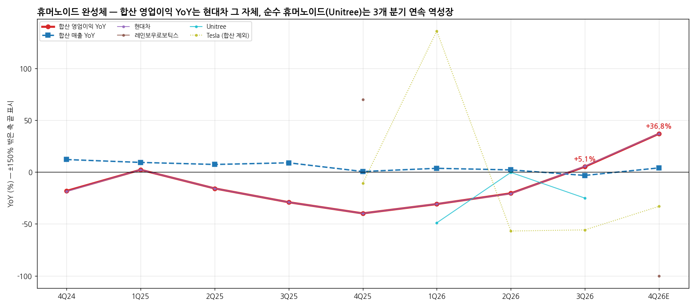
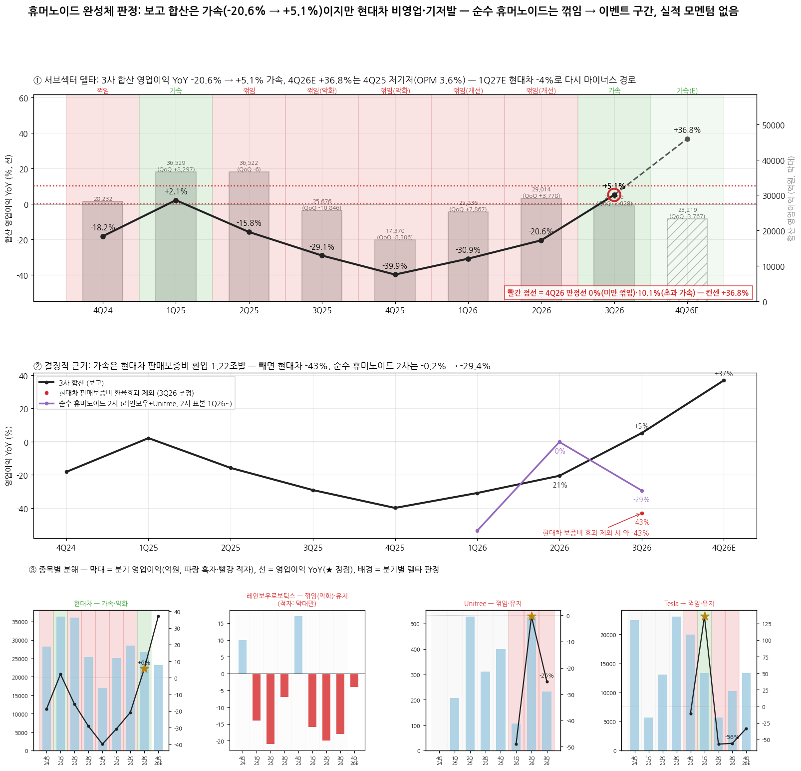

# 로봇 · 휴머노이드 완성체 섹터 리뷰

> 현재 상태 (최신 분기 기준)
> 최신 분기: 2026-Q3
> 섹터 델타: 꺾임 | 내러티브: 약화
> 모멘텀 신호: 없음
> 활성 테마: 없음
> 포지셔닝: 서브섹터 축소 | 한국 언더퍼폼 | 1등 없음
> 델타 근거: 보고 YoY -20.6→+5.1%는 보증비 환입·관세 기저발이라 불인정(본업 약 -42%) → 4Q 컨센 +36.8%도 저기저라 불인정
> 내러티브 근거: 이익 99%인 완성차가 멀티플 하향으로 약화했고, 양산 원년 스토리가 2026년 숫자로 확인되지 않음
> PM 근거: 순수 완성체도 -0.2→-29.4%로 꺾여 서브섹터 축소. 한국은 본업 -43%·순수사 적자 확대로 흑자 중국사보다 나빠 언더퍼폼
> 편입 종목: 현대차, 레인보우로보틱스, Unitree, UBTech(반기 — 3Q 합산 제외) · 확장 Tesla(합산 제외, 참고)
> 갱신 시각: 2026-11-23 16:20 KST (v2 — BT 2026-11-23 결정: 비영업발 가속 불인정 반영)

## 누적 시계열

| 분기 | 편입 종목 | 합산 매출 | 합산 영업이익 | OPM | 매출 YoY | 영업이익 YoY | 영업이익 YoY 델타 (%p) | 섹터 델타 | 내러티브 | 모멘텀 신호 | 활성 테마 |
|---|---|---|---|---|---|---|---|---|---|---|---|
| 4Q24 | 2사 (현대차·레인보우) | 466,334억원 ($32.86B) | 28,232억원 ($1.99B) | 6.1 | +12.0% | -18.2% | n.m. | — | - | - | - |
| 1Q25 | 3사 레벨 / YoY 2사 (Unitree 분기 공시 시작) | 444,650억원 ($31.34B) | 36,529억원 ($2.57B) | 8.2 | +9.2% | +2.1% | +20.3%p | 가속 | - | - | - |
| 2Q25 | 3사 레벨 / YoY 2사 | 484,037억원 ($34.11B) | 36,522억원 ($2.57B) | 7.5 | +7.3% | -15.8% | -17.9%p | 꺾임 | - | - | - |
| 3Q25 | 3사 레벨 / YoY 2사 | 468,146억원 ($32.99B) | 25,676억원 ($1.81B) | 5.5 | +8.9% | -29.1% | -13.3%p | 꺾임(악화) | - | - | - |
| 4Q25 | 3사 레벨 / YoY 2사 | 469,639억원 ($33.10B) | 17,370억원 ($1.22B) | 3.7 | +0.5% | -39.9% | -10.7%p | 꺾임(악화) | - | - | - |
| 1Q26 | 3사 (현대차·레인보우·Unitree) | 460,373억원 ($32.44B) | 25,236억원 ($1.78B) | 5.5 | +3.5% | -30.9% | +9.0%p | 꺾임(개선) | - | - | - |
| 2Q26 | 3사 | 493,814억원 ($34.80B) | 29,014억원 ($2.04B) | 5.9 | +2.0% | -20.6% | +10.4%p | 꺾임(개선) | - | - | - |
| **3Q26** | **3사 (UBTech 반기·Tesla 확장 제외)** | **452,644억원 ($31.90B)** | **26,986억원 ($1.90B)** | **6.0** | **-3.3%** | **+5.1% (비영업 제외 약 -42%)** | **+25.7%p (비영업 제외 약 -22%p)** | **꺾임(악화)** | **약화** | **없음** | **없음** |

→ **환율 (고정, 3Q26 평균)**: $1 = 1,419원, RMB 1 = 211원 — 엔터 섹터 리뷰와 같은 값(한국은행 원/달러 MBW 인용, 위안은 TME 3Q26 RMB→$ 역산 교차환율). 모든 분기에 같은 환율을 적용해 YoY에 환율 효과가 섞이지 않는다(현지 통화 YoY와 같은 성격) [계산]. 괄호 안 달러는 같은 환율로 환산
→ **합산 방식**: 각 종목 실적 리뷰 1번 ① 표 그대로 — 현대차 K-IFRS 연결 영업이익(OpenDART), 레인보우로보틱스 K-IFRS 연결, Unitree는 리뷰의 "K-IFRS식 재계산 영업이익(매출 − 원가 − 세금 − 판매·관리·연구개발비, 2Q25 주식보상 3.49억위안 조정)" [계산]
→ **동일 표본**: Unitree는 분기 단독 공시가 1Q25부터라 1Q25\~4Q25는 레벨에만 넣고 YoY는 현대차·레인보우 2사로 계산, 1Q26부터 3사 YoY. 4Q26E는 컨센이 있는 현대차(4곳 평균)·레인보우(유진 1곳) 2사 [계산]
→ **제외**: UBTech — 홍콩 상장 반기 공시, 3Q 손익 없음(최신 = `2026-Q2_9880.HK_리뷰.md` 1H26) → 3Q 델타 비교 제외, 반기 판정만 ② 아래 별도 표기. Tesla — 확장 종목, 아래 (서브) 섹션 참조
→ **이익 비중**: 3Q26 합산 영업이익 26,986억원 중 현대차 99.2%, Unitree 0.9%, 레인보우 -0.1% [계산] — **이 서브섹터 합산 델타는 사실상 현대차 자동차 사이클이다**
→ **3Q26 판정 = 비영업 제외 기준**(BT 2026-11-23: 비영업 요인이 만든 가속은 인수 주도 가속과 같은 방식으로 섹터 판정에서 가속으로 세지 않음). 보고 합산 숫자는 표에 그대로 두고, 판정은 현대차 판매보증비 환율효과(-1.22조)를 뺀 합산 YoY 약 -42%(2Q26 -20.6%보다 마이너스 폭 확대) 기준으로 **꺾임(악화)**
→ 소급 분기 판정은 같은 기준(섹터 델타 기준표 + 2026-11-22 마이너스 구간 개선/악화 표기)으로 산정, 내러티브·테마 열은 첫 작성이라 `-`

## 2026-Q3 섹터 리뷰

> 분석 대상 파일: `earnings-review/2026-Q3_현대차_리뷰.md`(v2 풀, 셀사이드 10건), `2026-Q3_레인보우로보틱스_리뷰.md`(풀, 유진 1건), `2026-Q3_688836.SS_리뷰.md`(Unitree, 숫자 중심), `2026-Q2_9880.HK_리뷰.md`(UBTech 1H26, 숫자 중심 — 3Q 분기 업데이트 덧붙임 없음), `2026-Q3_TSLA_리뷰.md`(확장 참고)

① 서브섹터 합산 숫자와 델타

| 구분 (억원, 고정환율) | 4Q24 | 1Q25 | 2Q25 | 3Q25 | 4Q25 | 1Q26 | 2Q26 | 3Q26 | 4Q26E |
|---|---|---|---|---|---|---|---|---|---|
| **휴머노이드 3사** 매출 | 466,334 | 444,650 | 484,037 | 468,146 | 469,639 | 460,373 | 493,814 | 452,644 | 486,993 |
| 휴머노이드 3사 영업이익 | 28,232 | 36,529 | 36,522 | 25,676 | 17,370 | 25,236 | 29,014 | 26,986 | 23,219 |
| 휴머노이드 3사 OPM | 6.1 | 8.2 | 7.5 | 5.5 | 3.7 | 5.5 | 5.9 | 6.0 | 4.8 |
| 휴머노이드 3사 매출 YoY | +12.0% | +9.2% | +7.3% | +8.9% | +0.5% | +3.5% | +2.0% | -3.3% | +3.9% |
| 휴머노이드 3사 영업이익 YoY | -18.2% | +2.1% | -15.8% | -29.1% | -39.9% | -30.9% | -20.6% | +5.1% | +36.8% |
| 휴머노이드 3사 영업이익 YoY 델타 | n.m. | +20.3%p | -17.9%p | -13.3%p | -10.7%p | +9.0%p | +10.4%p | +25.7%p | +31.7%p |
| **순수 휴머노이드 2사**(레인보우+Unitree) 영업이익 | — | 193 | 506 | 303 | 416 | 90 | 505 | 214 | — |
| 순수 휴머노이드 2사 영업이익 YoY | — | — | — | — | — | -53.6% | -0.2% | **-29.4%** | — |

→ (출처: 3사 실적 리뷰 1번 ① 표, 고정환율 원화 환산 [계산]. 4Q26E = 현대차 증권사 4곳 평균(삼성·하나·메리츠·미래), 레인보우 유진 1곳. Unitree는 가이던스·컨센 없음 → 4Q26E 표본에서 제외(4Q25도 같은 2사))
→ **합산 가속의 출처**: 3Q26 합산 증가분 +1,310억원 중 현대차 +1,399억, Unitree -78억, 레인보우 -11억 [계산]. 현대차 증가분은 판매보증비 YoY -1.22조(기말환율 급락에 따른 충당부채 환율효과)와 3Q25 관세 최대 분기(하나 집계 관세 비용 1.82조) 기저가 만들었다 — 보증비 효과를 빼면 현대차 영업이익 약 1.45조, YoY 약 -43% (현대차 리뷰 ⚠ 플래그 `[추정]`). 같은 방식이면 서브섹터 합산도 약 -42% [계산]
→ **비영업발 가속 불인정 (BT 2026-11-23)**: 현대차 종목 판정이 `유지 | 약화 → 매매 제외 구간`으로 바뀌었다(보고 YoY는 플러스 전환이지만 판매보증비 환율효과·관세 기저발). 섹터 집계도 인수 주도 가속 규칙과 같은 방식 — 현대차는 `가속 (비영업 → 섹터 집계에서 불인정, 종목 판정 유지)`, 서브섹터 판정은 비영업 제외 합산(약 -42%)과 순수 휴머노이드 2사(-0.2% → -29.4%) 기준으로 **꺾임(악화)**
→ 컨센 경로: 4Q26E +36.8%는 4Q25 OPM 3.6%(현대차 YoY -39.9% 저점, 하나 집계 4Q25 관세 비용 1.46조)라는 관세 저기저 효과 — 같은 원칙이면 4Q26 보고 가속도 가속으로 세지 않는다. 현대차 1Q27E -4%(하나 단독), 2Q27E -11% → **서브섹터 합산 YoY 정점은 4Q26E**, 2027 상반기에 다시 마이너스 경로 [전망]

→ (출처: 3사 실적 리뷰로 계산. 굵은 빨강 = 3사 합산 영업이익 YoY, 파랑 점선 = 합산 매출 YoY, 가는 선 = 종목별 영업이익 YoY(흑자 종목만), 점선 = Tesla(합산 제외). 레인보우는 적자라 YoY 선 없음)

② 종목별 델타 판정표

| 델타 순위 | 종목 | 국가 | 매출 YoY | 영업이익 YoY | 영업이익 YoY 델타 | 델타 판정 | 내러티브 | 비영업 요인 | 한 줄 |
|---|---|---|---|---|---|---|---|---|---|
| 1 | 현대차 | 한국 | -3.4% | +5.5% (2Q26 -20.8%) / 보증비 제외 약 -43% | +26.4%p (보증비 제외 약 -22%p) | 유지 (비영업발 가속 불인정 → 섹터 집계도 가속 아님) | 약화 | ⚠ 판매보증비 환율효과 -1.22조 · 3Q25 관세 저기저 | 매매 제외 구간 — 본업은 물량 -1.11조·믹스 -0.57조로 감익, 로봇 매출 0(BD 지분법) |
| 2 | Unitree | 중국 | +69.9% | -24.9% (2Q26 -0.4%) | -24.5%p | 꺾임 | 유지 | 2Q25 주식보상 3.49억위안 조정 | 매출은 재가속, R&D +250%(매출의 19%)·GPM 50.6%(4개 분기 연속 하락)로 이익 역성장 |
| 3 | 레인보우로보틱스 | 한국 | +30.1% | 적자 확대 (-7억 → -18억, 적자 축소율 +1.4% → -146.4%) | -147.8%p (축소율) | 꺾임(악화) | 유지 | 없음 (3Q25 -7억 저기저) | 휴머노이드 매출 19억(1H 분기 평균 43억의 절반), 인력 161 → 247명 |
| 제외 | UBTech (1H26) | 중국 | +104.2% (반기) | 영업적자 -36.4% (2H25 -44.5%) | +8.1%p (축소 속도 둔화) | 둔화 | 약화 | ⚠ 주식보상 소멸 0.72억위안(적자 개선의 45%)·锋龙 인수 편입(매출 1.39억, 손익 판정 영향 작음) | 반기 공시 — 3Q 델타 비교 제외. 광시 공장 2\~3개월 지연, 2H26 매출 22\~27억위안 필요 |
| 참고 | Tesla (확장) | 미국 | -0.2% | -55.8% (2Q26 -56.9%) | +1.1%p | 꺾임 | 유지 | — | 합산 제외 — Optimus 매출 0, 외부 인도 2027년 말 |

→ 판정·내러티브는 각 종목 리뷰 0번 그대로(현대차는 2026-11-23 수정본). 델타 순위 = 영업이익 YoY 델타 큰 순(현대차는 보고 기준 순위를 유지했지만 가속 근거로 쓰지 않음, 레인보우는 적자 축소율 델타)
→ **선행 종목**: 순수 휴머노이드가 먼저 꺾였다 — Unitree는 분기 YoY 공시 시작(1Q26)부터 3개 분기 연속 역성장, 레인보우는 3Q26 적자 확대, UBTech는 1H26 적자 축소 속도 둔화. **인정되는 가속 종목은 없다** (현대차 보고 가속은 비영업발)
→ **판정 방식 주의**: 현대차는 통합 검수에서 한때 "가속(관찰 구간 + ⚠)"이었으나 2026-11-23 BT 결정("비영업 요인은 쳐주지 말아야 한다")으로 `유지 | 약화 → 매매 제외 구간`으로 확정

③ 섹터 공통 쟁점

(1) **이익 역성장의 원인 = 비용 투입** — Unitree·레인보우·Tesla·UBTech
(1-1) Unitree R&D +249.6% YoY(매출 대비 19.1%), 레인보우 3Q 인건비 4.6배·판관비 +68%(임직원 161 → 247명), Tesla R&D +69%·주식보상 +76%, UBTech는 1H26 적자 축소 속도가 2H25보다 느려짐 (각 리뷰)
(1-2) [판단] 휴머노이드 완성체는 지금 "매출은 늘고 이익은 줄어드는" 투자 국면이다. 매출 YoY는 Unitree +70%·레인보우 +30%·UBTech +104%로 빠르지만, 이익 델타 기준으로는 3사 모두 꺾임·둔화 — BT 프레임(이익 델타)에서는 매매 대상 종목이 없다

(2) **양산·인도 지연** — UBTech·레인보우·Tesla·현대차
(2-1) UBTech 광시 공장 2\~3개월 지연 / 레인보우 RB-Y1 1H 수출 65억 → 3Q 0.6억(RB-Y2 전환 공백) / Tesla Optimus 주 2만 대는 "최소 1년", 외부 인도 2027년 말 / 현대차 BD 아틀라스는 2028년 연 3만 대 계획, 로봇생산법인·BD 1조원+ 제3자 유증은 연말 예정 (각 리뷰)
(2-2) [판단] 모든 완성체의 매출 램프 시점이 2027년 하반기 이후로 밀려 있다. 2026년 휴머노이드 매출은 연구·교육·데모 수요라 분기마다 출렁인다(레인보우 휴머노이드 매출 비중 40.5% → 13.5%)

(3) **가격 하락 속 마진 방어** — Unitree·UBTech
(3-1) Unitree 휴머노이드 평균단가 26.0 → 16.6만위안(2024 → 2025), GPM 62.0% → 50.6% / UBTech 풀사이즈 평균단가 84.9 → 64.1만위안인데 GPM 66.8% (각 리뷰)
(3-2) [판단] 중국 완성체는 단가를 내리며 물량을 키우는 중 — 피지컬AI 테마분석의 "완제품 레이어 D(중국 F 전조)" 진단과 같은 방향

(4) **TP 하향 = 멀티플** — 현대차
(4-1) 현대차 원문 7곳 TP 57.8만 → 48.8만(-15.6%), 하향 6·유지 4·상향 0, 하향 원인은 Target P/E -25% 등 멀티플 (현대차 리뷰). 중국 2사·레인보우는 셀사이드 편차 비교 불가(첨부 0\~1건)

→ 종목 고유 이슈: 현대차 — 2027년 감익(삼성·메리츠 -8%) vs 하반기 증익(상상인 +14%) 논쟁 / 레인보우 — 삼성향 용역 75억이 매출을 메움, 4Q 흑자 계절성(4Q25 +17억) / Unitree — 제품별 분기 공시 없음 / UBTech — 매출채권 22.25억위안(1년 초과 7.67억)

④ 섹터 판정

> 섹터 델타: **꺾임** | 내러티브: **약화** → **보고 합산 +5.1%는 현대차 판매보증비 환입·관세 기저가 만든 숫자라 가속으로 세지 않는다 — 비영업 제외 약 -42%, 순수 휴머노이드(Unitree·레인보우)도 -0.2% → -29.4%. 서브섹터 실적 모멘텀은 끝났고, 주가는 BD·Optimus·삼성 휴머노이드 같은 이벤트로 움직이는 구간**

→ (출처: 3사 실적 리뷰로 계산, 고정환율 원화 환산. 상단 = 3사 합산 영업이익 YoY(검은 선 = 보고, 빨간 선 = 3Q26 비영업 제외)·합산 영업이익과 QoQ(막대)·분기별 판정 배경색(3Q26 = 비영업 제외 기준 꺾임(악화), 4Q26E = 관세 기저라 판정 보류), 점선 = 4Q26E 컨센, 빨간 점선 = 0% / 중단 = 결정적 근거 — 3사 합산 vs 순수 휴머노이드 2사, 빨간 점 = 현대차 보증비 효과 제외 / 하단 = 종목별 분해(Tesla는 합산 제외 참고))

→ 델타 판정 근거: 보고 합산은 -20.6%(2Q26) → +5.1%(3Q26)로 숫자상 가속 조건이지만, 증가분(+1,310억)은 현대차(+1,399억) 판매보증비 환율효과·관세 기저발 → **가속 불인정**. 비영업 제외 합산 약 -42%(마이너스 폭 확대), 순수 휴머노이드 2사 -0.2% → -29.4% → **꺾임(악화)**. 4Q26E +36.8%도 관세 저기저라 같은 원칙이면 가속으로 세지 않고, 현대차 1Q27E -4% [전망]
→ 비영업 요인 영향: 판정을 가른 요인 — 보고 기준이면 가속, 비영업 제외 기준이면 꺾임(악화). BT 2026-11-23 결정으로 후자를 섹터 판정으로 쓴다(인수 주도 가속 규칙과 같은 처리)
→ 내러티브 근거: 현대차 약화(TP 하향 6건, 멀티플)·UBTech 약화(인도 지연)·레인보우 유지·Unitree 유지. 이익 가중으로는 현대차가 지배 → **약화** [판단]. "휴머노이드 양산 원년" 스토리는 2026년 숫자로 확인되지 않았다
→ 직전 분기 대비: 꺾임(개선)(2Q26) → 꺾임(악화)(3Q26, 비영업 제외). 소급 궤적은 꺾임 3개 분기(2Q25\~4Q25) → 꺾임(개선) 2개 분기(1Q26\~2Q26, 마이너스 폭 축소 = 턴어라운드 패턴) → 3Q26 비영업 제외 시 다시 악화 — 턴어라운드 패턴이 본업 기준으로는 이어지지 않았다

⑤ 모멘텀 신호

→ 없음 (활성 테마 없음 — 피지컬AI 테마는 2026-11-23 BT 판단으로 sunset, `earnings-theme/피지컬AI_테마분석.md` status: sunset)
→ 조건 대조 — 델타 급증 후보: ① 섹터 델타 확대 — 미충족(비영업 제외 꺾임(악화)) ② 편입 종목 과반 가속 — 0/3(현대차 가속 불인정) ③ 내러티브 형성·강화 — 미충족 → 후보로 올리지 않음
→ 테마 종료 확인: 피지컬AI sunset 판단과 숫자가 같은 방향 — 테마의 핵심 완성체(Unitree, theme_relevance high)가 3개 분기 연속 이익 역성장 [판단]
→ 반대 논거: 매출 YoY는 Unitree +70%·UBTech +104%로 수요 자체는 강하다. 이익 역성장이 수요 부족이 아니라 R&D·인력 투자라면, 투자 사이클이 끝나는 시점(UBTech 목표 2027년 4분기 분기 흑자)에 이익 델타가 크게 튈 수 있다
→ 다음 분기 후보 조건: Unitree 분기 영업이익 YoY 플러스 복귀(4Q25 기저 1.89억위안 이상) + 레인보우 4Q26 흑자 17억 초과 — 순수 완성체 2사 동시 가속

⑥ 다음 분기 섹터 관전 포인트

| 순위 | 무엇을 (변수·임계값) | 어떤 데이터로 | 언제 |
|---|---|---|---|
| 1 | **4Q26 판정은 비영업 제외 기준** — 보고 합산 YoY(컨센 +36.8%)는 4Q25 관세 저기저라 가속으로 세지 않는다. 판정선: ① 순수 휴머노이드 2사 영업이익 4Q25 416억원 초과(= 플러스 복귀) ② 현대차 판매보증비 되돌림·관세 기저를 걷어낸 본업 영업이익 YoY 0% 이상(삼성 4Q26E OPM 4.5%) — 둘 다 미달이면 꺾임 지속 | 현대차 4Q26 실적·레인보우 사업보고서·Unitree 연간 보고서 | 2027년 1월 말 / 3월 |
| 2 | 현대차 연말 로봇생산법인 설립·BD 1조원+ 제3자 유상증자 — 로봇 실체 이벤트 | 현대차 공시 | 2026년 12월 |
| 3 | Unitree 4Q26 영업이익 1.89억위안 이상(YoY 플러스 복귀) — 순수 완성체 델타 반전 | Unitree 2026 연간 보고서(4Q = 연간 − 9M) | 2027년 3\~4월 |
| 4 | UBTech 2H26 영업적자 -1.89억위안 이하(축소율 -44.5% 이상 = 가속) + 2026 매출 35\~40억위안 목표 | UBTech 2026 연간 실적 | 2027년 3월 말 |
| 5 | 레인보우 4Q26 흑자 17억 초과 + 휴머노이드 분기 매출 60억 회복, CES 2027 삼성 휴머노이드 | 레인보우 사업보고서, CES | 2027년 1월(CES) / 3월 |

⑦ 글로벌 PM 포지셔닝 — 결론 (서브섹터 리뷰)

> **서브섹터: 축소 — 순수 완성체 2사 이상 YoY 플러스 복귀면 유지 복귀** | **한국: 언더퍼폼 (비영업 제외 시 현대차 -43%, 레인보우 적자 확대 vs Unitree 흑자 -25%)** | **1등: 없음 — 인정되는 가속 종목 없음**

(1) 서브섹터 판정 — 축소 [판단]
→ 비영업 제외 기준 서브섹터 델타는 꺾임(악화), 순수 완성체 3사(Unitree·레인보우·UBTech)도 꺾임·둔화 — BT 프레임(델타가 꺾이면 매매하지 않음)대로 **축소**. 4Q26E 보고 가속(+36.8%)은 관세 저기저라 유지 근거가 되지 못한다
→ 유지 복귀 조건: 순수 완성체 2사 이상 YoY 플러스 복귀(Unitree 4Q26 1.89억위안 이상, 레인보우 4Q 흑자 17억 초과, UBTech 2H26 적자 -1.89억위안 이하 중 2개) 또는 현대차 본업 영업이익 YoY 플러스(보증비·관세 기저 제외)
→ 확대 전환: 위 조건 + 현대차 로봇생산법인 설립·BD 유증 실체 확인

(2) 같은 서브섹터 안 한국 vs 글로벌 — 한국 언더퍼폼 [판단]

| 경쟁력 축 | 한국 (현대차·레인보우) | 글로벌 (Unitree·UBTech, 참고 Tesla) | 우위 |
|---|---|---|---|
| 델타 방향 (1순위) | 현대차 유지(비영업발 가속 불인정, 보증비 제외 약 -43%), 레인보우 꺾임(악화) | Unitree 꺾임(-24.9%), UBTech 둔화(1H), Tesla 꺾임 | 글로벌 (덜 나쁨) |
| 마진 레벨 | 레인보우 OPM -12.8% | Unitree OPM 16.6%, UBTech -22.0%(1H) | 중국(Unitree) |
| 매출 성장 | 레인보우 +30.1%, 현대차 -3.4% | Unitree +69.9%, UBTech +104.2% | 중국 |
| 휴머노이드 매출 | 레인보우 19억/분기(비중 13.5%), 현대차 0(BD 지분법) | Unitree 2025 휴머노이드 8.68억위안(5,215대), UBTech 1H26 풀사이즈 5.90억위안 | 중국 |
| 양산 시점 | BD 아틀라스 2028년 연 3만 대 계획 | Unitree·UBTech 이미 수천 대 출하, Tesla 외부 인도 2027년 말 | 중국 |
| 이익 추정 방향 | 현대차 2027E 컨센 -4.3% 하향, 레인보우 2027E 흑자전환(유진 1곳) | 공개 컨센 없음 | 한국 하향 |

→ 결론: **한국 언더퍼폼** — 이유 ① 델타: 비영업 제외 기준 현대차 -43%·레인보우 적자 확대로 한국이 더 나쁘다(Unitree -25%) ② 이익 추정: 현대차 2027E 하향, 중국은 컨센 없음 ③ 구조: 중국은 출하 기반으로 흑자(Unitree), 한국은 완성체 지분(BD 지분법)·대기업 용역(삼성-레인보우) 모델이라 휴머노이드 매출이 숫자로 잡히지 않는다
→ 반대 논거: 현대차 연말 로봇생산법인·BD 유증, CES 2027 삼성 휴머노이드는 한국 쪽에만 있는 이벤트 — 이벤트 프레임이면 한국 아웃퍼폼 가능. 델타 프레임 결론
→ 비교 범위: 한국 2사 실적 리뷰(현대차 셀사이드 10건 풀) / 중국 2사 숫자 중심 리뷰(셀사이드 0건). UBTech는 반기 숫자라 분기 델타 비교에서 제외 — **근거 얇음**(중국 쪽 셀사이드 부재)

(3) 서브섹터 1등 종목
→ **1등 없음** — 원칙(BT 승인 2026-11-23): **1등·선호 종목의 가속이 비영업발이면 1등·선호에서 제외**한다. 현대차는 보고 기준 델타 1위지만 비영업발 가속 불인정(종목 판정 유지·매매 제외), 나머지 순수 완성체는 전부 꺾임·둔화
→ 상대 순위(참고): 현대차(유지·약화, 보증비 제외 델타 약 -22%p) ≈ Unitree(꺾임·유지, -24.5%p, 흑자) > 레인보우(꺾임(악화)) — 셋 다 매매 대상 아님. UBTech 1H 둔화는 반기 기준 참고
→ 비선호: 레인보우로보틱스 — 꺾임(악화)·유지. **반등 후보 (이벤트 드리븐)**: 레인보우 — 확인 이벤트 CES 2027 삼성 휴머노이드 공개 + 4Q 흑자 17억 초과 / 현대차 — 확인 이벤트 연말 로봇생산법인·BD 1조원+ 유증

(4) 콜을 바꾸는 조건과 일정

| 시점 | 이벤트 | 서브섹터 비중 | 1등 종목 |
|---|---|---|---|
| 2026-12 | 현대차 로봇생산법인 설립·BD 제3자 유증 | 실체 확인 + 순수 완성체 반전이면 유지 복귀 검토 | 이벤트 반등 후보 |
| 2027-01 초 | CES 2027 (삼성 휴머노이드·현대차 BD) | 이벤트 — 숫자 콜 영향 없음 | 레인보우 반등 후보 점검 |
| 2027-01 말 | 현대차 4Q26 실적·2027 가이던스 | 보증비 되돌림·관세 기저 제외 본업 YoY 플러스면 유지 복귀 검토 | 본업 가속이면 1등 후보 |
| 2027-03 | 레인보우 사업보고서, Unitree 연간 보고서, UBTech 연간 실적 | 순수 플레이 2사 이상 플러스 복귀면 유지 복귀 | Unitree 플러스 복귀면 1등 |

→ 직전 분기 콜 체크: 첫 섹터 리뷰 — 직전 콜 없음

### (서브) Tesla — 어떻게 되고 있나

→ **합산·판정에는 넣지 않음** — Tesla 단독 판정 `꺾임 | 유지 → 숫자 기준 매매 제외 구간, 주가는 이벤트(Optimus·합병·EU FSD)로 움직이는 국면` (`2026-Q3_TSLA_리뷰.md`)
→ 제외 이유: ① 실적 리뷰의 주 섹터가 미국 빅테크·소비자·모빌리티라 그 섹터 리뷰에 이미 합산 — 중복 합산 금지 ② Optimus 매출 0(외부 인도 2027년 말) ③ 영업이익 10,188억원(3Q26, 고정환율)으로 넣으면 서브섹터 합산의 27%가 되어 "자동차 2사 합산"이 된다 [계산]
→ 3Q26 영업이익 $718M(-55.8%), 2개 분기 연속 -56\~57% — 현대차와 같은 자동차 사이클이지만 방향은 반대(현대차는 관세 기저로 플러스 전환). R&D +69%의 상당 부분이 Optimus·AI
→ 현대차와 비교: 둘 다 "자동차 숫자 + 로봇 옵션"이고, 둘 다 이익 델타로는 매매 제외 구간(Tesla 꺾임, 현대차 비영업발 가속 불인정 → 유지)
→ 휴머노이드 관점: Optimus는 프리몬트에서 초기 생산 개시(양산 품질), 주 2만 대까지 "최소 1년" — 완성체 양산 램프가 2027년 하반기 이후라는 점에서 현대차 BD(2028)·UBTech(2H26 램프 지연)와 같은 시간표
→ 주가: 실적 후 10/27 $407(발표 전 +5.4%) — 이익 델타와 주가가 가장 무관한 종목. 휴머노이드 이벤트의 글로벌 기준점으로만 본다
