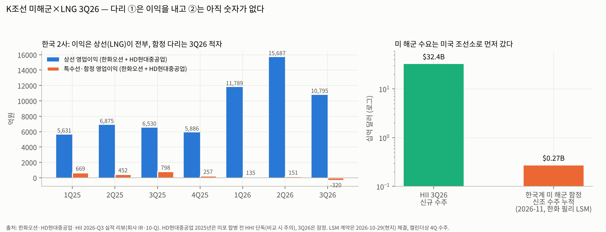

> 모드: 테마 리뷰
> 테마: K조선 미해군×LNG
> 분기: 2026-Q3 (기준선 리뷰 — 섹터 리뷰상 테마 활성 시작은 2026-Q4)
> 발행일: 2026-11-14
> 입력: `sector-review/조선_섹터리뷰.md`(2026-11-14 19:37, 글로벌 9사판) · `earnings-review/2026-Q3_{한화오션|HD현대중공업|삼성중공업|HII}_리뷰.md` · `earnings-theme/K조선_미해군-LNG_테마분석.md`(1차, 2026-11-03) · `earnings-theme/조선_산업기초.md`
> 참조 범위: active_companies 6사 중 실적 리뷰 4사(한화오션·HD현대중공업·삼성중공업·HII) 완료 = 67%. HD한국조선해양은 HD현대중공업 리뷰로 대체(중간지주), HJ중공업은 리뷰 없음. 직전 테마 리뷰 없음(첫 리뷰)
> 주의: 테마 분석은 **1차본**이고 통합본(Step 9)이 아직 없다. 이 리뷰는 1차본의 Step 6~8(★ 판정·리스크·트래킹)을 기준선으로 검증한다

# K조선 미해군×LNG 테마 리뷰 3Q26 — 이익은 LNG선이 다 냈고, 미 해군 다리는 "수요 확인, 한국 참여 미확인"

---

## ① 분기 테마 highlight

> 테마 델타: **꺾임** | 내러티브: **약화** | 상태: **진행 (종료 후보 직전)**

**한 줄**: 3Q26 K조선 미해군×LNG 테마는 다리 ①(LNG선 중심 상선)이 이익의 전부를 냈지만 증가율이 정점을 지났고(한국 2사 상선 영업이익 YoY 둔화, 섹터 합산 꺾임), 다리 ②(미 해군)는 수요가 오히려 커졌는데(HII 3Q 수주 $32.4B) 한국 쪽 숫자는 적자였다(한국 2사 특수선·함정 영업이익 −320억원). **다음 분기 watch = 한화오션 4Q26 영업이익 2,475억원 선 + 11월 말~12월 NDAA 해외건조 조항.**

판정 근거:
- **테마 델타 = 꺾임**: 테마가 걸린 유일한 섹터(조선)의 섹터 델타가 꺾임이다(글로벌 합산 영업이익 YoY +85% → +67% → +40%, 컨센 4Q26E +30%). 테마 핵심 종목인 한국 2사의 이익은 사실상 전부 상선에서 나오고, 상선 영업이익 YoY는 한화오션 +115% → +95% → +54%, HD현대중공업(합병 조정) +70% → +108% → +11%다.
- **내러티브 = 약화**: 셀사이드 15곳(한화오션)·12곳(HD현대중공업)이 TP를 −25~−30% 내렸고, 그 원인은 이익 추정(−4~−9%)이 아니라 **멀티플(미 해군 할증 제거 + LNG선 피크아웃)**이다. JPM·노무라는 한화오션 함정 가치를 0으로 둔다.
- **상태 = 진행**: 섹터 리뷰 ⑤ 모멘텀 신호의 "테마 종료 후보" 조건 2개 중 1개만 충족(섹터 델타 꺾임 O, 선행 종목 꺾임 X). 다음 분기 한화오션 4Q26 영업이익이 2,475억원(YoY 0%)을 밑돌면 종료 후보로 올라간다.

---

## ② 종목·서브섹터 실적 + 전망 통합 (bottom-up)

### ②-1. 조선 (한국 3사) — 테마 dominant·challenger

**서브섹터 숫자** (조선 섹터 리뷰 ① (3), 원화)

| 항목 | 1Q26 | 2Q26 | **3Q26** | 4Q26E |
|---|---|---|---|---|
| 한국 3사 합산 영업이익 | 1조 6,196억 | 2조 1,010억 | **1조 7,233억** | 1조 8,106억 |
| OPM | 13.5% | 14.0% | **14.0%** | 13.4% |
| 영업이익 YoY | +83.2% | +84.7% | **+34.0%** | +44.5%(4Q25 저기저) |
| 연간 경로 | 2025 PF 4.56조 → **2026E 7.26조(+59%) → 2027E 8.63조(+19%)** → 2028E 9.88조(+14%) | | | |

**다리별로 쪼개 보면** (한화오션·HD현대중공업 사업부 표 [계산])

| 다리 | 지표 | 1Q26 | 2Q26 | **3Q26** | 해석 |
|---|---|---|---|---|---|
| ① 상선 (LNG선 중심) | 2사 상선 영업이익 | 1조 1,789억 | 1조 5,687억 | **1조 795억** | 2사 이익의 사실상 100% |
| | 한화오션 상선 OPM | 17.9% | 22.7% | **17.4%** | "17~18%가 현재 빈티지의 경상 마진"이 시장 합의 |
| | HD현대중공업 상선 OPM | 15.9% | 17.8% | **14.7%** | 조업중단·환율·임단협 일회성. 조정 시 15.9%(JPM) |
| ② 특수선·함정 | 2사 특수선·함정 영업이익 | 135억 | 151억 | **−320억** | 한화오션 −706억(공사손실충당부채), HD +386억(수출 함정 OPM 15.0%) |
| | 2사 특수선·함정 매출 | 6,001억 | 6,282억 | **6,200억** | 2사 합산 매출의 약 7% |

**종목별 핵심 시그널**

| 종목 | 테마 위치 | 3Q26 핵심 | 테마 관점 한 줄 |
|---|---|---|---|
| **한화오션** (dominant) | 두 다리 모두 | 영업이익 4,857억(+67.6%, 컨센 −10%). 상선 +53.6%로 2개 분기 연속 둔화. 특수선 −706억(OPM −19.4%), 3개 분기 연속 적자. 상선 매출 중 LNG선 비중 70% → 60% | **교집합 1순위였는데 두 다리가 같은 분기에 같이 약해졌다.** 2027E 영업이익 +6.7%로 한국 3사 중 가장 먼저 평탄화. 필리조선소 프로젝트 9척은 한화오션 이익에 "간접 수혜"뿐(신한 Q&A). 미 해군·MASGA 업데이트는 "Austal US 인수 협상 진행 중" 외에 없음(JPM) |
| **HD현대중공업** (dominant) | 두 다리 + 엔진 | 영업이익 8,992억(+61.3% 보고 / 조정 +18.6%, 컨센 −8%). 함정 OPM 15.0%이지만 매출 비중 4.5%, 2026 함정 수주는 목표의 13%(유진). 발전엔진 3GW 수주로 2029년까지 캐파 소진 | **테마 밖 다리(발전엔진)가 주가 논리의 중심으로 이동.** 키윗 JV 투자계획은 2026년 말 확정 예정, JV 지분이 HHI냐 중간지주냐가 미정(유안타). 메리츠만 2027년 미 해군 2척을 실적에 넣음(2028 함정 매출 4.2조) |
| 삼성중공업 (challenger) | 다리 ①만 | 영업이익 3,384억(+42.1%), OPM 9.4 → 10.1 → 10.7% 3개 분기 연속 상승(100% 환헤지). 2029년 LNG선 슬롯 75% 소진, 최근 선가 2.47억 달러 | **미 해군 다리가 없어서 오히려 선호.** 섹터 리뷰 한국 유일 선호 종목. "MASGA 기대의 반영과 하락에서 자유롭다"(유안타). 2027E 영업이익 +43% |
| HD한국조선해양 (challenger) | 중간지주 | 별도 리뷰 없음 | 키윗 JV 지분 귀속에 따라 HD현대중공업 대비 상대가치가 갈린다 |
| HJ중공업 (challenger) | MRO만 | 리뷰 없음 | 미 해군 MRO 1건 완료, 범위 확대 |

### ②-2. 조선 글로벌 — 미 해군 수요의 실제 수혜처

| 종목 | 3Q26 | 테마 관점 |
|---|---|---|
| **HII** (dominant, 미국) | 매출 $3,537M(+10.8%), GAAP 영업이익 $246M(+52.8%). EAC 환입 $76M 제외 세그먼트 영업이익 YoY +2.2%. **3Q 신규 수주 $32.4B, 잔고 $57.3B → $86.2B(사상 최대)**, 2030년까지 조선 매출 약 90% 계약 확보 | 미 해군 다리의 "수요"는 테마 분석의 가정(예산 +39%)보다 더 강하게 확인됐다. 다만 그 수주는 전부 미국 조선소로 갔다. 조선 마진 6.0~6.5%(2026 가이던스) — 미 해군 일감은 저마진이라는 테마 분석 리스크도 확인 |
| TKMS (참고, 독일) | FQ3 매출 +36.7%, 잠수함 이익 4배. 캐나다 CPSP 우선협상(회사 추정 €15B+), A-200 호위함 약 €5B | 한화오션을 이긴 경쟁자. 캐나다는 한화오션을 예비 공급자로 지정 — 협상 결렬 시 옵션 |
| Fincantieri (참고, 이탈리아) | 함정 매출 −37%, LSM 건조 계약 대기 | '외국계 미국 조선소' 비교 모델(Marinette). LSM 경쟁 상대 |
| 중국선박공업·양쯔장조선 (참고) | 중국선박 순이익 YoY +252% → +113% → +68% 둔화, 양쯔장 반기 가속·조선 GPM 37.1% | 다리 ①의 경쟁자. 상선 정점은 중국도 같이 지났다(중국선박) |

### ②-종합. 두 다리 사이의 격차 — 이번 분기의 핵심

1. **다리 ①은 "레벨은 최고, 증가율은 정점 통과"**: 한국 2사 상선 영업이익 1조 795억원은 2Q26 다음으로 높다. 그러나 증가율이 꺾이고 있고, 셀사이드는 2029년 이후 상선 이익의 "지속 기간"을 할인한다. 판단 데이터는 **2030년 슬롯 LNG선 선가**다(삼성중공업 최근 2.47억 달러, 기준선 2.5억 달러).
2. **다리 ②는 "수요는 가속, 한국 참여는 0"**: 함정 그룹(HII·Fincantieri) 영업이익 YoY가 +23% → +29%로 가속하고 HII 수주가 사상 최대인데, 한국 2사 특수선·함정은 −320억원이다. 테마 분석이 짚은 "A 병목의 이익은 미국 내 CAPA라는 깔때기를 지나야 한국에 온다"는 구조가 숫자로 확인됐다. 깔때기는 아직 열리지 않았다.
3. **두 다리를 동시에 가진 것이 이번 분기에는 할인 요인이었다**: 한국 3사 TP 하향폭은 미 해군 노출 순서와 같다 — 한화오션 −30.3% > HD현대중공업 −24.6% > 삼성중공업 −20.5%. "교집합 = 한국 고유 자리"라는 테마 분석의 존재 근거가 시장에서는 "아직 값을 쳐주지 않는 옵션"으로 재분류됐다.
4. **테마 밖 다리가 생겼다**: HD현대중공업은 발전엔진 3GW(2029년까지 캐파 소진, 2027E 엔진 영업이익 9,760억~1조 5,210억원)로 셀사이드 논리의 무게중심을 옮겼다. 삼성중공업은 FLNG(점유율 64%)·FDC, 한화오션은 Venus FPSO·태국 호위함. **"섹터 공통 스토리 약화 → 종목별 고유 스토리"**(섹터 리뷰 ③ (5))는 이 테마가 묶음 단위로서 힘을 잃고 있다는 뜻이기도 하다.

---

## ③ theme-analysis narrative와 비교·검증

### 1차 분석(2026-11-03) 가설 vs 3Q26 실제

| 1차 분석 가설 | 3Q26 실제 | 판정 |
|---|---|---|
| "LNG선 = 이익 엔진이나 고원. 선가 하락(2.48 → 2.45억 달러)·중국 점유율 39%" | 상선 OPM 14.7~17.4% 유지, 증가율 둔화. LNG선 비중 하락(한화오션 70 → 60%), 삼성중공업 신규 수주 선가 2.47억 달러 | **검증** (고원 + 증가율 정점 통과) |
| "미 해군 병목 = A. 예산 +39%, GAO '7곳 모두 목표 미달'" | HII 수주 $32.4B·잔고 $86.2B, 함정 그룹 이익 가속 | **검증 (예상보다 강함)** |
| "한국의 몫은 '미국 내 CAPA'라는 깔때기로 제한" | 한국 2사 함정·특수선 −320억원. 필리 LSM 1척(2.69억 달러)은 한화오션 연결 이익에 간접 | **검증** |
| "MASGA 집행 지연 = 확률 높음·임팩트 높음 리스크" | 노무라: 2027 NDAA가 해외 전투함 건조 예산 배정을 막는다. 셀사이드 함정 가치 0~11.7조원으로 극단 분산 | **검증 (리스크 현실화 진행)** |
| "주도주 후보 1순위 한화오션, 2순위 HD현대중공업" | 시장 선호는 삼성중공업 > HD현대중공업 > 한화오션(델타 기준). 한화오션은 비선호(선행 꺾임 후보) | **반박** — 교집합을 많이 가질수록 이번 분기에는 불리 |
| "주도 섹터 가능성 ★★☆(조건부), 재평가 R1~R3 중 2개 동시 충족 시 ★★★" | R1(LSM 옵션 행사)·R2(법 개정)·R3(HD 첫 미국 함정 수주) 모두 미충족. R2는 반대 방향 신호(NDAA) | **조정 필요** — 아래 권고 |
| "R4 보조: 한국 대형 LNG선 점유율 60%+ & 선가 2.5억 달러 회복" | 점유율 61%(9/18 기준) 유지, 선가 2.47억 달러 < 2.5억 | **절반 충족** |

### narrative shift — 감지됨 (의미 있음)

시장의 해석 틀이 이번 실적 시즌에 이렇게 바뀌었다(실적 리뷰 쟁점·TP 표 기준):

| 구분 | 2026-04 고점까지 | 3Q26 실적 시즌 이후 |
|---|---|---|
| 미 해군 | "MASGA로 멀티플 상향(적정 PER 20배)" | "derailed가 아니라 delayed"(JPM). 적정 PER 20배 → 15배(다올), 2007년 4사 PER 할증 10% → 할인 5%(신한) |
| LNG선 | "한국 독점, 선가 상승" | "중국 캐파 증설 → 상선 피크아웃", 평가 방식을 수주잔고 → P/E(중국 조선사 8배)로 변경(JPM) |
| 묶음 단위 | "한국 조선 = 미 해군 + LNG선 교집합" | "종목별 고유 다리(엔진·FLNG·FDC)로 선별" |

> ### theme-analysis 갱신 권고
> 1. **주도 섹터 가능성 ★★☆ → ★☆☆(조건부) 하향 검토.** 근거: 테마 델타 꺾임 + 재평가 조건 R1~R3 전부 미충족 + R2는 반대 신호(2027 NDAA). ESS 테마(2026-10)와 같은 논리 — 셀사이드 추정치 시계가 늘어나는 대신 2027E에서 평탄화(한화오션 +6.7%)
> 2. **테마 정의를 "교집합"에서 "미 해군 이벤트 옵션"으로 좁히는 것 검토.** LNG선 다리는 섹터 리뷰(조선)가 상시로 추적하므로 테마에서 빼도 정보 손실이 없다. 남는 질문은 "한국 참여가 숫자로 열리는가" 하나다
> 3. **active_companies 재분류 검토**: 삼성중공업은 미 해군 다리가 없어 테마 관련도가 낮다(섹터 리뷰 선호 종목이지만 테마 종목은 아님) → sunset 후보. HD현대중공업의 발전엔진 다리는 `전력 인프라` 쪽 테마와 연결되는 별도 이슈로 분리
> 4. **Step 7 리스크 표 갱신**: "미국 법 미개정" 확률 높음 → 현실화(NDAA 해외 전투함 예산 금지, 노무라). "MASGA 집행 지연" 진행 중 유지
>
> 자동 수정하지 않는다. BT가 산업/기업 세션에서 결정한다.

---

## ④ 다음 분기 watch points

### 직전 watch points carryover (1차 분석 Step 6·8 기준)

| 항목 | 1차 분석 시점 | 3Q26 이후 상태 |
|---|---|---|
| R1 필리 후속 함정 수주(LSM 옵션 3척 등) | LSM 1척(10/29) | **미해결** — 옵션 행사 없음. 필리 진행 9척(신한 Q&A) |
| R2 반스-톨레프슨 예외 입법·면제 | 발의 단계 | **악화** — 2027 NDAA가 해외 전투함 건조 예산 배정 금지(노무라). 최종본 11월 말~12월 |
| R3 HD 첫 미국 함정 수주(NGLS·HD키윗) | HD키윗 계약(10/22) | **미해결** — JV 투자계획 연말 확정 예정, 함정 수주 목표의 13% |
| R4 한국 LNG선 점유율 60%+ & 선가 2.5억 달러 | 61% / 2.45억 | **절반** — 점유율 유지, 선가 2.47억(삼성중공업 신규) |
| 중국의 한화 미국 자회사 제재 유예 만료(11/10) | 예정 | **확인 필요** — 미·중 휴전 2027-01-10 연장 발표, 상무부 공식 고시 여부 미확인 |
| Austal USA 인수 | 비구속 제안 | **진행 중** — "협상 진행 중"(JPM 체크리스트) |

### 새 watch points (4Q26)

| # | 무엇을 (임계값) | 데이터 | 시점 | 테마 의미 |
|---|---|---|---|---|
| 1 | **한화오션 4Q26 영업이익 ≥ 2,475억원** + 일회성 제외 상선 OPM 17%대. 미만이면 선행 종목 꺾임 → **테마 종료 후보** | 4Q 잠정실적·임단협 타결금 | 2027-01 말 | 테마 생존 판정선 |
| 2 | **FY27 NDAA 최종본의 해외건조 조항** — 금지 유지면 R2 소멸, 동맹국 예외 신설이면 ★★★ 재평가 조건 1개 충족 | 미 의회 발표 | 11월 말~12월 | 다리 ②의 법적 문 |
| 3 | **HD키윗 투자계획(규모·지분 주체 HHI vs 중간지주)** + 미 해군 지원함 물량 MOU | 공시 | 12월 | R3, 주주가치 귀속 |
| 4 | **한국계 미 해군 신조 누적 2척 이상**(LSM 옵션 행사 또는 지원함·MDA선) | TOTE·해군 발표, 한화 공시 | 4Q26~1Q27 | R1 |
| 5 | **2030년 슬롯 LNG선 선가 ≥ 2.5억 달러** & 중국 LNG선 점유율 40% 이하 유지 | 수주 공시, 클락슨 월간 | 월간, 1Q27까지(삼성 2029 잔여 5척 소진 후) | 다리 ① 지속 기간 |

보조 이벤트: 태국 호위함 본계약(한화오션, 약 6.8억 달러, 연내), TKMS 12/7 실적(캐나다 CPSP 본계약 지연 언급 시 한화오션 예비 지위 부각), IMO NZF 12/4 표결, USTR 입항료 유예 2027-01-09.

---

## ⑤ 메타데이터 update

| 항목 | 내용 |
|---|---|
| `last_theme_review_date` | `2026-Q3-2026-11-14` (테마 분석 .md 메타데이터에 반영) |
| active_companies 변동 제안 | 삼성중공업: challenger → **sunset 후보**(미 해군 다리 없음, 섹터 리뷰에서 추적) / TKMS: 참고 경쟁자로 언급만(한국 테마라 편입 안 함) / 나머지 유지 |
| 테마 상태 | active 유지. 섹터 리뷰 상태 블록 `활성 테마: K조선 미해군×LNG (2026-Q4~)`와 맞추기 위해 이번 3Q26 리뷰는 **기준선**으로 두고, 정식 1회차는 4Q26 |
| 다음 리뷰 | 2026-Q4 (한국 3사 4Q 잠정실적 이후, 2027-02 전후) |
| 발행 | 2026-11-14 |
| 추가 변동 (2026-11-14, BT 재정의 후) | 삼성중공업·**HJ중공업** sunset 확정(두 다리 기준 미충족) → active = 한화오션·HD현대중공업·HII(dominant) + HD한국조선해양(challenger) |

---

## 부록. LNG선 다리 재판정 — '미국 프로젝트향' 기준 (2026-11-14)

BT가 테마를 **"미국발 조선 수요"**(미 해군 + 미국 LNG 수출 프로젝트향 LNG선)로 재정의했다. 본문 판정은 전체 LNG선 시장 기준이었으므로, LNG선 다리만 미국향 기준으로 다시 본다.

### 사실 (Fact)

| 항목 | 내용 | 출처 |
|---|---|---|
| 중국 배제 | 벤처글로벌이 LNG선 발주 입찰에서 중국 조선소를 제외. 과거엔 중국과도 계약했으나 미 정부 제재 움직임을 반영한 것으로 해석 | THE GURU, 시사저널e (2025) |
| 미국 시장 구도 | 미국 발주처 물량에서 중국 조선사는 사실상 수주전 밖 | 뉴스토마토 (2025) |
| 2025년 수주 | 미국 연계 LNG선 28척을 한국 조선사가 전량 수주, 중국 0척(별도 2척은 필리조선소 물량) | 중앙이코노미뉴스 (2025) — 집계 범위 [미확인] |
| 쉐니에르 용선선 | HD현대 건조, 2029년 인도 | 대한경제 |
| 후속 발주 후보 | 엑슨모빌 20~30척 검토, 우드사이드 루이지애나 프로젝트용 신조 검토 | 대한경제 (2026) |
| 전체 시장 (참고) | 클락슨 2026 LNG선 발주 전망 115척. 중국 조선소(Hudong-Zhonghua·Jiangnan)가 25~30% 확보, 카타르 물량은 한·중 분산 | 대한경제 / Energy News Beat(Bloomberg 2026-07 인용) |

### 판정

| 기준 | 본문 판정 (전체 시장) | 미국향 기준 재판정 |
|---|---|---|
| 한국 점유 | 61% → 독점 약화 (중국 39%) | **사실상 독점 유지** — 미국향에서 중국 배제 |
| 선가 | 17.4만㎥ 2.45억 달러, 정체 | 같은 선가 범위(2.45~2.5억 달러). 미국향 프리미엄은 확인 못 함 [미확인] |
| 물량 | 2026 발주 둔화 | 미국 FID 2026년 둔화 전망 → 연 10~20척 수준(시사저널e 추정)의 **작지만 보호된 수요** |
| 다리 판정 | 꺾임 쪽 | **유지 (정책 보호, 물량은 작음)** |

### 테마 전체 판정에 미치는 영향

- LNG선 다리는 '꺾임'에서 **'유지'로 상향**된다. 재정의의 효과가 실제로 있다 — 중국 점유율 39%는 대부분 미국 외 물량이라 테마 밖 이슈가 된다.
- 그러나 **테마 델타 판정은 '꺾임' 그대로 둔다.** 이유: ① 본문 ②-종합의 핵심 약점은 미 해군 다리(한국 2사 특수선 영업이익 −320억원, 한화 −706억원)였고 재정의로 바뀌지 않는다. ② 미국향 LNG선은 연 10~20척 규모라 한국 2사 상선 이익(분기 1조 795억원)의 방향을 바꿀 크기가 아니다 [추정].
- 즉 재정의 후 테마 구조는 "**보호된 LNG선(안정) + 아직 이익이 안 나는 미 해군(옵션)**"이다. 다음 분기 판정의 열쇠는 여전히 미 해군 다리다.

### 4Q26 추가 watch point
- 엑슨모빌·우드사이드 미국향 LNG선 발주의 수주처와 선가 (한국 몫 100% 유지 여부, 선가 2.5억 달러 이상 여부)
- USTR 301 중국 선박 입항료: 유예가 2027-01-09까지 2개월 연장 확정(2026-11-09). 만료 후 재부과·영구 유예 여부 — 중국 배제 장치의 지속성

---

## 출처
- `sector-review/조선_섹터리뷰.md` (2026-Q3, 2026-11-14 19:37 글로벌 9사판): ① 합산·그룹별 YoY, ③ 공통 쟁점 (2)·(3)·(5)·(7), ⑤ 모멘텀 신호, ⑦ 포지셔닝
- `earnings-review/2026-Q3_한화오션_리뷰.md`: 사업부 표(상선·특수선·EPU), 쟁점 2(특수선 할증), TP 표(JPM·노무라·유안타·다올·신한)
- `earnings-review/2026-Q3_HD현대중공업_리뷰.md` [잠정]: 사업부 표(상선·함정), 쟁점 3(해양·함정·MASGA), 메리츠 2027 Outlook
- `earnings-review/2026-Q3_삼성중공업_리뷰.md` [잠정]: 쟁점 2(LNG선 슬롯·선가)
- `earnings-review/2026-Q3_HII_리뷰.md`: 수주·잔고·EAC
- `earnings-theme/K조선_미해군-LNG_테마분석.md` (1차, 2026-11-03): Step 6 판정·R1~R4·Step 7~8
- 차트 숫자는 위 리뷰들의 사업부 표 합산 [계산]. HD현대중공업 2025년 사업부 수치는 미포 합병 전 HHI 단독이라 YoY 비교에 쓰지 않았다
- 부록(미국향 LNG선 재판정): THE GURU·시사저널e·뉴스토마토(2025), 중앙이코노미뉴스(2025), 대한경제(2026), Energy News Beat(Bloomberg 2026-07 인용), Holland & Knight(2026-11-09)·gCaptain(2026-11-10)
